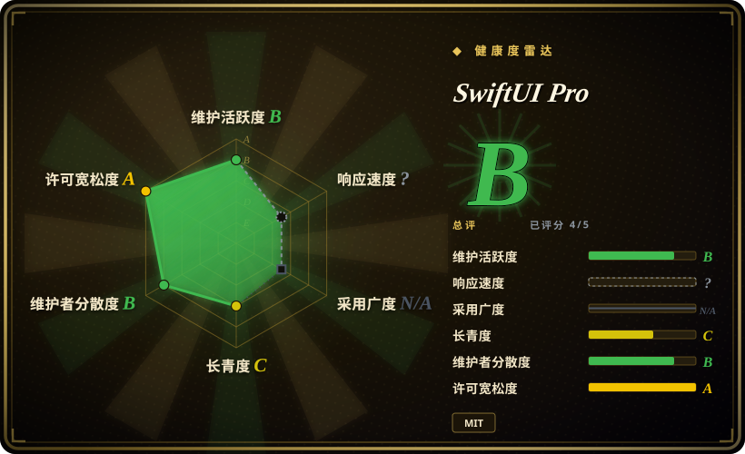
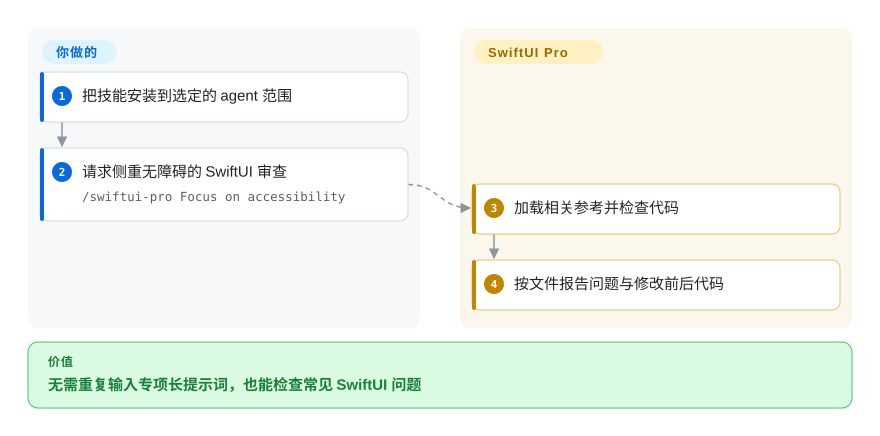
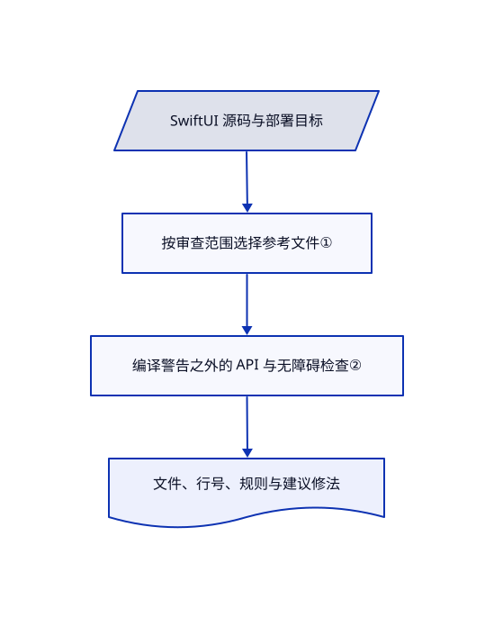

# SwiftUI Pro

生成的 SwiftUI 虽能编译，纯图标按钮却让 VoiceOver 读不清，旧 API 也没人检查。SwiftUI Pro 让编码 agent 按 Apple 专项清单审查，并按文件给出修法。

## 何时使用

你维护 SwiftUI 应用，希望 agent 找出零编译警告仍会漏掉的数据流、导航、无障碍和 API 问题。主要需求是跨多种 agent 的专项审查，而不是模拟器编排和上架操作时，选此技能而非宽泛个人合集。还可指定局部审查，让模型只读相关参考文件。

## 何时不用

- **需要确定性的持续集成检查。** 使用 [SwiftLint](https://github.com/realm/SwiftLint) 与编译器；技能是模型参考指令，不是可执行分析器。
- **部署目标或 SDK 较旧。** 以项目编译器和可用性检查为准。必须用已有目标过滤技能的最新平台假设，不可盲目现代化。
- **需要模拟器启动或打包流程。** 采用相关 [Dimillian Skills](../personal-collections/engineering-workflows/dimillian-skills.zh.md)，并核对其旧快照与当前工具链；不要期待本审查清单提供这些集成。

## 横向对比

| 替代品 | 是否收录 | 我们的评价 | 取舍 |
|---|---|---|---|
| [Dimillian Skills](../personal-collections/engineering-workflows/dimillian-skills.zh.md) | ✅ | 专注跨宿主审查选 SwiftUI Pro；具体模拟器、重构与打包流程选 Dimillian。 | 专项审查对比更广的 Apple 合集，但后者已收录快照较旧。 |
| SwiftLint | 未收录 | 持续集成中可重复的风格失败选 SwiftLint；需要语义解释和修改建议选 SwiftUI Pro。 | 可执行规则对比模型判断；本次标签批次未收录。 |
| Xcode 编译器与分析器 | 非仓库 | 对真实 SDK 的编译结果以 Xcode 为准；用 SwiftUI Pro 补充可用性与现代化审查。 | 闭源开发产品；编译成功不等于交互无障碍。 |

## 快速上手

README 使用 `npx skills add https://github.com/twostraws/swiftui-agent-skill --skill swiftui-pro` 安装，由安装器选择项目或全局范围。让宿主使用 `swiftui-pro`，或在 Claude Code 输入 `/swiftui-pro Focus on accessibility`。agent 读取对应参考，按文件、行号和前后代码报告真实问题。代码、部署目标与真实 Xcode 验证由你提供；技能自身不构建、不测量性能，也不认证无障碍。无关现代化应单列建议，不自动扩大修改范围。

<!-- flow-steps:begin (generated from flows/swiftui-agent-skill.json by tools/flow_card.py — do not edit) -->

流程文字版

1. **你**：把技能安装到选定的 agent 范围
2. **你**：请求侧重无障碍的 SwiftUI 审查 — `/swiftui-pro Focus on accessibility`
3. **SwiftUI Pro**：加载相关参考并检查代码
4. **SwiftUI Pro**：按文件报告问题与修改前后代码

**价值**：无需重复输入专项长提示词，也能检查常见 SwiftUI 问题

<!-- flow-steps:end -->

## 技术要点

<!-- mechanism:begin (generated from mechanisms/swiftui-agent-skill.json by tools/mechanism_card.py; do not edit) -->

机制文字版

- SwiftUI 源码与部署目标
- 按审查范围选择参考文件①
- 编译警告之外的 API 与无障碍检查②
- 文件、行号、规则与建议修法

- SwiftUI 源码与部署目标 → 按审查范围选择参考文件①
- 按审查范围选择参考文件① → 编译警告之外的 API 与无障碍检查②
- 编译警告之外的 API 与无障碍检查② → 文件、行号、规则与建议修法

<!-- mechanism:end -->

### 1. 按审查范围加载参考

- **解决：** 小改动若做完整 Apple 审查，容易消耗上下文并引入无关重写。
- **做法：** 入口把 API、数据、导航、设计、无障碍与性能检查路由到独立文件。局部审查只读相关文件，深度性能材料不进入常规审查。
- **边界：** 路由是指令，不是强制加载器；平台版本描述仍需与项目真实 SDK 核对。
- **源码：** [审查路由与目标检查](https://github.com/twostraws/SwiftUI-Agent-Skill/blob/ce32af1693b9e78a7d22ff48001c97a304d32063/swiftui-pro/SKILL.md#L10-L41)。

### 2. 给出编译警告之外的具体修改

- **解决：** 编译器不一定发现无障碍标签不清或软弃用 API。
- **做法：** 参考文件说明图标按钮文字、动态字号与减少动画检查；输出要求包含文件、行号、规则及修改前后代码。API 指南专门提醒不会产生普通警告的软弃用。
- **边界：** 源码建议不能替代 VoiceOver 实测、窗口缩放和真机性能分析；看似合理的问题也可能误报。
- **源码：** [无障碍规则](https://github.com/twostraws/SwiftUI-Agent-Skill/blob/ce32af1693b9e78a7d22ff48001c97a304d32063/swiftui-pro/references/accessibility.md)、[API 指南](https://github.com/twostraws/SwiftUI-Agent-Skill/blob/ce32af1693b9e78a7d22ff48001c97a304d32063/swiftui-pro/references/api.md#L1-L5)、[问题格式](https://github.com/twostraws/SwiftUI-Agent-Skill/blob/ce32af1693b9e78a7d22ff48001c97a304d32063/swiftui-pro/SKILL.md#L46-L54)。

## 健康度与可持续性

- **截至 2026-10-18：** 仓库建于 2026 年 3 月，README 与 MIT 实文均署名 Paul Hudson。技能、参考和插件元数据较少，无需运行代码即可阅读。
- **判断：** 七个月不足以为快速变化的 Apple SDK 规则提供强长期存续证据。作者经验有价值，但不能替代版本可用性检查。
- **维护风险：** 已读技能与 API 参考包含超出 README 徽章的新平台假设。应固定提交并核对具体目标，不能把徽章当完整支持矩阵。

## 存疑（未验证）

- [未验证：未在对应 Xcode SDK 编译] 本页把最新平台声明视为上游指令，并未独立证明 API 可用性；每个建议符号仍需对照已安装 SDK。
