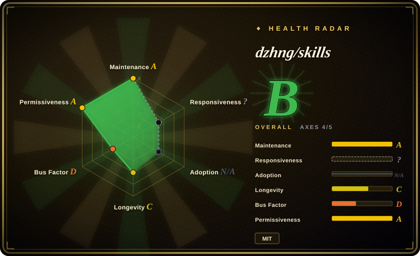
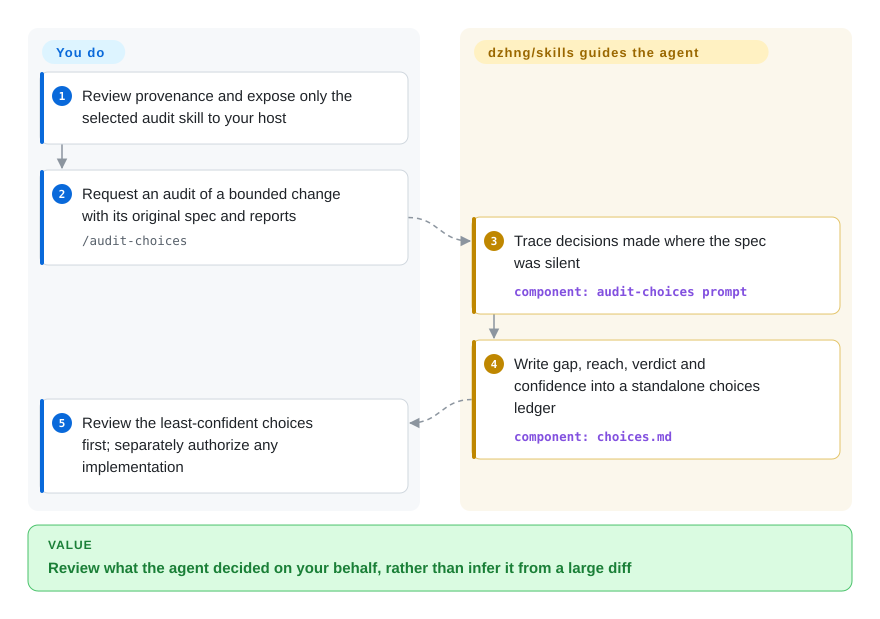
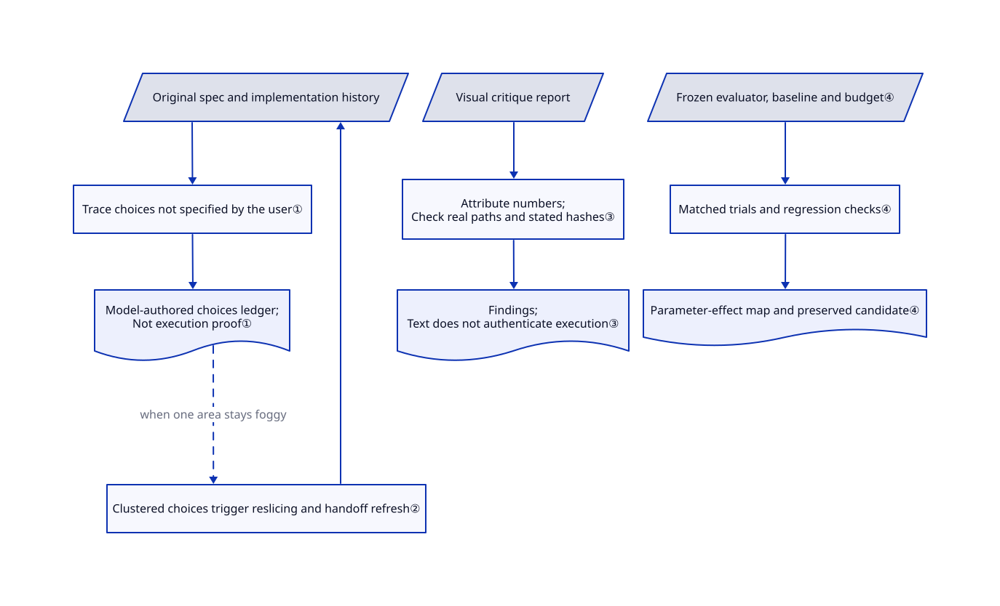

# dzhng/skills

Your agent ships a working feature, but nobody chose its new storage format or dependency. dzhng/skills asks it to record those unstated decisions in a separate review ledger, alongside a spec-driven build workflow.

> [!WARNING]
> **Information listing, not redistribution clearance.** The root LICENSE declares MIT for David Zhang's work. The imported `xiaohei-illustrations` subtree lacks Ian's original copyright and MIT permission notice in the reviewed tree. The index maintainer allowed this warning-bearing listing on 2026-10-24; that decision neither repairs the notices nor grants third-party rights. `NOASSERTION` avoids treating the whole bundle as verified MIT. See [the import](https://github.com/dzhng/skills/pull/11), [root LICENSE](https://github.com/dzhng/skills/blob/8e74252ad975acff3de6305299cf82c4b14cc026/LICENSE#L1-L13), and [Ian's LICENSE](https://github.com/helloianneo/ian-xiaohei-illustrations/blob/686575741a61e2c0be5e4c6d3615ebf6217dd322/LICENSE#L1-L13).

## When to use

You maintain an application built over several agent sessions. The tests are green, but the implementation quietly added a cache, changed an error contract, and chose where to store user data. You want the agent to show what the spec left open, what it chose, and what future work inherits. The standalone `audit-choices` skill traces reports and diffs into `choices.md`, grouped by verdict and ordered least-confident first. Choose this reference when that decision-review surface matters more than adopting Superpowers' TDD-first lifecycle or gstack's complete role-and-browser suite.

You can also study its planning spine: independently checkable slices, a current handoff prompt, and reslicing when one area keeps generating new decisions. At the reviewed commit, the tree contains 34 `SKILL.md` files, including 22 under engineering; those are directory counts, not an originality count. README credits imported retrospective, animation, and illustration material. This page focuses on the engineering core, not clearance of the entire collection.

## When NOT to use

- **You need a rights-cleared bundle to copy or redistribute.** Do not ship this whole collection on the strength of its root MIT file. Prefer an independently licensed engineering alternative such as [Superpowers](../../../agent-dev-methodology/coding-agent-harnesses/superpowers.md), after its own license review. The maintainer's information-listing decision did not supply Ian's missing notices or third-party permission.
- **You require explicit sign-off before a boundary decision.** Keep your approval workflow rather than adopting `implement-spec` unchanged: its human checkpoints allow roughly five minutes, then instruct the agent to decide if nobody replies. Use Superpowers' design-approval step where that fits; neither prompt pack replaces an enforced authorization gate.
- **You need execution proof, not plausible reports.** Use your CI's actual job logs and retained artifacts rather than a clean `choices.md` or receipts report. The choices ledger is model-authored. Receipts checks numeric attribution in text and real file/hash claims; a fabricated command transcript can still pass.
- **You want an integrated browser QA and release cockpit.** Prefer [gstack](gstack.md) when its browser and ordered role commands are the deciding need. This pack composes prompts and optional scripts; you supply the host, permissions, test runners, and integration.
- **You only need product framing before code.** Read [shaping-skills](shaping-skills.md) as an archived pattern reference, not an install recommendation; its author marks it obsolete. For a maintained implementation lifecycle, use Superpowers instead of assembling an unattended loop for a framing-only task.
- **You must preserve existing test or sandbox policy.** Keep your current suite and host controls. Upstream's current test preference favors end-to-end/system regressions, while its CLI delegation examples include permission-bypass modes. These are upstream policies to review, not reasons to delete unit tests or disable approvals.

## Comparison

| Alternative | In index | Our verdict | Tradeoff |
|---|---|---|---|
| [Superpowers](../../../agent-dev-methodology/coding-agent-harnesses/superpowers.md) | ✅ | Choose Superpowers for a TDD-first lifecycle with design approval; study dzhng/skills when the missing deliverable is a standalone ledger of decisions the spec never made. | A prescribed development spine reduces assembly work; the dzhng audit can be read independently but its ledger is not a hard gate. |
| [gstack](gstack.md) | ✅ | Choose gstack when browser-driven QA and release roles must arrive together; choose selected dzhng engineering patterns when you already own those tools and want decision disclosure instead. | gstack supplies a wider integrated surface with a browser footprint; dzhng leaves host integration and permission policy with you. |
| [shaping-skills](shaping-skills.md) | ✅ | Use the archived shaping-skills only to study problem framing; choose dzhng's spec and audit patterns when decisions must remain visible through implementation and handoff. | Shape Up vocabulary focuses the pre-build conversation, but its obsolete pack has no ongoing maintenance; dzhng spans more stages at the cost of more policy review. |

## Quick start

The [README](https://github.com/dzhng/skills/blob/8e74252ad975acff3de6305299cf82c4b14cc026/README.md#L13-L34) documents `npx skills add dzhng/skills`, selective installation, and copying a single skill folder into a host's skills directory; this listing does not endorse whole-pack installation. After reviewing that folder's provenance and linked references, expose only the selected engineering skill to your host and invoke `/audit-choices` on a bounded change with its original spec and reports. The agent writes `choices.md` beside the plan; you judge the findings and authorize any subsequent implementation. A compatible model host and its inference charges remain yours; Node is needed for the supplied JavaScript helpers, while Codex/Claude delegation needs those authenticated CLIs and sends task context to their services. The local installer flattens folders, rewrites Markdown links, overwrites selected `.agents/skills` copies, and links `.claude/skills`; do not run it over valuable local copies without reviewing the plan. `handoff-spec` explicitly asks for a push, so skill loading is not authorization to publish code, open issues, or send private material; this entry was researched without installing or executing upstream.

Implementation references: [installer](https://github.com/dzhng/skills/blob/8e74252ad975acff3de6305299cf82c4b14cc026/scripts/install-skills.mjs#L87-L140), [Codex delegation](https://github.com/dzhng/skills/blob/8e74252ad975acff3de6305299cf82c4b14cc026/skills/engineering/codex/SKILL.md#L96-L129), [Claude delegation](https://github.com/dzhng/skills/blob/8e74252ad975acff3de6305299cf82c4b14cc026/skills/engineering/claude/SKILL.md#L82-L118), and [push-oriented handoff](https://github.com/dzhng/skills/blob/8e74252ad975acff3de6305299cf82c4b14cc026/skills/engineering/handoff-spec/SKILL.md#L14-L28).

<!-- flow-steps:begin (generated from flows/dzhng-skills.json by tools/flow_card.py — do not edit) -->

Text version of the flow

1. **You**: Review provenance and expose only the selected audit skill to your host
2. **You**: Request an audit of a bounded change with its original spec and reports — `/audit-choices`
3. **dzhng/skills**: Trace decisions made where the spec was silent — component: `audit-choices prompt`
4. **dzhng/skills**: Write gap, reach, verdict and confidence into a standalone choices ledger — component: `choices.md`
5. **You**: Review the least-confident choices first; separately authorize any implementation

**Value**: Review what the agent decided on your behalf, rather than infer it from a large diff

<!-- flow-steps:end -->

## Key techniques

<!-- mechanism:begin (generated from mechanisms/dzhng-skills.json by tools/mechanism_card.py; do not edit) -->

Text version of the mechanism

- Original spec and implementation history
- Trace choices not specified by the user①
- Model-authored choices ledger; Not execution proof①
- Clustered choices trigger reslicing and handoff refresh②
- Visual critique report
- Attribute numbers; Check real paths and stated hashes③
- Findings; Text does not authenticate execution③
- Frozen evaluator, baseline and budget④
- Matched trials and regression checks④
- Parameter-effect map and preserved candidate④

- Original spec and implementation history → Trace choices not specified by the user①
- Trace choices not specified by the user① → Model-authored choices ledger; Not execution proof①
- Model-authored choices ledger; Not execution proof① → Clustered choices trigger reslicing and handoff refresh② (when one area stays foggy) [optional/fallback]
- Clustered choices trigger reslicing and handoff refresh② → Original spec and implementation history
- Visual critique report → Attribute numbers; Check real paths and stated hashes③
- Attribute numbers; Check real paths and stated hashes③ → Findings; Text does not authenticate execution③
- Frozen evaluator, baseline and budget④ → Matched trials and regression checks④
- Matched trials and regression checks④ → Parameter-effect map and preserved candidate④

<!-- mechanism:end -->

### 1. Separate decision review from patch review

- **Problem:** Passing tests do not reveal a storage format or dependency chosen where the spec was silent.
- **How:** The prompt traces session history, delegated reports, and diffs. It records the gap, choice, future reach, verdict, and confidence in a persistent ledger; each verdict group is ordered least-confident first.
- **Limits:** The audit changes no implementation code. A model's ledger can omit decisions or misjudge them, and its confidence is not a measured probability; it does not prove tests ran or grant permission to act.
- **Source:** [Audit workflow and ledger](https://github.com/dzhng/skills/blob/8e74252ad975acff3de6305299cf82c4b14cc026/skills/engineering/audit-choices/SKILL.md#L41-L136), [read-only implementation boundary](https://github.com/dzhng/skills/blob/8e74252ad975acff3de6305299cf82c4b14cc026/skills/engineering/audit-choices/SKILL.md#L151-L166).

### 2. Treat recurring choices as a signal to reslice the spec

- **Problem:** A large slice keeps forcing new architectural decisions, while the handoff still describes yesterday's plan.
- **How:** `write-spec` gives each slice one seam and reviewable artifact. `implement-spec` triggers maintenance checkpoints after failures, several commits, or resume, then reslices foggy work and updates the next-agent prompt; final consolidation checks ledger entries against the final code.
- **Limits:** These are agent instructions, not a scheduler or enforced state machine. The upstream no-reply checkpoint policy is unsuitable where human approval is mandatory.
- **Source:** [Recursive slicing and decision budget](https://github.com/dzhng/skills/blob/8e74252ad975acff3de6305299cf82c4b14cc026/skills/engineering/write-spec/SKILL.md#L138-L185), [checkpoints and final reconciliation](https://github.com/dzhng/skills/blob/8e74252ad975acff3de6305299cf82c4b14cc026/skills/engineering/implement-spec/SKILL.md#L79-L132), [no-reply policy](https://github.com/dzhng/skills/blob/8e74252ad975acff3de6305299cf82c4b14cc026/skills/engineering/implement-spec/SKILL.md#L191-L200).

### 3. Distinguish text attribution from artifact checks

- **Problem:** A visual critic invents a brightness number and a crop filename that look like measurements.
- **How:** `receipts.mjs` finds measurement claims and nearby command/output blocks, then checks named artifact paths on disk and recomputes stated SHA-256 hashes. Unsupported claims produce findings and a nonzero exit status.
- **Limits:** Numeric checks use text heuristics, not authenticated execution records. An invented transcript can pass, and a matching file hash does not establish how the file was produced; the checker does not measure image quality.
- **Source:** [Explicit attribution limit](https://github.com/dzhng/skills/blob/8e74252ad975acff3de6305299cf82c4b14cc026/skills/visual/screenshot-critique/scripts/receipts.mjs#L9-L19), [filesystem/hash checks](https://github.com/dzhng/skills/blob/8e74252ad975acff3de6305299cf82c4b14cc026/skills/visual/screenshot-critique/scripts/receipts.mjs#L302-L359), [claim matching and exit](https://github.com/dzhng/skills/blob/8e74252ad975acff3de6305299cf82c4b14cc026/skills/visual/screenshot-critique/scripts/receipts.mjs#L363-L478).

### 4. Freeze experiment criteria before optimizing

- **Problem:** A cheaper run gets called a win even though the baseline, task set, or quality criterion changed.
- **How:** `auto-research` fixes the evaluator, baseline identity, budgets, and promotion rule first. It tests one conceptual change against a fixed parent, checks combinations against the strongest candidate, and retains earlier tasks as regressions before widening coverage.
- **Limits:** The workflow needs a real evaluator, preserved raw outputs, and paid compute where models are involved. Its parameter-effect map is a record, not independent validation; development-case wins cannot establish generalization.
- **Source:** [Criteria and bounded loop](https://github.com/dzhng/skills/blob/8e74252ad975acff3de6305299cf82c4b14cc026/skills/engineering/auto-research/SKILL.md#L21-L60), [trials and promotion](https://github.com/dzhng/skills/blob/8e74252ad975acff3de6305299cf82c4b14cc026/skills/engineering/auto-research/SKILL.md#L62-L113), [separate confirmation evidence](https://github.com/dzhng/skills/blob/8e74252ad975acff3de6305299cf82c4b14cc026/skills/engineering/auto-research/SKILL.md#L144-L165).

## Health & viability

- **Maintenance, 2026-10-24:** public, not archived, created 2026-07-02; default-branch commit is `8e74252a` from 2026-10-21. GitHub returns no releases. The current tree is identical to the 2026-10-22 review baseline; that commit changed testing guidance, not the copied illustration notices.
- **Governance and adoption:** a personal `User` repository. The contributors endpoint reports 128 contributions for dzhng, two for gwelinder, and one for allanbeke-sys. Its 1,378 stars indicate attention, not validated production use or governance redundancy. Pin a commit rather than assuming the manifest's private `1.0.0` is a published release.
- **Age and durability:** [推断：based on the July creation date and October activity, not a durability study] less than four months of history plus recent commits supports studying current patterns, not a strong Lindy or maintenance-guarantee claim.
- **License and trust:** root MIT is real, but the imported Xiaohei subtree still lacks Ian's copyright and permission notice. The 2026-10-24 information-listing decision neither repairs that gap nor approves copying or redistribution. The automatic radar measures repository metadata, including GitHub's root-license classification; it does not clear third-party rights.
- **Operational judgment:** use selected, reviewed engineering patterns rather than importing the full policy stack. Approval-by-silence, optional CLI permission bypasses, installer overwrites, and a push-oriented handoff all need separate authorization; a worktree is not a security sandbox.

## Caveats (unverified)

- [未验证：third-party authorization was not supplied] Ian's original MIT notice is absent from the reviewed imported subtree. README attribution and the index maintainer's information-listing decision are not substitute permission; the whole collection is not represented as rights-cleared MIT.
- [未验证：upstream execution and installation were outside this research scope] Host activation, receipts behavior, and autonomous-run benefits were not reproduced. README's multi-day run is an author report, not this entry's execution evidence.
- [推断：based on prompt control flow and the receipts source, without a behavioral trial] Decision disclosure and numeric attribution can help review, but cannot certify complete decision coverage, real command execution, or correct output.
- [推断：based on repository age and contributor concentration, without a support agreement] Continued maintenance is a personal-project dependency; recent activity and stars do not establish long-term support.
