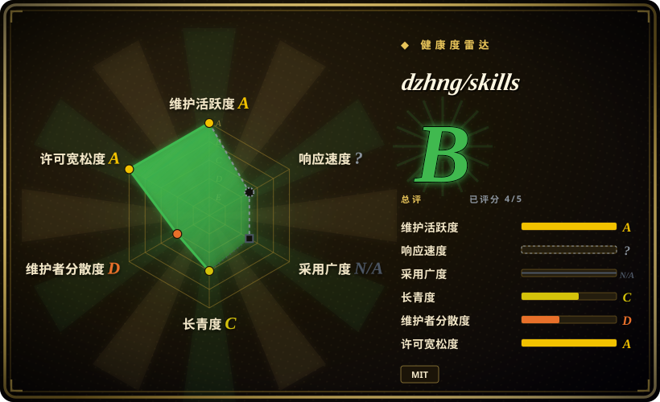
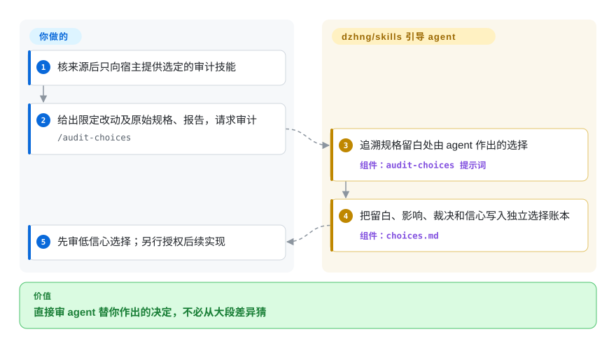
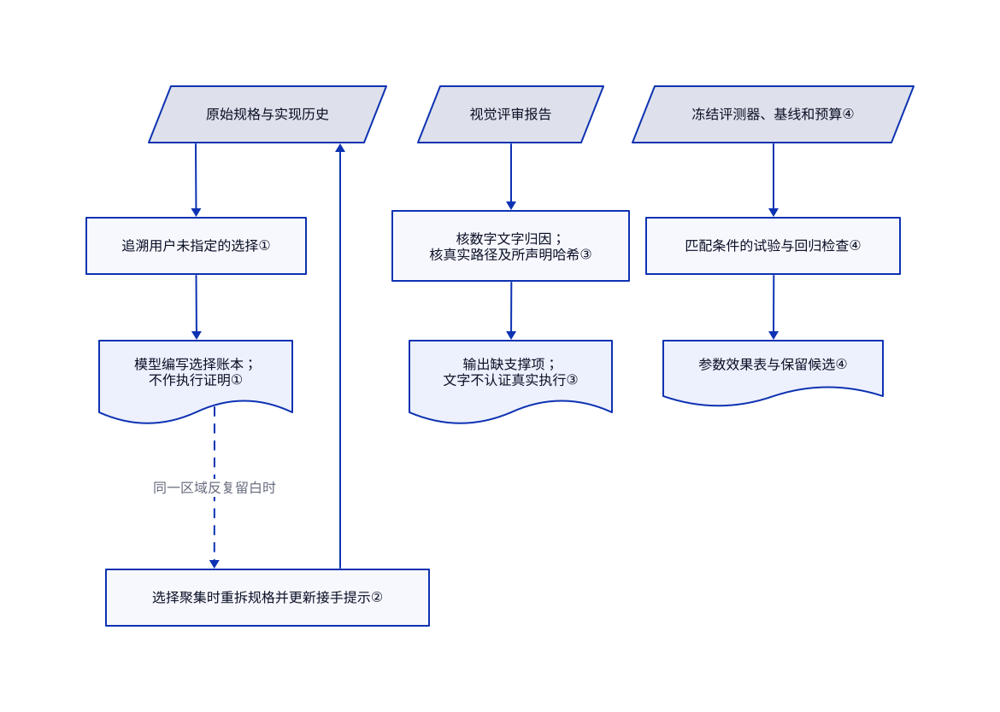

# dzhng/skills

功能能跑，agent 却替你决定了存储格式和新依赖。dzhng/skills 把规格没写的选择单独记账，配合分片实现流程交给你审。

> [!WARNING]
> **仅作信息收录，不代表可直接复制再分发。** 根许可为 David Zhang 的工作声明 MIT；导入的 `xiaohei-illustrations` 子树未保留 Ian 原有的版权与 MIT 许可通知。维护者于 2026-10-24 同意带警告收录，但该裁决没有补齐声明，也不是第三方权利人的许可。`NOASSERTION` 表示不能把整包当作已核清的 MIT。依据见[导入记录](https://github.com/dzhng/skills/pull/11)、[根许可](https://github.com/dzhng/skills/blob/8e74252ad975acff3de6305299cf82c4b14cc026/LICENSE#L1-L13)和 [Ian 原许可](https://github.com/helloianneo/ian-xiaohei-illustrations/blob/686575741a61e2c0be5e4c6d3615ebf6217dd322/LICENSE#L1-L13)。

## 何时使用

你维护一个跨多次 agent 会话开发的应用。测试全绿，实现却悄悄加入缓存、改变错误返回、选定用户数据的保存位置。你想看到规格哪里留白、agent 怎么决定、后续工作要承担什么。独立的 `audit-choices` 技能把报告和差异追成 `choices.md`，按裁决分组，把最低信心的选择放在前面。如果你缺的是这种决策审阅入口，而不是 Superpowers 的测试先行全流程或 gstack 的角色加浏览器整套工具，可以研究它。

它也提供另一条可参考的主线：分成能独立验证的小片，维护下一位 agent 的接手提示；某处反复冒出新决策时，重新拆规格。当前树有 34 份 `SKILL.md`，工程目录占 22 份；这只是目录计数，不是原创数量。README 已致谢导入的复盘、动画和插画内容。本页关注工程核心，不替整包作权利清理结论。

## 何时不用

- **要复制或再分发权利清晰的整包。** 不要仅凭根 MIT 就打包发布。可先审查 [Superpowers](../../../agent-dev-methodology/coding-agent-harnesses/superpowers.zh.md) 等独立工程替代品的许可。维护者的信息收录裁决没有补齐 Ian 的通知，也没有提供第三方许可。
- **边界决策必须等本人批准。** 保留现有审批流程，不原样采用 `implement-spec`：它给人工检查点约五分钟，无回复就要求 agent 自行决定。可参考 Superpowers 的设计批准步骤，但两种提示词都不能替代机器授权门。
- **需要真实执行证明。** 使用 CI 的实际作业日志和留存产物，不把 `choices.md` 或 receipts 绿灯当成执行凭据。选择账本由模型编写；receipts 只核数字的文字归因及文件／哈希，伪造整段命令转录仍可能通过。
- **想要浏览器验收和发布控制台一起到位。** 若真浏览器与有序角色命令是关键，优先比较 [gstack](gstack.zh.md)。本包组合提示词与可选脚本，宿主、权限、测试运行器和接线仍由你负责。
- **只想在写代码前明确产品问题。** 可把 [shaping-skills](shaping-skills.zh.md) 当归档模式材料读，不建议安装；作者已标为过时。若需要仍维护的实现流程，选 Superpowers，不必为单纯的问题澄清拼无人值守循环。
- **必须保留现有测试与沙箱策略。** 保留已有测试和宿主控制。上游当前偏好用端到端／系统测试覆盖回归，CLI 委派示例也含绕过权限的模式。这些是待审的上游政策，不是删单测或关闭审批的依据。

## 横向对比

| 替代品 | 是否收录 | 我们的评价 | 取舍 |
|---|---|---|---|
| [Superpowers](../../../agent-dev-methodology/coding-agent-harnesses/superpowers.zh.md) | ✅ | 要测试先行且带设计批准的开发主线，选 Superpowers；缺的是“规格没写、实现却决定了什么”的独立账本，再研究 dzhng/skills。 | 固定开发主线减少拼装；dzhng 的审计可单独阅读，但账本不是强制门禁。 |
| [gstack](gstack.zh.md) | ✅ | 浏览器验收与发布角色必须一起交付时选 gstack；已有这些工具，只想补决策披露时，参考 dzhng 的局部工程机制。 | gstack 接线更全，也带来浏览器负担；dzhng 把宿主集成与权限政策留给你。 |
| [shaping-skills](shaping-skills.zh.md) | ✅ | 只把已归档的 shaping-skills 当问题澄清材料；决策需贯穿实现与交接时，研究 dzhng 的规格和审计模式。 | Shape Up 词汇聚焦开工前的讨论，但过时包不再维护；dzhng 覆盖更多阶段，也要审查更多政策。 |

## 快速上手

[README](https://github.com/dzhng/skills/blob/8e74252ad975acff3de6305299cf82c4b14cc026/README.md#L13-L34) 给出 `npx skills add dzhng/skills`、按需安装和复制单个技能目录的路径；本页不因此推荐安装整包。核过选定目录及链接引用的来源后，只向宿主提供需要的工程技能，再对限定改动及其原始规格、报告调用 `/audit-choices`。agent 把 `choices.md` 写在计划旁；你判断发现，并另行授权后续实现。兼容的模型宿主及推理费用由你承担；JavaScript 辅助脚本需要 Node，Codex／Claude 委派需要已认证 CLI，并把任务上下文发送给相应服务。本地安装器会拍平目录、重写 Markdown 链接、覆盖选中的 `.agents/skills` 副本，再链接 `.claude/skills`，不要未经核对就覆盖本地修改。`handoff-spec` 明确要求推送，读取技能不等于获准发布代码、开 issue 或外发私人材料；本页研究未安装或执行上游。

实现依据：[安装器](https://github.com/dzhng/skills/blob/8e74252ad975acff3de6305299cf82c4b14cc026/scripts/install-skills.mjs#L87-L140)、[Codex 委派](https://github.com/dzhng/skills/blob/8e74252ad975acff3de6305299cf82c4b14cc026/skills/engineering/codex/SKILL.md#L96-L129)、[Claude 委派](https://github.com/dzhng/skills/blob/8e74252ad975acff3de6305299cf82c4b14cc026/skills/engineering/claude/SKILL.md#L82-L118)、[交接推送指令](https://github.com/dzhng/skills/blob/8e74252ad975acff3de6305299cf82c4b14cc026/skills/engineering/handoff-spec/SKILL.md#L14-L28)。

<!-- flow-steps:begin (generated from flows/dzhng-skills.json by tools/flow_card.py — do not edit) -->

流程文字版

1. **你**：核来源后只向宿主提供选定的审计技能
2. **你**：给出限定改动及原始规格、报告，请求审计 — `/audit-choices`
3. **dzhng/skills**：追溯规格留白处由 agent 作出的选择 — 组件：`audit-choices 提示词`
4. **dzhng/skills**：把留白、影响、裁决和信心写入独立选择账本 — 组件：`choices.md`
5. **你**：先审低信心选择；另行授权后续实现

**价值**：直接审 agent 替你作出的决定，不必从大段差异猜

<!-- flow-steps:end -->

## 技术要点

<!-- mechanism:begin (generated from mechanisms/dzhng-skills.json by tools/mechanism_card.py; do not edit) -->

机制文字版

- 原始规格与实现历史
- 追溯用户未指定的选择①
- 模型编写选择账本； 不作执行证明①
- 选择聚集时重拆规格并更新接手提示②
- 视觉评审报告
- 核数字文字归因； 核真实路径及所声明哈希③
- 输出缺支撑项； 文字不认证真实执行③
- 冻结评测器、基线和预算④
- 匹配条件的试验与回归检查④
- 参数效果表与保留候选④

- 原始规格与实现历史 → 追溯用户未指定的选择①
- 追溯用户未指定的选择① → 模型编写选择账本； 不作执行证明①
- 模型编写选择账本； 不作执行证明① → 选择聚集时重拆规格并更新接手提示②（同一区域反复留白时）〔可选／兜底〕
- 选择聚集时重拆规格并更新接手提示② → 原始规格与实现历史
- 视觉评审报告 → 核数字文字归因； 核真实路径及所声明哈希③
- 核数字文字归因； 核真实路径及所声明哈希③ → 输出缺支撑项； 文字不认证真实执行③
- 冻结评测器、基线和预算④ → 匹配条件的试验与回归检查④
- 匹配条件的试验与回归检查④ → 参数效果表与保留候选④

<!-- mechanism:end -->

### 1. 把决策审计与补丁审查分开

- **解决：** 测试通过，也看不出规格留白处是谁选了存储格式或依赖。
- **做法：** 提示词追溯会话历史、委派报告和差异，把留白、选择、后续影响、裁决、信心写入长期账本；每个裁决组都先展示低信心项。
- **边界：** 审计不改实现代码。模型账本可能遗漏或误判，信心不是测量概率；它不证明测试跑过，也不授予执行权。
- **源码：** [审计流程及账本](https://github.com/dzhng/skills/blob/8e74252ad975acff3de6305299cf82c4b14cc026/skills/engineering/audit-choices/SKILL.md#L41-L136)、[不改实现的边界](https://github.com/dzhng/skills/blob/8e74252ad975acff3de6305299cf82c4b14cc026/skills/engineering/audit-choices/SKILL.md#L151-L166)。

### 2. 用反复冒出的选择反查规格切片

- **解决：** 大切片反复逼 agent 发明架构，交接文件却还描述昨天的计划。
- **做法：** `write-spec` 要求每片有单一接口边界和可审产物。`implement-spec` 在失败、若干提交或恢复后触发维护检查，重拆不清楚的工作并更新接手提示；收尾再用最终代码核对账本。
- **边界：** 这是给 agent 的指令，不是调度器或强制状态机。上游“无人回复就自行决定”的检查点政策不适合必须人审的场合。
- **源码：** [递归切片与决策预算](https://github.com/dzhng/skills/blob/8e74252ad975acff3de6305299cf82c4b14cc026/skills/engineering/write-spec/SKILL.md#L138-L185)、[维护检查与最终核对](https://github.com/dzhng/skills/blob/8e74252ad975acff3de6305299cf82c4b14cc026/skills/engineering/implement-spec/SKILL.md#L79-L132)、[无回复政策](https://github.com/dzhng/skills/blob/8e74252ad975acff3de6305299cf82c4b14cc026/skills/engineering/implement-spec/SKILL.md#L191-L200)。

### 3. 区分文字归因检查与真实文件检查

- **解决：** 视觉评审编出亮度数值和裁图文件名，看起来像测量结果。
- **做法：** `receipts.mjs` 找测量断言及附近命令／输出块，再查磁盘上的产物路径，并重算所声明的 SHA-256。缺支撑的断言会成为 finding，并使退出码非零。
- **边界：** 数字检查靠文字启发式，不是真实执行日志。编造整段转录仍可通过；文件哈希吻合也不说明文件怎样产生，检查器不测图像质量。
- **源码：** [归因能力的明确上限](https://github.com/dzhng/skills/blob/8e74252ad975acff3de6305299cf82c4b14cc026/skills/visual/screenshot-critique/scripts/receipts.mjs#L9-L19)、[文件与哈希检查](https://github.com/dzhng/skills/blob/8e74252ad975acff3de6305299cf82c4b14cc026/skills/visual/screenshot-critique/scripts/receipts.mjs#L302-L359)、[断言匹配与退出码](https://github.com/dzhng/skills/blob/8e74252ad975acff3de6305299cf82c4b14cc026/skills/visual/screenshot-critique/scripts/receipts.mjs#L363-L478)。

### 4. 优化前冻结实验判据

- **解决：** 基线、任务集或质量标准变了，省钱的单次运行却仍被叫作成功。
- **做法：** `auto-research` 先固定评测器、基线身份、预算和晋升规则。每次只对固定父版本改变一个概念因素，再让组合与最强候选比较；扩大覆盖前，先把旧任务留下作回归。
- **边界：** 必须有真实评测器和原始输出；涉及模型时还要计算费用。参数效果表是记录，不是独立验证；开发样本获胜不证明泛化。
- **源码：** [判据及有界内循环](https://github.com/dzhng/skills/blob/8e74252ad975acff3de6305299cf82c4b14cc026/skills/engineering/auto-research/SKILL.md#L21-L60)、[试验与晋升](https://github.com/dzhng/skills/blob/8e74252ad975acff3de6305299cf82c4b14cc026/skills/engineering/auto-research/SKILL.md#L62-L113)、[确认材料独立](https://github.com/dzhng/skills/blob/8e74252ad975acff3de6305299cf82c4b14cc026/skills/engineering/auto-research/SKILL.md#L144-L165)。

## 健康度与可持续性

- **维护，2026-10-24：** 公开、未归档，创建于 2026-07-02；默认分支为 2026-10-21 的 `8e74252a`。GitHub 没有发布记录。当前树与 2026-10-22 已核基线完全一致；该提交修改测试指导，没有补复制插画的声明。
- **治理与采用：** 个人 `User` 仓库。贡献者接口显示 dzhng 为 128 次贡献，gwelinder 为两次，allanbeke-sys 为一次。1,378 星表示关注，不证明生产采用或治理冗余。应固定提交，不把私有包清单的 `1.0.0` 当已发布版本。
- **年龄与持久性：** [推断：依据为七月创建日期及十月提交，未做持久性研究] 不足四个月的历史加近期活跃，支持研究当前模式，不支持强 Lindy 或持续维护保证。
- **许可与信任：** 根 MIT 声明确实存在，但导入的小黑子树仍缺 Ian 的版权和许可通知。2026-10-24 信息收录裁决既没补齐声明，也没批准复制或再分发。自动雷达衡量仓库元数据，其中许可轴读取 GitHub 的根许可分类，不负责核清第三方权利。
- **使用判断：** 只参考经过审查的局部工程模式，不整套导入政策。沉默后自行决定、可选 CLI 权限绕过、安装覆盖、交接即推送都须单独授权；worktree 不是安全沙箱。

## 存疑（未验证）

- [未验证：未提供第三方授权材料] 所核导入子树缺少 Ian 原 MIT 通知。README 致谢和维护者的信息收录裁决都不是替代许可；本页不把整包标为权利已核清的 MIT。
- [未验证：本次研究明确不安装或执行上游] 未复现宿主激活、receipts 行为或无人值守收益。README 的多日运行是作者报告，不是本页的执行证明。
- [推断：依据为提示词控制流程和 receipts 源码，未做行为试验] 决策披露与数字归因可辅助审查，但不能证明选择完整、命令真实执行或结果正确。
- [推断：依据为仓库年龄和贡献集中度，未见支持协议] 后续维护依赖个人项目，近期提交与星数不代表长期支持。
