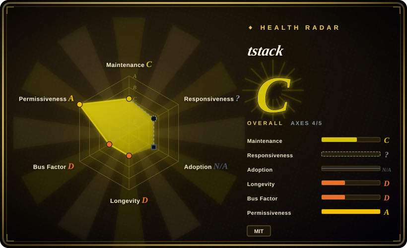
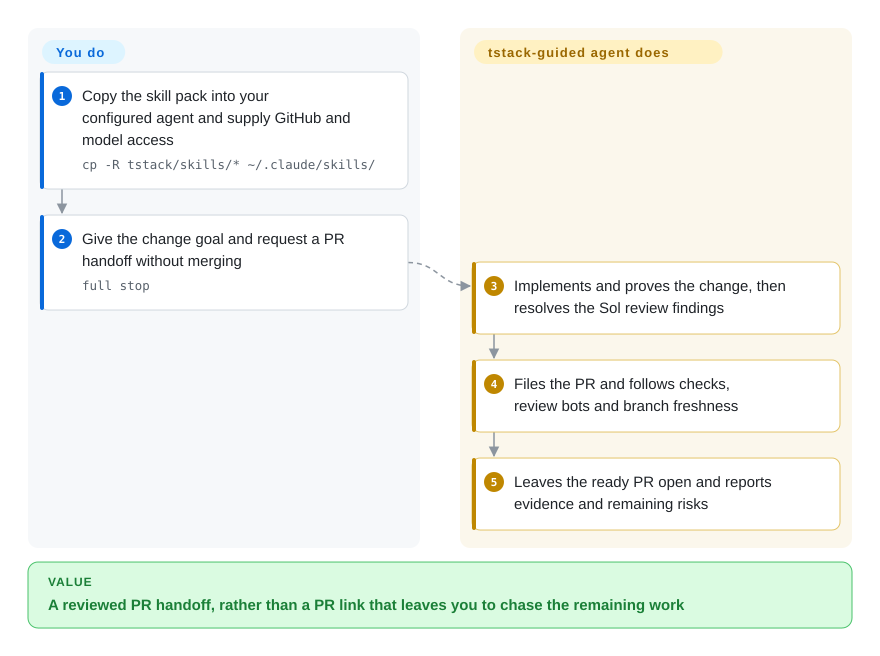
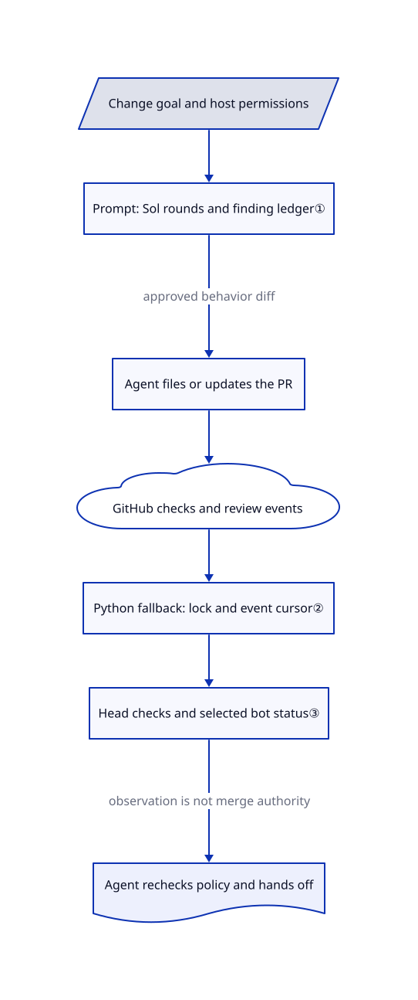

# tstack

Your agent opens a PR, then leaves you to chase CI, review bots and the final handoff. tstack gives that agent nine named delivery playbooks, with separate paths for merging unattended or leaving the PR for you.

## When to use

You already work in Claude Code or Codex and have a small change ready to finish. The missing piece is not another application template: the agent needs to prove the change, get another model's review, write a useful PR description and stay with CI rather than announcing success at PR creation. Choose tstack when you want this narrow GitHub-delivery sequence as editable skill files, instead of adopting a larger planning framework or a browser-equipped development suite.

Its nine skills cover delivery, review, PR writing, handoff and old-branch reassessment. `full-send` aims for a merged PR; `full-stop` inherits the work but forbids merging. `sol-loop` calls one Sol reviewer, while `council` calls three providers. These are instructions for a capable host agent, not a standalone orchestrator or model router. The [README dependency list](https://github.com/t3dotgg/tstack/blob/92e38e2cf677a84a142e8df296861c588542135c/README.md#L22-L43) is part of the adoption decision: copying only one top-level skill can omit the skills it calls.

## When NOT to use

- **The agent starts coding before the problem or tests are clear.** Prefer [Superpowers](../../../agent-dev-methodology/coding-agent-harnesses/superpowers.md) for its brainstorm, plan and test-first development spine. tstack concentrates on finishing, reviewing and shipping an existing goal, not defining the whole development method.
- **You cannot route a subagent to Sol, or want general habits without that named-model dependency.** Prefer [Waza](../../engineering/waza.md). tstack's `sol-loop` explicitly stops rather than substituting an unavailable model; installing Markdown does not create cross-provider execution access or pay for it.
- **You need product interviews, browser QA and release roles in one package.** Prefer [gstack](gstack.md), accepting its larger runtime footprint. tstack ships no browser driver, no web-app scaffolder and no TanStack library.
- **You want review-only help under narrow permissions.** Start with [Waza](../../engineering/waza.md) and your repository's explicit release policy, not an unedited `full-send` or `full-stop`. The former treats its trigger as authority for merging and lease-protected force-pushing; the latter still permits commits, pushes, rebases and changes to auto-merge/queue settings. Neither prompt replaces host permissions or branch protection ([grant](https://github.com/t3dotgg/tstack/blob/92e38e2cf677a84a142e8df296861c588542135c/skills/full-send/SKILL.md#L13-L41), [stop overrides](https://github.com/t3dotgg/tstack/blob/92e38e2cf677a84a142e8df296861c588542135c/skills/full-stop/SKILL.md#L8-L27)).

The inherited [proof-permission text](https://github.com/t3dotgg/tstack/blob/92e38e2cf677a84a142e8df296861c588542135c/skills/full-send/SKILL.md#L24-L40) also treats computer use, browsers, devices and screenshots as authorized test methods, claiming to override project-level ask-first rules. This prompt text cannot waive host or system approvals; adopt it only after defining your own narrower permission policy.

## Comparison

| Alternative | In index | Our verdict | Tradeoff |
|---|---|---|---|
| [Superpowers](../../../agent-dev-methodology/coding-agent-harnesses/superpowers.md) | Indexed | Pick Superpowers when the gap begins at requirements and test-first implementation; pick tstack when a defined change chiefly needs multi-model review and a GitHub delivery handoff. | Superpowers supplies a broader development method and host install channels. tstack is a smaller manual-copy pack, but its main delivery route requires Sol access and your own permission policy. |
| [Waza](../../engineering/waza.md) | Indexed | Pick Waza for a compact menu of planning, debugging, reading and checking habits; pick tstack when explicit PR babysitting and a merge-versus-handoff split matter more. | Waza lets you chain broader habits. tstack encodes the delivery chain and includes a persistent PR watcher, at the cost of account API quota and bot-specific readiness assumptions. |
| [gstack](gstack.md) | Indexed | Pick gstack for an operator's whole product sprint with browser QA; pick tstack when you want PR-focused instructions without installing another browser runtime. | The lighter pack leaves product discovery, browser tooling and model routing to you. gstack integrates more roles but brings substantially more setup and state. |

## Quick start

Clone the repository using the [documented manual install](https://github.com/t3dotgg/tstack/blob/92e38e2cf677a84a142e8df296861c588542135c/README.md#L29-L49), then copy its skill directories into the existing Claude Code or Codex skills directory; back up colliding names before copying. Provide authenticated GitHub CLI access, Python 3 for the fallback watcher, and a host route to Sol; `council` additionally needs three model providers. Choose the permission policy yourself and keep personal model choices in your existing project instructions, as upstream recommends; these files do not install models or grant credentials. To reach an **unmerged** PR handoff, give the agent the change goal and ask for `full stop`: it is instructed to implement, prove, review, file and babysit the PR, while you remain responsible for account/API costs, repository checks and the final merge. This is not a read-only trigger: [its rules](https://github.com/t3dotgg/tstack/blob/92e38e2cf677a84a142e8df296861c588542135c/skills/full-stop/SKILL.md#L19-L47) allow branch updates and disable auto-merging; even a closing “Full stop.” can activate it at the reviewed revision.

<!-- flow-steps:begin (generated from flows/tstack.json by tools/flow_card.py — do not edit) -->

Text version of the flow

1. **You**: Copy the skill pack into your configured agent and supply GitHub and model access — `cp -R tstack/skills/* ~/.claude/skills/`
2. **You**: Give the change goal and request a PR handoff without merging — `full stop`
3. **tstack**: Implements and proves the change, then resolves the Sol review findings
4. **tstack**: Files the PR and follows checks, review bots and branch freshness
5. **tstack**: Leaves the ready PR open and reports evidence and remaining risks

**Value**: A reviewed PR handoff, rather than a PR link that leaves you to chase the remaining work

<!-- flow-steps:end -->

## Key techniques

<!-- mechanism:begin (generated from mechanisms/tstack.json by tools/mechanism_card.py; do not edit) -->

Text version of the mechanism

- Change goal and host permissions
- Prompt: Sol rounds and finding ledger①
- Agent files or updates the PR
- GitHub checks and review events
- Python fallback: lock and event cursor②
- Head checks and selected bot status③
- Agent rechecks policy and hands off

- Change goal and host permissions → Prompt: Sol rounds and finding ledger①
- Prompt: Sol rounds and finding ledger① → Agent files or updates the PR (approved behavior diff)
- Agent files or updates the PR → GitHub checks and review events
- GitHub checks and review events → Python fallback: lock and event cursor②
- Python fallback: lock and event cursor② → Head checks and selected bot status③
- Head checks and selected bot status③ → Agent rechecks policy and hands off (observation is not merge authority)

<!-- mechanism:end -->

### 1. Limit review growth with a finding ledger and a round budget

- **Problem:** Repeated model review can keep adding low-value fixes and lose track of which behavior was actually approved.
- **How:** The Sol playbook fixes one diff scope, records stable finding IDs and outcomes, uses three rounds by default and allows five only under named risk conditions. Later rounds focus on changed code and unresolved findings; nits alone do not require another round.
- **Limits:** This is a prompt-level contract, not a scheduler-enforced budget. It caps round count, not elapsed time; the asynchronous waiting instructions have no explicit deadline. The separate three-provider council has no corresponding numeric round cap.
- **Source:** [Budget and fixed scope, lines 15–44](https://github.com/t3dotgg/tstack/blob/92e38e2cf677a84a142e8df296861c588542135c/skills/sol-loop/SKILL.md#L15-L44), [wait and next-round rules, lines 55–108](https://github.com/t3dotgg/tstack/blob/92e38e2cf677a84a142e8df296861c588542135c/skills/sol-loop/SKILL.md#L55-L108), [council continuation](https://github.com/t3dotgg/tstack/blob/92e38e2cf677a84a142e8df296861c588542135c/skills/council/SKILL.md#L46-L51).

### 2. Keep one resumable observer per pull request

- **Problem:** Several agents polling the same PR duplicate API traffic, while a restarted observer can repeat old notifications.
- **How:** The Python fallback holds a nonblocking per-PR file lock, records seen event IDs and bot-summary digests, and atomically replaces a JSON state file. A first observation establishes a baseline; resumed observations report unseen events rather than the whole thread.
- **Limits:** The GraphQL query reads the latest 100 comments, reviews and threads, and state older than six hours becomes a new baseline; this is not a complete missed-event audit log. The script requires POSIX locking and still polls GitHub; it does not replace the native T3 watcher or establish native-Windows compatibility.
- **Source:** [State lifetime and lock, lines 62–69 and 207–224](https://github.com/t3dotgg/tstack/blob/92e38e2cf677a84a142e8df296861c588542135c/skills/babysit-pr/scripts/pr-wait#L62-L224), [load, save and event deduplication, lines 248–290](https://github.com/t3dotgg/tstack/blob/92e38e2cf677a84a142e8df296861c588542135c/skills/babysit-pr/scripts/pr-wait#L248-L290), [single-watcher host routing](https://github.com/t3dotgg/tstack/blob/92e38e2cf677a84a142e8df296861c588542135c/skills/babysit-pr/SKILL.md#L11-L36).

### 3. Separate observed readiness from permission to merge

- **Problem:** A brief green check or an old bot review can be mistaken for approval of the current PR head.
- **How:** The watcher looks up required checks, treats missing required names as pending and waits for two matching check snapshots. Its `ready` path requires Greptile or Macroscope to be deemed finished and no unresolved threads. Bot checks ending satisfy that signal; without such checks, it looks for a review of the current head or a summary containing its short hash. The skill then asks the agent to recheck the broader merge gate.
- **Limits:** The script hardcodes those two gating bots; CodeRabbit is advisory. A finished signal is not an approving review: even failed bot checks can satisfy it when they are not required checks. `green` skips the bot gate and does not reject a merely BEHIND branch. Neither exit status enforces every human-approval or repository policy; the host agent must inspect those separately, and only an authorized workflow may merge.
- **Source:** [Required-check discovery, lines 227–245](https://github.com/t3dotgg/tstack/blob/92e38e2cf677a84a142e8df296861c588542135c/skills/babysit-pr/scripts/pr-wait#L227-L245), [stable checks and head-specific bot status, lines 344–453](https://github.com/t3dotgg/tstack/blob/92e38e2cf677a84a142e8df296861c588542135c/skills/babysit-pr/scripts/pr-wait#L344-L453), [exit gates, lines 496–517](https://github.com/t3dotgg/tstack/blob/92e38e2cf677a84a142e8df296861c588542135c/skills/babysit-pr/scripts/pr-wait#L496-L517), [broader merge policy](https://github.com/t3dotgg/tstack/blob/92e38e2cf677a84a142e8df296861c588542135c/skills/full-send/SKILL.md#L82-L98).

## Health & viability

- **Maintenance, 2026-10-27:** public, unarchived and updated on the verification day, but created only on October 24. There are nine skills and one Python helper, no release objects, package manifest, test files or formal contribution/security policy in the complete reviewed tree. Pin a commit rather than assuming a stable release channel.
- **Governance and license:** the contributor endpoint lists one contributor, `t3dotgg`; the reviewed commit and actual [MIT text](https://github.com/t3dotgg/tstack/blob/92e38e2cf677a84a142e8df296861c588542135c/LICENSE#L1-L21) identify Theo Browne. No separately licensed vendored component appears in the sixteen-file tree. T3 Code, GitHub CLI and model providers are external dependencies, not programs relicensed by this pack's MIT notice.
- **Age and adoption:** roughly 1.9k stars after three days measure attention, not proven review quality or organizational adoption. [推断: based on repository age, one-contributor history and lack of releases] Use it as a small, reviewable starting point, not a long-lived delivery standard whose maintenance is already demonstrated.
- **Known limitations:** [issue #8](https://github.com/t3dotgg/tstack/issues/8) reports an indefinitely waiting Sol review; [issue #7](https://github.com/t3dotgg/tstack/issues/7) describes bot-specific readiness, and [issue #5](https://github.com/t3dotgg/tstack/issues/5) questions model reasoning defaults. These are reports, not reproduced outcomes here. The pinned source confirms no review deadline, hardcoded watcher bots and no explicit Sol effort setting; pending PRs are not treated as already shipped fixes.

## Caveats (unverified)

- [未验证: executing upstream skills and scripts was prohibited for this intake] Cross-host activation, actual Sol delegation, watcher behavior and end-to-end PR handoff were researched, not run. No review-quality, productivity, latency or token-saving claim was independently measured.
- [未验证: reporter environments were not reproduced] Issues #5, #7 and #8 are useful boundary evidence, not proof of the same runtime symptom on every host. Proposed fixes in open PRs are outside the reviewed commit.
- [推断: based on age, contributor sample and absent release history] The durability judgment is provisional; popularity does not establish a support commitment.
- [未验证: provenance checks covered the complete target tree and a blob comparison with the referenced T3 Code host, not every possible public source] No matching blob was found in that host snapshot; this does not prove universal originality or replace provider/runtime license review.
