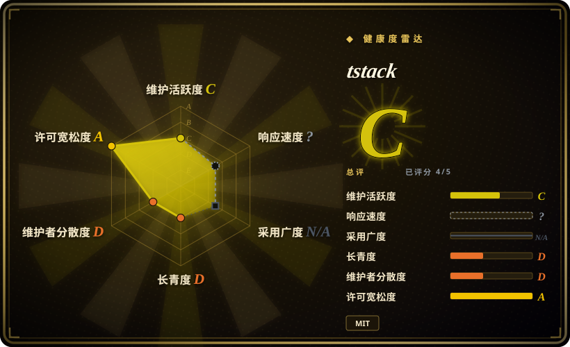
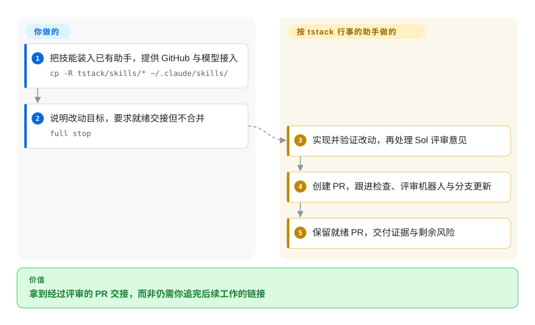
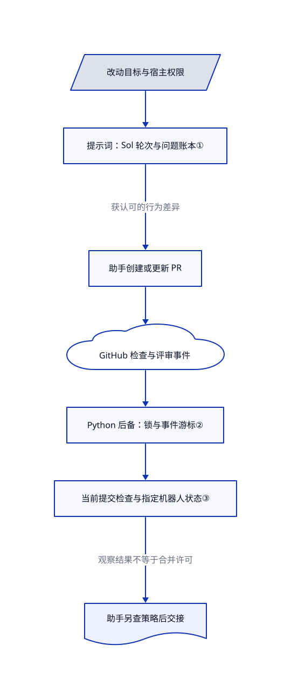

# tstack

助手开好 PR 就停了，CI、评审机器人和最后交接仍由你盯。tstack 把这些交付步骤写成九项技能，并分开“无人值守合并”和“留给你合并”两条路径。

## 何时使用

你已经在 Claude Code 或 Codex 中工作，有一个范围明确的小改动需要收尾。你缺的不是应用模板，而是让助手验证改动、请另一个模型评审、写清 PR 解决什么问题，并继续盯住 CI，而不是创建 PR 就宣布完成。需要这条聚焦 GitHub 交付的短流程，又不想引入整套规划框架或附带浏览器的开发套件时，可以考虑 tstack 这组可编辑技能文件。

九项技能覆盖交付、评审、PR 写作、接手和旧分支重审。`full-send` 以合并 PR 为终点；`full-stop` 继承前面的工作，但禁止合并。`sol-loop` 调一个 Sol 评审者，`council` 调三个提供方。它们是给宿主助手的指令，不是独立编排器或模型路由器。[说明中的依赖关系](https://github.com/t3dotgg/tstack/blob/92e38e2cf677a84a142e8df296861c588542135c/README.md#L22-L43)也是选型条件：只复制一个顶层技能，可能漏掉它要调用的其他技能。

## 何时不用

- **助手连问题和测试都没弄清就开始写代码。** 优先用 [Superpowers](../../../agent-dev-methodology/coding-agent-harnesses/superpowers.zh.md) 的需求澄清、规划和测试先行主线。tstack 主要负责把已明确的目标做完、评审和交付，不定义完整开发方法。
- **你无法把子任务路由给 Sol，或只想要不依赖该指定模型的工程习惯。** 优先用 [Waza](../../engineering/waza.zh.md)。tstack 的 `sol-loop` 明确要求模型不可用时停止，不得静默替换；安装 Markdown 不会凭空提供跨提供方执行权限，也不会支付调用费用。
- **你需要产品访谈、浏览器验收和发布角色一体化。** 选 [gstack](gstack.zh.md)，同时接受更大的运行时负担。tstack 不附带浏览器驱动，不生成 Web 应用，也不是 TanStack 库。
- **你只想在窄权限下做只读评审。** 从 [Waza](../../engineering/waza.zh.md) 和仓库自己的明确发布策略入手，不要直接采用未经修改的 `full-send` 或 `full-stop`。前者把触发词当作合并与带租约强推的授权；后者仍允许提交、推送、变基以及修改自动合并和队列设置。提示词不能替代宿主权限或分支保护（[权限文本](https://github.com/t3dotgg/tstack/blob/92e38e2cf677a84a142e8df296861c588542135c/skills/full-send/SKILL.md#L13-L41)、[停止版覆盖规则](https://github.com/t3dotgg/tstack/blob/92e38e2cf677a84a142e8df296861c588542135c/skills/full-stop/SKILL.md#L8-L27)）。

继承的[测试授权文本](https://github.com/t3dotgg/tstack/blob/92e38e2cf677a84a142e8df296861c588542135c/skills/full-send/SKILL.md#L24-L40)还把电脑操作、浏览器、设备和截图当成获准测试方法，并声称可覆盖项目级先询问规则。这些提示词不能绕过宿主或系统审批；采用前应另定更窄的权限策略。

## 横向对比

| 替代品 | 是否收录 | 我们的评价 | 取舍 |
|---|---|---|---|
| [Superpowers](../../../agent-dev-methodology/coding-agent-harnesses/superpowers.zh.md) | 已收录 | 从需求和测试先行就有缺口时选 Superpowers；改动已明确，主要缺跨模型评审和 GitHub 交接时选 tstack。 | Superpowers 提供更完整的开发方法和宿主安装渠道。tstack 是手动复制的小包，但主交付路径要求 Sol 接入和你自己的权限策略。 |
| [Waza](../../engineering/waza.zh.md) | 已收录 | 想要规划、排错、阅读和检查的紧凑习惯菜单时选 Waza；更重视明确的 PR 值守，以及合并与交接分流时选 tstack。 | Waza 让你组合较广的工程习惯。tstack 写好了交付链，并带持久化 PR watcher，代价是账号 API 配额和针对特定机器人的就绪假设。 |
| [gstack](gstack.zh.md) | 已收录 | 想要包含浏览器验收的整套产品冲刺时选 gstack；只需要聚焦 PR 的指令、不想再装浏览器运行时时选 tstack。 | 小包把产品探索、浏览器工具和模型路由留给你。gstack 集成更多角色，但也带来更多安装与状态管理。 |

## 快速上手

按[手动安装说明](https://github.com/t3dotgg/tstack/blob/92e38e2cf677a84a142e8df296861c588542135c/README.md#L29-L49)克隆仓库，再把技能目录复制到已有 Claude Code 或 Codex 的技能目录；复制前先备份同名项。你需要提供已认证的 GitHub CLI、后备 watcher 所需的 Python 3，以及能调用 Sol 的宿主路由；`council` 还需要三个模型提供方。权限策略由你决定，个人模型偏好按上游建议保留在已有项目指令中；技能文件不会安装模型或授予凭据。要得到**尚未合并**的 PR 交接，向助手说明改动目标并要求 `full stop`：技能指示它实现、验证、评审、建 PR 并值守，你负责账号和 API 费用、仓库检查，以及最后合并。它不是只读触发词：[其规则](https://github.com/t3dotgg/tstack/blob/92e38e2cf677a84a142e8df296861c588542135c/skills/full-stop/SKILL.md#L19-L47)允许更新分支并关闭自动合并；此版本连结尾强调的“Full stop.”也可能触发。

<!-- flow-steps:begin (generated from flows/tstack.json by tools/flow_card.py — do not edit) -->

流程文字版

1. **你**：把技能装入已有助手，提供 GitHub 与模型接入 — `cp -R tstack/skills/* ~/.claude/skills/`
2. **你**：说明改动目标，要求就绪交接但不合并 — `full stop`
3. **tstack**：实现并验证改动，再处理 Sol 评审意见
4. **tstack**：创建 PR，跟进检查、评审机器人与分支更新
5. **tstack**：保留就绪 PR，交付证据与剩余风险

**价值**：拿到经过评审的 PR 交接，而非仍需你追完后续工作的链接

<!-- flow-steps:end -->

## 技术要点

<!-- mechanism:begin (generated from mechanisms/tstack.json by tools/mechanism_card.py; do not edit) -->

机制文字版

- 改动目标与宿主权限
- 提示词：Sol 轮次与问题账本①
- 助手创建或更新 PR
- GitHub 检查与评审事件
- Python 后备：锁与事件游标②
- 当前提交检查与指定机器人状态③
- 助手另查策略后交接

- 改动目标与宿主权限 → 提示词：Sol 轮次与问题账本①
- 提示词：Sol 轮次与问题账本① → 助手创建或更新 PR（获认可的行为差异）
- 助手创建或更新 PR → GitHub 检查与评审事件
- GitHub 检查与评审事件 → Python 后备：锁与事件游标②
- Python 后备：锁与事件游标② → 当前提交检查与指定机器人状态③
- 当前提交检查与指定机器人状态③ → 助手另查策略后交接（观察结果不等于合并许可）

<!-- mechanism:end -->

### 1. 用问题账本和轮数预算限制评审膨胀

- **解决：** 反复模型评审可能不断追加低价值修改，也会忘记究竟哪个行为版本获得过认可。
- **做法：** Sol 流程固定差异范围，记录稳定的问题编号与处理结果，默认三轮，仅在列明的风险条件下延至五轮。后续轮次聚焦改动代码和未结问题；只有小修意见时不再开新轮。
- **边界：** 这是提示词合同，不是调度器强制预算。它限制轮数，不限制耗时；异步等待指令没有明确期限。独立的三提供方 council 也没有对应的数字轮数上限。
- **源码：** [预算和固定范围，第 15—44 行](https://github.com/t3dotgg/tstack/blob/92e38e2cf677a84a142e8df296861c588542135c/skills/sol-loop/SKILL.md#L15-L44)、[等待与下一轮规则，第 55—108 行](https://github.com/t3dotgg/tstack/blob/92e38e2cf677a84a142e8df296861c588542135c/skills/sol-loop/SKILL.md#L55-L108)、[council 续轮](https://github.com/t3dotgg/tstack/blob/92e38e2cf677a84a142e8df296861c588542135c/skills/council/SKILL.md#L46-L51)。

### 2. 每个 PR 只保留一个可续接观察者

- **解决：** 多个助手盯同一 PR 会重复消耗 API 配额，观察者重启后又可能重复播报旧消息。
- **做法：** Python 后备脚本为每个 PR 持有非阻塞文件锁，保存已见事件编号和机器人总结摘要，并用原子替换更新 JSON 状态。首次观察只建基线；恢复后播报未见事件，不重放整个讨论串。
- **边界：** GraphQL 查询只读取最新一百条评论、评审和讨论串，超过六小时的状态也会重建基线，因此它不是补齐遗漏事件的完整审计日志。脚本需要 POSIX 锁，仍会轮询 GitHub；不能替代 T3 原生 watcher，也不能据此声称原生支持 Windows。
- **源码：** [状态寿命和锁，第 62—69、207—224 行](https://github.com/t3dotgg/tstack/blob/92e38e2cf677a84a142e8df296861c588542135c/skills/babysit-pr/scripts/pr-wait#L62-L224)、[加载、保存与去重，第 248—290 行](https://github.com/t3dotgg/tstack/blob/92e38e2cf677a84a142e8df296861c588542135c/skills/babysit-pr/scripts/pr-wait#L248-L290)、[单 watcher 宿主分流](https://github.com/t3dotgg/tstack/blob/92e38e2cf677a84a142e8df296861c588542135c/skills/babysit-pr/SKILL.md#L11-L36)。

### 3. 分开观察到的就绪和真正的合并许可

- **解决：** 短暂变绿的检查或旧机器人评审，容易被误当成当前 PR 提交已经获准。
- **做法：** watcher 查找必需检查，把尚未出现的必需名称视为等待中，并要求两次检查快照一致。`ready` 路径还要求 Greptile 或 Macroscope 被判为已完成，且没有未解决讨论。有机器人检查时，检查结束即可满足该信号；否则看当前提交的评审，或摘要中是否含当前短哈希。技能再要求助手复核更完整的合并条件。
- **边界：** 脚本写死这两个门禁机器人，CodeRabbit 仅作建议。已完成信号不是评审批准：非必需机器人检查即使失败，也可满足该信号。`green` 跳过机器人条件，也不拒绝仅处于 BEHIND 的分支。退出状态都不强制涵盖全部人工批准或仓库策略；宿主助手须另查，只有获授权的流程才能合并。
- **源码：** [必需检查发现，第 227—245 行](https://github.com/t3dotgg/tstack/blob/92e38e2cf677a84a142e8df296861c588542135c/skills/babysit-pr/scripts/pr-wait#L227-L245)、[稳定检查与当前提交机器人状态，第 344—453 行](https://github.com/t3dotgg/tstack/blob/92e38e2cf677a84a142e8df296861c588542135c/skills/babysit-pr/scripts/pr-wait#L344-L453)、[退出条件，第 496—517 行](https://github.com/t3dotgg/tstack/blob/92e38e2cf677a84a142e8df296861c588542135c/skills/babysit-pr/scripts/pr-wait#L496-L517)、[完整合并策略](https://github.com/t3dotgg/tstack/blob/92e38e2cf677a84a142e8df296861c588542135c/skills/full-send/SKILL.md#L82-L98)。

## 健康度与可持续性

- **维护，截至 2026-10-27：** 仓库公开、未归档，核验当天仍有更新，但十月二十四日才创建。完整审阅树里有九项技能和一个 Python 工具，没有发布对象、包清单、测试文件或正式贡献与安全政策。应固定提交，而不是假定已有稳定发布渠道。
- **治理与许可：** 贡献者接口只列出 `t3dotgg`；审阅提交和实际 [MIT 正文](https://github.com/t3dotgg/tstack/blob/92e38e2cf677a84a142e8df296861c588542135c/LICENSE#L1-L21)均标示 Theo Browne。十六个文件中没有单列不同许可的内置组件。T3 Code、GitHub CLI 和模型提供方是外部依赖，不会因本包的 MIT 声明而改用 MIT。
- **年龄与采用：** 三天内约 1.9 千星只代表关注，不代表已验证的评审质量或组织采用。[推断：依据为仓库年龄、单贡献者历史与缺少发布记录] 可以作为小而可审阅的起点，不应当成长期维护能力已经得到证明的交付标准。
- **已知限制：** [问题 #8](https://github.com/t3dotgg/tstack/issues/8)报告 Sol 评审无限等待，[问题 #7](https://github.com/t3dotgg/tstack/issues/7)讨论指定机器人的就绪条件，[问题 #5](https://github.com/t3dotgg/tstack/issues/5)质疑模型推理档位默认值。本次没有复现报告中的运行结果。固定源码能确认没有评审期限、watcher 机器人写死，以及未显式设置 Sol 推理档位；不把待合并 PR 当作已发布修复。

## 存疑（未验证）

- [未验证：本轮禁止执行上游技能和脚本] 跨宿主触发、实际 Sol 委派、watcher 行为和完整 PR 交接均为研究结果，未运行。未独立测量评审质量、生产率、时延或 token 节省。
- [未验证：未复现报告者环境] #5、#7、#8 是边界线索，不证明每种宿主都会出现同样症状。开放 PR 中的修复不属于审阅提交。
- [推断：依据为年龄、贡献者样本与缺少发布历史] 可持续性判断仍属早期结论；热度不能证明支持承诺。
- [未验证：来源检查覆盖完整目标树及被引用 T3 Code 宿主的 blob 比较，未遍查全部公开来源] 该宿主快照没有相同 blob，不证明绝对原创，也不能替代提供方与运行时的许可核查。
