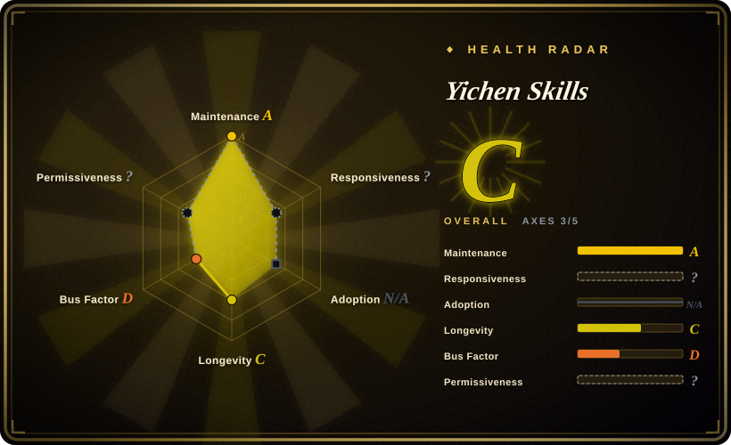
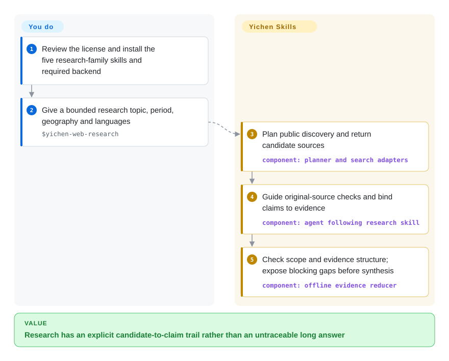
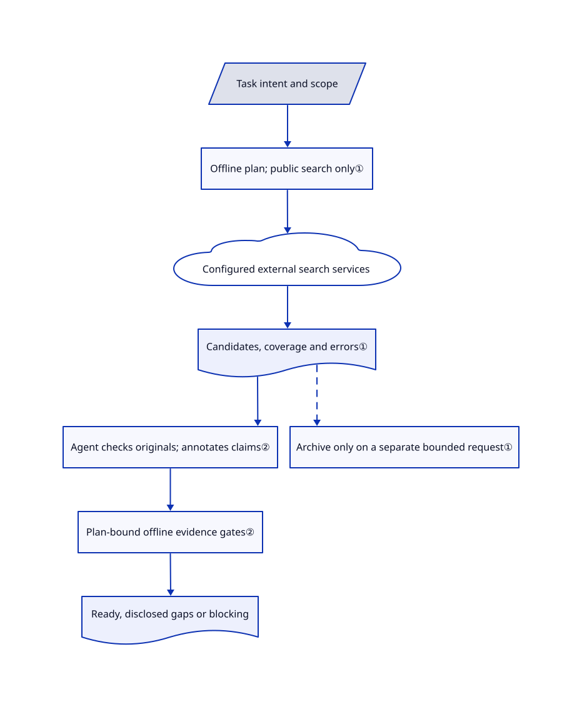

# Yichen Skills

Your agent finds social posts, then treats search results as verified sources or starts downloading without a separate request. Yichen separates discovery, confirmed-link archiving, private bookmarks and transcription into distinct skill workflows.

**License boundary:** this is source-available, not OSI open source. The [actual license](https://github.com/mcncarl/yichen-skills/blob/ed6200f81ff1fddd1482ad6cae7f4a75de5ffc75/LICENSE#L5-L33) permits personal non-commercial study/workflows, but prohibits business operations, client delivery, company toolkits and public repackaging without prior written permission. This index entry grants none of those rights. Third-party materials retain their own terms.

**Media boundary:** the Volc ASR script's new-task path uploads the exact file supplied to its CLI to TOS object storage, not a transcoded intermediate. After an upload response of 200/201, it attempts an `AllUsers` READ ACL and returns the object URL for ASR submission even if that ACL attempt fails. This is not proof that public access succeeds. Authorize file transfer and the public-ACL attempt separately, and budget for potential TOS storage, request and transcription charges; an ASR token alone is insufficient. See the [upload/ACL code](https://github.com/mcncarl/yichen-skills/blob/ed6200f81ff1fddd1482ad6cae7f4a75de5ffc75/yichen-volc-asr/scripts/transcribe.py#L100-L229).

## When to use

You use Codex or Claude Code for personal Chinese-language research. A request like “compare this company's history with today's competitors” leaves you with duplicate social links, snippets presented as facts and no record of missing sources. You want a staged research family: public discovery returns candidates, you check original sources, and only an explicit, bounded archive request saves content. Yichen adds an offline plan and evidence-ledger checker to that handoff, rather than only supplying a long-report writing prompt.

Choose individual modules for adjacent personal workflows: an authorized WeChat/WeCom plaintext snapshot, X Markdown draft upload, public X image/video slices, transcription or a Grok second opinion. The fixed tree contains 17 skill entries, not 17 independent engines: memory delegates to a separate vault project and Grok is a Codex MCP plugin. ChatGPT collaboration requires the official signed-in website, visible Chat/Chat mode and a route visibly labeled `Pro`; API calls, another account or Codex-only reasoning are not accepted substitutes. Only code, hybrid and review modes require a separately supplied compatible runtime; pure research uses no code Tunnel. These are [skill capability gates](https://github.com/mcncarl/yichen-skills/blob/ed6200f81ff1fddd1482ad6cae7f4a75de5ffc75/yichen-codex-chatgpt/README.md#L15-L27), not a claim about a particular subscription tier or current price. Compared with Baoyu's publishing emphasis or ljg's reading methods, this pack emphasizes platform-specific acquisition and explicit handoffs. Do not adopt the entire collection merely for one summarization task.

## When NOT to use

- **Commercial work or a publicly redistributed harness.** Choose [Baoyu Skills](../../ai-writing/content-production/baoyu-skills.md) for its MIT-licensed writing/formatting workflows, subject to its own dependencies. Yichen's root license expressly covers business operations and company toolkits, not just resale; personal access or a community purchase is not evidence of your written grant.
- **An offline, self-contained research engine.** Use [ljg-skills](ljg-skills.md) to structure reading of material you already possess. Yichen search sends queries to selected services; Grok needs its CLI/account, some platform routes use browser sessions, Step ASR is not bundled, and ChatGPT code review needs an external private Tunnel/MCP runtime.
- **Media that must stay local or must never face a public-ACL attempt.** Do not select the Volc ASR script; use an approved offline transcriber, then [ljg-skills](ljg-skills.md) for text analysis. Its new-task route transfers the CLI input file to TOS and attempts public READ access. `--dry-run`, `--no-execute` and `--transcribe-only` do not disable that route; they affect later editing/output. Object storage and request costs need consideration even when ASR uses trial quota.
- **Only AI-news lookup or general long-form research framing.** Choose [Khazix Skills](khazix-skills.md) for the smaller utility/research pack. Yichen's five-directory research family adds routing, adapters and evidence bookkeeping you must maintain; its horizontal/vertical mode explicitly derives from Khazix's `hv-analysis`.
- **Guaranteed WeChat version coverage or complete media recovery.** Choose a user-provided plaintext export and [ljg-skills](ljg-skills.md) for analysis when process/key access is unacceptable. Yichen's Windows capture is experimental; decrypted media databases do not imply restored media files. Mac key-capture failures and WeCom version adaptation remain visible in issues.
- **A hard security sandbox or a fact-checking oracle.** Prefer your host's permission controls plus [Baoyu Skills](../../ai-writing/content-production/baoyu-skills.md) for a narrower content task. Yichen mixes executable structural checks with agent instructions; a `ready` evidence bundle does not prove its sources truthful. Some public-search instructions permit bounded reuse of existing browser sessions, which does not override your own authorization policy.

## Comparison

| Alternative | In index | Our verdict | Tradeoff |
|---|---|---|---|
| [Baoyu Skills](../../ai-writing/content-production/baoyu-skills.md) | indexed | Choose Baoyu for translation, article formatting and visual publishing when MIT reuse matters; choose Yichen for personal platform acquisition and evidence handoffs. | Baoyu supplies broader writing/output workflows; Yichen adds local chat parsing and research adapters, but its original contributions are commercially restricted. |
| [Khazix Skills](khazix-skills.md) | indexed | Choose Khazix for a smaller AI-news/research/housekeeping toolbox; choose Yichen when research needs machine-readable plan and claim-source gates. | Yichen extends the cited horizontal/vertical research idea with scripts and several service adapters; this brings more setup and does not make evidence automatically true. |
| [ljg-skills](ljg-skills.md) | indexed | Choose ljg when the input is already a paper, book or concept and the goal is explanation; choose Yichen when collecting and preserving platform material is the bottleneck. | Reading methods avoid Yichen's acquisition/account surface, but do not replace its platform-specific vault/export workflows. |

## Quick start

First check that your intended use is permitted, and review a fixed revision before loading any skill. For the research backbone, the README installs `yichen-web-research`, `yichen-unified-search`, `yichen-content-archive`, `yichen-bookmarks-export` and `yichen-asr` together using per-skill `npx skills add mcncarl/yichen-skills --skill …` commands; these examples follow the current branch, so record the revision actually installed. Configure only the chosen backend, validate the family with `python3 yichen-web-research/scripts/validate_family.py`, then give `$yichen-web-research` a bounded topic, time range, geography and languages. The agent plans discovery, returns candidates, checks originals and organizes claim/source evidence; you supply service access, review claims and separately authorize private reading, archiving or paid transcription. Other modules need their own setup: Python/Playwright and X cookies for drafts, Node/Chrome/FFmpeg for slices, cryptographic libraries and explicit key-access permission for chat vaults; Grok's plugin is not installed by merely copying a skill folder.

For Volc ASR, the script requires `TOS_ACCESS_KEY`, `TOS_SECRET_KEY` and `TOS_BUCKET`, uses `TOS_REGION` (default `cn-beijing`), and separately needs the selected ASR AppID/token. A truthy cache result skips new submission; otherwise an explicit request ID or a matching pending-task record resumes querying without re-upload. With neither, it uploads the CLI input bytes before any FFmpeg editing. `--no-cache` bypasses cache reuse, while `--force-new` bypasses pending-task reuse, not cache reuse. The public-ACL call has no success value checked by the uploader; ACL failure does not stop the URL being returned. Budget separately for potential TOS storage/requests and ASR usage rather than assuming trial ASR covers storage. No live billing or public-access outcome was tested. See the [branch order](https://github.com/mcncarl/yichen-skills/blob/ed6200f81ff1fddd1482ad6cae7f4a75de5ffc75/yichen-volc-asr/scripts/transcribe.py#L990-L1054), [cache/pending validation](https://github.com/mcncarl/yichen-skills/blob/ed6200f81ff1fddd1482ad6cae7f4a75de5ffc75/yichen-volc-asr/scripts/transcribe.py#L876-L915) and [configuration](https://github.com/mcncarl/yichen-skills/blob/ed6200f81ff1fddd1482ad6cae7f4a75de5ffc75/yichen-volc-asr/scripts/transcribe.py#L29-L64).

<!-- flow-steps:begin (generated from flows/yichen-skills.json by tools/flow_card.py — do not edit) -->

Text version of the flow

1. **You**: Review the license and install the five research-family skills and required backend
2. **You**: Give a bounded research topic, period, geography and languages — `$yichen-web-research`
3. **Yichen Skills**: Plan public discovery and return candidate sources — component: `planner and search adapters`
4. **Yichen Skills**: Guide original-source checks and bind claims to evidence — component: `agent following research skill`
5. **Yichen Skills**: Check scope and evidence structure; expose blocking gaps before synthesis — component: `offline evidence reducer`

**Value**: Research has an explicit candidate-to-claim trail rather than an untraceable long answer

<!-- flow-steps:end -->

## Key techniques

<!-- mechanism:begin (generated from mechanisms/yichen-skills.json by tools/mechanism_card.py; do not edit) -->

Text version of the mechanism

- Task intent and scope
- Offline plan; public search only①
- Configured external search services
- Candidates, coverage and errors①
- Agent checks originals; annotates claims②
- Plan-bound offline evidence gates②
- Ready, disclosed gaps or blocking
- Archive only on a separate bounded request①

- Task intent and scope → Offline plan; public search only①
- Offline plan; public search only① → Configured external search services
- Configured external search services → Candidates, coverage and errors①
- Candidates, coverage and errors① → Agent checks originals; annotates claims②
- Agent checks originals; annotates claims② → Plan-bound offline evidence gates②
- Plan-bound offline evidence gates② → Ready, disclosed gaps or blocking
- Candidates, coverage and errors① → Archive only on a separate bounded request① [optional/fallback]

<!-- mechanism:end -->

### 1. Classify intent before handing off to a platform

- **Problem:** A keyword search, a known URL and private bookmarks imply different access and persistence rights.
- **How:** The offline search planner blocks private-data requests, routes known URLs to the archive workflow, validates platform limits and emits backend steps rather than executing them. The five-skill family keeps search candidates, archive manifests, bookmark files and ASR tasks separate.
- **Limits:** The planner does not enforce the behavior of an agent executing its plan. Several platform CLIs still return raw output rather than normalized candidates, and permitted browser-session reuse remains a host-policy decision.
- **Source:** [Planner branches](https://github.com/mcncarl/yichen-skills/blob/ed6200f81ff1fddd1482ad6cae7f4a75de5ffc75/yichen-unified-search/scripts/route_search.py#L1108-L1302), [handoff and authorization rules](https://github.com/mcncarl/yichen-skills/blob/ed6200f81ff1fddd1482ad6cae7f4a75de5ffc75/yichen-web-research/SKILL.md#L20-L44), [platform coverage qualifications](https://github.com/mcncarl/yichen-skills/blob/ed6200f81ff1fddd1482ad6cae7f4a75de5ffc75/README.zh.md#L171-L199).

### 2. Gate synthesis on a bound plan and claim-source ledger

- **Problem:** A long report can hide missing scope, stale evidence or unsupported causal conclusions.
- **How:** An offline reducer requires a matching canonical `plan_id`, merges candidate envelopes and source annotations, then checks claim coverage, dated historical claims, present-state comparisons, contradictions, cross-axis insights and bounded scenarios. It emits `blocking`, `ready` or `ready_with_disclosure`; retained gaps cannot bypass required structural gates.
- **Limits:** The reducer checks submitted structure and annotations, not the underlying web's truth. The agent must open originals and verify each material claim; an opened-page flag or AI summary alone is insufficient. It performs no search or archive operation itself.
- **Source:** [Bundle binding and final gates](https://github.com/mcncarl/yichen-skills/blob/ed6200f81ff1fddd1482ad6cae7f4a75de5ffc75/yichen-web-research/scripts/assemble_hengzong_evidence.py#L1485-L1738), [research protocol and provenance](https://github.com/mcncarl/yichen-skills/blob/ed6200f81ff1fddd1482ad6cae7f4a75de5ffc75/yichen-web-research/SKILL.md#L46-L75).

## Health & viability

- **Maintenance, 2026-10-30:** created 2026-02-11; last pushed 2026-10-28 and not archived. The release API lists one uploader-specific v1.0.1 release from 2026-08-16, not a version for the whole collection. Pin the reviewed tree rather than treating that tag as a current pack release.
- **Governance and backing:** the user-owned repository has four API-listed contributors, with 45 of 49 counted contributions from the owner. The README advertises paid commercial authorization, but no foundation governance or support SLA appears in the reviewed tree. Treat it as a maintainer-led collection, not a supported integration platform.
- **Age, adoption and Lindy:** under nine months old at verification. Current activity is useful, but it has not demonstrated multi-year survival through platform changes. GitHub stars and forks do not demonstrate successful installations or long-term maintenance. [推断：judgment from creation/push dates and the contributor record]
- **Risks:** the non-commercial license is a selection blocker for business use. Upstream notices identify adaptations and retained MIT licenses; six source-tree comparisons found only five identical license blobs, not a copied collection. That is a limited provenance check, not a complete copyright audit. The separate memory-vault project is canonical for memory runtime maintenance, not a replacement for this whole pack.
- **Compatibility:** the archive skill rejects WeChat account-history enumeration, while the standalone MP exporter still describes history/enhanced modes. Do not infer support from the root README; use the chosen module's current contract and verify its backend. [Mac key capture](https://github.com/mcncarl/yichen-skills/issues/17) and [WeCom compatibility](https://github.com/mcncarl/yichen-skills/issues/16) failures remain open; proposed PRs are not shipped fixes. The machine radar covers only three of five applicable axes: `risk_license` is unknown because the custom license is unparsed, not because no license exists; responsiveness is unknown under the scorer's skill-pack policy.

## Caveats (unverified)

- [未验证：no installation, browser, credentials or paid-service execution was authorized] Skill activation, platform compatibility, draft persistence, Windows/Mac capture and report quality were reviewed from fixed sources, not reproduced here. Upstream test files are present but were not executed.
- [未验证：third-party legal and distribution chains were not fully audited] Notices preserve several MIT texts, but this review cannot certify every adaptation, external CLI's provenance or a user's commercial grant. Do not copy this source into a public skill bundle or assume the root restriction relicenses upstream MIT material.
- [推断：creation/push dates and owner-heavy contributions are the available evidence] Active development at this age does not establish durability; maintain an exit path and recheck platform-specific contracts before upgrades.
