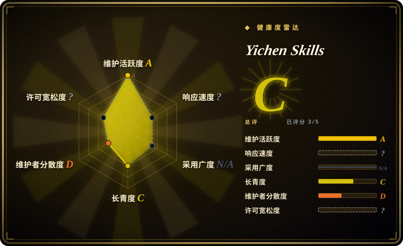
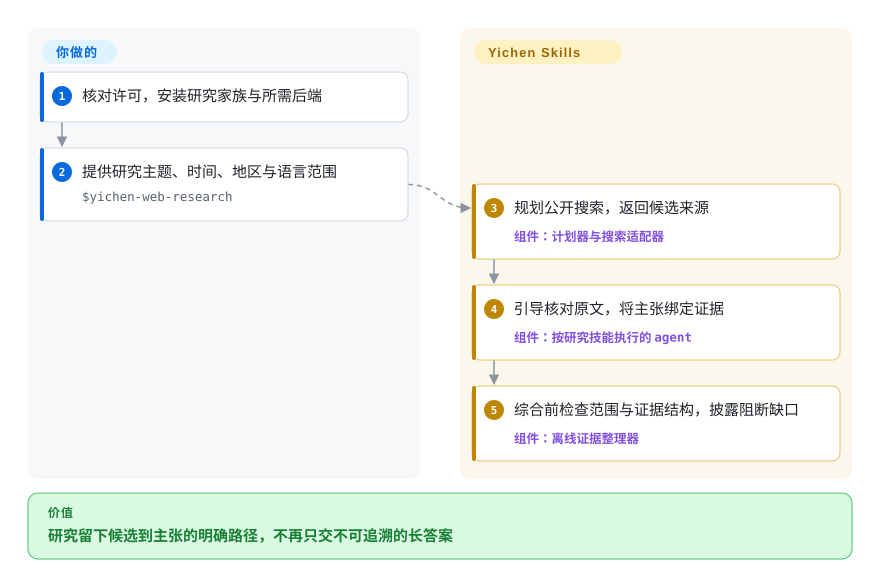
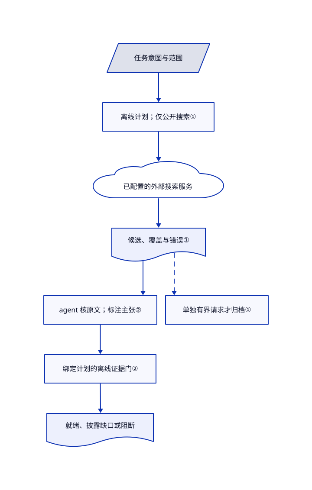

# Yichen Skills

你让 agent 找社交资料，它却把搜索摘要当事实，还顺手开始下载。Yichen 把搜索发现、已确认链接归档、私人收藏和转写拆成独立技能流程。

**许可边界：** 这是源码可见项目，不是 OSI 开源软件。[真实许可](https://github.com/mcncarl/yichen-skills/blob/ed6200f81ff1fddd1482ad6cae7f4a75de5ffc75/LICENSE#L5-L33)允许个人非商业学习与工作流，但商用、客户交付、公司工具包和公开重新打包均须事先取得书面许可。本页不授予这些权利，第三方材料继续适用各自条款。

**媒体边界：** 火山 ASR 脚本的新任务分支，会把命令行指定的文件原样上传到 TOS 对象存储，不是中间转码文件。上传响应为 200／201 后，脚本尝试设置 `AllUsers` READ ACL；即使 ACL 尝试失败，仍返回供 ASR 提交使用的对象 URL。这不证明公开访问已成功。文件外传与公开 ACL 尝试需要单独授权，还须考虑可能的 TOS 存储、请求及转写费用，只有 ASR Token 不够。详见[上传与 ACL 实现](https://github.com/mcncarl/yichen-skills/blob/ed6200f81ff1fddd1482ad6cae7f4a75de5ffc75/yichen-volc-asr/scripts/transcribe.py#L100-L229)。

## 何时使用

你用 Codex 或 Claude Code 做个人中文调研。“比较这家公司发展史与当前竞品”的结果，却是一堆重复社交链接、冒充事实的摘要，以及没有记录的来源缺口。你需要分阶段的研究家族：公开搜索先交候选，核对原始来源，再按明确且有界的请求保存内容。Yichen 为交接增加离线计划器和证据账本检查，不只是让模型写长报告。

相邻个人任务可以只选对应模块：解析已授权的微信／企微明文快照、把 Markdown 上传为 X 草稿、制作公开 X 图片与视频切片、转写或获取 Grok 第二意见。固定树包含 17 个技能入口，不代表 17 个独立引擎。记忆依赖另一仓库，Grok 是 Codex MCP 插件。ChatGPT 协作要求官网登录、可见的 Chat／聊天模式，以及明确标为 `Pro` 的模型路线；API、其他账号或 Codex 自行推理均不能替代。只有代码、混合与审查模式需自备兼容运行时，纯研究不走代码 Tunnel。这是[技能的能力门槛](https://github.com/mcncarl/yichen-skills/blob/ed6200f81ff1fddd1482ad6cae7f4a75de5ffc75/yichen-codex-chatgpt/README.md#L15-L27)，不等于声明具体订阅套餐或实时价格。相较宝玉的内容发布和李继刚的阅读方法，本包偏重平台采集与明确交接，不值得为一次摘要装齐全套。

## 何时不用

- **商用或公开分发个人 harness。** 写作与排版可选 MIT 许可的 [Baoyu Skills](../../ai-writing/content-production/baoyu-skills.zh.md)，仍需检查其依赖。Yichen 根许可连企业业务操作和公司工具包都限制，不仅限制转售；个人能访问或付费入群，不等于已经取得书面授权。
- **需要离线、自包含的研究引擎。** 分析已有材料可选 [ljg-skills](ljg-skills.zh.md)。Yichen 搜索会向选定服务发送查询；Grok 需要 CLI 与账号，部分路线复用浏览器会话，Step ASR 未分发，ChatGPT 代码审查还依赖外部私有 Tunnel／MCP 运行时。
- **媒体必须留在本机，或绝不允许公开 ACL 尝试。** 不选火山 ASR 脚本，先用获准的离线转写器，再由 [ljg-skills](ljg-skills.zh.md)分析文字。其新任务路径会将命令行输入文件传到 TOS，并尝试公开 READ。`--dry-run`、`--no-execute` 和 `--transcribe-only` 不关闭这条路径，只影响后续剪辑或输出。即使用 ASR 试用额度，也须考虑对象存储和请求费用。
- **只查 AI 新闻或需要一般长文研究框架。** 可选更小的 [Khazix Skills](khazix-skills.zh.md)。Yichen 的五目录研究家族多了路由、适配器和证据记账维护；其横纵研究也明确基于 Khazix 的 `hv-analysis` 扩展。
- **要求微信全版本兼容或完整媒体还原。** 不接受进程与密钥访问时，使用本人提供的明文导出，再由 [ljg-skills](ljg-skills.zh.md)分析。Yichen 的 Windows 采集仍为实验性，解密媒体库不等于还原媒体文件；问题列表仍有 Mac 抓 key 和企微版本适配报告。
- **需要硬安全沙箱或自动事实判定器。** 更窄的内容任务可用 [Baoyu Skills](../../ai-writing/content-production/baoyu-skills.zh.md)，并依赖宿主权限控制。Yichen 混合可执行结构检查与模型指令，证据包 `ready` 不证明来源真实。部分公开搜索规则允许有界复用已有登录态，也不能覆盖你的授权政策。

## 横向对比

| 替代品 | 是否收录 | 我们的评价 | 取舍 |
|---|---|---|---|
| [Baoyu Skills](../../ai-writing/content-production/baoyu-skills.zh.md) | 已收录 | 需要翻译、文章排版、视觉发布且重视 MIT 复用时选宝玉；个人平台采集和证据交接选 Yichen。 | 宝玉的写作与输出面更广；Yichen 增加聊天解析和研究适配器，但其原创部分受非商用限制。 |
| [Khazix Skills](khazix-skills.zh.md) | 已收录 | 小型 AI 新闻、研究与整理工具箱选 Khazix；需要机器可读计划与主张来源门禁时选 Yichen。 | Yichen 为所引用的横纵研究思路增加脚本与多服务适配，配置更多，也不会自动让证据变真。 |
| [ljg-skills](ljg-skills.zh.md) | 已收录 | 输入已是论文、书或概念，目标是讲清楚时选李继刚；瓶颈在平台采集与保存时选 Yichen。 | 阅读方法减少采集与账号接触面，但不能替代 Yichen 的平台快照和导出流程。 |

## 快速上手

先核对用途是否获准，再审阅固定版本，之后才加载技能。研究主干按 README 用逐技能的 `npx skills add mcncarl/yichen-skills --skill …` 命令，一起安装 `yichen-web-research`、`yichen-unified-search`、`yichen-content-archive`、`yichen-bookmarks-export` 和 `yichen-asr`；这些示例跟随当前分支，应记录实际安装版本。只配置本轮所需后端，运行 `python3 yichen-web-research/scripts/validate_family.py` 检查家族，再向 `$yichen-web-research` 提供主题、时间、地区与语言范围。agent 规划搜索、返回候选、核原文并整理主张来源；你负责提供服务访问、审查事实，并分别授权私域读取、归档和付费转写。其他模块另有依赖：草稿需要 Python、Playwright 与 X Cookie，切片需要 Node、Chrome 和 FFmpeg，聊天库需要密码库与明确的密钥访问授权；Grok 插件不能只靠复制技能目录安装。

火山 ASR 脚本要求 `TOS_ACCESS_KEY`、`TOS_SECRET_KEY` 和 `TOS_BUCKET`，使用 `TOS_REGION`（默认 `cn-beijing`），另需所选 ASR 应用的 AppID 与 Token。缓存结果为真值时不重新提交；否则，显式请求 ID 或匹配的未完成任务记录可恢复查询，不重新上传。两者都没有时，脚本先上传命令行输入的原始字节，之后才可能执行 FFmpeg 剪辑。`--no-cache` 跳过缓存复用，`--force-new` 只跳过未完成任务复用，不跳过缓存。上传器不检查公开 ACL 调用的成功返回值，ACL 失败也不阻止返回 URL。应分别预算可能的 TOS 存储／请求与 ASR 用量，不把 ASR 试用额度当作存储免费；本轮未测试实际计费或公开访问结果。依据为[分支顺序](https://github.com/mcncarl/yichen-skills/blob/ed6200f81ff1fddd1482ad6cae7f4a75de5ffc75/yichen-volc-asr/scripts/transcribe.py#L990-L1054)、[缓存及未完成任务检查](https://github.com/mcncarl/yichen-skills/blob/ed6200f81ff1fddd1482ad6cae7f4a75de5ffc75/yichen-volc-asr/scripts/transcribe.py#L876-L915)与[配置](https://github.com/mcncarl/yichen-skills/blob/ed6200f81ff1fddd1482ad6cae7f4a75de5ffc75/yichen-volc-asr/scripts/transcribe.py#L29-L64)。

<!-- flow-steps:begin (generated from flows/yichen-skills.json by tools/flow_card.py — do not edit) -->

流程文字版

1. **你**：核对许可，安装研究家族与所需后端
2. **你**：提供研究主题、时间、地区与语言范围 — `$yichen-web-research`
3. **Yichen Skills**：规划公开搜索，返回候选来源 — 组件：`计划器与搜索适配器`
4. **Yichen Skills**：引导核对原文，将主张绑定证据 — 组件：`按研究技能执行的 agent`
5. **Yichen Skills**：综合前检查范围与证据结构，披露阻断缺口 — 组件：`离线证据整理器`

**价值**：研究留下候选到主张的明确路径，不再只交不可追溯的长答案

<!-- flow-steps:end -->

## 技术要点

<!-- mechanism:begin (generated from mechanisms/yichen-skills.json by tools/mechanism_card.py; do not edit) -->

机制文字版

- 任务意图与范围
- 离线计划；仅公开搜索①
- 已配置的外部搜索服务
- 候选、覆盖与错误①
- agent 核原文；标注主张②
- 绑定计划的离线证据门②
- 就绪、披露缺口或阻断
- 单独有界请求才归档①

- 任务意图与范围 → 离线计划；仅公开搜索①
- 离线计划；仅公开搜索① → 已配置的外部搜索服务
- 已配置的外部搜索服务 → 候选、覆盖与错误①
- 候选、覆盖与错误① → agent 核原文；标注主张②
- agent 核原文；标注主张② → 绑定计划的离线证据门②
- 绑定计划的离线证据门② → 就绪、披露缺口或阻断
- 候选、覆盖与错误① → 单独有界请求才归档①〔可选／兜底〕

<!-- mechanism:end -->

### 1. 先区分输入意图，再交给平台

- **解决：** 关键词、已知链接与私人收藏的访问权和持久化权限不同。
- **做法：** 离线搜索计划器阻断私域请求，将已知链接交给归档流程，检查平台上限，再生成后端步骤，而非直接执行。五技能家族分别保留搜索候选、归档清单、收藏文件与转写任务。
- **边界：** 计划器不能强制 agent 正确执行计划；部分平台 CLI 仍输出原始结果，而不是标准候选。允许复用浏览器会话与否，仍取决于宿主政策。
- **源码：** [计划器分支](https://github.com/mcncarl/yichen-skills/blob/ed6200f81ff1fddd1482ad6cae7f4a75de5ffc75/yichen-unified-search/scripts/route_search.py#L1108-L1302)、[交接与授权规则](https://github.com/mcncarl/yichen-skills/blob/ed6200f81ff1fddd1482ad6cae7f4a75de5ffc75/yichen-web-research/SKILL.md#L20-L44)、[平台覆盖限定](https://github.com/mcncarl/yichen-skills/blob/ed6200f81ff1fddd1482ad6cae7f4a75de5ffc75/README.zh.md#L171-L199)。

### 2. 用绑定计划的主张来源账本约束综合

- **解决：** 长报告容易掩盖范围缺口、过期材料和没有证据的因果判断。
- **做法：** 离线整理器要求匹配规范计划的 `plan_id`，合并候选交接包和来源标注，再检查主张覆盖、历史日期、现状比较、矛盾、横纵交汇与有界情景。输出 `blocking`、`ready` 或 `ready_with_disclosure`，保留缺口不能跳过必需结构门。
- **边界：** 整理器只检查输入结构和标注，不判断网页事实真假。agent 仍须打开原文逐条核验，打开页面或 AI 摘要本身都不构成事实证明；脚本自身不搜索或归档。
- **源码：** [证据包绑定与完成门禁](https://github.com/mcncarl/yichen-skills/blob/ed6200f81ff1fddd1482ad6cae7f4a75de5ffc75/yichen-web-research/scripts/assemble_hengzong_evidence.py#L1485-L1738)、[研究协议与来源归属](https://github.com/mcncarl/yichen-skills/blob/ed6200f81ff1fddd1482ad6cae7f4a75de5ffc75/yichen-web-research/SKILL.md#L46-L75)。

## 健康度与可持续性

- **维护，2026-10-30：** 创建于 2026-02-11，最近推送为 2026-10-28，未归档。release API 只有 2026-08-16 的上传器 v1.0.1，不是整包版本。应固定已审树，不能把该 tag 当全套当前发布。
- **治理与支持：** 用户名下仓库，API 列出四名贡献者，计数中作者占 49 次贡献的 45 次。README 提供付费商业授权，已审树没有基金会治理或支持时效承诺。应当作维护者主导的个人合集，而非有支持保障的平台。
- **年龄、采用与林迪判断：** 核验时不足九个月，当前活跃有价值，但没有跨平台变化存活多年的记录。星数与 fork 数不证明安装成功或长期维护。[推断：依据创建与推送日期、贡献者记录作判断]
- **风险：** 非商用许可直接限制企业选型。来源通知列出改编及保留的 MIT 文本；六个来源树比对只命中五个相同许可 blob，并非复制整个合集。这是有限来源检查，不是完整版权审计。独立记忆仓库才是记忆运行时维护的权威源，但不能替代本包全部功能。
- **兼容性：** 归档技能拒绝公众号账号历史枚举，独立公众号导出器却仍描述历史与增强模式。不能依据根 README 推定可用，应查所选模块当前契约与后端。[Mac 密钥捕获](https://github.com/mcncarl/yichen-skills/issues/17)和[企微兼容](https://github.com/mcncarl/yichen-skills/issues/16)失败仍为开放问题，未合入 PR 不能当作已发布修复。机器雷达只覆盖五个适用轴中的三个；许可风险未知是因为自定义许可未被解析，并不是没有许可，响应轴则按评分器的技能包政策保留未知。

## 存疑（未验证）

- [未验证：本轮未授权安装、浏览器、凭据或付费服务执行] 技能激活、平台兼容、草稿持久化、Windows／Mac 采集及报告质量仅依据固定源码研究，未在本轮复现。上游有测试文件，但未执行。
- [未验证：未完整审计第三方权属及分发链] 通知保留多份 MIT 文本，但不能据此认证每一处改编、外部 CLI 来源或用户的商业授权。不可复制本源码进公开技能包，也不可认为根限制重新授权了上游 MIT 材料。
- [推断：证据限于创建日期、推送日期与作者集中的贡献记录] 这个年龄的活跃开发不代表可持续性，应保留退出路径，并在升级前重查平台契约。
