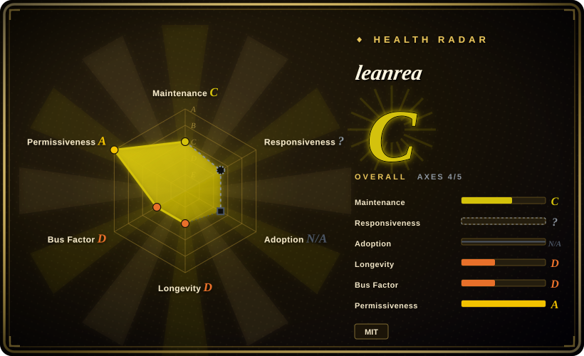
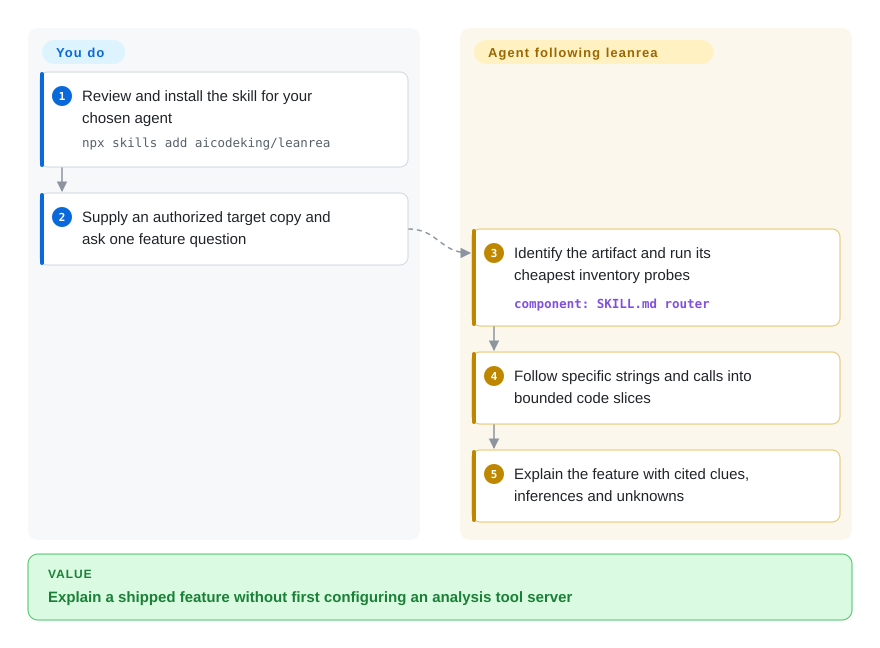
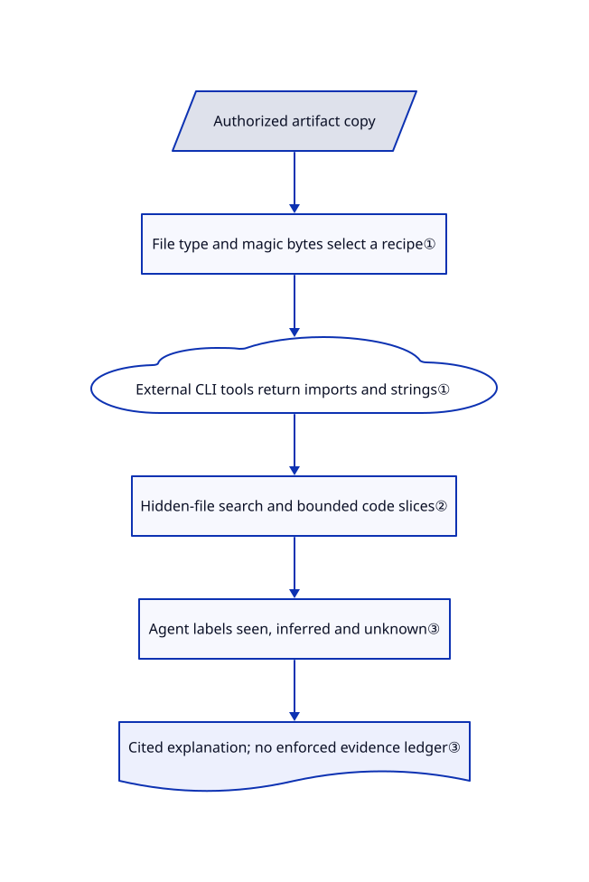

# leanrea

Your agent spends several turns choosing tools just to explain one feature in a shipped app. leanrea gives it a short file-type router and targeted inspection commands, without installing another tool server.

## When to use

You maintain an integration with an app you may inspect, but only have its Electron archive or a compiled helper. You ask which message starts a feature, and the agent repeatedly lists files or reads an entire compressed JavaScript bundle. Choose leanrea when the missing piece is a concise investigation recipe: identify the artifact, inventory cheap clues, then follow a specific string or call into a small code slice.

Unlike [REA](../../dev-utilities/binary-analysis/rea.md), it installs no analysis service or agent-callable tool catalog. Its reusable component is one 8374-byte skill; the agent still executes independently installed tools. This fits a short, operator-supervised investigation better than a requirement for machine-enforced evidence records or case management.

## When NOT to use

- **You need structured, persistent evidence records.** Choose [REA](../../dev-utilities/binary-analysis/rea.md) for implemented analysis adapters and its evidence ledger. leanrea asks the model to label evidence but has no ledger runtime or schema enforcement.
- **You need engagement authorization and case tracking.** Evaluate [reverse-skill](reverse-skill.md), with its documented case guard and case workflow, instead of treating leanrea's copy-first rule as permission checking. Audit that pack's own bootstrap and payload risks too.
- **Your task is specifically an Android HTTP API inventory.** Choose [android-reverse-engineering](android-reverse-engineering.md) for its Kotlin-name recovery and endpoint pipeline. leanrea's APK row is a short jadx/apktool recipe, not that extraction system.
- **You expect safe unattended operation on hostile artifacts.** Use reviewed static operations in REA rather than leanrea's paste-and-run snippets, and provide an isolated environment either way. The reviewed skill has an unquoted recursive cleanup path; its benchmark preapproves Bash without creating an OS sandbox. [Issue #3](https://github.com/aicodeking/leanrea/issues/3) and [PR #4](https://github.com/aicodeking/leanrea/pull/4) remain open; do not copy the Electron first-move command unchanged.
- **You expect every native recipe to work out of the box.** Prefer REA with a configured native engine when integration matters. This revision references an absent `DecompileAll.java`; several table commands retain escaped pipes. [PR #5](https://github.com/aicodeking/leanrea/pull/5) and [PR #6](https://github.com/aicodeking/leanrea/pull/6) propose fixes but are not in the reviewed default branch.

## Comparison

| Alternative | In index | Our verdict | Tradeoff |
|---|---|---|---|
| [REA](../../dev-utilities/binary-analysis/rea.md) | ✅ | Choose leanrea for a brief supervised CLI investigation; choose REA when implemented adapters and consistent evidence records matter more than a small prompt footprint. | One editable instruction file versus a Node-based analysis layer; leanrea leaves command safety and evidence persistence to the operator. |
| [reverse-skill](reverse-skill.md) | ✅ | Choose reverse-skill for engagements requiring authorization records and case reporting; choose leanrea for an isolated feature question without that workflow machinery. | Broader security playbooks and governance versus a smaller artifact router; the broader pack also has its own bootstrap and payload hazards. |
| [android-reverse-engineering](android-reverse-engineering.md) | ✅ | Choose the Android pipeline when obfuscated Kotlin names obscure backend endpoints; choose leanrea when the same investigation crosses Electron, native and build metadata. | Specialized recovery scripts and API output versus compact cross-format guidance; neither choice removes toolchain or authorization responsibilities. |

## Quick start

The README documents `npx skills add aicodeking/leanrea`, which lets you select an agent; review the skill before installing it. Supply a copy of an authorized target and ask a concrete feature question, for example `/leanrea How does the search feature in Foo.app work? Show the evidence.` The agent follows the router and runs local tools, then returns an explanation with file, symbol or offset evidence. You provide the actual tools, execution permissions, isolation and model budget: Node/npm for the documented installer and Electron extraction, Xcode tools for Mach-O, Go for Go build information, or separate decompilers for deeper targets. Installation does not install that entire toolchain or make the snippets safe; correct the documented command defects before use.

<!-- flow-steps:begin (generated from flows/leanrea.json by tools/flow_card.py — do not edit) -->

Text version of the flow

1. **You**: Review and install the skill for your chosen agent — `npx skills add aicodeking/leanrea`
2. **You**: Supply an authorized target copy and ask one feature question
3. **leanrea**: Identify the artifact and run its cheapest inventory probes — component: `SKILL.md router`
4. **leanrea**: Follow specific strings and calls into bounded code slices
5. **leanrea**: Explain the feature with cited clues, inferences and unknowns

**Value**: Explain a shipped feature without first configuring an analysis tool server

<!-- flow-steps:end -->

## Key techniques

<!-- mechanism:begin (generated from mechanisms/leanrea.json by tools/mechanism_card.py; do not edit) -->

Text version of the mechanism

- Authorized artifact copy
- File type and magic bytes select a recipe①
- External CLI tools return imports and strings①
- Hidden-file search and bounded code slices②
- Agent labels seen, inferred and unknown③
- Cited explanation; no enforced evidence ledger③

- Authorized artifact copy → File type and magic bytes select a recipe①
- File type and magic bytes select a recipe① → External CLI tools return imports and strings①
- External CLI tools return imports and strings① → Hidden-file search and bounded code slices②
- Hidden-file search and bounded code slices② → Agent labels seen, inferred and unknown③
- Agent labels seen, inferred and unknown③ → Cited explanation; no enforced evidence ledger③

<!-- mechanism:end -->

### 1. Route by artifact before paying for deep analysis

- **Problem:** Starting a decompiler for a version question adds work that build metadata could answer directly.
- **How:** The skill first asks for file type and magic bytes, then routes to 18 target recipes. For example, Go build information gets a direct command, while native analysis starts with imports, exports and strings.
- **Limits:** This is model-followed routing, not an executable detector. Tool availability is external; the Ghidra recipe names a script missing from this revision.
- **Source:** [Rules and first moves](https://github.com/aicodeking/leanrea/blob/09ba4aa0217f82cd880f855a60b877f59f39b22b/leanrea/SKILL.md#L10-L33), [router](https://github.com/aicodeking/leanrea/blob/09ba4aa0217f82cd880f855a60b877f59f39b22b/leanrea/SKILL.md#L35-L55), [missing-script fix proposal](https://github.com/aicodeking/leanrea/pull/5).

### 2. Slice hidden bundles instead of flooding the model

- **Problem:** Minified bundles can fill the context while ordinary search skips hidden build directories containing the relevant code.
- **How:** The instructions use hidden-file-aware search, bounded text around a needle and one saved disassembly. Electron tracing follows the native call inward through its caller, message registration and renderer or preload code.
- **Limits:** Output caps and chosen search terms can omit evidence. Several router examples escape pipe characters for a Markdown table, so raw copying changes command meaning; the pending list-based rewrite is not installed code.
- **Source:** [Search and output rules](https://github.com/aicodeking/leanrea/blob/09ba4aa0217f82cd880f855a60b877f59f39b22b/leanrea/SKILL.md#L13-L18), [Electron slices](https://github.com/aicodeking/leanrea/blob/09ba4aa0217f82cd880f855a60b877f59f39b22b/leanrea/SKILL.md#L27-L31), [tracing patterns](https://github.com/aicodeking/leanrea/blob/09ba4aa0217f82cd880f855a60b877f59f39b22b/leanrea/SKILL.md#L57-L63), [pipe correction proposal](https://github.com/aicodeking/leanrea/pull/6).

### 3. Separate observed clues from inferred explanations

- **Problem:** A static call sequence can be mistaken for an observed runtime behavior, or a failed search for proof of absence.
- **How:** The prompt requires seen claims with file offsets, symbols or strings, inferred claims, and explicit unknowns. It tells the agent to stop once the requested items have evidence rather than repeatedly collecting the same clues.
- **Limits:** These are instructions, not a verifier. The benchmark checks answer text against regular expressions; it does not validate evidence citations, runtime behavior or shell confinement.
- **Source:** [Evidence and stopping rules](https://github.com/aicodeking/leanrea/blob/09ba4aa0217f82cd880f855a60b877f59f39b22b/leanrea/SKILL.md#L16-L18), [benchmark runner](https://github.com/aicodeking/leanrea/blob/09ba4aa0217f82cd880f855a60b877f59f39b22b/bench/run.py#L15-L49).

## Health & viability

- **2026-10-21 — experimental, not established.** Created four days ago, with four default-branch commits all dated October 17; the later repository push timestamp does not establish a newer main revision. Releases and tags are empty. [推断：based on API age and commit history] Keep it optional and pinned rather than a mandatory analysis dependency.
- **Ownership and provenance.** The API lists one contributor under a personal account. The MIT file names AICodeKing; the README credits REA's code and docs for many gotchas. Comparing both complete repository trees found no identical file blobs, which rules out a whole-file duplicate at those revisions, not every possible copied passage. No governance or funding file appears in the reviewed tree.
- **Adoption and quality.** The API reports 1259 stars and 190 forks on this date, but those are attention counts. The repository contains a skill and five benchmark scripts, not a standalone analysis engine or a general correctness test suite.
- **Benchmark boundary.** The author reports 38% less time and 35% lower cost than REA 6.5.0, from four tasks with three repetitions per arm on one macOS machine. The [raw log](https://github.com/aicodeking/leanrea/blob/09ba4aa0217f82cd880f855a60b877f59f39b22b/bench/results/final.jsonl) has 36 rows and scores leanrea at 74/75 versus REA at 75/75; [native decompilers were not installed](https://github.com/aicodeking/leanrea/blob/09ba4aa0217f82cd880f855a60b877f59f39b22b/bench/BENCHMARK.md#L75-L77). This does not establish equivalent accuracy across the router's 18 target types.
- **Risk verdict.** Command-copy defects, absent native support script and unsafe cleanup remain in the reviewed commit. These are concrete adoption blockers for unattended use, not reasons to discard a reusable supervised recipe. Review [open issues and proposals](https://github.com/aicodeking/leanrea/issues) before upgrading.

## Caveats (unverified)

- [未验证：upstream execution was prohibited for this intake] No installation, target analysis or benchmark was executed. Actual command behavior, agent compatibility and claimed speed/cost gains were not independently reproduced; published metrics were inspected as author data only.
- [推断：four days of history and one listed contributor] Long-term maintenance and reliability cannot be inferred from rapid star growth. The optional, supervised-use recommendation is a selection judgment, not a measured reliability result.
