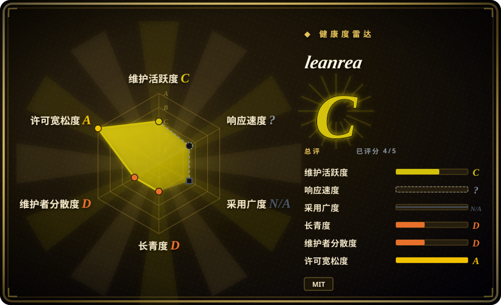
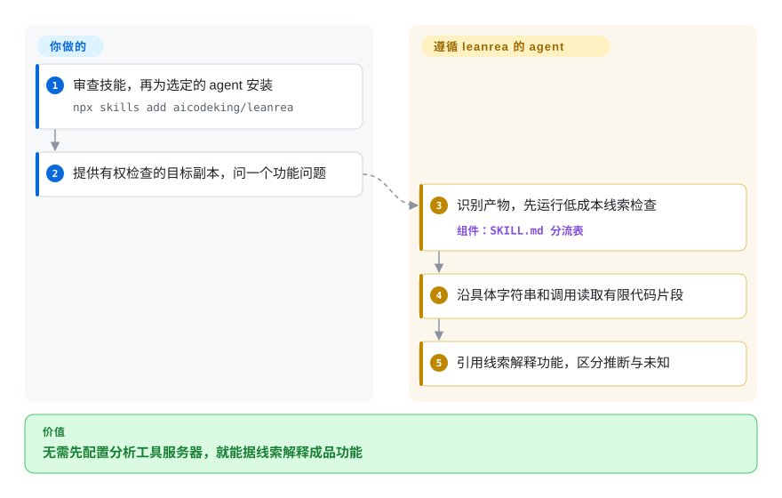
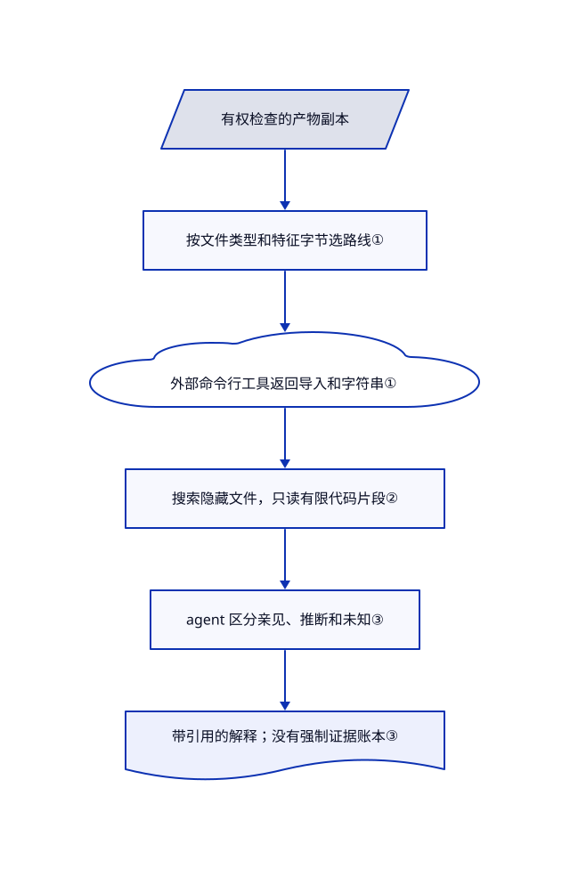

# leanrea

你只想解释成品应用的一个功能，agent 却花几轮挑工具、列文件。leanrea 用一份短指令按文件类型分流，再查具体线索，不必另装工具服务器。

## 何时使用

你维护一个应用集成，有权检查目标，却只有 Electron 归档或编译后的辅助程序。你问哪个消息启动了某项功能，agent 却反复列目录，或把整份压缩后的 JavaScript 读进上下文。缺的是一套短调查路线时，选 leanrea：先识别产物，查成本低的线索，再沿某个字符串或调用切出小段代码。

它不像 [REA](../../dev-utilities/data-tools/rea.zh.md) 那样安装分析服务和可供 agent 调用的工具目录。可复用核心是一份 8374 字节的技能文件；命令仍由 agent 调用另装的工具执行。它更适合有人监督的短调查，不适合把机器强制的证据记录或案件管理当作硬要求的流程。

## 何时不用

- **你要结构化、持久化的证据记录。** 选 [REA](../../dev-utilities/data-tools/rea.zh.md) 的分析适配器和证据账本。leanrea 只要求模型标注证据，没有账本运行时和结构校验。
- **你要项目授权和案件跟踪。** 评估 [reverse-skill](reverse-skill.zh.md) 的授权检查和案件流程，别把 leanrea 的“先复制文件”当成权限检查。也要审查前者自己的自举和载荷风险。
- **任务就是整理安卓应用的 HTTP API。** 选 [android-reverse-engineering](android-reverse-engineering.zh.md) 的 Kotlin 名称恢复和端点流水线。leanrea 的 APK 条目只给 jadx/apktool 短路线，不包含那套提取系统。
- **你要无人值守地分析恶意产物。** 改用 REA 中经过审查的静态操作，并为两者都提供隔离环境。当前技能包含未加引号的递归清理路径；基准脚本预授权 Bash，却不创建操作系统沙箱。[问题 #3](https://github.com/aicodeking/leanrea/issues/3) 和 [PR #4](https://github.com/aicodeking/leanrea/pull/4) 仍开放，不要原样复制 Electron 起手命令。
- **你希望所有原生分析命令都能开箱即用。** 若重视工具集成，选配好原生引擎的 REA。当前版本引用了未提供的 `DecompileAll.java`，多条表格命令仍带转义管道符。[PR #5](https://github.com/aicodeking/leanrea/pull/5) 和 [PR #6](https://github.com/aicodeking/leanrea/pull/6) 提议修复，但不在本次读取的默认分支内。

## 横向对比

| 替代品 | 是否收录 | 我们的评价 | 取舍 |
|---|---|---|---|
| [REA](../../dev-utilities/data-tools/rea.zh.md) | ✅ | 有人监督的短命令行调查选 leanrea；实际适配器和一致证据记录比短提示词更重要时，选 REA。 | 一份可编辑指令对比基于 Node 的分析层；leanrea 把命令安全和证据持久化交给操作者。 |
| [reverse-skill](reverse-skill.zh.md) | ✅ | 要授权记录和案件报告时选 reverse-skill；只问某项功能、无需案件流程时选 leanrea。 | 更多安全流程和治理对比更小的产物路由；前者也带自己的自举和载荷风险。 |
| [android-reverse-engineering](android-reverse-engineering.zh.md) | ✅ | 混淆后的 Kotlin 名称挡住后端端点调查时，选安卓专用流水线；同次调查跨 Electron、原生代码和构建信息时，选 leanrea。 | 专用恢复脚本和 API 文档对比跨格式短指引；两者都不免除工具链和授权责任。 |

## 快速上手

README 给出的安装命令是 `npx skills add aicodeking/leanrea`，由你选择 agent，安装前先审查技能。提供有权检查的目标副本，再问具体功能问题，例如 `/leanrea How does the search feature in Foo.app work? Show the evidence.` agent 按路线调用本地工具，最后返回带文件、符号或偏移证据的解释。你负责工具、执行权限、隔离和模型费用：文档安装器及 Electron 解包需要 Node/npm，Mach-O 使用 Xcode 工具，Go 构建信息使用 Go，深入分析还需另装反编译器。安装技能不会装齐这些工具，也不会让命令自动变安全；使用前先修正文档中的命令缺陷。

<!-- flow-steps:begin (generated from flows/leanrea.json by tools/flow_card.py — do not edit) -->

流程文字版

1. **你**：审查技能，再为选定的 agent 安装 — `npx skills add aicodeking/leanrea`
2. **你**：提供有权检查的目标副本，问一个功能问题
3. **leanrea**：识别产物，先运行低成本线索检查 — 组件：`SKILL.md 分流表`
4. **leanrea**：沿具体字符串和调用读取有限代码片段
5. **leanrea**：引用线索解释功能，区分推断与未知

**价值**：无需先配置分析工具服务器，就能据线索解释成品功能

<!-- flow-steps:end -->

## 技术要点

<!-- mechanism:begin (generated from mechanisms/leanrea.json by tools/mechanism_card.py; do not edit) -->

机制文字版

- 有权检查的产物副本
- 按文件类型和特征字节选路线①
- 外部命令行工具返回导入和字符串①
- 搜索隐藏文件，只读有限代码片段②
- agent 区分亲见、推断和未知③
- 带引用的解释；没有强制证据账本③

- 有权检查的产物副本 → 按文件类型和特征字节选路线①
- 按文件类型和特征字节选路线① → 外部命令行工具返回导入和字符串①
- 外部命令行工具返回导入和字符串① → 搜索隐藏文件，只读有限代码片段②
- 搜索隐藏文件，只读有限代码片段② → agent 区分亲见、推断和未知③
- agent 区分亲见、推断和未知③ → 带引用的解释；没有强制证据账本③

<!-- mechanism:end -->

### 1. 先按产物分流，再支付深度分析成本

- **解决：** 只是问编译版本，却启动反编译器，做了构建信息本可回答的工作。
- **做法：** 技能先要求识别文件类型和特征字节，再分流到 18 类目标路线。例如 Go 构建信息用直接命令，原生分析先查导入、导出和字符串。
- **边界：** 这是由模型遵循的路线，不是可执行检测器。工具需要另备；Ghidra 路线还引用了本版本没有提供的脚本。
- **源码：** [规则与起手动作](https://github.com/aicodeking/leanrea/blob/09ba4aa0217f82cd880f855a60b877f59f39b22b/leanrea/SKILL.md#L10-L33)、[分流表](https://github.com/aicodeking/leanrea/blob/09ba4aa0217f82cd880f855a60b877f59f39b22b/leanrea/SKILL.md#L35-L55)、[缺失脚本修复提案](https://github.com/aicodeking/leanrea/pull/5)。

### 2. 切出隐藏目录中的线索，不灌入整个包

- **解决：** 压缩后的脚本可能塞满上下文，普通搜索还会跳过藏有目标代码的隐藏构建目录。
- **做法：** 指令要求搜索隐藏文件、只读关键词附近的有限文字，并把反汇编保存一次。Electron 调查沿原生调用、调用类、消息注册，再到界面或预加载脚本。
- **边界：** 输出上限和关键词选择可能遗漏证据。分流表的多条命令为 Markdown 转义了管道符，原样复制会改变命令含义；待合并的列表改写不是当前已安装内容。
- **源码：** [搜索和输出规则](https://github.com/aicodeking/leanrea/blob/09ba4aa0217f82cd880f855a60b877f59f39b22b/leanrea/SKILL.md#L13-L18)、[Electron 切片](https://github.com/aicodeking/leanrea/blob/09ba4aa0217f82cd880f855a60b877f59f39b22b/leanrea/SKILL.md#L27-L31)、[追踪模式](https://github.com/aicodeking/leanrea/blob/09ba4aa0217f82cd880f855a60b877f59f39b22b/leanrea/SKILL.md#L57-L63)、[管道修复提案](https://github.com/aicodeking/leanrea/pull/6)。

### 3. 区分亲见线索和推理解释

- **解决：** 静态调用序列容易被当作运行时实测；没搜到也容易被写成不存在。
- **做法：** 提示词要求亲见结论带文件偏移、符号或字符串，并另标推断和未知。请求中的各项已有证据就停止，避免反复收集同一线索。
- **边界：** 这只是指令，不是验证器。基准用正则匹配答案文字，不核验证据引用、运行时行为或 shell 隔离。
- **源码：** [证据与停止规则](https://github.com/aicodeking/leanrea/blob/09ba4aa0217f82cd880f855a60b877f59f39b22b/leanrea/SKILL.md#L16-L18)、[基准运行器](https://github.com/aicodeking/leanrea/blob/09ba4aa0217f82cd880f855a60b877f59f39b22b/bench/run.py#L15-L49)。

## 健康度与可持续性

- **2026-10-21——仍是实验性项目。** 建仓仅四天，默认分支四次提交都在 10 月 17 日；较新的仓库推送时间不代表主分支更新。发布和标签均为空。[推断：依据是 API 年龄和提交历史] 宜固定版本、作为可选工具，不宜成为必需分析依赖。
- **归属与来源。** API 只列出个人账号下的一位贡献者。MIT 文件署名 AICodeKing，README 致谢 REA 的源码和文档提供了许多易错点。两个完整仓库树没有相同文件 blob，这排除了对应版本的整文件重复，但不证明每段文字都独立原创。本次仓库树没有治理或资金文件。
- **采用与质量。** 当日 API 返回 1259 星、190 个 fork，这些只是关注数。仓库包含技能和五个基准脚本，不是独立分析引擎，也没有通用正确性测试套件。
- **基准边界。** 作者声称比 REA 6.5.0 少耗时 38％、少花费 35％，来自一台 macOS 机器上的四个任务，每组重复三次。[原始日志](https://github.com/aicodeking/leanrea/blob/09ba4aa0217f82cd880f855a60b877f59f39b22b/bench/results/final.jsonl)共 36 行，leanrea 得分 74/75，REA 为 75/75；[未安装原生反编译器](https://github.com/aicodeking/leanrea/blob/09ba4aa0217f82cd880f855a60b877f59f39b22b/bench/BENCHMARK.md#L75-L77)。这不证明分流表 18 类目标的精度相当。
- **风险裁决。** 本次提交仍有命令复制缺陷、缺失的原生脚本和危险清理。这些会阻断无人值守采用，但不否定有人监督时的短路线复用价值。升级前核查[开放问题与提案](https://github.com/aicodeking/leanrea/issues)。

## 存疑（未验证）

- [未验证：本次收录禁止执行上游内容] 未安装技能、分析目标或运行基准。命令行为、agent 兼容性及速度费用收益均未独立复现；发布指标只按作者数据读取。
- [推断：依据是四天历史与一位已列贡献者] 快速涨星不能证明长期维护和可靠性。可选、有人监督的采用建议属于选型判断，不是可靠性测量结果。
