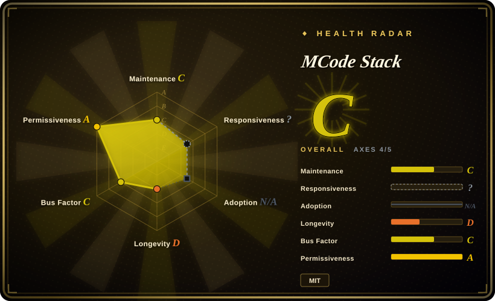
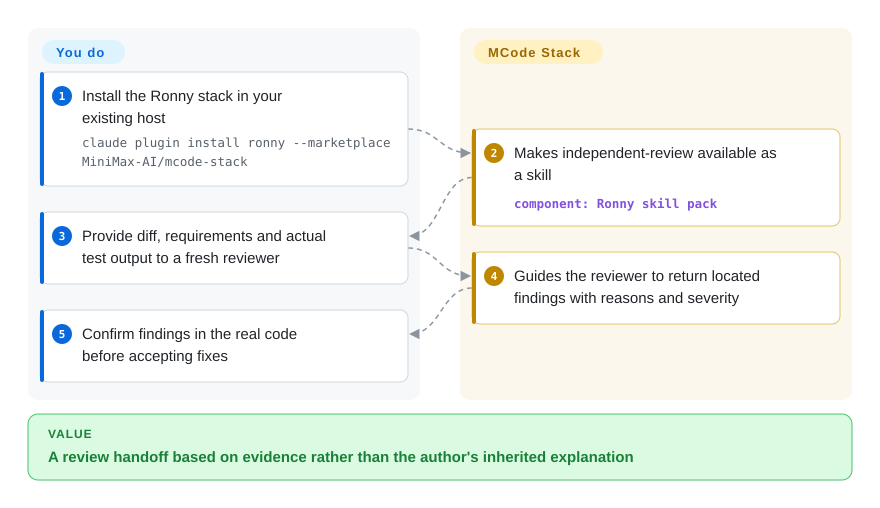
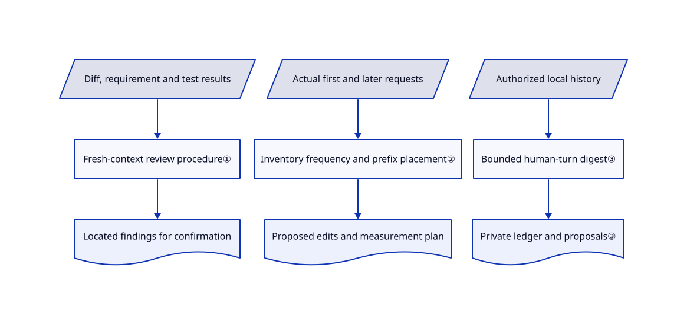

# MCode Stack

Your coding agent reviews its own patch with the same assumptions, while timestamps and tool lists keep swelling each request. MCode Stack supplies separate review and context-audit procedures you can adopt without replacing your whole development workflow.

**License boundary:** the root [MIT license](https://github.com/MiniMax-AI/mcode-stack/blob/49a3ff4dfd1aa159c8a84579f3ac0ce38e1aaa6d/LICENSE) does not make every skill MIT-only. The `engineering-*` adaptations retain **CC-BY 3.0**; preserve attribution and change notices alongside the MIT notices in [NOTICE.md](https://github.com/MiniMax-AI/mcode-stack/blob/49a3ff4dfd1aa159c8a84579f3ac0ce38e1aaa6d/stacks/ronny/NOTICE.md). This page describes the repository; it grants no additional reuse rights.

## When to use

You maintain a coding-agent harness. A reviewer says “looks good” after inheriting the writer's conversation, or your request log shows the current time inserted before otherwise identical instructions. You want a procedure that asks for the real diff, requirements and test output, or inventories changing request fields before proposing a fix. Choose the Ronny stack over a whole-lifecycle pack such as Superpowers when you need these targeted audits inside an existing workflow, not a second brainstorm-to-TDD pipeline.

The separate Jiachen stack fits a different recurring problem: you keep telling agents to retry, carrying context between sessions, or manually turning notes into Chinese posts and short videos. It adds a private intervention ledger and content scripts. Select it deliberately rather than treating those data-reading and media features as prerequisites for Ronny's review skills.

## When NOT to use

- **You want MiniMax Code itself or a model server.** This repository contains workflows and skills, not that application's source or model weights. Use the separate MiniMax Code product for its application, or [Superpowers](../../../agent-dev-methodology/coding-agent-harnesses/superpowers.md) for a workflow in an existing agent. No named model or MiniMax inference endpoint is required by Ronny's manifests.
- **You need one prescribed coding lifecycle.** Choose [Superpowers](../../../agent-dev-methodology/coding-agent-harnesses/superpowers.md) for planning, test-first coding and verification; MCode Stack's point skills do not orchestrate that lifecycle or enforce a sandbox.
- **You want frontend, document or MiniMax media-generation recipes.** Compare [MiniMax Skills](minimax-skills.md), a separate repository. MCode Stack concentrates on engineering habits; Jiachen's optional video path uses Edge read-aloud or Volcengine, not a bundled MiniMax generation service.
- **Local chat history must not enter the agent's context.** Skip `lifting-loops`; use Ronny's explicit-input `independent-review` instead. Batch reflection scans local agent sessions and optional notes/exports, then writes gitignored private digests. “Local” storage does not prevent a hosted agent from receiving the material it reads.
- **You need a scheduled repository automation loop with runnable CI scaffolding.** Compare [HumanLayer Skills](humanlayer-skills.md); MCode's checklists diagnose process issues, while its scheduling guidance is not a ready-made CI controller.
- **You cannot risk overwriting existing skills.** Prefer a separately managed plugin or a reviewed single-skill copy. Do not run the generic installer blindly: with neither Claude nor Codex present, it deletes each same-named destination in `~/.agents/skills/` before copying. Keep your existing reviewed workflow rather than stacking conflicting review instructions.

## Comparison

| Alternative | In index | Our verdict | Tradeoff |
|---|---|---|---|
| [Superpowers](../../../agent-dev-methodology/coding-agent-harnesses/superpowers.md) | Indexed | Choose Superpowers when the missing piece is a consistent plan–TDD–verify lifecycle; choose MCode Stack when an existing lifecycle needs isolated review and context audits. | Whole-process guidance versus composable point procedures; both still depend on agent adherence. |
| [MiniMax Skills](minimax-skills.md) | Indexed | Choose MiniMax Skills for vendor recipes that produce application UI, documents or media; choose MCode Stack for examining how the coding agent works. | Domain-authoring breadth versus review, context and experiment discipline; they are distinct repositories, not versions of one bundle. |
| [HumanLayer Skills](humanlayer-skills.md) | Indexed | Choose HumanLayer when you want to build a scheduled, feedback-steered repository job; choose MCode Stack when you first need evidence about where human intervention or request overhead comes from. | CI-loop templates versus diagnostic checklists and a local private loop ledger; running automation adds permissions and operating work. |

## Quick start

Use the README's Claude command `claude plugin install ronny --marketplace MiniMax-AI/mcode-stack`, or copy one reviewed skill folder into your harness's skills directory. The host agent supplies the model, tools, file access and any subagent capability; the stack does not supply inference, API credit or permission isolation. For independent review, provide the diff, requirement and real test output, and start the reviewer in a fresh context; it returns located findings which the main agent must confirm before editing. The README also documents Codex and MiniMax Code installation, but compatibility was not executed here. Prefer an immutable reviewed revision for manual vendoring: no release or tag was published at this check, and manifest version `0.2.5` alone is not an immutable artifact.

<!-- flow-steps:begin (generated from flows/mcode-stack.json by tools/flow_card.py — do not edit) -->

Text version of the flow

1. **You**: Install the Ronny stack in your existing host — `claude plugin install ronny --marketplace MiniMax-AI/mcode-stack`
2. **MCode Stack**: Makes independent-review available as a skill — component: `Ronny skill pack`
3. **You**: Provide diff, requirements and actual test output to a fresh reviewer
4. **MCode Stack**: Guides the reviewer to return located findings with reasons and severity
5. **You**: Confirm findings in the real code before accepting fixes

**Value**: A review handoff based on evidence rather than the author's inherited explanation

<!-- flow-steps:end -->

Jiachen is optional. Reflection's `digest.py` uses Python's standard library and stores ledgers, proposals and cursors beneath the skill's `private/`; read its source scope before allowing a scan. Video work additionally needs Python packages, Playwright Chromium, `ffmpeg`/`ffprobe` and a Chinese font. Its `tts.py` defaults to the network-backed `edge-tts` service with `zh-CN-YunxiNeural`; optional Volcengine uses `https://openspeech.bytedance.com/api/v3/tts/unidirectional`, `VOLC_TTS_API_KEY` and a trained speaker ID. The script selects `seed-icl-2.0`, described as per-character billing, with four workers and up to three attempts; it has no spend ceiling. Check the provider's current prices and voice-use consent yourself; no numerical price or free-service SLA is established here. Do not follow the reference's suggestion to hand over a key in chat; supply secrets through your approved secret channel.

Content production is not fully self-contained. [Rewrite instructions](https://github.com/MiniMax-AI/mcode-stack/blob/49a3ff4dfd1aa159c8a84579f3ac0ce38e1aaa6d/stacks/jiachen/skills/making-content/SKILL.md#L28-L38) request separately installed Chinese style skills and an English humanizer, with consent before installation and a documented fallback to local rules. [Asset fetching](https://github.com/MiniMax-AI/mcode-stack/blob/49a3ff4dfd1aa159c8a84579f3ac0ce38e1aaa6d/stacks/jiachen/skills/making-content/scripts/fetch_assets.py#L19-L61) contacts Google Fonts, GitHub/avatar or supplied URLs, and Incompetech music; screenshots open URLs from the project source map in a new Playwright browser. These paths need network approval and separate asset-license checks. A download error suggests fetching elsewhere; that is not authorization to bypass an environment denial.

To stop using it, disable or uninstall the selected stack in the host, or remove only manually copied skill folders after preserving local changes. Back up Jiachen's `private/` and `test-cases/` before plugin replacement or removal. Remove any separately created schedule, revoke a dedicated Volcengine key and stop provider resources separately; deleting skills does not undo edits, generated files, API charges or memory changes already applied. Keep shared Chromium, fonts and `ffmpeg` if other tools still use them.

## Key techniques

<!-- mechanism:begin (generated from mechanisms/mcode-stack.json by tools/mechanism_card.py; do not edit) -->

Text version of the mechanism

- Diff, requirement and test results
- Fresh-context review procedure①
- Located findings for confirmation
- Actual first and later requests
- Inventory frequency and prefix placement②
- Proposed edits and measurement plan
- Authorized local history
- Bounded human-turn digest③
- Private ledger and proposals③

- Diff, requirement and test results → Fresh-context review procedure①
- Fresh-context review procedure① → Located findings for confirmation
- Actual first and later requests → Inventory frequency and prefix placement②
- Inventory frequency and prefix placement② → Proposed edits and measurement plan
- Authorized local history → Bounded human-turn digest③
- Bounded human-turn digest③ → Private ledger and proposals③

<!-- mechanism:end -->

### 1. Separate review evidence from the author's reasoning

- **Problem:** A reviewer that inherits the writer's explanation can repeat the same unchecked assumptions.
- **How:** `independent-review` restricts the initial handoff to diff, requirement and actual test results. It asks for a fresh reviewer context and findings with problem, location, reason and severity; the main loop opens the cited code before accepting a fix.
- **Limits:** This is a prompt procedure, not an isolation runtime. The host must start a clean context and provide the evidence; a clean review does not prove the tests cover the requirement.
- **Source:** [Review input and confirmation protocol](https://github.com/MiniMax-AI/mcode-stack/blob/49a3ff4dfd1aa159c8a84579f3ac0ce38e1aaa6d/stacks/ronny/skills/independent-review/SKILL.md#L15-L74).

### 2. Audit request placement, not just token totals

- **Problem:** Removing a few tokens does not explain why a nearly unchanged request loses its reusable prefix.
- **How:** `context-tax-audit` inventories a real first request and a later turn, records change frequency and tokenization, then examines necessity, position, precision and history rewriting. It proposes moving volatile time after stable instructions and measures cache hits, cost and task quality together.
- **Limits:** The skill does not rewrite the provider's request assembler or implement caching. The provider's actual cache rules and token accounting still need measurement; the repository's prefix explanation is not a universal pricing contract.
- **Source:** [Inventory, placement and measurement checklist](https://github.com/MiniMax-AI/mcode-stack/blob/49a3ff4dfd1aa159c8a84579f3ac0ce38e1aaa6d/stacks/ronny/skills/context-tax-audit/SKILL.md#L18-L74).

### 3. Turn repeated intervention into a private proposal ledger

- **Problem:** Repeated “continue”, output corrections and context carrying disappear into separate conversations instead of becoming a specific process change.
- **How:** `lifting-loops` groups six intervention roles, writes evidence and proposals under `private/`, and pairs intervention counts with an outcome signal. Batch scanning uses bounded human-turn digests; proposals prioritize deleting a stale rule or improving an existing artifact before adding another global rule.
- **Limits:** The digest limits first prompts to 400 characters, follow-ups to 240 characters and at most 20 displayed follow-ups, so it is a lossy lead, not a complete transcript audit. Tracked changes and memory deletion require proposal acceptance in the skill text; the script is not an access-control boundary, and the host must protect private evidence.
- **Source:** [Ledger, modes and acceptance boundary](https://github.com/MiniMax-AI/mcode-stack/blob/49a3ff4dfd1aa159c8a84579f3ac0ce38e1aaa6d/stacks/jiachen/skills/lifting-loops/SKILL.md#L8-L135), [digest sources and limits](https://github.com/MiniMax-AI/mcode-stack/blob/49a3ff4dfd1aa159c8a84579f3ac0ce38e1aaa6d/stacks/jiachen/skills/lifting-loops/scripts/digest.py#L29-L45).

## Health & viability

- **2026-10-30 maintenance:** created on 2026-10-28, last pushed on 2026-10-29; no GitHub releases or tags. Ronny's manifest is `0.2.5`. This is launch activity, not evidence of a stable release cadence.
- **Governance:** MiniMax organization ownership and two visible contributors provide identifiable provenance, not neutral governance. [CONTRIBUTING](https://github.com/MiniMax-AI/mcode-stack/blob/49a3ff4dfd1aa159c8a84579f3ac0ce38e1aaa6d/CONTRIBUTING.md#L5-L8) accepts PRs only from collaborators; other readers must open an issue first.
- **Age and adoption:** roughly two days old, with 444 stars and 32 forks at the metadata observation. [推断：based on creation date and short visible history] There is no meaningful Lindy track record; use a pinned, inspectable skill for present value rather than betting on long-term maintenance or treating stars as measured effectiveness.
- **Provenance and risk:** engineering skills explicitly credit Google and agentara; Jiachen explicitly identifies the author's dotfiles as the first-change source. The target is a vendor distribution of the authors' practices, not a claim that all content originated here. Mixed licenses, private-history handling and installer replacement matter more than its aggregate MIT badge.
- **Radar scope:** the automatic scorer reports C with four of five applicable axes scored; responsiveness is unknown and adoption is inapplicable. Its license axis reads GitHub's MIT metadata, not the per-skill CC-BY notices; its A grade is not legal clearance. Contributor statistics count three active accounts, while the separately queried contributors list returned two people.

## Caveats (unverified)

- [未验证：upstream execution, dependency installation and model calls were excluded from this intake] Host activation, independent-review effectiveness, claimed daily team usage and content-rendering quality were not reproduced. Sources were reviewed at `49a3ff4dfd1aa159c8a84579f3ac0ce38e1aaa6d`.
- [未验证：no provider account or live service call was used] Current Edge service terms/availability, Volcengine prices, quotas and permission provisioning are not established by comments in `tts.py`. Optional speech sends narration to the selected service; host inference costs are separate.
- [推断：the repository is only about two days old] Current activity and vendor authorship do not establish long-term support, reliable adoption or bus-factor resilience.
