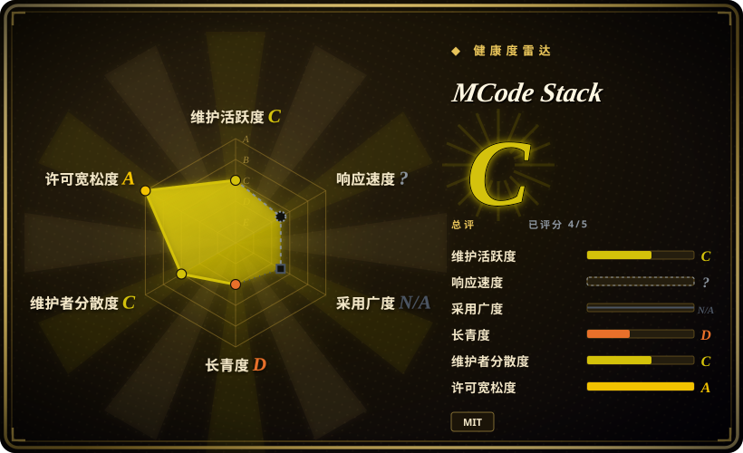
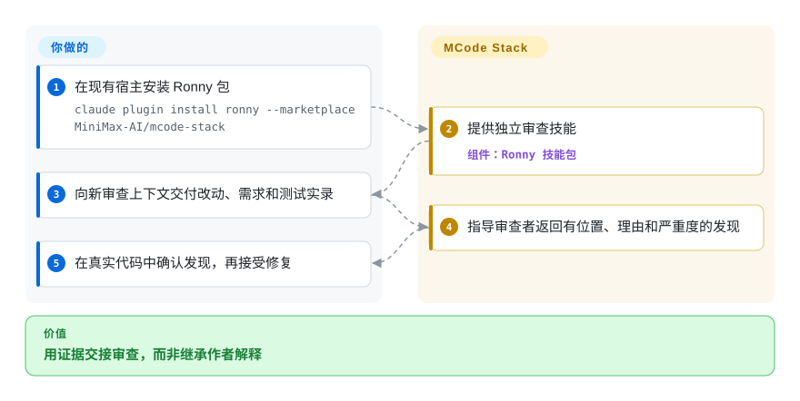
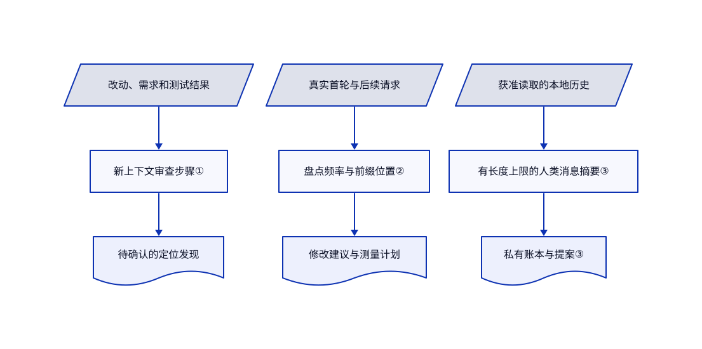

# MCode Stack

agent 带着写代码时的理由自审，时间戳和工具清单又让每轮请求变大。MCode Stack 提供独立审查和上下文审计步骤，不必替换整套开发流程。

**许可边界：** 根目录的 [MIT 许可](https://github.com/MiniMax-AI/mcode-stack/blob/49a3ff4dfd1aa159c8a84579f3ac0ce38e1aaa6d/LICENSE)不代表所有技能都只有 MIT。`engineering-*` 改编内容保留 **CC-BY 3.0**；复用时须保留署名、修改说明及 [NOTICE.md](https://github.com/MiniMax-AI/mcode-stack/blob/49a3ff4dfd1aa159c8a84579f3ac0ce38e1aaa6d/stacks/ronny/NOTICE.md) 中的 MIT 通知。本页是项目介绍，不额外授予软件复用权利。

## 何时使用

你维护编码 agent 的工作环境。审查者继承作者对话后只说“看起来没问题”，或者请求日志显示，每次变化的当前时间排在大段相同指令之前。你需要一套步骤，要求审查读取真实改动、需求和测试输出，或先列清请求里哪些字段会变化。已有开发流程只缺这些局部审计时，选 Ronny，而不是再叠一套 Superpowers 式规划到测试先行的完整流程。

另一个 Jiachen 包处理不同问题：你总要催 agent 继续、跨会话搬上下文，或手动把笔记变成中文帖子和短视频。它增加私有人为干预账本及内容脚本。应主动选择这部分，不要把读历史和媒体功能当成 Ronny 审查技能的前置要求。

## 何时不用

- **你要 MiniMax Code 应用或模型服务器。** 本仓库只有工作流和技能，不含应用源码或模型权重。要应用请看独立 MiniMax Code 产品；要已有 agent 的工作流可选 [Superpowers](../../../agent-dev-methodology/coding-agent-harnesses/superpowers.zh.md)。Ronny 清单不要求指定模型或 MiniMax 推理端点。
- **你缺一套统一开发流程。** 选 [Superpowers](../../../agent-dev-methodology/coding-agent-harnesses/superpowers.zh.md) 来组织规划、测试先行和验证；MCode Stack 的局部技能不会编排整条流程，也不强制沙箱隔离。
- **你要前端、文档或 MiniMax 媒体生成配方。** 比较独立仓库 [MiniMax Skills](minimax-skills.zh.md)。本项目主打工程习惯；Jiachen 可选视频路径用 Edge 朗读或火山引擎，不是内置 MiniMax 生成服务。
- **本地聊天历史不能进入模型上下文。** 跳过 `lifting-loops`，改用只接收明确输入的 Ronny `independent-review`。批量复盘扫描本地 agent 会话及可选笔记、导出文件，再写忽略提交的私有摘要。“落在本地”不能阻止托管 agent 接收它读到的材料。
- **你要带 CI 模板的定时仓库任务。** 比较 [HumanLayer Skills](humanlayer-skills.zh.md)。本项目清单用于诊断流程，其调度说明不是现成的 CI 控制器。
- **你不能接受覆盖旧技能。** 优先独立管理插件，或只复制审查过的单项技能。不要盲跑通用安装器：找不到 Claude 和 Codex 时，它先删除 `~/.agents/skills/` 中的同名目录，再复制技能。保留已有可信流程，不要叠加冲突的审查指令。

## 横向对比

| 替代品 | 是否收录 | 我们的评价 | 取舍 |
|---|---|---|---|
| [Superpowers](../../../agent-dev-methodology/coding-agent-harnesses/superpowers.zh.md) | 已收录 | 缺统一规划、测试先行、验证流程时选 Superpowers；已有流程只缺独立审查和上下文审计时选 MCode Stack。 | 整体流程指导换局部可组合步骤；两者仍依赖 agent 遵守指令。 |
| [MiniMax Skills](minimax-skills.zh.md) | 已收录 | 要生成应用界面、文档或媒体时选 MiniMax Skills；要检查编码 agent 如何工作时选 MCode Stack。 | 领域创作广度换审查、上下文与实验纪律；它们不是同一包的新旧版本。 |
| [HumanLayer Skills](humanlayer-skills.zh.md) | 已收录 | 要建立定时、反馈驱动的仓库任务时选 HumanLayer；要先查人工干预和请求开销从哪来时选 MCode Stack。 | CI 循环模板换诊断清单与本地私有账本；运行自动化另增权限和运维责任。 |

## 快速上手

可用 README 的 Claude 命令 `claude plugin install ronny --marketplace MiniMax-AI/mcode-stack`，或把审查过的单项技能复制到宿主的技能目录。宿主 agent 提供模型、工具、文件权限及子任务能力；技能包不提供推理服务、API 额度或权限隔离。独立审查时，你提供改动、需求和真实测试输出，再启动全新上下文的审查者；它返回有位置的发现，主 agent 确认后才修改。README 也记录了 Codex 和 MiniMax Code 安装路径，但本次没有执行兼容性验证。手工纳入配置时应固定审查过的版本：本次查询没有 release 或 tag，清单里的 `0.2.5` 本身不是不可变制品。

<!-- flow-steps:begin (generated from flows/mcode-stack.json by tools/flow_card.py — do not edit) -->

流程文字版

1. **你**：在现有宿主安装 Ronny 包 — `claude plugin install ronny --marketplace MiniMax-AI/mcode-stack`
2. **MCode Stack**：提供独立审查技能 — 组件：`Ronny 技能包`
3. **你**：向新审查上下文交付改动、需求和测试实录
4. **MCode Stack**：指导审查者返回有位置、理由和严重度的发现
5. **你**：在真实代码中确认发现，再接受修复

**价值**：用证据交接审查，而非继承作者解释

<!-- flow-steps:end -->

Jiachen 是可选包。复盘脚本 `digest.py` 只依赖 Python 标准库，把账本、提案和游标写到技能目录的 `private/`；允许扫描前先核定数据源。视频还要 Python 包、Playwright Chromium、`ffmpeg`／`ffprobe` 和中文字体。`tts.py` 默认通过联网的 `edge-tts` 使用 `zh-CN-YunxiNeural`；可选火山引擎调用 `https://openspeech.bytedance.com/api/v3/tts/unidirectional`，需要 `VOLC_TTS_API_KEY` 和训练后的音色编号。脚本选择 `seed-icl-2.0`，注释称按字符计费，使用四个工作线程且最多尝试三次，没有费用上限。你须另查当前价格并确认声音使用许可；本页不确认具体单价或免费服务保障。参考文档建议在聊天里交付密钥，不应照做，应使用已批准的秘密传递方式。

内容生产并非完全自包含。[改写指令](https://github.com/MiniMax-AI/mcode-stack/blob/49a3ff4dfd1aa159c8a84579f3ac0ce38e1aaa6d/stacks/jiachen/skills/making-content/SKILL.md#L28-L38)要求另装中文风格技能，英文另用 humanizer；安装须获同意，缺失时可退回本技能规则。[素材抓取](https://github.com/MiniMax-AI/mcode-stack/blob/49a3ff4dfd1aa159c8a84579f3ac0ce38e1aaa6d/stacks/jiachen/skills/making-content/scripts/fetch_assets.py#L19-L61)会访问 Google Fonts、GitHub 头像或传入网址，以及 Incompetech 音乐；截图按项目来源表在新 Playwright 浏览器打开网址。这些路径须获网络许可，素材许可另查。下载报错建议换处下载，不构成绕过环境拒绝的授权。

停用时，在宿主禁用或卸载所选插件；手工安装则先保留本地修改，只移除对应技能目录。替换或卸载前备份 Jiachen 的 `private/` 和 `test-cases/`。另行移除自己建立的定时任务、吊销专用火山引擎密钥并停止厂商资源；删除技能不会撤销已做的改动、生成文件、API 费用或记忆修改。其他工具仍使用的 Chromium、字体和 `ffmpeg` 不要一并删除。

## 技术要点

<!-- mechanism:begin (generated from mechanisms/mcode-stack.json by tools/mechanism_card.py; do not edit) -->

机制文字版

- 改动、需求和测试结果
- 新上下文审查步骤①
- 待确认的定位发现
- 真实首轮与后续请求
- 盘点频率与前缀位置②
- 修改建议与测量计划
- 获准读取的本地历史
- 有长度上限的人类消息摘要③
- 私有账本与提案③

- 改动、需求和测试结果 → 新上下文审查步骤①
- 新上下文审查步骤① → 待确认的定位发现
- 真实首轮与后续请求 → 盘点频率与前缀位置②
- 盘点频率与前缀位置② → 修改建议与测量计划
- 获准读取的本地历史 → 有长度上限的人类消息摘要③
- 有长度上限的人类消息摘要③ → 私有账本与提案③

<!-- mechanism:end -->

### 1. 把审查证据与作者推理分开

- **解决：** 审查者继承作者解释后，容易复述同样未经检查的假设。
- **做法：** `independent-review` 把初始交接限定为改动、需求和真实测试结果。它要求新上下文，并按问题、位置、理由和严重度返回发现；主循环先打开对应代码再接受修复。
- **边界：** 这是提示词步骤，不是隔离运行时。宿主必须提供新上下文和证据；审查没有发现问题，也不能证明测试覆盖需求。
- **源码：** [审查输入与确认协议](https://github.com/MiniMax-AI/mcode-stack/blob/49a3ff4dfd1aa159c8a84579f3ac0ce38e1aaa6d/stacks/ronny/skills/independent-review/SKILL.md#L15-L74)。

### 2. 审计请求位置，不只数 token

- **解决：** 少删几个 token，不能解释几乎相同的请求为何仍丢失可复用前缀。
- **做法：** `context-tax-audit` 对照真实首轮和后续请求，记录变化频率、分词计数，再检查必要性、位置、精度和历史重写。它建议把易变时间移到稳定指令后，并同时测缓存命中、费用和任务质量。
- **边界：** 技能不会修改厂商请求拼装代码，也不实现缓存。实际缓存规则和 token 计费仍要测量；仓库里的前缀解释不是通用价格合同。
- **源码：** [字段盘点、位置与测量清单](https://github.com/MiniMax-AI/mcode-stack/blob/49a3ff4dfd1aa159c8a84579f3ac0ce38e1aaa6d/stacks/ronny/skills/context-tax-audit/SKILL.md#L18-L74)。

### 3. 把重复干预落到私有提案账本

- **解决：** 反复催继续、纠正输出和搬上下文，散落在会话里，不能形成具体流程修改。
- **做法：** `lifting-loops` 按六类干预归组，把证据和提案写入 `private/`，并用结果指标配对干预次数。批量扫描先生成有长度上限的人类消息摘要；提案优先删旧规则、改已有资产，最后才新增全局规则。
- **边界：** 摘要把首条提示限制为 400 字符、后续为 240 字符，最多展示 20 条后续消息，是有损线索，不是完整审计。技能文字要求接受提案后才改跟踪文件或删除记忆；脚本不是访问控制边界，宿主仍须保护私有证据。
- **源码：** [账本、模式与采纳边界](https://github.com/MiniMax-AI/mcode-stack/blob/49a3ff4dfd1aa159c8a84579f3ac0ce38e1aaa6d/stacks/jiachen/skills/lifting-loops/SKILL.md#L8-L135)、[摘要源与长度限制](https://github.com/MiniMax-AI/mcode-stack/blob/49a3ff4dfd1aa159c8a84579f3ac0ce38e1aaa6d/stacks/jiachen/skills/lifting-loops/scripts/digest.py#L29-L45)。

## 健康度与可持续性

- **2026-10-30 维护情况：** 仓库创建于 2026-10-28，最后推送于 2026-10-29；没有 GitHub release 或 tag。Ronny 清单版本为 `0.2.5`。这只证明上线初期活跃，不证明稳定发布节奏。
- **治理：** MiniMax 组织所有权和两名可见贡献者提供了可追溯来源，不是中立治理。[贡献约定](https://github.com/MiniMax-AI/mcode-stack/blob/49a3ff4dfd1aa159c8a84579f3ac0ce38e1aaa6d/CONTRIBUTING.md#L5-L8)仅接受协作者 PR，其他读者须先开 issue。
- **年龄与采用：** 约两天历史，元数据查询时为 444 星、32 fork。[推断：依据创建日期和短暂公开历史] 还没有可用的 Lindy 长期信号；应固定可检查的技能获取当前价值，不把星数当效果测量或长期维护承诺。
- **来源与风险：** 工程技能明确署名 Google 和 agentara；Jiachen 明确以作者 dotfiles 为先更新源。这是作者实践的厂商分发入口，不宣称内容都在此原创。混合许可、私有历史处理和安装覆盖，比整体 MIT 徽章更影响选型。
- **雷达范围：** 自动评分为 C，五个适用轴中四个有分数；响应未知，采用轴不适用。许可轴读取 GitHub 的 MIT 元数据，不读各技能的 CC-BY 通知，A 分不是法律放行。贡献统计计为三个活跃账号，独立查询的贡献者列表则返回两人。

## 存疑（未验证）

- [未验证：本次明确不执行上游、不安装依赖、不调用模型] 没有复现宿主激活、独立审查效果、团队日常使用声明及内容渲染质量。源码固定在 `49a3ff4dfd1aa159c8a84579f3ac0ce38e1aaa6d`。
- [未验证：未使用厂商账号或真实服务请求] Edge 当前条款和可用性、火山引擎价格、配额及权限开通，不能由 `tts.py` 注释证明。可选配音会把旁白交给对应服务；宿主推理费用另算。
- [推断：仓库只有约两天公开历史] 当前活跃和厂商作者身份，不足以证明长期支持、真实采用效果或维护者抗流失能力。
