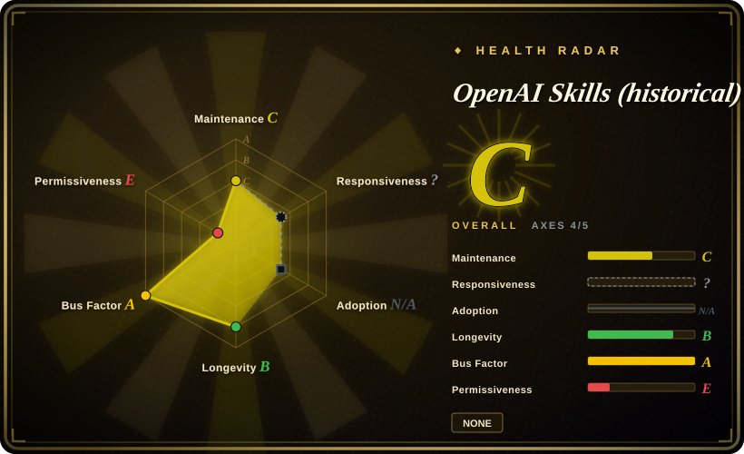
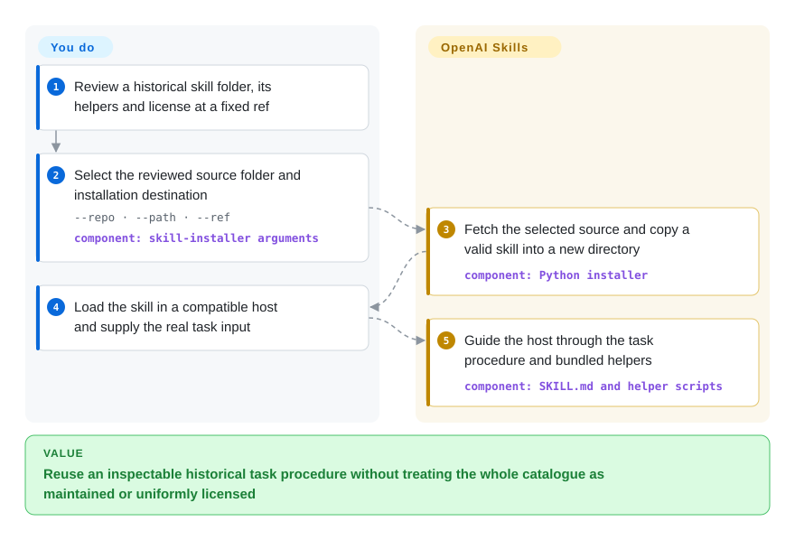
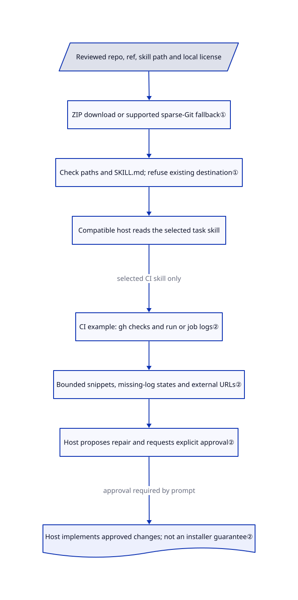

# OpenAI Skills (historical)

You need to recover or audit an older Codex task skill, not adopt a moving plugin catalogue. This deprecated collection preserves task instructions and runnable helpers, including a pinned-ref installer and GitHub Actions triage.

> **Deprecated upstream.** The README directs new Codex skill/plugin users to [openai/plugins](https://github.com/openai/plugins). Keep this page for deliberate historical reuse; that redirect does not establish that every old skill or helper was migrated unchanged.

## When to use

You maintain an existing Codex setup and need to inspect exactly how an installed skill downloads a folder, collects failed CI logs or reviews a PDF. Choose a pinned folder from this repository when its actual prompt, script and license are the object of reuse. On the reviewed commit there are 44 skill entry points under `.curated` and `.system`; it remains substantive reference material despite upstream deprecation. For a new installation, start with the current successor rather than assuming this is the maintained catalogue.

## When NOT to use

- For current first-party Codex plugin examples, use [openai/plugins](https://github.com/openai/plugins); this repository explicitly deprecates itself and its default branch last changed in June 2026.
- For Claude-oriented task references, inspect [Anthropic Skills](anthropic-skills.md). Similar folder names do not imply identical instructions or licenses; this repository's inspected PDF skill is Apache-2.0, not a claim about Anthropic's PDF license.
- For Cursor-native rules, hooks and connector manifests, use [Cursor Plugins](cursor-plugins.md); copying a Codex skill folder does not recreate that loader surface.
- If redistribution requires one uniform permissive license, select individually verified Apache-2.0 folders or another audited pack. This collection has no repo-wide license grant: the inspected Figma Code Connect skill uses Figma Developer Terms and is marked Beta.
- If your existing host already supplies system skills, use that host's maintained copy instead of overwriting it with this snapshot. The legacy installer checks folder shape and paths, not prompt safety, authorship or current host compatibility.

## Comparison

| Alternative | In index | Our verdict | Tradeoff |
|---|---|---|---|
| [OpenAI Plugins](https://github.com/openai/plugins) | not indexed | Choose the successor for new Codex plugin examples; choose this historical collection only when an exact older skill or helper is required. | Current manifests and companion plugin surfaces versus preserved legacy procedures; the successor is not added in this tab batch, and complete content migration is not established. |
| [Anthropic Skills](anthropic-skills.md) | ✅ | Choose Anthropic's collection for its Claude-oriented task examples; choose this one to inspect Codex-specific installation and historical task helpers. | Different host assumptions and per-area licenses; neither collection's license can be inferred from the other's. |
| [Cursor Plugins](cursor-plugins.md) | ✅ | Choose Cursor Plugins for native Cursor rules, hooks and connectors; choose a vetted folder here for a narrow legacy Codex task. | Full plugin integration versus a skill folder and its scripts, with deprecation risk on this side. |

## Quick start

First review the chosen folder's `SKILL.md`, helper code and local license at a fixed commit; do not install the whole tree as uniformly licensed content. The legacy README offers `$skill-installer gh-address-comments`; the installer also accepts `--repo`, `--path`, `--ref` and `--dest` to select an exact source and destination. After the selected folder is copied, follow your host's skill-discovery rules; the historical README asks for a Codex restart. Ask for the task with its real input, such as a PR number for `gh-fix-ci`, and provide that skill's prerequisites, including Python and authorized `gh` access for CI inspection. The agent follows the procedure and uses the supplied helper; you retain approval over repairs, network access and changes to your project. Downloading a folder neither installs all its runtime dependencies nor proves that the current host can load it.

<!-- flow-steps:begin (generated from flows/openai-skills.json by tools/flow_card.py — do not edit) -->

Text version of the flow

1. **You**: Review a historical skill folder, its helpers and license at a fixed ref
2. **You**: Select the reviewed source folder and installation destination — `--repo · --path · --ref` — component: `skill-installer arguments`
3. **OpenAI Skills (historical)**: Fetch the selected source and copy a valid skill into a new directory — component: `Python installer`
4. **You**: Load the skill in a compatible host and supply the real task input
5. **OpenAI Skills (historical)**: Guide the host through the task procedure and bundled helpers — component: `SKILL.md and helper scripts`

**Value**: Reuse an inspectable historical task procedure without treating the whole catalogue as maintained or uniformly licensed

<!-- flow-steps:end -->

## Key techniques

<!-- mechanism:begin (generated from mechanisms/openai-skills.json by tools/mechanism_card.py; do not edit) -->

Text version of the mechanism

- Reviewed repo, ref, skill path and local license
- ZIP download or supported sparse-Git fallback①
- Check paths and SKILL.md; refuse existing destination①
- Compatible host reads the selected task skill
- CI example: gh checks and run or job logs②
- Bounded snippets, missing-log states and external URLs②
- Host proposes repair and requests explicit approval②
- Host implements approved changes; not an installer guarantee②

- Reviewed repo, ref, skill path and local license → ZIP download or supported sparse-Git fallback①
- ZIP download or supported sparse-Git fallback① → Check paths and SKILL.md; refuse existing destination①
- Check paths and SKILL.md; refuse existing destination① → Compatible host reads the selected task skill
- Compatible host reads the selected task skill → CI example: gh checks and run or job logs② (selected CI skill only)
- CI example: gh checks and run or job logs② → Bounded snippets, missing-log states and external URLs②
- Bounded snippets, missing-log states and external URLs② → Host proposes repair and requests explicit approval②
- Host proposes repair and requests explicit approval② → Host implements approved changes; not an installer guarantee② (approval required by prompt)

<!-- mechanism:end -->

### 1. Install one reviewed folder from a selected revision

- **Problem:** A useful skill is buried in a large historical catalogue, and an uncontrolled copy can overwrite an existing setup.
- **How:** The Python installer resolves a GitHub repo, relative skill paths and a ref. It downloads a ZIP, checks extraction destinations, or falls back to sparse Git retrieval for supported download errors; it requires `SKILL.md` and refuses an existing destination before copying the folder.
- **Limits:** These are path/layout checks, not a security audit or publisher-signature verification. `main` is the default unless a ref is supplied; installed scripts and prompts still require review and compatible host behavior.
- **Source:** [Download, path checks and copy](https://github.com/openai/skills/blob/49f948faa9258a0c61caceaf225e179651397431/skills/.system/skill-installer/scripts/install-skill-from-github.py#L59-L176), [source resolution and installation](https://github.com/openai/skills/blob/49f948faa9258a0c61caceaf225e179651397431/skills/.system/skill-installer/scripts/install-skill-from-github.py#L187-L295).

### 2. Gather CI evidence before asking for a repair decision

- **Problem:** A failed PR check points to a log page, not a reproducible diagnosis or an approved code change.
- **How:** The CI helper uses `gh` to inspect failing checks, adapts to available JSON fields and tries run/job logs. It reports failure snippets, pending or unavailable logs, and external check URLs. The skill instructs the host agent to summarize evidence and obtain explicit plan approval before implementing a fix.
- **Limits:** Log snippets are bounded and failure markers are heuristic, not complete root-cause analysis. External CI providers are out of scope; approval is a prompt-level workflow rule, not a machine-enforced authorization gate.
- **Source:** [Check/log inspection](https://github.com/openai/skills/blob/49f948faa9258a0c61caceaf225e179651397431/skills/.curated/gh-fix-ci/scripts/inspect_pr_checks.py#L182-L377), [approval and external-provider boundary](https://github.com/openai/skills/blob/49f948faa9258a0c61caceaf225e179651397431/skills/.curated/gh-fix-ci/SKILL.md#L27-L58).

## Health & viability

- On 2026-10-18, GitHub reported the repository as not archived, but its README explicitly deprecated it; the latest default-branch commit was 2026-06-24. No GitHub releases were listed. Not archived does not mean currently recommended.
- Created 2025-11-25 and owned by OpenAI, with multiple contributors: official provenance and nearly eleven months of history do not offset the vendor's explicit change of distribution direction. The 28,135 stars are visibility, not support or host-compatibility evidence.
- There is no repo-wide LICENSE. The inspected installer, PDF and CI-repair folders carry Apache-2.0; Figma Code Connect carries Figma Developer Terms and a Beta change/discontinuation notice. Read every selected folder's own terms.
- [推断：依据是官方弃用、主干停更及逐技能授权] Prefer fixed historical reuse over taking this collection as a maintained default. The observed installer remains reusable code; a successor link alone does not prove its complete replacement.

## Caveats (unverified)

- [未验证：本任务禁止安装或执行上游] Installation, present-day Codex discovery and CI/PDF workflows were source-inspected, not run.
- [未验证：未逐文件审计全部 44 个技能] The examples above do not certify every folder's security, dependency compatibility or license; the frontmatter deliberately does not claim repo-wide Apache-2.0.
- [未验证：后继声明未提供完整迁移清单] Complete semantic migration to openai/plugins is not established; different file blobs would not by themselves prove that no equivalent exists.
- [推断：依据是官方弃用、主干停更及逐技能授权] A frozen, selected skill can remain useful while new-host integration and future fixes become the adopter's responsibility.
