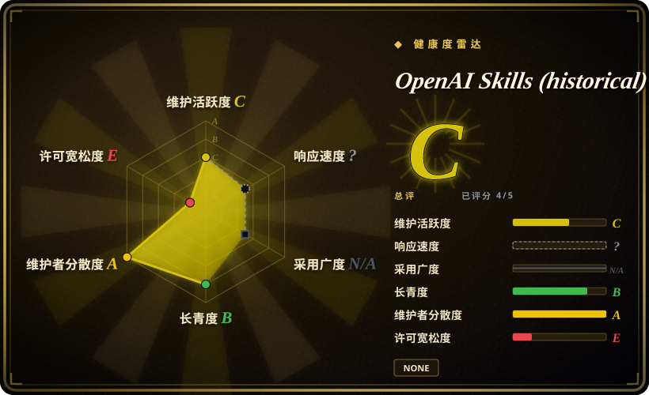
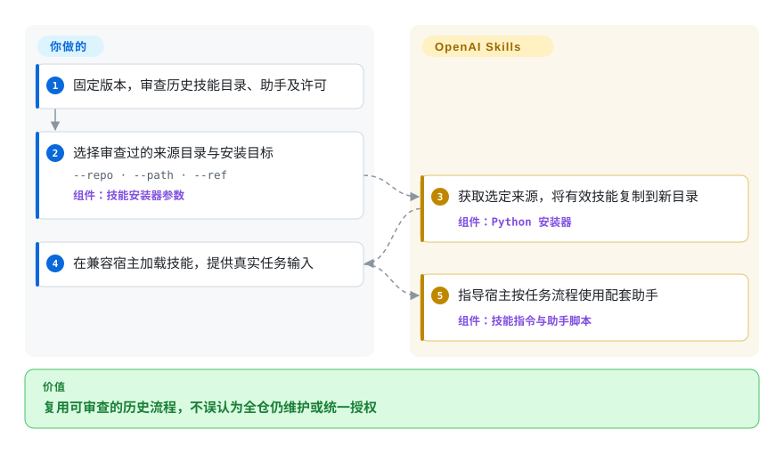
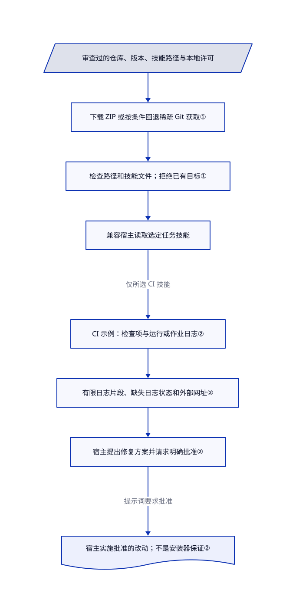

# OpenAI Skills（历史集合）

你要恢复或审计旧版 Codex 技能，而非跟随不断变化的插件目录。这个已弃用集合保留了任务指令与可运行助手，包括固定版本安装器和 GitHub Actions 排障脚本。

> **上游已弃用。** README 引导新用户改看 [openai/plugins](https://github.com/openai/plugins)。本页服务于明确选择的历史复用；跳转声明不能证明所有旧技能或助手都已原样迁移。

## 何时使用

你维护现有 Codex 配置，想准确核查已安装技能如何下载目录、收集 CI 失败日志，或检查 PDF。若要复用的对象正是这份提示词、脚本和许可，选仓库中固定提交的具体目录。已核查提交在 `.curated` 与 `.system` 下共有 44 个技能入口；官方弃用不等于它只剩跳转空壳。全新安装应先看当前后继，不要把这里当成仍维护的默认目录。

## 何时不用

- 要当前官方 Codex 插件示例，选 [openai/plugins](https://github.com/openai/plugins)。旧库已明确弃用，默认分支最近提交停在 2026 年 6 月。
- 要 Claude 取向的任务参考，先看 [Anthropic Skills](anthropic-skills.zh.md)。目录同名不代表指令和许可相同；本库实读 PDF 技能为 Apache-2.0，不能据此判断 Anthropic 的 PDF 许可。
- 要 Cursor 原生规则、hook 和连接器清单，选 [Cursor Plugins](cursor-plugins.zh.md)。复制 Codex 技能目录不会补齐那套加载表面。
- 分发要求统一宽松许可时，只选逐一确认的 Apache-2.0 目录，或改选其他审查过的包。这里没有全仓许可授权；实读 Figma Code Connect 技能受 Figma Developer Terms 约束，并标为 Beta。
- 现有宿主已内置系统技能时，优先用宿主维护的版本，不要拿历史快照覆盖。旧安装器只查目录和路径，不检查提示词安全、作者身份或当前宿主兼容性。

## 横向对比

| 替代品 | 是否收录 | 我们的评价 | 取舍 |
|---|---|---|---|
| [OpenAI Plugins](https://github.com/openai/plugins) | 未收录 | 新建 Codex 插件选后继；只有明确需要旧版技能或助手时才选本历史集合。 | 当前清单和插件配套表面，与保留的旧流程之间取舍；后继本批未收录，未证明完整内容迁移。 |
| [Anthropic Skills](anthropic-skills.zh.md) | ✅ | Claude 取向的任务示例选 Anthropic 集合；核查 Codex 安装和历史任务助手选本库。 | 宿主假设与分区许可不同，不能用一家的许可推断另一家。 |
| [Cursor Plugins](cursor-plugins.zh.md) | ✅ | Cursor 原生规则、hook 和连接器选 Cursor Plugins；窄范围旧 Codex 任务可选这里审过的目录。 | 完整插件集成，与技能目录及脚本之间取舍；本库另有弃用风险。 |

## 快速上手

先在固定提交逐一审查所选目录的 `SKILL.md`、脚本和许可，不要把全仓当成统一授权内容安装。旧 README 提供 `$skill-installer gh-address-comments`，安装器还接受 `--repo`、`--path`、`--ref` 和 `--dest` 来指定准确来源与目标。复制目录后按宿主的技能发现规则加载；历史 README 要求重启 Codex。然后提供真实任务输入，例如给 `gh-fix-ci` 一个 PR 编号，并准备该技能所需的 Python 与已授权 `gh` 访问。代理按指令使用助手，你仍掌握修复、联网和项目改动的批准权。下载目录不等于装齐运行依赖，也不证明当前宿主能加载它。

<!-- flow-steps:begin (generated from flows/openai-skills.json by tools/flow_card.py — do not edit) -->

流程文字版

1. **你**：固定版本，审查历史技能目录、助手及许可
2. **你**：选择审查过的来源目录与安装目标 — `--repo · --path · --ref` — 组件：`技能安装器参数`
3. **OpenAI Skills (historical)**：获取选定来源，将有效技能复制到新目录 — 组件：`Python 安装器`
4. **你**：在兼容宿主加载技能，提供真实任务输入
5. **OpenAI Skills (historical)**：指导宿主按任务流程使用配套助手 — 组件：`技能指令与助手脚本`

**价值**：复用可审查的历史流程，不误认为全仓仍维护或统一授权

<!-- flow-steps:end -->

## 技术要点

<!-- mechanism:begin (generated from mechanisms/openai-skills.json by tools/mechanism_card.py; do not edit) -->

机制文字版

- 审查过的仓库、版本、技能路径与本地许可
- 下载 ZIP 或按条件回退稀疏 Git 获取①
- 检查路径和技能文件；拒绝已有目标①
- 兼容宿主读取选定任务技能
- CI 示例：检查项与运行或作业日志②
- 有限日志片段、缺失日志状态和外部网址②
- 宿主提出修复方案并请求明确批准②
- 宿主实施批准的改动；不是安装器保证②

- 审查过的仓库、版本、技能路径与本地许可 → 下载 ZIP 或按条件回退稀疏 Git 获取①
- 下载 ZIP 或按条件回退稀疏 Git 获取① → 检查路径和技能文件；拒绝已有目标①
- 检查路径和技能文件；拒绝已有目标① → 兼容宿主读取选定任务技能
- 兼容宿主读取选定任务技能 → CI 示例：检查项与运行或作业日志②（仅所选 CI 技能）
- CI 示例：检查项与运行或作业日志② → 有限日志片段、缺失日志状态和外部网址②
- 有限日志片段、缺失日志状态和外部网址② → 宿主提出修复方案并请求明确批准②
- 宿主提出修复方案并请求明确批准② → 宿主实施批准的改动；不是安装器保证②（提示词要求批准）

<!-- mechanism:end -->

### 1. 从选定版本安装一个审查过的目录

- **解决：** 有用技能藏在大历史目录里，无控制的复制还可能覆盖现有配置。
- **做法：** Python 安装器解析 GitHub 仓库、相对技能路径和版本。下载 ZIP 后检查解压目标，遇到指定下载错误可回退为稀疏 Git 获取；复制前要求存在 `SKILL.md`，并拒绝已存在目标。
- **边界：** 这些是路径与目录检查，不是安全审计或发布者签名校验。不提供版本时默认 `main`；安装的脚本和提示词仍需审查，并依赖宿主兼容。
- **源码：** [下载、路径检查与复制](https://github.com/openai/skills/blob/49f948faa9258a0c61caceaf225e179651397431/skills/.system/skill-installer/scripts/install-skill-from-github.py#L59-L176)、[来源解析与安装](https://github.com/openai/skills/blob/49f948faa9258a0c61caceaf225e179651397431/skills/.system/skill-installer/scripts/install-skill-from-github.py#L187-L295)。

### 2. 先收集 CI 证据，再请求修复裁决

- **解决：** PR 红灯只给出日志链接，不等于可复查的归因或已批准的代码改动。
- **做法：** CI 助手用 `gh` 检查失败项，适配可用 JSON 字段，并尝试运行或作业日志。它报告失败片段、待就绪或不可用日志，以及外部检查网址；技能要求宿主先汇总证据、取得明确方案批准，再实施修复。
- **边界：** 日志片段有上限，失败关键词是启发式，不保证找到完整根因。外部 CI 提供商不在范围内；批准是提示词流程，不是机器强制授权门。
- **源码：** [检查与日志收集](https://github.com/openai/skills/blob/49f948faa9258a0c61caceaf225e179651397431/skills/.curated/gh-fix-ci/scripts/inspect_pr_checks.py#L182-L377)、[批准和外部提供商边界](https://github.com/openai/skills/blob/49f948faa9258a0c61caceaf225e179651397431/skills/.curated/gh-fix-ci/SKILL.md#L27-L58)。

## 健康度与可持续性

- 截至 2026-10-18，GitHub 显示未归档，但 README 已明确弃用；默认分支最近提交为 2026-06-24，未列 GitHub 发布。未归档不代表当前推荐。
- 创建于 2025-11-25，由 OpenAI 持有并有多名贡献者。官方来源与近十一个月历史，不能抵消厂商已改变分发方向的事实。28,135 颗星是关注度，不是支持或兼容证据。
- 没有全仓 LICENSE。实读安装器、PDF 和 CI 修复目录采用 Apache-2.0；Figma Code Connect 使用 Figma Developer Terms，并声明 Beta 可变化或终止。应逐目录核查。
- [推断：依据是官方弃用、主干停更及逐技能授权] 适合固定历史复用，不适合作为持续维护的默认技能集。安装器仍是实际可复用代码，后继链接本身不证明完整替代。

## 存疑（未验证）

- [未验证：本任务禁止安装或执行上游] 仅从源码核查安装、当前 Codex 发现及 CI／PDF 流程，未运行。
- [未验证：未逐文件审计全部 44 个技能] 上述样例不认证全部目录的安全、依赖兼容或许可；前置信息刻意不宣称全仓 Apache-2.0。
- [未验证：后继声明未提供完整迁移清单] 未确立向 openai/plugins 的完整语义迁移；文件内容不同也不能单独证明没有等价实现。
- [推断：依据是官方弃用、主干停更及逐技能授权] 固定且选定的技能仍可能有用，但新宿主适配与后续修复需采用者承担。
