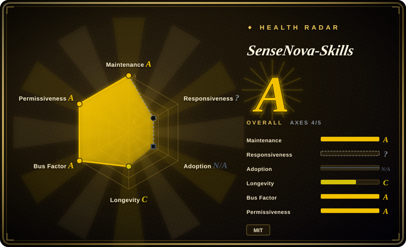
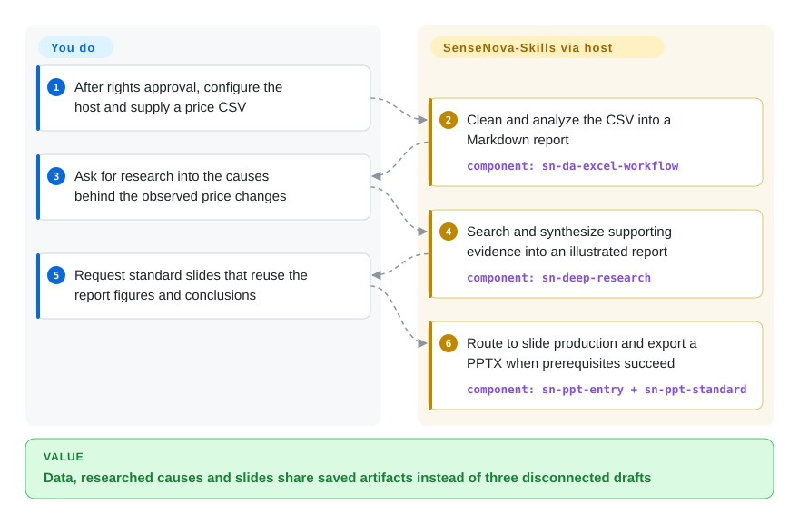
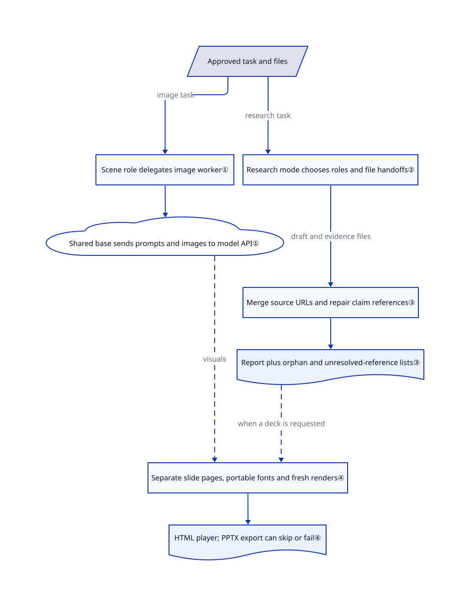

# SenseNova-Skills

Your price spreadsheet, market research and presentation keep losing each other's figures. SenseNova-Skills connects those jobs through named skills and saved files, with SenseNova-oriented image and slide helpers.

> [!WARNING]
> Information listing only; third-party provenance and authorization remain unresolved. The [root MIT](https://github.com/OpenSenseNova/SenseNova-Skills/blob/7838651111ef2dc3ac0293f08008730f1a022694/LICENSE) names SenseNova, but does not establish rights to every bundled file. Twelve nonempty infographic style files match an earlier Baoyu tree byte-for-byte; the reviewed target texts contain no Jim Liu/Baoyu attribution or corresponding third-party license notice. `license: NOASSERTION` avoids treating the whole bundle as cleared MIT. Listing is not permission to install, copy or redistribute, and does not mean the gap is fixed. This is not an infringement finding.

## When to use

You support a business analyst who has a CSV of component prices and needs to explain the rise in a board presentation. The chart in the spreadsheet says one thing, the research draft quotes another date, and the slides silently redraw both. You want to inspect a concrete data-analysis → research → presentation workflow, rather than assemble unrelated writing and image prompts. The repository's memory-price example documents exactly that handoff, including reuse of report figures and a slide-count constraint.

Use this as a source for evaluating an OpenClaw/Hermes office workflow, especially if SenseNova model integration matters. Its distinguishing surface is 36 skill directories plus Python/Node helpers, not a standalone office application. Actual adoption must wait for per-file rights review, host compatibility checks and explicit approval of data egress; this page records the workflow without granting those approvals.

## When NOT to use

- **You need a bundle whose redistribution rights are already settled.** Do not ship this tree on the strength of its root MIT. For Claude role workflows, evaluate [Knowledge Work Plugins](knowledge-work-plugins.md) under its own terms; for the matching visual material, review [Baoyu Skills](../../ai-writing/content-production/baoyu-skills.md) at its source and applicable version. Neither substitution retroactively clears SenseNova's copies; third-party attribution, applicable notices and the authorization chain still need checking.
- **Your job is Claude document editing, not a SenseNova-oriented office pipeline.** Prefer [Anthropic Skills](anthropic-skills.md) for its document procedures, subject to their separate source-available terms. SenseNova's documented setup targets OpenClaw/Hermes and requires its own model and script configuration; an open [compatibility report](https://github.com/OpenSenseNova/SenseNova-Skills/issues/180) is not a verified promise of direct portability.
- **You only need publishing illustrations or translated articles.** Evaluate [Baoyu Skills](../../ai-writing/content-production/baoyu-skills.md) for that publishing slice. SenseNova adds research orchestration, analysis and presentation machinery that a single illustration task does not need.
- **The environment forbids network uploads or runtime installs.** Keep the task in an approved local workflow instead of importing another skill bundle. Model adapters send prompts and images to configured endpoints; importing image configuration loads dotenv files, including host configuration, while PPT export can install npm packages and Chromium. See [configuration](https://github.com/OpenSenseNova/SenseNova-Skills/blob/7838651111ef2dc3ac0293f08008730f1a022694/skills/sn-image-base/scripts/sn_image_base/configs.py#L15-L41) and [export setup](https://github.com/OpenSenseNova/SenseNova-Skills/blob/7838651111ef2dc3ac0293f08008730f1a022694/skills/sn-ppt-standard/scripts/export_pptx/html_to_pptx.mjs#L18-L45).
- **You require a hard acceptance gate.** Keep your existing artifact verifier rather than substituting the skill's status labels: default one-round infographic generation records `PASS` without visual review, citation rendering can report success with orphans, and PPT export may return `skipped` without a PPTX. The mechanism section identifies each boundary; none is evidence of a completed deliverable by itself.

## Comparison

| Alternative | In index | Our verdict | Tradeoff |
|---|---|---|---|
| [Anthropic Skills](anthropic-skills.md) | ✅ | Choose Anthropic for Claude document manipulation; inspect SenseNova when the data → research → deck handoff and SenseNova model adapters are the deciding requirements. | Anthropic provides vendor document procedures with per-area license restrictions; SenseNova supplies a wider office chain but adds host setup, helper dependencies and the unresolved bundled-style authorization gap. |
| [Knowledge Work Plugins](knowledge-work-plugins.md) | ✅ | Choose the role plugins when a Cowork/Claude team needs sales, finance or research procedures connected to its business tools; inspect SenseNova for file-based analysis and presentation production. | Prewired role connectors reduce SaaS integration work; SenseNova's local artifacts offer a different handoff model, but you operate the Python/Node and model environment yourself. |
| [Baoyu Skills](../../ai-writing/content-production/baoyu-skills.md) | ✅ | Choose Baoyu for publishing, translation and illustration workflows; inspect SenseNova for a documented spreadsheet → research → presentation example rather than a publishing suite. | A narrower publishing focus avoids SenseNova's full office orchestration; reviewing the original style source helps establish provenance but does not prove authorization for the historical SenseNova copies. |

## Quick start

This is the documented route, not an instruction to install the unresolved bundle now. After rights and runtime approval, the [installation guide](https://github.com/OpenSenseNova/SenseNova-Skills/blob/7838651111ef2dc3ac0293f08008730f1a022694/INSTALL.md) says to copy selected skill directories into OpenClaw or Hermes, configure a region-matched model address, key and model name, install the selected skills' dependencies, then restart the host if needed. You supply approved files, search/model access and API budget; the host follows the skill instructions and runs their helpers. The [worked example](https://github.com/OpenSenseNova/SenseNova-Skills/blob/7838651111ef2dc3ac0293f08008730f1a022694/examples/memory-price-end2end-analysis/README.md) starts with a price CSV, asks for analysis, follows with causal research, and reuses the report's figures for a standard-mode deck. You still check facts, image text, export status and the actual PPTX; no upstream code or model call was executed for this listing.

<!-- flow-steps:begin (generated from flows/sensenova-skills.json by tools/flow_card.py — do not edit) -->

Text version of the flow

1. **You**: After rights approval, configure the host and supply a price CSV
2. **SenseNova-Skills**: Clean and analyze the CSV into a Markdown report — component: `sn-da-excel-workflow`
3. **You**: Ask for research into the causes behind the observed price changes
4. **SenseNova-Skills**: Search and synthesize supporting evidence into an illustrated report — component: `sn-deep-research`
5. **You**: Request standard slides that reuse the report figures and conclusions
6. **SenseNova-Skills**: Route to slide production and export a PPTX when prerequisites succeed — component: `sn-ppt-entry + sn-ppt-standard`

**Value**: Data, researched causes and slides share saved artifacts instead of three disconnected drafts

<!-- flow-steps:end -->

## Key techniques

<!-- mechanism:begin (generated from mechanisms/sensenova-skills.json by tools/mechanism_card.py; do not edit) -->

Text version of the mechanism

- Approved task and files
- Scene role delegates image worker①
- Shared base sends prompts and images to model API①
- Research mode chooses roles and file handoffs②
- Merge source URLs and repair claim references③
- Report plus orphan and unresolved-reference lists③
- Separate slide pages, portable fonts and fresh renders④
- HTML player; PPTX export can skip or fail④

- Approved task and files → Scene role delegates image worker① (image task)
- Scene role delegates image worker① → Shared base sends prompts and images to model API①
- Approved task and files → Research mode chooses roles and file handoffs② (research task)
- Research mode chooses roles and file handoffs② → Merge source URLs and repair claim references③ (draft and evidence files)
- Merge source URLs and repair claim references③ → Report plus orphan and unresolved-reference lists③
- Report plus orphan and unresolved-reference lists③ → Separate slide pages, portable fonts and fresh renders④ (when a deck is requested) [optional/fallback]
- Shared base sends prompts and images to model API① → Separate slide pages, portable fonts and fresh renders④ (visuals) [optional/fallback]
- Separate slide pages, portable fonts and fresh renders④ → HTML player; PPTX export can skip or fail④

<!-- mechanism:end -->

### 1. Separate scene instructions from model calls

- **Problem:** A single image request otherwise mixes user communication, prompt design and provider-specific HTTP calls.
- **How:** The infographic main role normalizes parameters and delegates one worker; the worker calls the shared image/text/vision base and returns structured JSON. Layout and style selection is weighted random sampling of names, followed by reading only the chosen files.
- **Limits:** This is a prompt-defined division, not a sandbox. Default `max_rounds=1` skips vision review and fills `result="PASS"`; multiple rounds use model judgments, not an independent quality score. The chat adapter sends prompt text and image data to its configured HTTP endpoint.
- **Source:** [Role boundaries and selection](https://github.com/OpenSenseNova/SenseNova-Skills/blob/7838651111ef2dc3ac0293f08008730f1a022694/skills/sn-infographic/SKILL.md#L72-L86), [random pick](https://github.com/OpenSenseNova/SenseNova-Skills/blob/7838651111ef2dc3ac0293f08008730f1a022694/skills/sn-infographic/SKILL.md#L239-L255), [review and PASS](https://github.com/OpenSenseNova/SenseNova-Skills/blob/7838651111ef2dc3ac0293f08008730f1a022694/skills/sn-infographic/SKILL.md#L336-L411), [HTTP payload](https://github.com/OpenSenseNova/SenseNova-Skills/blob/7838651111ef2dc3ac0293f08008730f1a022694/skills/sn-image-base/scripts/sn_image_base/llm/chat_completions_adapter.py#L74-L112).

### 2. Choose research depth before handing off files

- **Problem:** Giving every research request the full review pipeline increases cost and floods the coordinator's context.
- **How:** The research prompt defines quick as research plus writer, normal as plan plus parallel research plus one writer, and heavy as the expanded review/supplement path. Roles exchange absolute file paths; the coordinator reads scheduling fields rather than full evidence or chapters.
- **Limits:** The host must implement delegation and tool access; a prompt is not an enforced scheduler. The mandatory startup instructions reference `progress_event.py` and `launch_workbench.py`, neither present in the reviewed complete tree, so the documented WebUI startup is not self-contained.
- **Source:** [Role payload contract](https://github.com/OpenSenseNova/SenseNova-Skills/blob/7838651111ef2dc3ac0293f08008730f1a022694/skills/sn-deep-research/SKILL.md#L61-L70), [mode pipelines](https://github.com/OpenSenseNova/SenseNova-Skills/blob/7838651111ef2dc3ac0293f08008730f1a022694/skills/sn-deep-research/SKILL.md#L182-L242), [missing-helper references](https://github.com/OpenSenseNova/SenseNova-Skills/blob/7838651111ef2dc3ac0293f08008730f1a022694/skills/sn-deep-research/SKILL.md#L103-L138), [complete tree](https://github.com/OpenSenseNova/SenseNova-Skills/tree/7838651111ef2dc3ac0293f08008730f1a022694).

### 3. Keep claim identifiers separate from citation identifiers

- **Problem:** A writer can cite an internal claim number as if it were a public source, or duplicate one URL under several names.
- **How:** The citation helper merges normalized URLs, builds a claim-to-source map, repairs resolvable claim references, numbers citations and reports unresolved or orphan references. The research prompt says not to deliver when those lists remain nonempty.
- **Limits:** The helper can write the report and return `success: true` even with orphan citations. The host must inspect the JSON and block delivery; formatting and reference existence do not establish whether a source actually supports a claim.
- **Source:** [Source pool and claim map](https://github.com/OpenSenseNova/SenseNova-Skills/blob/7838651111ef2dc3ac0293f08008730f1a022694/skills/sn-prepare-citations/scripts/prepare_citations.py#L67-L131), [repair and numbering](https://github.com/OpenSenseNova/SenseNova-Skills/blob/7838651111ef2dc3ac0293f08008730f1a022694/skills/sn-prepare-citations/scripts/prepare_citations.py#L144-L230), [success with warnings](https://github.com/OpenSenseNova/SenseNova-Skills/blob/7838651111ef2dc3ac0293f08008730f1a022694/skills/sn-prepare-citations/scripts/prepare_citations.py#L484-L532), [delivery rule](https://github.com/OpenSenseNova/SenseNova-Skills/blob/7838651111ef2dc3ac0293f08008730f1a022694/skills/sn-deep-research/SKILL.md#L528-L533).

### 4. Isolate slide pages and verify export separately

- **Problem:** Combining independently styled slide HTML can cause CSS collisions, stale screenshots and missing fonts.
- **How:** The deck builder bundles fonts, checks render freshness and assembles a player that loads each slide in an iframe, a separate embedded page. A separate Node exporter extracts browser page structure and builds a PPTX.
- **Limits:** Building the HTML player is not PPTX acceptance. The exporter may install npm dependencies and Chromium, download remote images, or return `status: "skipped"` when its browser environment is unavailable. It reports page failures separately and can exit nonzero after printing a success-shaped result.
- **Source:** [Font and freshness checks](https://github.com/OpenSenseNova/SenseNova-Skills/blob/7838651111ef2dc3ac0293f08008730f1a022694/skills/sn-ppt-standard/scripts/deck.py#L78-L122), [iframe player](https://github.com/OpenSenseNova/SenseNova-Skills/blob/7838651111ef2dc3ac0293f08008730f1a022694/skills/sn-ppt-standard/scripts/deck.py#L1142-L1149), [export setup and skip](https://github.com/OpenSenseNova/SenseNova-Skills/blob/7838651111ef2dc3ac0293f08008730f1a022694/skills/sn-ppt-standard/scripts/export_pptx/html_to_pptx.mjs#L18-L99), [export results](https://github.com/OpenSenseNova/SenseNova-Skills/blob/7838651111ef2dc3ac0293f08008730f1a022694/skills/sn-ppt-standard/scripts/export_pptx/html_to_pptx.mjs#L101-L174).

## Health & viability

- **Maintenance, 2026-10-24 UTC:** created 2026-04-14, last default-branch commit 2026-10-09, not archived. GitHub shows no releases and two tags, `v2026.08` and `v2026.09`. Pin the reviewed SHA rather than infer stability from calendar tags; a six-month history is a weak longevity basis, not proof of abandonment or durability.
- **Governance and backing:** organization-owned under OpenSenseNova; the README identifies the SenseNova model family. The contributors API lists 21 contributors, but the complete tree has no dedicated GOVERNANCE, CODEOWNERS, SECURITY or CONTRIBUTING file. Contributor counts do not establish release authority or a service commitment.
- **Adoption and dependencies:** 5883 stars and 419 forks on the verification date are interest signals, not verified deployment counts. Raccoon's claimed user base is not this repository's install base. [Python requirements](https://github.com/OpenSenseNova/SenseNova-Skills/blob/7838651111ef2dc3ac0293f08008730f1a022694/skills/sn-image-base/requirements.txt) include httpx, Pillow and python-dotenv; the [export manifest](https://github.com/OpenSenseNova/SenseNova-Skills/blob/7838651111ef2dc3ac0293f08008730f1a022694/skills/sn-ppt-standard/scripts/export_pptx/package.json) adds PptxGenJS, Playwright and ECharts. Model/search charges and operating those runtimes remain the adopter's responsibility. The open [rate-limit report](https://github.com/OpenSenseNova/SenseNova-Skills/issues/184) illustrates an external service dependency, not an independently reproduced defect here.
- **License scope and chronology:** twelve style blobs match Baoyu, including [chalkboard in January](https://github.com/jimliu/baoyu-skills/blob/3ea311dfed207665f8bcd55f5e108a5c8573b7f8/skills/baoyu-infographic/references/styles/chalkboard.md), added to SenseNova on [April 18](https://github.com/OpenSenseNova/SenseNova-Skills/commit/b58551ea5b3b5637eb505c668c14b4be42389caa) and retained through its [rename](https://github.com/OpenSenseNova/SenseNova-Skills/commit/ccda30e4e88d5d3cd0256603403ff4a88b055262). Baoyu only added its root MIT on [June 20](https://github.com/jimliu/baoyu-skills/commit/348dc826123c306999b511d8c0417e4642ea82eb); do not apply that later declaration backward as proof of April authorization. No corresponding attribution or notice was found in 531 reviewed target texts. Twelve matches among 669 files do not support a claim that most of the bundle is copied. The automated `risk_license` axis uses root-license metadata and does not resolve this third-party rights gap; its grade is not legal clearance.
- **Selection judgment:** treat the pack as an inspectable workflow reference, not a preapproved production bundle. File contracts and helper logic are substantive; missing startup helpers, environment-loading side effects and status-label gaps mean a host needs its own acceptance checks. [推断：based on the pinned prompts and helper branches, without executing upstream] Public evidence cannot settle private authorization or future vendor support.

## Caveats (unverified)

- [未验证：no private authorization documents are public in the reviewed sources] The authorization chain for the twelve matching styles, third-party attribution and applicable notices remains unresolved. Root SenseNova MIT is a declaration for its rights, not proof of ownership of every component; no infringement or non-infringement conclusion is made.
- [未验证：upstream execution and model experiments were outside the approved scope] Host activation, CSV analysis correctness, image quality, live model/search compatibility and PPTX rendering were not reproduced. Some example archives and presentations are Git LFS pointers; their full artifacts were not downloaded.
- [推断：pinned source shows prompt-defined scheduling and success/skip branches] Production use requires independent artifact and reference checks. The exact cost and reliability depend on the chosen host, provider and input; no runtime or budget measurements were made.
- [未验证：no audited deployment figures or published governance commitment found] GitHub interest and the vendor's hosted-product claims do not establish pack adoption, long-term maintenance or support. Standalone TeamHarness, DeepResearch CLI and ProactiveAgent runtimes referenced by the documentation were not installed or audited; complete uninstall behavior is not established.
