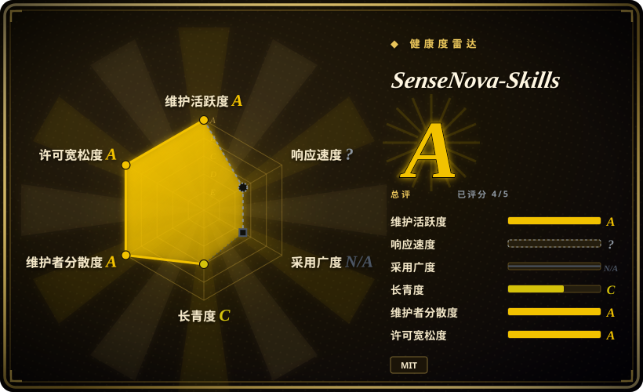
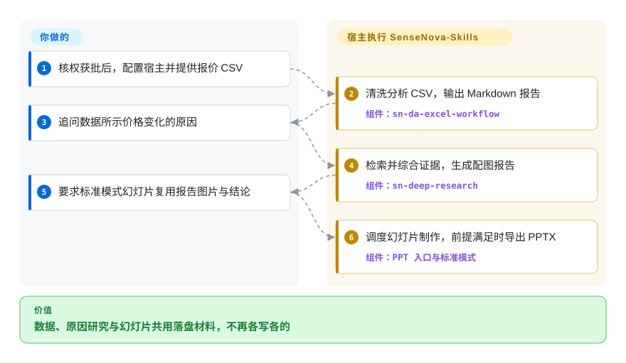
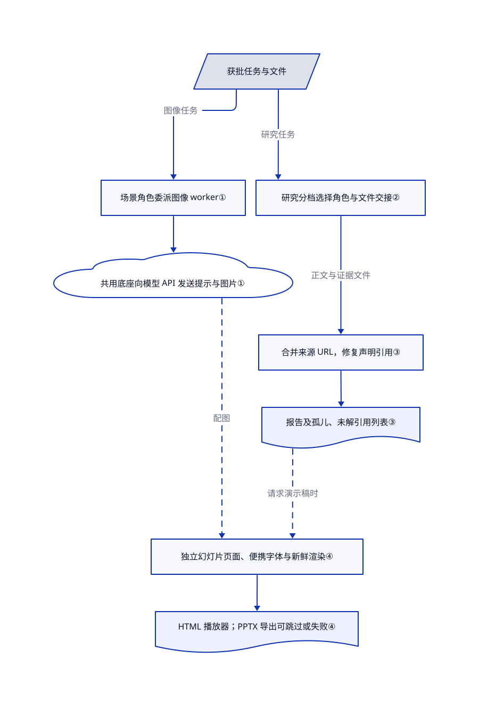

# SenseNova-Skills

报价表、行业调研和汇报幻灯片总对不上数。SenseNova-Skills 用具名技能和落盘文件串起三项工作，并提供偏向商汤模型的图像与幻灯片助手。

> [!WARNING]
> 仅作信息收录，第三方来源与授权链仍待核。[根 MIT](https://github.com/OpenSenseNova/SenseNova-Skills/blob/7838651111ef2dc3ac0293f08008730f1a022694/LICENSE)署名 SenseNova，但不能证明它拥有全部捆绑文件的权利。12 个非空信息图风格文件与宝玉更早的树逐字节相同；已读目标文本未见 Jim Liu／宝玉署名及对应第三方许可通知。`license: NOASSERTION` 避免把整包背书为权利已核清的 MIT。本页不授权安装、复制或再分发，也不表示缺口已补齐；不作侵权法律判断。

## 何时使用

你要帮业务分析师把元器件报价 CSV 做成董事会汇报。表格图表用一个日期，调研稿引用另一个日期，幻灯片又重画了一次。你想先看一条有实例的“数据分析 → 调研 → 演示稿”交接路线，而不是拼接互不相干的写作与生图提示。仓库的内存价格样例正好记录了这条链，还要求复用报告图片并限制页数。

当你评估 OpenClaw／Hermes 办公流程，尤其看重商汤模型适配时，可把它当作研究来源。它的实质是 36 个技能目录及 Python／Node 助手，不是独立办公软件。真正接入前，仍需逐文件核权、验证宿主兼容性，并明确批准数据外发；本页只记录流程，不替你批准这些动作。

## 何时不用

- **你需要再分发权已核清的整包。** 不要凭根 MIT 打包发布。Claude 岗位流程可按其自身条款评估 [Knowledge Work Plugins](knowledge-work-plugins.zh.md)；同源视觉材料应回 [Baoyu Skills](../../ai-writing/content-production/baoyu-skills.zh.md) 核对适用版本。替换来源不等于替 SenseNova 的历史副本补权，第三方署名、适用通知与授权链仍待核。
- **你只要 Claude 文档编辑，不要商汤办公链。** 优先看 [Anthropic Skills](anthropic-skills.zh.md) 的文档流程，并遵守其单独的源码可见条款。SenseNova 文档面向 OpenClaw／Hermes，还需独立模型与脚本配置；公开的[兼容性报告](https://github.com/OpenSenseNova/SenseNova-Skills/issues/180)不是已经验证的跨宿主承诺。
- **你只做发布插图或文章翻译。** 可评估 [Baoyu Skills](../../ai-writing/content-production/baoyu-skills.zh.md) 的内容发布路线。SenseNova 额外引入研究调度、分析和演示稿机制，单张插图不需要这整套流程。
- **环境禁止联网外发或运行时安装。** 留在已有且获批的本地流程，不要为此导入另一套技能。模型适配器向配置端点发送提示与图片；图像配置模块导入时会加载 dotenv 文件，包括宿主配置；PPT 导出可安装 npm 包与 Chromium。见[配置入口](https://github.com/OpenSenseNova/SenseNova-Skills/blob/7838651111ef2dc3ac0293f08008730f1a022694/skills/sn-image-base/scripts/sn_image_base/configs.py#L15-L41)及[导出准备](https://github.com/OpenSenseNova/SenseNova-Skills/blob/7838651111ef2dc3ac0293f08008730f1a022694/skills/sn-ppt-standard/scripts/export_pptx/html_to_pptx.mjs#L18-L45)。
- **你要求硬性验收。** 保留自己的产物验证器，不用技能状态标签替代。信息图默认单轮未经视觉检查就记 `PASS`；引用渲染有孤儿引用仍可报告成功；PPT 导出可在没有 PPTX 时返回 `skipped`。下文逐项说明，这些标签单独都不证明交付完成。

## 横向对比

| 替代品 | 是否收录 | 我们的评价 | 取舍 |
|---|---|---|---|
| [Anthropic Skills](anthropic-skills.zh.md) | ✅ | Claude 文档操作选 Anthropic；只有数据到调研再到演示稿的交接、商汤模型适配成为决定因素时，才研究 SenseNova。 | Anthropic 提供厂商文档流程，但各区域许可不同；SenseNova 办公链更广，代价是宿主配置、助手依赖和捆绑风格授权缺口。 |
| [Knowledge Work Plugins](knowledge-work-plugins.zh.md) | ✅ | Cowork／Claude 团队要把销售、财务或研究流程接到业务工具时，选岗位插件；本地文件分析与演示制作可研究 SenseNova。 | 预接岗位连接器减少 SaaS 集成工作；SenseNova 采用文件交接，但 Python／Node 和模型环境由你维护。 |
| [Baoyu Skills](../../ai-writing/content-production/baoyu-skills.zh.md) | ✅ | 内容发布、翻译与插图优先选宝玉；要研究表格到调研再到演示稿的具体案例，才看 SenseNova。 | 发布路线较聚焦，少一层完整办公调度；回看风格原始来源能核实出处，却不能证明 SenseNova 历史副本已获授权。 |

## 快速上手

这里描述文档路径，不要求现在安装授权未明的整包。核权和运行审批完成后，[安装指南](https://github.com/OpenSenseNova/SenseNova-Skills/blob/7838651111ef2dc3ac0293f08008730f1a022694/INSTALL.md)要求把选中的技能目录复制到 OpenClaw 或 Hermes，配置同地域的模型地址、密钥与模型名，安装对应依赖，必要时重启宿主。你提供获批文件、搜索及模型访问和 API 预算；宿主按技能指令调助手执行。[实际样例](https://github.com/OpenSenseNova/SenseNova-Skills/blob/7838651111ef2dc3ac0293f08008730f1a022694/examples/memory-price-end2end-analysis/README.md)先分析报价 CSV，再追问涨价原因，最后复用报告图片生成标准模式演示稿。事实、图片文字、导出状态与真正的 PPTX 仍由你验收；本次收录未执行上游或调用模型。

<!-- flow-steps:begin (generated from flows/sensenova-skills.json by tools/flow_card.py — do not edit) -->

流程文字版

1. **你**：核权获批后，配置宿主并提供报价 CSV
2. **SenseNova-Skills**：清洗分析 CSV，输出 Markdown 报告 — 组件：`sn-da-excel-workflow`
3. **你**：追问数据所示价格变化的原因
4. **SenseNova-Skills**：检索并综合证据，生成配图报告 — 组件：`sn-deep-research`
5. **你**：要求标准模式幻灯片复用报告图片与结论
6. **SenseNova-Skills**：调度幻灯片制作，前提满足时导出 PPTX — 组件：`PPT 入口与标准模式`

**价值**：数据、原因研究与幻灯片共用落盘材料，不再各写各的

<!-- flow-steps:end -->

## 技术要点

<!-- mechanism:begin (generated from mechanisms/sensenova-skills.json by tools/mechanism_card.py; do not edit) -->

机制文字版

- 获批任务与文件
- 场景角色委派图像 worker①
- 共用底座向模型 API 发送提示与图片①
- 研究分档选择角色与文件交接②
- 合并来源 URL，修复声明引用③
- 报告及孤儿、未解引用列表③
- 独立幻灯片页面、便携字体与新鲜渲染④
- HTML 播放器；PPTX 导出可跳过或失败④

- 获批任务与文件 → 场景角色委派图像 worker①（图像任务）
- 场景角色委派图像 worker① → 共用底座向模型 API 发送提示与图片①
- 获批任务与文件 → 研究分档选择角色与文件交接②（研究任务）
- 研究分档选择角色与文件交接② → 合并来源 URL，修复声明引用③（正文与证据文件）
- 合并来源 URL，修复声明引用③ → 报告及孤儿、未解引用列表③
- 报告及孤儿、未解引用列表③ → 独立幻灯片页面、便携字体与新鲜渲染④（请求演示稿时）〔可选／兜底〕
- 共用底座向模型 API 发送提示与图片① → 独立幻灯片页面、便携字体与新鲜渲染④（配图）〔可选／兜底〕
- 独立幻灯片页面、便携字体与新鲜渲染④ → HTML 播放器；PPTX 导出可跳过或失败④

<!-- mechanism:end -->

### 1. 场景指令与模型调用分层

- **解决：** 一次生图请求容易混合用户沟通、提示设计和不同厂商的 HTTP 调用。
- **做法：** 信息图主角色整理参数，只启动一个 worker；worker 调用共用的图像、文本和视觉底座，返回结构化 JSON。布局与风格先按名称加权随机抽取，再读取选中的文件。
- **边界：** 这是提示定义的分工，不是沙箱。默认 `max_rounds=1` 跳过视觉检查并直接填 `result="PASS"`；多轮使用模型判断，也不是独立质量评分。聊天适配器会把提示文本及图片数据发往配置的 HTTP 端点。
- **源码：** [角色分工](https://github.com/OpenSenseNova/SenseNova-Skills/blob/7838651111ef2dc3ac0293f08008730f1a022694/skills/sn-infographic/SKILL.md#L72-L86)、[随机选择](https://github.com/OpenSenseNova/SenseNova-Skills/blob/7838651111ef2dc3ac0293f08008730f1a022694/skills/sn-infographic/SKILL.md#L239-L255)、[检查与 PASS](https://github.com/OpenSenseNova/SenseNova-Skills/blob/7838651111ef2dc3ac0293f08008730f1a022694/skills/sn-infographic/SKILL.md#L336-L411)、[HTTP 请求体](https://github.com/OpenSenseNova/SenseNova-Skills/blob/7838651111ef2dc3ac0293f08008730f1a022694/skills/sn-image-base/scripts/sn_image_base/llm/chat_completions_adapter.py#L74-L112)。

### 2. 先选研究深度，再用文件交接

- **解决：** 每项研究都走完整评审链，会增加费用并挤满总控上下文。
- **做法：** 研究提示把 quick 定为研究加写作，normal 定为规划、并行研究再一次成文，heavy 再加评审与补研。角色用绝对文件路径交接，总控只读取调度字段，不读完整证据或章节。
- **边界：** 宿主须提供委派及工具能力，提示本身不是强制调度器。必需启动步骤引用的 `progress_event.py` 和 `launch_workbench.py` 均不在已核完整树内，因此文档所述工作台启动路径并不自包含。
- **源码：** [角色交接合同](https://github.com/OpenSenseNova/SenseNova-Skills/blob/7838651111ef2dc3ac0293f08008730f1a022694/skills/sn-deep-research/SKILL.md#L61-L70)、[分档流程](https://github.com/OpenSenseNova/SenseNova-Skills/blob/7838651111ef2dc3ac0293f08008730f1a022694/skills/sn-deep-research/SKILL.md#L182-L242)、[缺失助手引用](https://github.com/OpenSenseNova/SenseNova-Skills/blob/7838651111ef2dc3ac0293f08008730f1a022694/skills/sn-deep-research/SKILL.md#L103-L138)、[完整树](https://github.com/OpenSenseNova/SenseNova-Skills/tree/7838651111ef2dc3ac0293f08008730f1a022694)。

### 3. 声明编号与来源编号分账

- **解决：** 写作角色可能把内部声明编号当成公开来源，也可能给同一 URL 起多个名字。
- **做法：** 引用助手归一 URL 并合并来源，建立声明到来源的映射，修复能查到的误用声明编号，再编号引用并报告未解或孤儿引用。研究提示要求这些列表非空时不得交付。
- **边界：** 助手存在孤儿引用时仍可写报告并返回 `success: true`。宿主必须读取 JSON 并阻断交付；格式正确、来源存在，也不等于来源真的支持该声明。
- **源码：** [来源池与声明映射](https://github.com/OpenSenseNova/SenseNova-Skills/blob/7838651111ef2dc3ac0293f08008730f1a022694/skills/sn-prepare-citations/scripts/prepare_citations.py#L67-L131)、[修复与编号](https://github.com/OpenSenseNova/SenseNova-Skills/blob/7838651111ef2dc3ac0293f08008730f1a022694/skills/sn-prepare-citations/scripts/prepare_citations.py#L144-L230)、[成功结果与警告](https://github.com/OpenSenseNova/SenseNova-Skills/blob/7838651111ef2dc3ac0293f08008730f1a022694/skills/sn-prepare-citations/scripts/prepare_citations.py#L484-L532)、[交付规则](https://github.com/OpenSenseNova/SenseNova-Skills/blob/7838651111ef2dc3ac0293f08008730f1a022694/skills/sn-deep-research/SKILL.md#L528-L533)。

### 4. 隔离幻灯片页面，单独验收导出

- **解决：** 独立样式的幻灯片 HTML 直接合并，会出现 CSS 冲突、截图过期和缺字体。
- **做法：** 构建器打包字体、检查渲染新鲜度，再用 iframe（独立嵌入页面）逐页装入播放器。独立 Node 导出器提取浏览器页面结构并构建 PPTX。
- **边界：** 播放器建成不等于 PPTX 验收。导出器可安装 npm 依赖与 Chromium、下载远程图片；缺浏览器环境时返回 `status: "skipped"`。页面转换失败会另计，也可能在打印成功形状的结果后以非零退出。
- **源码：** [字体与新鲜度检查](https://github.com/OpenSenseNova/SenseNova-Skills/blob/7838651111ef2dc3ac0293f08008730f1a022694/skills/sn-ppt-standard/scripts/deck.py#L78-L122)、[iframe 播放器](https://github.com/OpenSenseNova/SenseNova-Skills/blob/7838651111ef2dc3ac0293f08008730f1a022694/skills/sn-ppt-standard/scripts/deck.py#L1142-L1149)、[导出准备与跳过](https://github.com/OpenSenseNova/SenseNova-Skills/blob/7838651111ef2dc3ac0293f08008730f1a022694/skills/sn-ppt-standard/scripts/export_pptx/html_to_pptx.mjs#L18-L99)、[导出结果](https://github.com/OpenSenseNova/SenseNova-Skills/blob/7838651111ef2dc3ac0293f08008730f1a022694/skills/sn-ppt-standard/scripts/export_pptx/html_to_pptx.mjs#L101-L174)。

## 健康度与可持续性

- **维护，截至 2026-10-24 UTC：** 2026-04-14 创建，默认分支最近提交为 2026-10-09，未归档。GitHub 没有 release，有 `v2026.08`、`v2026.09` 两个 tag。应锁定已读 SHA，不从日历式 tag 推导稳定性；半年历史不足以建立长期持续性结论，也不等于已弃维护。
- **治理与背书：** 仓库由 OpenSenseNova 组织持有，README 明确对接商汤模型系列。贡献者 API 列出 21 人，但完整树没有专门的 GOVERNANCE、CODEOWNERS、SECURITY 或 CONTRIBUTING 文件。贡献者人数不证明发布权限分布，也不构成服务承诺。
- **采用与依赖：** 核验日有 5883 星、419 个 fork，只代表关注，不是已核部署量。小浣熊的用户宣传不能算成本仓库安装量。[Python 依赖](https://github.com/OpenSenseNova/SenseNova-Skills/blob/7838651111ef2dc3ac0293f08008730f1a022694/skills/sn-image-base/requirements.txt)包括 httpx、Pillow、python-dotenv；[导出清单](https://github.com/OpenSenseNova/SenseNova-Skills/blob/7838651111ef2dc3ac0293f08008730f1a022694/skills/sn-ppt-standard/scripts/export_pptx/package.json)另需 PptxGenJS、Playwright、ECharts。模型及搜索费用、运行环境维护均由接入方承担。公开[限流报告](https://github.com/OpenSenseNova/SenseNova-Skills/issues/184)说明存在外部服务依赖，本次没有独立复现其报错。
- **许可范围与时间线：** 12 个风格 blob 与宝玉相同，包括[一月已有的 chalkboard](https://github.com/jimliu/baoyu-skills/blob/3ea311dfed207665f8bcd55f5e108a5c8573b7f8/skills/baoyu-infographic/references/styles/chalkboard.md)。SenseNova 在[四月十八日](https://github.com/OpenSenseNova/SenseNova-Skills/commit/b58551ea5b3b5637eb505c668c14b4be42389caa)加入，并在[改名时](https://github.com/OpenSenseNova/SenseNova-Skills/commit/ccda30e4e88d5d3cd0256603403ff4a88b055262)保留。宝玉直到[六月二十日](https://github.com/jimliu/baoyu-skills/commit/348dc826123c306999b511d8c0417e4642ea82eb)才添加根 MIT，不能用后来的声明倒证四月已经获权。已读的 531 个目标文本未见对应署名或通知。669 个文件中的 12 个匹配，不支持“整包多数复制”的判断。自动评分的 `risk_license` 轴依据根许可元数据，不能发现或解决这条第三方权利链缺口；高分不是法律放行。
- **选型判断：** 把它视为可研究的工作流参考，不是预先批准的生产整包。文件合同与助手逻辑有实质内容，但启动助手缺失、环境加载副作用和状态标签缺口要求宿主另做验收。[推断：依据固定提交的提示与助手分支，未执行上游] 公开材料不足以判定私下授权或未来厂商支持。

## 存疑（未验证）

- [未验证：已读公开来源没有私下授权文件] 12 个同源风格的授权链、第三方署名和适用通知仍待核。SenseNova 根 MIT 只声明其自身可授出的权利，不证明它拥有所有组成部分；本页不作侵权或不侵权结论。
- [未验证：批准范围不包括运行上游或模型实验] 未复现宿主加载、CSV 分析正确性、图像质量、实时模型与搜索兼容性或 PPTX 渲染。部分样例压缩包和演示稿是 Git LFS 指针，未下载完整产物。
- [推断：固定源码显示提示式调度与成功／跳过分支] 生产接入需独立检查产物和引用。实际费用及可靠性取决于宿主、服务商和输入，本次未测运行时间与预算。
- [未验证：未见可审计部署量或公开治理承诺] GitHub 关注和厂商托管产品宣传不证明技能包采用量、长期维护或支持。文档指向的独立 TeamHarness、DeepResearch CLI、ProactiveAgent 运行时未安装、未审计，不能保证完整卸载。
