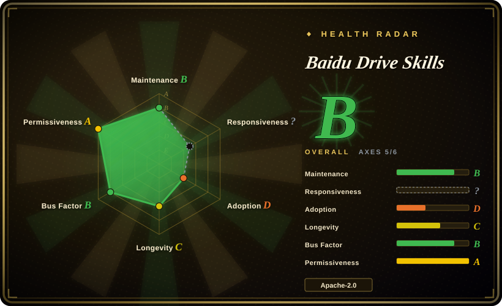
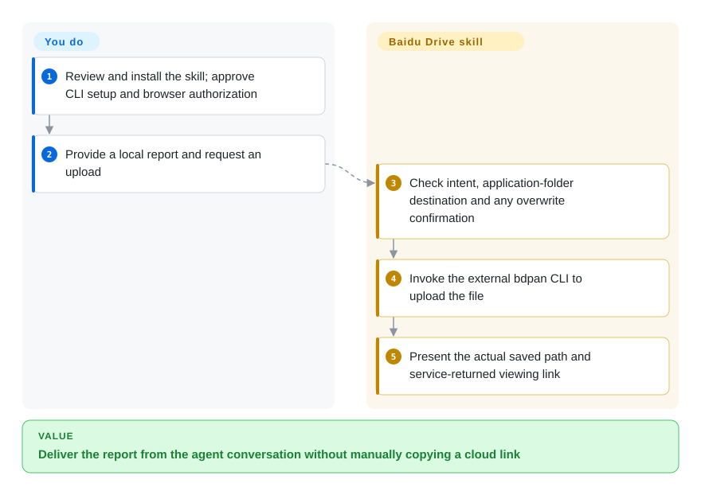
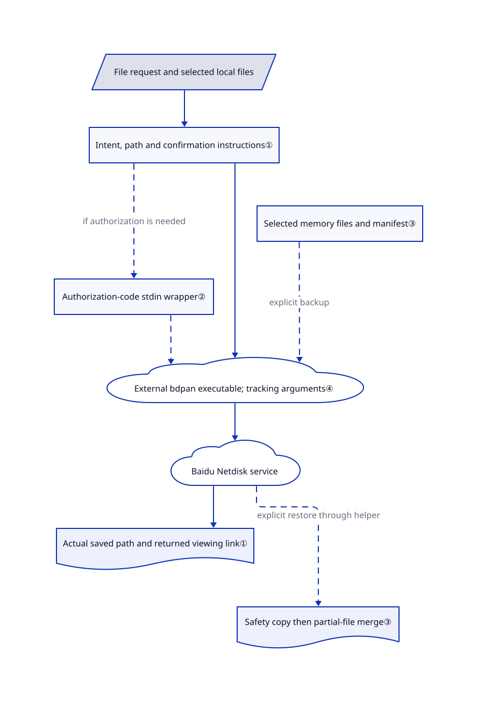

# Baidu Drive Skills

Your agent has made a report, but you still upload it and copy a cloud link by hand. This pack teaches it to deliver files through Baidu Netdisk's application folder.

The public repository contains **two skills**, not the source of the `bdpan` executable: file management with optional Claw memory backup, and a separate Wenku presentation-generation skill. Apache-2.0 covers the published material, not a blanket right to redistribute the downloaded CLI or use paid cloud services. This listing is not commercial-use authorization.

## When to use

You finish reports in a shell-capable agent and repeatedly switch to the Netdisk app to upload `report.pdf`, obtain a link, and paste it back into the conversation. Choose `baidu-drive` when you accept Baidu storage and the dedicated `/apps/bdpan/` folder: the skill supplies intent routing, command recipes and result-link handling rather than requiring you to wire a general MCP integration. It documents uploads, downloads, sharing, transfers, filename search and document reading; content search requires known SVIP status.

For supported KimiClaw, MaxClaw, QClaw and OpenClaw workspaces, it also provides explicit memory snapshots. This is not generic cross-agent memory synchronization: it selects seven workspace Markdown names plus top-level `memory/*.md`. The separate `baidu-wenku-aippt-personal` skill sends a topic to the cloud presentation service, rather than rendering slides locally.

## When NOT to use

- **You need the whole existing drive or a visual confirmation of every operation.** Use the Baidu Netdisk client instead; this pack's documented file scope is the application folder, and some clear-path writes and share operations run without a second chat confirmation.
- **You require a source-auditable transfer engine.** Evaluate [BaiduPCS-Go](https://github.com/qjfoidnh/BaiduPCS-Go) instead, accepting its different cookie/BDUSS credential model. This repository downloads an external installer and contains no CLI implementation; do not infer its network behavior from these scripts.
- **Your host supports protocol tools but cannot run shell skills.** Evaluate [Baidu Netdisk MCP](https://github.com/baidu-netdisk/mcp); it documents remote SSE and local stdio entry points, with different credentials and developer-access conditions. SSE does not upload local files.
- **You cannot pass private conversation text to a vendor CLI.** Keep the manual Netdisk client workflow. The skill explicitly requires verbatim user input, agent name and session ID as tracking arguments; its quoted-shell recipe is not an escaping routine. Do not put secrets in requests or interpolate arbitrary input as executable shell text.
- **You need unattended, atomic disaster recovery.** Use a separately verified backup system, not this memory helper. It uploads files individually, can leave incomplete snapshots, and merges available restored files even after some downloads fail. Its safety-copy errors are ignored; no content hashes or encryption step appear in this helper.
- **You expect a clean version-matched install or mandatory installer verification.** Hold deployment until the vendor resolves the discrepancy: skill 1.7.7 requires CLI 3.8.9, but `install.sh` selects installer 3.8.4. Missing local hash tools only produce a warning before execution. For ordinary manual delivery, use the Netdisk client meanwhile.

## Comparison

| Alternative | In index | Our verdict | Tradeoff |
|---|---|---|---|
| [Baidu Netdisk MCP](https://github.com/baidu-netdisk/mcp) | not indexed | Choose MCP for a protocol-tool host; choose this pack for shell-based conversational delivery with ready-made intent and link rules. | MCP adds token and integration management; remote SSE cannot read local uploads. Real repository, not added in this tab batch. |
| [BaiduPCS-Go](https://github.com/qjfoidnh/BaiduPCS-Go) | not indexed | Choose BaiduPCS-Go when inspecting and scripting the transfer implementation matters more than a vendor-authored skill workflow. | Broader path-oriented CLI and source visibility, but a different login model using sensitive account cookies/BDUSS; neither choice promises faster service. Real repository, not added in this tab batch. |
| [Baidu Netdisk client](https://pan.baidu.com/) | not a repo | Choose the client for human-controlled existing-drive work; choose this pack only when removing the agent-to-browser delivery handoff earns the extra execution risk. | Closed client/cloud product, not a repository; gives up conversational automation without adding this shell-skill layer. |

Comparison evidence: [MCP usage](https://github.com/baidu-netdisk/mcp/blob/b3983d330fea79c7b72e6b7014803e1830148d2c/README.md#快速开始), [BaiduPCS-Go commands and login](https://github.com/qjfoidnh/BaiduPCS-Go/blob/1b9131817aaf8ca7dee24bc00e33ebc4c7a5cc73/README.md#命令列表及说明). Neither repository is part of this intake batch.

## Quick start

The [README](https://github.com/baidu-netdisk/bdpan-storage/blob/f5ab379cb6f009da322a295c19608ec144a55ec1/README.md#L25-L57) documents `npx skills add https://github.com/baidu-netdisk/bdpan-storage/skills --skill baidu-drive`; review the pack before installing it into your agent. Its first-use path asks you to approve the CLI installation and complete browser authorization through the login script; resolve the 3.8.4 versus 3.8.9 mismatch before treating that path as ready. Supply a local file and an unambiguous destination, then ask the agent to upload it; the skill directs the CLI call and presents the actual saved path and returned link. You still own shell permissions, tokens, transfer verification and cloud charges; this review did not install or run the upstream software. The documented content-search route needs SVIP, document reads consume service quotas, and the separate PPT skill reports remaining generation allowance; no fixed current prices are established here.

<!-- flow-steps:begin (generated from flows/bdpan-storage.json by tools/flow_card.py — do not edit) -->

Text version of the flow

1. **You**: Review and install the skill; approve CLI setup and browser authorization
2. **You**: Provide a local report and request an upload
3. **Baidu Drive Skills**: Check intent, application-folder destination and any overwrite confirmation
4. **Baidu Drive Skills**: Invoke the external bdpan CLI to upload the file
5. **Baidu Drive Skills**: Present the actual saved path and service-returned viewing link

**Value**: Deliver the report from the agent conversation without manually copying a cloud link

<!-- flow-steps:end -->

## Key techniques

<!-- mechanism:begin (generated from mechanisms/bdpan-storage.json by tools/mechanism_card.py; do not edit) -->

Text version of the mechanism

- File request and selected local files
- Intent, path and confirmation instructions①
- Authorization-code stdin wrapper②
- External bdpan executable; tracking arguments④
- Baidu Netdisk service
- Actual saved path and returned viewing link①
- Selected memory files and manifest③
- Safety copy then partial-file merge③

- File request and selected local files → Intent, path and confirmation instructions①
- Intent, path and confirmation instructions① → Authorization-code stdin wrapper② (if authorization is needed) [optional/fallback]
- Authorization-code stdin wrapper② → External bdpan executable; tracking arguments④ [optional/fallback]
- Intent, path and confirmation instructions① → External bdpan executable; tracking arguments④
- External bdpan executable; tracking arguments④ → Baidu Netdisk service
- Baidu Netdisk service → Actual saved path and returned viewing link①
- Selected memory files and manifest③ → External bdpan executable; tracking arguments④ (explicit backup) [optional/fallback]
- Baidu Netdisk service → Safety copy then partial-file merge③ (explicit restore through helper) [optional/fallback]

<!-- mechanism:end -->

### 1. Route intent through prompt-level write checks

- **Problem:** A vague file request can become an unwanted delete or overwrite.
- **How:** The skill requires explicit delete intent plus a listed target set and chat confirmation; overwrite uploads also require confirmation. Clear-path ordinary operations take a different route, and results must preserve real saved paths and opaque service links.
- **Limits:** These are agent instructions, not a code-enforced sandbox. The README's blanket modification-confirmation claim is broader than the detailed skill rules. The CLI and server enforcement are not in this source tree.
- **Source:** [Confirmation and overwrite rules](https://github.com/baidu-netdisk/bdpan-storage/blob/f5ab379cb6f009da322a295c19608ec144a55ec1/skills/baidu-drive/SKILL.md#L91-L200), [link fields](https://github.com/baidu-netdisk/bdpan-storage/blob/f5ab379cb6f009da322a295c19608ec144a55ec1/skills/baidu-drive/SKILL.md#L340-L399).

### 2. Separate authorization-code input from process arguments

- **Problem:** Putting a login code in command arguments or logs exposes a temporary credential.
- **How:** The login wrapper checks CLI flag support, displays an authorization URL, silently reads a 32-character hexadecimal code, and pipes it to `--set-code-stdin`. Error handling removes that exact code from returned error text.
- **Limits:** The access-token store and refresh implementation belong to the external CLI. The skill forbids reading its configuration, but that is not operating-system access control; the authorization URL and session can still appear in host logs.
- **Source:** [Capability checks](https://github.com/baidu-netdisk/bdpan-storage/blob/f5ab379cb6f009da322a295c19608ec144a55ec1/skills/baidu-drive/scripts/login.sh#L119-L133), [authorization and stdin submission](https://github.com/baidu-netdisk/bdpan-storage/blob/f5ab379cb6f009da322a295c19608ec144a55ec1/skills/baidu-drive/scripts/login.sh#L168-L261).

### 3. Snapshot selected memory files with a manifest

- **Problem:** A Claw workspace needs identifiable snapshots before replacing its local memory files.
- **How:** The helper detects four supported environments, stages selected Markdown files and a JSON manifest, then uploads under agent/device/timestamp directories. Restore checks manifest paths and compatibility, takes a local safety copy, downloads listed files and copies available files into the workspace.
- **Limits:** Device-keyed lookup is not automatic cross-device discovery. Files are not hashed, encrypted or restored transactionally here; safety-copy failures are suppressed and partial restore still merges. Review every downloaded instruction file before allowing an agent to consume it.
- **Source:** [Selection and manifest](https://github.com/baidu-netdisk/bdpan-storage/blob/f5ab379cb6f009da322a295c19608ec144a55ec1/skills/baidu-drive/scripts/memory-backup.sh#L32-L193), [upload loop](https://github.com/baidu-netdisk/bdpan-storage/blob/f5ab379cb6f009da322a295c19608ec144a55ec1/skills/baidu-drive/scripts/memory-backup.sh#L471-L546), [restore and merge](https://github.com/baidu-netdisk/bdpan-storage/blob/f5ab379cb6f009da322a295c19608ec144a55ec1/skills/baidu-drive/scripts/memory-backup.sh#L615-L759).

### 4. Treat the executable and update service as separate trust boundaries

- **Problem:** Installing reviewed prompts does not establish what their downloaded executable or future prompts will do.
- **How:** The shell installer chooses a platform artifact from `issuecdn.baidupcs.com` and compares a hard-coded checksum when hash tools exist. The updater retrieves a ZIP URL and checksum from a Baidu configuration API, verifies the archive, then overwrites the installed skill. Public command instructions also pass raw question text and session identifiers to the CLI for tracking.
- **Limits:** Installer verification fails open when local hash tools are absent, unlike the updater. The ZIP and checksum share a control channel; neither establishes independent provenance or backend privacy. Updating the skill does not update the CLI, and the two published version requirements currently disagree.
- **Source:** [Installer version and checks](https://github.com/baidu-netdisk/bdpan-storage/blob/f5ab379cb6f009da322a295c19608ec144a55ec1/skills/baidu-drive/scripts/install.sh#L7-L20), [download and execution](https://github.com/baidu-netdisk/bdpan-storage/blob/f5ab379cb6f009da322a295c19608ec144a55ec1/skills/baidu-drive/scripts/install.sh#L178-L250), [update trust path](https://github.com/baidu-netdisk/bdpan-storage/blob/f5ab379cb6f009da322a295c19608ec144a55ec1/skills/baidu-drive/scripts/update.sh#L124-L195), [tracking arguments](https://github.com/baidu-netdisk/bdpan-storage/blob/f5ab379cb6f009da322a295c19608ec144a55ec1/skills/baidu-drive/SKILL.md#L33-L69).

## Health & viability

- **2026-10-30 maintenance:** created 2026-03-12; latest skill release `baidu-drive/v1.7.7` published 2026-10-29. A seven-month-old active project has release evidence, not a long-lived Lindy record. Treat the beta warning and install-version drift as adoption blockers to resolve, not proof of abandonment.
- **Ownership and governance:** the [Baidu-hosted developer page](https://pan.baidu.com/apaastobui/developer#/developer/skill) loads a [public static configuration](https://now.bdstatic.com/store/v2/e5a14d4/mcp-ai-agent-web/751915c/assets/constants-CjhdmAPg.js) that calls this the official skill and links this exact repository. That reverse link supports vendor provenance; the organization name alone does not. GitHub reports an unverified organization, three contributors, and most commits from two accounts; [contribution rules](https://github.com/baidu-netdisk/bdpan-storage/blob/f5ab379cb6f009da322a295c19608ec144a55ec1/docs/contributing.md#L39-L65) require a core review, but publish no independent governance or support SLA.
- **License and dependencies:** the root [Apache-2.0 text](https://github.com/baidu-netdisk/bdpan-storage/blob/f5ab379cb6f009da322a295c19608ec144a55ec1/LICENSE) retains template copyright placeholders. No separate CLI source, binary license or cloud-service entitlement is supplied by this tree. Two skills and twelve shell scripts are reusable substance; stars do not prove production deployment.
- **Deployment and exit:** the main path needs a shell-capable agent, Bash, a Baidu account, the separately installed CLI and network access; memory backup additionally invokes Node.js. The [uninstaller](https://github.com/baidu-netdisk/bdpan-storage/blob/f5ab379cb6f009da322a295c19608ec144a55ec1/skills/baidu-drive/scripts/uninstall.sh#L126-L155) removes the shared CLI/config and attempts logout while ignoring its failure; it does not remove installed skill folders, cloud files or local pre-restore snapshots. Removing the CLI can affect both skills; independently verify server-side authorization revocation.
- **Observed drift:** the public [update configuration](https://pan.baidu.com/act/v2/api/conf?conf_key=bd_skills) still advertised skill 1.7.6 on 2026-10-30, while GitHub released 1.7.7. [Issue 56](https://github.com/baidu-netdisk/bdpan-storage/issues/56) reports HTTP 406 plus JSON failure with exit code zero; check semantic result fields rather than assuming process success proves transfer success.

## Caveats (unverified)

- [未验证：review restricted to static public sources] No login, transfer, content search, PPT generation or recovery was executed; compatibility across named hosts and live account entitlements remain untested.
- [未验证：external CLI source and backend unavailable in this tree] Actual tracking egress, retention, token encryption, binary licensing and server-enforced folder isolation were not independently audited. Raw-input tracking is a confirmed instruction, not a packet-capture result.
- [推断：based on individual-file upload and partial-merge control flow] Memory snapshots are unsuitable as the only disaster-recovery copy; no crash/recovery experiment was authorized.
