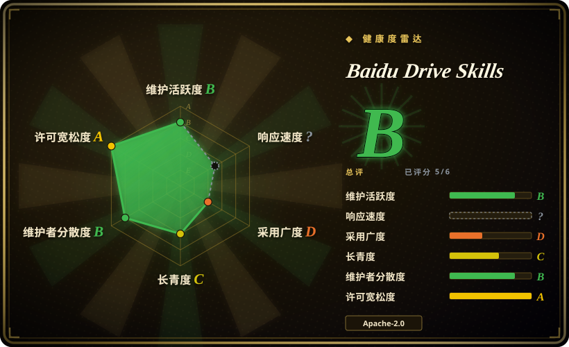
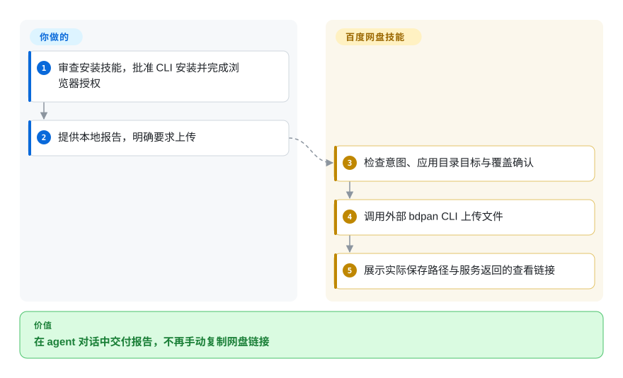
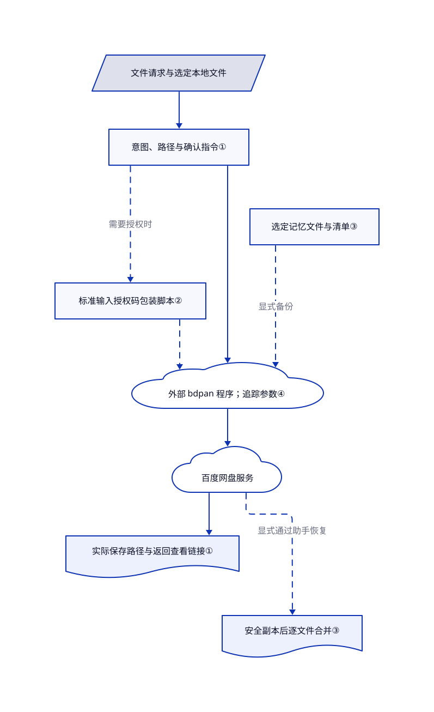

# Baidu Drive Skills

agent 写好了报告，你还要手动上传网盘、复制链接。这个技能包教它把文件交付到百度网盘的应用目录。

公开仓库包含**两个技能**，不含 `bdpan` 可执行程序源码：文件管理与可选 Claw 记忆备份，以及独立的文库演示文稿生成技能。Apache-2.0 适用于已发布材料，不自动授权再分发外部 CLI 或使用付费云服务。收录介绍不等于商用授权。

## 何时使用

你用能执行终端命令的 agent 写报告，每次还要打开网盘，上传 `report.pdf`，取链接，再贴回对话。如果你接受百度存储和专用的 `/apps/bdpan/` 目录，可考虑 `baidu-drive`。它提供意图路由、命令配方和结果链接展示规则，不要求你先搭通用 MCP 集成。文档覆盖上传、下载、分享、转存、文件名搜索与正文读取；正文搜索要求已知 SVIP 身份。

对于受支持的 KimiClaw、MaxClaw、QClaw 和 OpenClaw 工作区，它还提供显式记忆快照。但这不是通用跨 agent 记忆同步：只选七个固定工作区文件和顶层 `memory/*.md`。另一个 `baidu-wenku-aippt-personal` 技能把主题交给云端生成演示文稿，不在本地渲染幻灯片。

## 何时不用

- **你要操作已有主盘，或逐步目视确认。** 改用百度网盘客户端。本包文档限定应用目录，而且路径明确的部分写操作和分享不要求再次对话确认。
- **你需要能审源码的传输引擎。** 可评估 [BaiduPCS-Go](https://github.com/qjfoidnh/BaiduPCS-Go)，但要接受它使用 Cookie、BDUSS 等敏感账号凭据的不同登录方式。本仓库只下载外部安装器，不含 CLI 实现；不能据此断言二进制的网络行为。
- **宿主支持协议工具，却不能执行 shell 技能。** 可评估[百度网盘 MCP](https://github.com/baidu-netdisk/mcp)。它提供远程 SSE 和本地标准输入输出入口，但凭据与开发者接入条件不同，SSE 不支持上传本地文件。
- **你不能把私密对话传给厂商 CLI。** 保留手动网盘客户端流程。本技能要求把用户原始提问、agent 名称和会话编号作为追踪参数传入；文档的单引号配方不是转义程序。请求不应夹带秘密，也不能把任意输入直接插成可执行 shell 文本。
- **你需要无人值守、原子恢复的灾备。** 使用另行验证的备份系统，不要依赖这个记忆助手。它逐文件上传，会留下不完整快照；部分下载失败后仍合并可用文件。恢复前安全副本的复制错误被忽略，助手没有内容哈希或加密步骤。
- **你期待版本匹配、强制校验的安装链。** 先等厂商解决差异：技能 1.7.7 要求 CLI 3.8.9，安装脚本却选择安装器 3.8.4。缺少本地哈希工具时只警告，然后继续执行。普通手动交付可先用网盘客户端。

## 横向对比

| 替代品 | 是否收录 | 我们的评价 | 取舍 |
|---|---|---|---|
| [百度网盘 MCP](https://github.com/baidu-netdisk/mcp) | 未收录 | 宿主只支持协议工具时选 MCP；需要现成意图和链接规则的终端对话交付时选本包。 | MCP 增加令牌和集成管理，远程 SSE 无法读取本地上传文件；真实仓库，本批不新增。 |
| [BaiduPCS-Go](https://github.com/qjfoidnh/BaiduPCS-Go) | 未收录 | 需要审查、编排传输实现时选 BaiduPCS-Go，而不是为了厂商编写的技能流程选本包。 | 提供源码和更广的路径式 CLI，但使用敏感账号 Cookie、BDUSS 等不同凭据；两者都不保证服务提速。真实仓库，本批不新增。 |
| [百度网盘客户端](https://pan.baidu.com/) | 非仓库 | 已有主盘的人控操作选客户端；只有减少 agent 到浏览器的交接足以抵偿执行风险时才选本包。 | 闭源客户端及云产品，不是仓库；放弃对话自动化，但不增加这层 shell 技能。 |

比较依据：[MCP 接入说明](https://github.com/baidu-netdisk/mcp/blob/b3983d330fea79c7b72e6b7014803e1830148d2c/README.md#快速开始)、[BaiduPCS-Go 命令与登录](https://github.com/qjfoidnh/BaiduPCS-Go/blob/1b9131817aaf8ca7dee24bc00e33ebc4c7a5cc73/README.md#命令列表及说明)。这两个仓库均不在本批收录名单。

## 快速上手

[README](https://github.com/baidu-netdisk/bdpan-storage/blob/f5ab379cb6f009da322a295c19608ec144a55ec1/README.md#L25-L57) 给出 `npx skills add https://github.com/baidu-netdisk/bdpan-storage/skills --skill baidu-drive`，安装到 agent 前应先审查技能。首次使用会引导你批准 CLI 安装，再经登录脚本完成浏览器授权；把这条链路当作可用流程前，先解决 3.8.4 与 3.8.9 的差异。你提供本地文件和明确目的地，再要求上传；技能指导 CLI 调用，并展示实际保存路径和返回链接。你仍负责终端权限、令牌、传输核验和云服务费用；本次没有安装或运行上游程序。文档中的正文搜索要求 SVIP，正文读取消耗服务配额，独立 PPT 技能会报告剩余生成次数；这里没有确立当前固定价格。

<!-- flow-steps:begin (generated from flows/bdpan-storage.json by tools/flow_card.py — do not edit) -->

流程文字版

1. **你**：审查安装技能，批准 CLI 安装并完成浏览器授权
2. **你**：提供本地报告，明确要求上传
3. **Baidu Drive Skills**：检查意图、应用目录目标与覆盖确认
4. **Baidu Drive Skills**：调用外部 bdpan CLI 上传文件
5. **Baidu Drive Skills**：展示实际保存路径与服务返回的查看链接

**价值**：在 agent 对话中交付报告，不再手动复制网盘链接

<!-- flow-steps:end -->

## 技术要点

<!-- mechanism:begin (generated from mechanisms/bdpan-storage.json by tools/mechanism_card.py; do not edit) -->

机制文字版

- 文件请求与选定本地文件
- 意图、路径与确认指令①
- 标准输入授权码包装脚本②
- 外部 bdpan 程序；追踪参数④
- 百度网盘服务
- 实际保存路径与返回查看链接①
- 选定记忆文件与清单③
- 安全副本后逐文件合并③

- 文件请求与选定本地文件 → 意图、路径与确认指令①
- 意图、路径与确认指令① → 标准输入授权码包装脚本②（需要授权时）〔可选／兜底〕
- 标准输入授权码包装脚本② → 外部 bdpan 程序；追踪参数④〔可选／兜底〕
- 意图、路径与确认指令① → 外部 bdpan 程序；追踪参数④
- 外部 bdpan 程序；追踪参数④ → 百度网盘服务
- 百度网盘服务 → 实际保存路径与返回查看链接①
- 选定记忆文件与清单③ → 外部 bdpan 程序；追踪参数④（显式备份）〔可选／兜底〕
- 百度网盘服务 → 安全副本后逐文件合并③（显式通过助手恢复）〔可选／兜底〕

<!-- mechanism:end -->

### 1. 用提示词分流意图与写入确认

- **解决：** 模糊的文件请求可能变成误删或覆盖。
- **做法：** 技能要求删除必须具备明确意图，先列目标，再在对话中确认；覆盖上传也要确认。路径明确的普通操作走另一条规则，结果必须保留实际保存路径和服务返回的不透明链接。
- **边界：** 这是 agent 指令，不是代码强制沙箱。README 声称的统一修改确认，比详细技能规则更严格。本树不含 CLI 与服务端的强制实现。
- **源码：** [确认与覆盖规则](https://github.com/baidu-netdisk/bdpan-storage/blob/f5ab379cb6f009da322a295c19608ec144a55ec1/skills/baidu-drive/SKILL.md#L91-L200)、[链接字段](https://github.com/baidu-netdisk/bdpan-storage/blob/f5ab379cb6f009da322a295c19608ec144a55ec1/skills/baidu-drive/SKILL.md#L340-L399)。

### 2. 让授权码走标准输入，不进入进程参数

- **解决：** 登录码出现在命令参数或日志里，会暴露临时凭据。
- **做法：** 登录包装脚本检查 CLI 参数能力，展示授权链接，静默读取三十二位十六进制授权码，再通过管道交给 `--set-code-stdin`。错误处理会从返回错误文本中替换该码。
- **边界：** 访问令牌存储和刷新由外部 CLI 实现。技能禁止读取配置，但这不是操作系统权限控制；授权链接和会话仍可能进入宿主日志。
- **源码：** [能力检查](https://github.com/baidu-netdisk/bdpan-storage/blob/f5ab379cb6f009da322a295c19608ec144a55ec1/skills/baidu-drive/scripts/login.sh#L119-L133)、[授权与标准输入提交](https://github.com/baidu-netdisk/bdpan-storage/blob/f5ab379cb6f009da322a295c19608ec144a55ec1/skills/baidu-drive/scripts/login.sh#L168-L261)。

### 3. 用清单给指定记忆文件做快照

- **解决：** Claw 工作区替换本地记忆前，需要能辨认的历史快照。
- **做法：** 助手识别四种环境，暂存选定的 Markdown 文件和 JSON 清单，再按 agent、设备和时间戳上传。恢复时检查清单路径与兼容性，复制本地安全副本，下载清单文件，把可用文件拷回工作区。
- **边界：** 按设备查找不等于自动跨设备发现。本脚本不做文件哈希、加密或事务恢复；安全副本失败被抑制，部分恢复仍合并。下载的指令文件必须先审查，再交给 agent 消费。
- **源码：** [选取与清单](https://github.com/baidu-netdisk/bdpan-storage/blob/f5ab379cb6f009da322a295c19608ec144a55ec1/skills/baidu-drive/scripts/memory-backup.sh#L32-L193)、[上传循环](https://github.com/baidu-netdisk/bdpan-storage/blob/f5ab379cb6f009da322a295c19608ec144a55ec1/skills/baidu-drive/scripts/memory-backup.sh#L471-L546)、[恢复与合并](https://github.com/baidu-netdisk/bdpan-storage/blob/f5ab379cb6f009da322a295c19608ec144a55ec1/skills/baidu-drive/scripts/memory-backup.sh#L615-L759)。

### 4. 把程序和更新服务视为独立信任边界

- **解决：** 审过提示词，不等于知道下载程序和未来提示词的行为。
- **做法：** 安装脚本从 `issuecdn.baidupcs.com` 选择平台安装器，有哈希工具时比对内置校验值。更新脚本从百度配置接口取 ZIP 地址和校验值，验包后覆盖技能。公共命令规则另要求把原始提问和会话标识传给 CLI 追踪。
- **边界：** 安装器缺哈希工具时放行，更新脚本则拒绝。ZIP 与校验值来自同一控制通道，不能证明独立来源或后端隐私。更新技能不会更新 CLI，目前两者发布版本要求不一致。
- **源码：** [安装器版本和校验值](https://github.com/baidu-netdisk/bdpan-storage/blob/f5ab379cb6f009da322a295c19608ec144a55ec1/skills/baidu-drive/scripts/install.sh#L7-L20)、[下载和执行](https://github.com/baidu-netdisk/bdpan-storage/blob/f5ab379cb6f009da322a295c19608ec144a55ec1/skills/baidu-drive/scripts/install.sh#L178-L250)、[更新信任链](https://github.com/baidu-netdisk/bdpan-storage/blob/f5ab379cb6f009da322a295c19608ec144a55ec1/skills/baidu-drive/scripts/update.sh#L124-L195)、[追踪参数](https://github.com/baidu-netdisk/bdpan-storage/blob/f5ab379cb6f009da322a295c19608ec144a55ec1/skills/baidu-drive/SKILL.md#L33-L69)。

## 健康度与可持续性

- **维护情况，截至 2026-10-30：** 仓库创建于 2026-03-12，最新技能版 `baidu-drive/v1.7.7` 发布于 2026-10-29。七个月的活跃项目有发布证据，却没有长期存续记录。公测提示与安装版本漂移应作为采用前要解决的阻碍，不能据此声称已弃维护。
- **归属与治理：** [百度域名的开发者页](https://pan.baidu.com/apaastobui/developer#/developer/skill)加载[公开静态配置](https://now.bdstatic.com/store/v2/e5a14d4/mcp-ai-agent-web/751915c/assets/constants-CjhdmAPg.js)，明确称其官方技能，并链接这个仓库。反向链接支持厂商归属，组织名本身不能证明。GitHub 显示组织未认证、三位贡献者，多数提交来自两个账号；[贡献规则](https://github.com/baidu-netdisk/bdpan-storage/blob/f5ab379cb6f009da322a295c19608ec144a55ec1/docs/contributing.md#L39-L65)要求核心成员审查，但未发布独立治理或支持时效承诺。
- **许可与依赖：** 根目录的 [Apache-2.0 正文](https://github.com/baidu-netdisk/bdpan-storage/blob/f5ab379cb6f009da322a295c19608ec144a55ec1/LICENSE)保留模板版权占位符。本树没有另行提供 CLI 源码、二进制许可或云服务使用权益。两个技能和十二份 shell 脚本构成可复用内容；星数不能证明生产部署。
- **部署与退出：** 主流程需要支持 shell 的 agent、Bash、百度账号、另装的 CLI 与联网；记忆助手额外调用 Node.js。[卸载器](https://github.com/baidu-netdisk/bdpan-storage/blob/f5ab379cb6f009da322a295c19608ec144a55ec1/skills/baidu-drive/scripts/uninstall.sh#L126-L155)会删共享 CLI 和配置，并尝试注销，但忽略注销失败；它不删已装技能目录、云文件和本地恢复前快照。删 CLI 会影响两个技能，服务端撤权要单独验证。
- **已观察漂移：** 2026-10-30 的公开[更新配置](https://pan.baidu.com/act/v2/api/conf?conf_key=bd_skills)仍宣告技能 1.7.6，GitHub 已发布 1.7.7。[问题 56](https://github.com/baidu-netdisk/bdpan-storage/issues/56)报告 HTTP 406 且 JSON 失败时进程退出码仍为零；应检查业务结果字段，不能把进程成功当传输成功。

## 存疑（未验证）

- [未验证：本次仅静读公开来源] 没有执行登录、传输、正文搜索、PPT 生成或恢复；所列宿主兼容性与实时账号权益未经实测。
- [未验证：本树缺外部 CLI 源码和后端] 没有独立审计实际追踪外传、保留策略、令牌加密、二进制许可与服务端目录隔离。传原始提问是已确认的技能指令，不是抓包结论。
- [推断：依据是逐文件上传和部分合并控制流] 记忆快照不适合作为唯一灾备副本；本次未获授权进行故障恢复实验。
