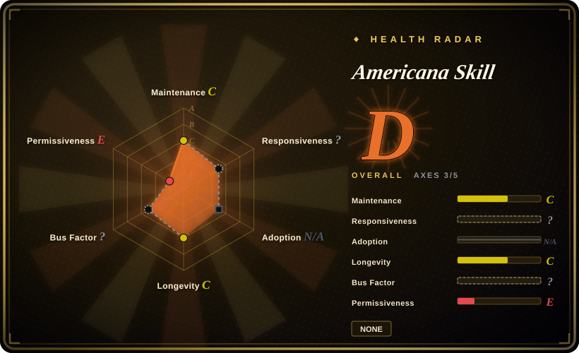
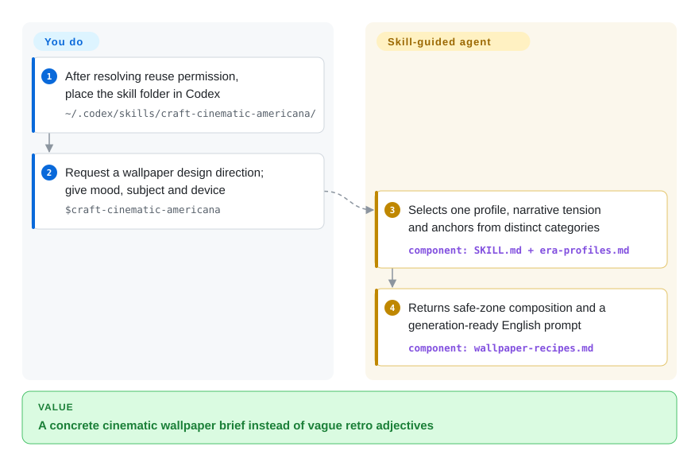
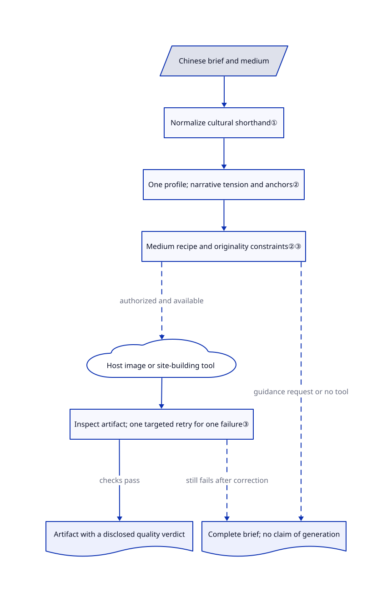

# Americana Skill

You ask for a melancholy summer wallpaper and get palm trees with a grain filter, or Chinese fan slang turns into literal lightning. This skill maps the brief to one of five visual profiles, then specifies composition, narrative tension and usable wallpaper zones.

## When to use

You are art-directing a fictional music-night poster, phone wallpaper or coastal portfolio from a short Chinese brief. The model keeps substituting a cheerful resort advertisement for the empty, uneasy summer scene you wanted. You want a defined visual vocabulary rather than another open-ended instruction to make the design tasteful. This pack supplies five profiles, three intensity levels and medium-specific recipes; it also interprets Chinese fan shorthand in context instead of drawing a storm.

Choose it over a general UI taste pack when the deciding requirement is this narrow Americana vocabulary across images and websites. Choose a fixed hand-drawn recipe pack instead when repeatable illustration linework matters more than profile selection. This page documents the repository for selection; its missing license is not permission to install, copy or redistribute its contents.

## When NOT to use

- **You need permission-cleared material to vendor or redistribute.** The complete reviewed tree contains no license file and the README and skill contain no license grant. Do not treat public visibility as an open-source license. Consider [hand-drawn-styles](hand-drawn-styles.md), whose code and recipe text are MIT, while separately checking rights in any referenced look or output.
- **You need exact poster lettering and editable card layout.** The image recipe itself recommends adding critical text through deterministic layout rather than trusting image generation. Use [Guizang Social Card Skill](guizang-social-card.md) for HTML-based composition and PNG rendering, subject to its AGPL terms.
- **You are building an ordinary dashboard or branded product UI.** Five artist-adjacent profiles impose a narrow aesthetic. Use [Taste-Skill](../design/ui-taste/taste-skill.md) for broader frontend taste, or keep your existing brand rules as the authority.
- **You need an image engine or an already built website.** This repository contains instructions, references and six showcase WebPs, not a renderer, model or web application. Use [Guizang Social Card Skill](guizang-social-card.md) for a supplied card-rendering workflow, or [Taste-Skill](../design/ui-taste/taste-skill.md) to guide your own coding agent. Neither replaces a separate image-generation service.

## Comparison

| Alternative | In index | Our verdict | Tradeoff |
|---|---|---|---|
| [hand-drawn-styles](hand-drawn-styles.md) | Yes | Choose hand-drawn-styles when a chosen illustration recipe must survive agent paraphrasing; choose this pack when you need to derive a cinematic scene from mood and cultural references. | Verbatim extraction with a Python helper versus model-interpreted profile rules; the latter provides more art-direction flexibility but no deterministic recipe enforcement and no declared license. |
| [Guizang Social Card Skill](guizang-social-card.md) | Yes | Choose Guizang for platform-sized cards with editable HTML and exact copy; choose this pack for wallpaper safe zones and cinematic scene direction. | Template-backed layout and a rendering script versus prompt-based image direction; Guizang brings Node/browser upkeep and AGPL obligations. |
| [Taste-Skill](../design/ui-taste/taste-skill.md) | Yes | Choose Taste-Skill for general frontend layout, typography and motion; choose this pack when one Americana profile must connect poster, wallpaper and website direction. | Broad UI taste and configurable dials versus five culturally specific profiles; both rely on the host agent, but this pack has no declared reuse terms. |

## Quick start

The README documents copying `craft-cinematic-americana` into `~/.codex/skills/craft-cinematic-americana/`, with `SKILL.md` directly inside it; resolve the missing reuse license before adopting that installation path. In a permitted environment, invoke `$craft-cinematic-americana` and supply the medium, subject, dimensions, exact text and any authorized assets. Ask for a design direction if you want a complete brief rather than immediate generation. The agent selects a profile and returns composition, color, lettering roles and an English image prompt, with Chinese explanation for a Chinese request. Actual image generation or site building requires tools supplied by your host agent, and any provider fees, asset rights and deployment remain yours; without those tools the skill instructs the agent to return the brief, not claim a generated artifact.

<!-- flow-steps:begin (generated from flows/cinematic-americana-design-skill.json by tools/flow_card.py — do not edit) -->

Text version of the flow

1. **You**: After resolving reuse permission, place the skill folder in Codex — `~/.codex/skills/craft-cinematic-americana/`
2. **You**: Request a wallpaper design direction; give mood, subject and device — `$craft-cinematic-americana`
3. **Americana Skill**: Selects one profile, narrative tension and anchors from distinct categories — component: `SKILL.md + era-profiles.md`
4. **Americana Skill**: Returns safe-zone composition and a generation-ready English prompt — component: `wallpaper-recipes.md`

**Value**: A concrete cinematic wallpaper brief instead of vague retro adjectives

<!-- flow-steps:end -->

## Key techniques

<!-- mechanism:begin (generated from mechanisms/cinematic-americana-design-skill.json by tools/mechanism_card.py; do not edit) -->

Text version of the mechanism

- Chinese brief and medium
- Normalize cultural shorthand①
- One profile; narrative tension and anchors②
- Medium recipe and originality constraints②③
- Host image or site-building tool
- Inspect artifact; one targeted retry for one failure③
- Artifact with a disclosed quality verdict
- Complete brief; no claim of generation

- Chinese brief and medium → Normalize cultural shorthand①
- Normalize cultural shorthand① → One profile; narrative tension and anchors②
- One profile; narrative tension and anchors② → Medium recipe and originality constraints②③
- Medium recipe and originality constraints②③ → Host image or site-building tool (authorized and available) [optional/fallback]
- Host image or site-building tool → Inspect artifact; one targeted retry for one failure③
- Inspect artifact; one targeted retry for one failure③ → Artifact with a disclosed quality verdict (checks pass)
- Medium recipe and originality constraints②③ → Complete brief; no claim of generation (guidance request or no tool) [optional/fallback]
- Inspect artifact; one targeted retry for one failure③ → Complete brief; no claim of generation (still fails after correction) [optional/fallback]

<!-- mechanism:end -->

### 1. Normalize cultural shorthand before routing the task

- **Problem:** Literal interpretation turns a Chinese aesthetic request into thunderstorm imagery.
- **How:** The skill routes Chinese requests to a dedicated delivery reference. It maps fan shorthand to visual attributes, requires explicit weather words before adding storms, and separates Chinese explanations from English generation prompts.
- **Limits:** These are model instructions, not a language classifier. Ambiguous mood-to-profile mappings still require interpretation, and no host activation was tested here.
- **Source:** [Skill entry](https://github.com/shirleylana/cinematic-americana-design-skill/blob/1abc3e497e6cb555cbea1ec42f2e8794681b834a/craft-cinematic-americana/SKILL.md), [Chinese delivery rules](https://github.com/shirleylana/cinematic-americana-design-skill/blob/1abc3e497e6cb555cbea1ec42f2e8794681b834a/craft-cinematic-americana/references/chinese-delivery.md).

### 2. Make the aesthetic structural rather than decorative

- **Problem:** Adding grain and vintage props can still produce a generic travel advertisement.
- **How:** One primary profile controls palette, type, framing and narrative tension. The strongest intensity requires a contradiction, anchors from three different categories, analog treatment and an anti-generic constraint; a secondary profile may contribute only one motif or treatment.
- **Limits:** Anchor counts constrain the brief, not generated pixels. Wallpaper safe-zone percentages are design instructions rather than measured device compatibility, and website tokens are guidance, not bundled components.
- **Source:** [Visual grammar](https://github.com/shirleylana/cinematic-americana-design-skill/blob/1abc3e497e6cb555cbea1ec42f2e8794681b834a/craft-cinematic-americana/references/visual-core.md), [profile definitions](https://github.com/shirleylana/cinematic-americana-design-skill/blob/1abc3e497e6cb555cbea1ec42f2e8794681b834a/craft-cinematic-americana/references/era-profiles.md), [wallpaper recipe](https://github.com/shirleylana/cinematic-americana-design-skill/blob/1abc3e497e6cb555cbea1ec42f2e8794681b834a/craft-cinematic-americana/references/wallpaper-recipes.md).

### 3. Inspect the artifact and bound corrections

- **Problem:** A good-looking prompt can yield broken title text, unusable safe zones or a cover imitation.
- **How:** The skill asks the agent to inspect the actual result for profile recognition, anchors, medium function and originality. A single failed check permits one targeted retry; continued failure must be disclosed with a complete brief. The originality reference compares subject, background, title treatment and props, and requests structural changes when at least two match an existing cover.
- **Limits:** No script enforces this gate, and there is no general retry policy for multiple simultaneous failures. Visual self-review is not a rights clearance or a similarity detector; the repository's own missing license remains a separate problem.
- **Source:** [Artifact gate](https://github.com/shirleylana/cinematic-americana-design-skill/blob/1abc3e497e6cb555cbea1ec42f2e8794681b834a/craft-cinematic-americana/SKILL.md), [originality checklist](https://github.com/shirleylana/cinematic-americana-design-skill/blob/1abc3e497e6cb555cbea1ec42f2e8794681b834a/craft-cinematic-americana/references/originality-guardrails.md), [text-fidelity fallback](https://github.com/shirleylana/cinematic-americana-design-skill/blob/1abc3e497e6cb555cbea1ec42f2e8794681b834a/craft-cinematic-americana/references/image-recipes.md).

## Health & viability

- **Maintenance, checked 2026-10-30:** created 2026-07-17; all 12 visible commits fall on July 17-18, with none since July 18. The repository is not archived, but has no tags or releases. Pin the reviewed commit rather than expecting a versioned compatibility contract.
- **Governance and backing:** the owner is a personal GitHub account. Commit authors are not linked to GitHub accounts, the contributors endpoint returned an empty array, and the complete tree has no governance, contribution or security policy. A maintainer team or institutional backstop is not established by the available evidence.
- **Age and durability:** at 105 days old and 104 days since its last commit, it has little observed maintenance history. [推断: based on creation and commit dates] Treat it as a small reference vocabulary to evaluate, not a proven long-lived dependency.
- **Adoption and evidence:** GitHub reports 8 stars and one fork on the verification date, with no issues or releases. Three evaluation documents record the author's baseline/forward tests and gallery checks; these are useful examples, not independently reproduced evidence of reliable generation.
- **Rights boundary:** no license file or reuse grant was found in the reviewed tree and text. Originality instructions exclude likenesses, logos, lyrics and copied cover structure, but do not grant rights to this skill or guarantee clearance of outputs.

## Caveats (unverified)

- [未验证: upstream execution and paid generation are outside task authorization] Skill activation, direct generation, exact lettering, safe zones and responsive implementation were not reproduced. The documented tests and six gallery images are upstream evidence only; website examples are explicitly direction mockups, not deployed sites.
- [未验证: no license grant or written author permission is available] Reuse permission remains unresolved. The absence of a license is verified; commercial adoption, copying and redistribution must not be assumed permitted.
- [未验证: no comprehensive external provenance or image-similarity audit was performed] The README calls the examples original and cites public cultural references. That statement and the prompt guardrails do not independently establish provenance or output clearance.
- [推断: based on a 105-day age and commits concentrated in two days] Long-term maintenance is unproven; no prediction of abandonment is made.
