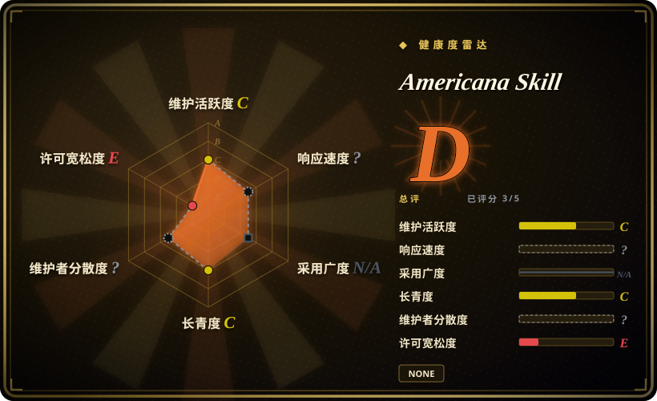
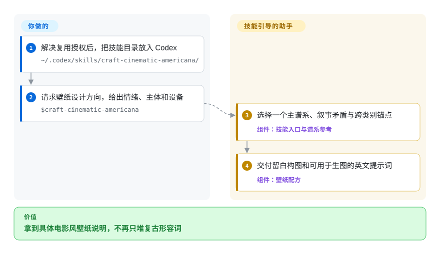
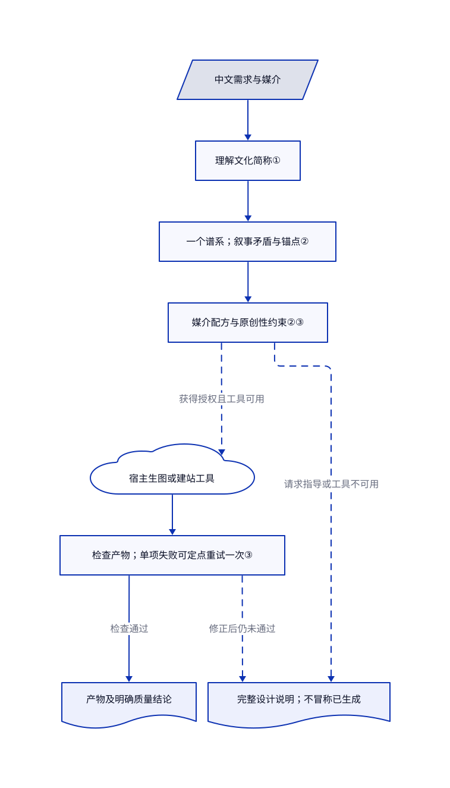

# Americana Skill

你想要忧郁夏日壁纸，模型却只会堆棕榈树和胶片颗粒，甚至把“打雷感”画成闪电。这套技能先选择五种视觉谱系之一，再规定叙事张力、构图和壁纸留白。

## 何时使用

你要从一句中文需求出发，为虚构音乐活动做海报、为手机做壁纸，或设计海岸主题作品集。你要的是空旷、不安的夏日场景，模型却总生成欢乐度假广告。比起再说一次“做得有品位”，你需要明确的视觉词汇。这套技能提供五种谱系、三档强度和分媒介配方，还会按设计语境理解中文粉丝用语，不把它们直接画成雷雨。

当决定因素是让图片与网站共用一套美式复古词汇时，选它而不是通用界面审美包。若你更在乎插画线条反复一致，应选固定手绘配方。本页用于选型信息收录；仓库没有许可证，不代表已获准安装、复制或再分发。

## 何时不用

- **你需要可直接纳入产品或再分发的授权素材。** 完整已读树没有许可证，说明书和技能也没有授权条款。公开可见不等于开源授权。可考察 [hand-drawn-styles](hand-drawn-styles.zh.md)，其代码和配方文字采用 MIT，但仍须单独核查参照画风与产物的权利。
- **你需要准确海报文字和可编辑卡片版式。** 上游图片配方也建议把关键文字放进确定性排版流程，不依赖生图模型。可选 [Guizang Social Card Skill](guizang-social-card.zh.md)，用 HTML 编排并渲染 PNG，同时遵守其 AGPL 条款。
- **你在做普通后台或已有品牌规范的产品界面。** 五种艺人相关谱系会强加狭窄审美。可用 [Taste-Skill](../design/ui-taste/taste-skill.zh.md) 做通用前端审美指导，或让现有品牌规则继续作为唯一依据。
- **你需要生图引擎或现成网站。** 仓库包含指令、参考文档和六张展示图，不含渲染器、模型或网站应用。卡片渲染可选 [Guizang Social Card Skill](guizang-social-card.zh.md)，代码生成指导可选 [Taste-Skill](../design/ui-taste/taste-skill.zh.md)。两者都不替代独立生图服务。

## 横向对比

| 替代品 | 是否收录 | 我们的评价 | 取舍 |
|---|---|---|---|
| [hand-drawn-styles](hand-drawn-styles.zh.md) | 已收录 | 已选插画配方不能被助手改写时，选 hand-drawn-styles；需要从情绪与文化参照推导电影场景时，选本项目。 | 前者用 Python 辅助原样提取，后者让模型解释谱系规则；本项目更灵活，但不确定性更高，也没有声明复用许可。 |
| [Guizang Social Card Skill](guizang-social-card.zh.md) | 已收录 | 需要平台尺寸、可编辑 HTML 和准确文案时，选 Guizang；需要壁纸安全区与电影场景方向时，选本项目。 | 模板和渲染脚本对比提示词美术指导；Guizang 多了 Node 与浏览器维护成本，也有 AGPL 义务。 |
| [Taste-Skill](../design/ui-taste/taste-skill.zh.md) | 已收录 | 通用前端布局、字体和动效选 Taste-Skill；海报、壁纸与网站要共用一种美式复古谱系时，选本项目。 | 广谱界面审美及可调参数，对比五种特定文化谱系；两者都依赖宿主助手，而本项目尚无复用条款。 |

## 快速上手

说明书要求把 `craft-cinematic-americana` 复制到 `~/.codex/skills/craft-cinematic-americana/`，并让 `SKILL.md` 直接位于该目录；采用这条安装路径前，先解决缺失的复用授权。在获得许可的环境中，调用 `$craft-cinematic-americana`，提供媒介、主体、尺寸、准确文字和有权使用的素材。只需要完整设计说明时，明确要求“设计方向”，不要要求立即生图。助手选择谱系后，给出构图、配色、字体角色和英文生图提示词；中文需求配中文解释。真正生图或建站依赖宿主助手已有工具，服务费用、素材授权与部署仍由你负责；工具不可用时，技能要求只交完整说明，不冒称已生成产物。

<!-- flow-steps:begin (generated from flows/cinematic-americana-design-skill.json by tools/flow_card.py — do not edit) -->

流程文字版

1. **你**：解决复用授权后，把技能目录放入 Codex — `~/.codex/skills/craft-cinematic-americana/`
2. **你**：请求壁纸设计方向，给出情绪、主体和设备 — `$craft-cinematic-americana`
3. **Americana Skill**：选择一个主谱系、叙事矛盾与跨类别锚点 — 组件：`技能入口与谱系参考`
4. **Americana Skill**：交付留白构图和可用于生图的英文提示词 — 组件：`壁纸配方`

**价值**：拿到具体电影风壁纸说明，不再只堆复古形容词

<!-- flow-steps:end -->

## 技术要点

<!-- mechanism:begin (generated from mechanisms/cinematic-americana-design-skill.json by tools/mechanism_card.py; do not edit) -->

机制文字版

- 中文需求与媒介
- 理解文化简称①
- 一个谱系；叙事矛盾与锚点②
- 媒介配方与原创性约束②③
- 宿主生图或建站工具
- 检查产物；单项失败可定点重试一次③
- 产物及明确质量结论
- 完整设计说明；不冒称已生成

- 中文需求与媒介 → 理解文化简称①
- 理解文化简称① → 一个谱系；叙事矛盾与锚点②
- 一个谱系；叙事矛盾与锚点② → 媒介配方与原创性约束②③
- 媒介配方与原创性约束②③ → 宿主生图或建站工具（获得授权且工具可用）〔可选／兜底〕
- 宿主生图或建站工具 → 检查产物；单项失败可定点重试一次③
- 检查产物；单项失败可定点重试一次③ → 产物及明确质量结论（检查通过）
- 媒介配方与原创性约束②③ → 完整设计说明；不冒称已生成（请求指导或工具不可用）〔可选／兜底〕
- 检查产物；单项失败可定点重试一次③ → 完整设计说明；不冒称已生成（修正后仍未通过）〔可选／兜底〕

<!-- mechanism:end -->

### 1. 先理解文化简称，再分派任务

- **解决：** 逐字理解会把中文审美需求画成雷雨天气。
- **做法：** 中文请求先读取专用交付参考。规则把粉丝简称映射成视觉属性，只有出现明确天气词才加入雷雨，并把中文解释与英文生图提示词分开。
- **边界：** 这是模型指令，不是语言分类器。模糊情绪与谱系的对应仍需要解释，本次没有实测宿主激活。
- **源码：** [技能入口](https://github.com/shirleylana/cinematic-americana-design-skill/blob/1abc3e497e6cb555cbea1ec42f2e8794681b834a/craft-cinematic-americana/SKILL.md)、[中文交付规则](https://github.com/shirleylana/cinematic-americana-design-skill/blob/1abc3e497e6cb555cbea1ec42f2e8794681b834a/craft-cinematic-americana/references/chinese-delivery.md)。

### 2. 用结构选择代替复古装饰堆叠

- **解决：** 胶片颗粒和复古道具加齐，仍可能只是普通旅行广告。
- **做法：** 一个主谱系统一控制配色、字体、取景与叙事张力。最高强度要求一个矛盾、三个不同类别的锚点、模拟胶片处理和反模板约束；次谱系只能贡献一个图案或材质处理。
- **边界：** 锚点计数约束的是说明，不是最终像素。壁纸留白比例是设计指令，不是测量过的设备适配；网页设计变量也是指导，不是随包组件。
- **源码：** [视觉语法](https://github.com/shirleylana/cinematic-americana-design-skill/blob/1abc3e497e6cb555cbea1ec42f2e8794681b834a/craft-cinematic-americana/references/visual-core.md)、[谱系定义](https://github.com/shirleylana/cinematic-americana-design-skill/blob/1abc3e497e6cb555cbea1ec42f2e8794681b834a/craft-cinematic-americana/references/era-profiles.md)、[壁纸配方](https://github.com/shirleylana/cinematic-americana-design-skill/blob/1abc3e497e6cb555cbea1ec42f2e8794681b834a/craft-cinematic-americana/references/wallpaper-recipes.md)。

### 3. 检查实际产物，并限制修正次数

- **解决：** 提示词写得完整，产物仍可能文字错误、安全区拥挤或近似现成封面。
- **做法：** 技能要求助手检查实际结果的谱系辨识、锚点、媒介功能和原创性。只有一项失败时，可针对性重试一次；仍失败就披露并交完整说明。原创性参考会比较主体、背景、标题和道具，至少两项匹配现成封面时要求改结构。
- **边界：** 没有脚本强制检查，多项同时失败也没有通用重试策略。模型目测既不是授权审查，也不是相似性检测；仓库自身缺许可证是独立问题。
- **源码：** [产物检查门](https://github.com/shirleylana/cinematic-americana-design-skill/blob/1abc3e497e6cb555cbea1ec42f2e8794681b834a/craft-cinematic-americana/SKILL.md)、[原创性清单](https://github.com/shirleylana/cinematic-americana-design-skill/blob/1abc3e497e6cb555cbea1ec42f2e8794681b834a/craft-cinematic-americana/references/originality-guardrails.md)、[文字精度替代路径](https://github.com/shirleylana/cinematic-americana-design-skill/blob/1abc3e497e6cb555cbea1ec42f2e8794681b834a/craft-cinematic-americana/references/image-recipes.md)。

## 健康度与可持续性

- **维护，核实于 2026-10-30：** 仓库创建于 2026-07-17；可见的 12 次提交全部集中在 7 月 17 至 18 日，此后无新提交。未归档，但没有标签或发布。应固定已审提交，不要期待版本化兼容合同。
- **治理与支持：** 仓库归个人账号所有。提交作者没有关联 GitHub 账号，贡献者接口返回空数组；完整树没有治理、贡献或安全政策。现有证据不足以证明维护团队或机构支持。
- **仓龄与持久性：** 仓龄 105 天，距最后提交 104 天，可观察的维护历史很短。[推断：依据为创建与提交日期] 应作为小型视觉词汇参考评估，而非已证明长寿的依赖。
- **采用与证据：** 核实日有 8 星和一个分叉，没有议题或发布。三份评估文档记录作者的前后对照和图库检查；可作为案例，但不是本次独立复现的稳定生成证据。
- **权利边界：** 已读树和文字没有许可证或复用授权。原创性指令排除肖像、标志、歌词和复制封面结构，但不授予技能本身的复用权，也不保证产物已完成权利审查。

## 存疑（未验证）

- [未验证：本任务禁止运行上游或调用付费生成工具] 未复现技能激活、直接生成、准确文字、安全区和响应式实现。文档测试和六张图库图片仅为上游证据；网站案例明确是方向图，不是已部署网站。
- [未验证：仓库没有许可授权文本，且未取得作者书面授权] 复用权限仍未解决。已确认的是缺少许可证，不能默认商用、复制或再分发获准。
- [未验证：未对外部作品库做全面权属和图像相似性审计] 说明书声称案例原创，并列出公开文化资料。该声明和提示词护栏不能独立证明来源权属或产物授权。
- [推断：依据为 105 天仓龄和集中于两天的提交记录] 长期维护尚无充分证据，不据此断言项目已弃用。
