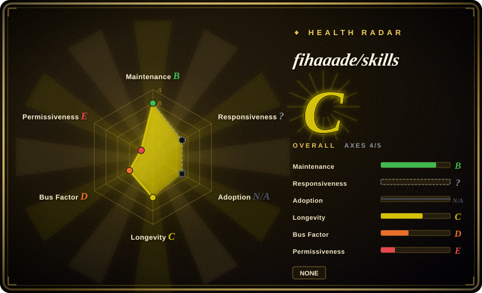
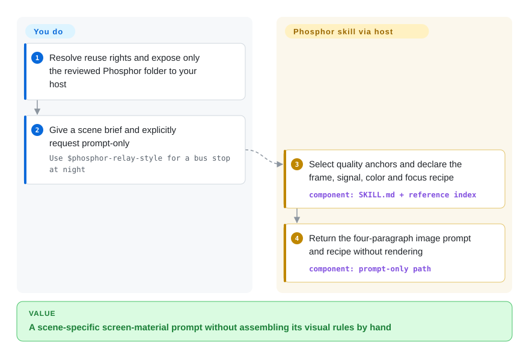
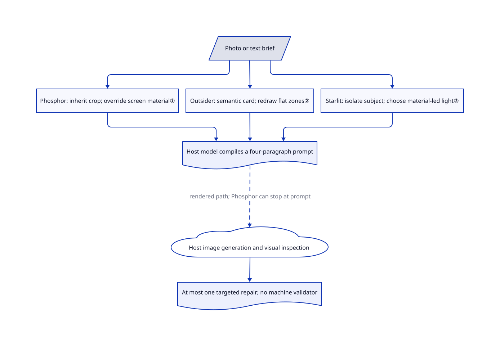

# fihaaade/skills

Your photo treatment keeps turning into a generic retro filter. This collection separates three concrete looks: a re-photographed glowing screen, a flat folk-art world, and a small object floating in blue night.

> **Information only, not permission to copy or commercialize.** The reviewed tree has no license grant. Its bundled screen references come from football broadcasts; their original creators and reuse rights are not established here. Repository ownership does not establish authorship of its prompts or images.

## When to use

You art-direct a poster or an editorial image, and “make it retro” keeps producing either clean clip art or random film grain. You need to inspect a small set of explicit visual grammars rather than browse hundreds of numbered looks. This **whole-repository** entry covers three skill folders at [reviewed commit `1aa85f4`](https://github.com/fihaaade/skills/tree/1aa85f4a0f426e985659b202efb33c3f7e01e48c): `phosphor-relay-style` applies screen material while preserving a supplied photograph's composition; `outsider-art` discards photographic pixels and rebuilds the scene as flat textured zones; `starlit-relic` isolates a subject in a grainy blue void with small hot highlights. The root README lists only the first; the other two are present in the tree.

Choose this as a **reference for a narrow art direction**, not as a cleared asset library. Compared with handraw-style's large gallery or hand-drawn-styles' verbatim recipes, these three prompts spend their detail on scene decisions, visual rejection rules and one targeted repair. You still need rights clearance and a host with the required image tools before adopting their workflow.

## When NOT to use

- **You need cleared commercial assets or a redistributable skill bundle.** No license exists in the reviewed tree, and the screen references have broadcast origins. Use your own rights-cleared artwork in [ComfyUI](../../on-device-ml/local-image-generation/comfyui.md); another repository's code license also cannot clear third-party art.
- **You want a large style menu or exact recipe extraction.** Pick [handraw-style](handraw-style.md) for gallery breadth, or [hand-drawn-styles](hand-drawn-styles.md) for its recipe renderer. Here, the host model compiles prose instructions; no script locks the resulting prompt.
- **You need offline generation, batch scheduling or reproducible pixels.** Use [ComfyUI](../../on-device-ml/local-image-generation/comfyui.md) with pinned weights and workflows. This repository contains no model, generator client, executable scripts or runtime tests. Host capabilities, fees and data handling remain yours.
- **Faces or crop fidelity are contractual requirements.** Use a reviewed [ComfyUI](../../on-device-ml/local-image-generation/comfyui.md) workflow with your own acceptance tests. Phosphor forbids identifiable real people; Outsider Art uses faceless figures. Starlit contradicts itself: its input rules ban faces, while its figure grammar and v1.4 notes allow them. Treat mode's instruction to preserve composition is not an enforced guarantee.

## Comparison

| Alternative | In index | Our verdict | Tradeoff |
|---|---|---|---|
| [handraw-style](handraw-style.md) | ✅ | Choose handraw-style when you need to discover a look through numbered styles, layouts and palettes; inspect this collection when screen material, flat folk scenes or night relics already define the brief. | Broad gallery and model-activation records versus three deeply specified workflows; bundled artwork rights still need separate review. |
| [hand-drawn-styles](hand-drawn-styles.md) | ✅ | Choose hand-drawn-styles when the same validated wording must survive repeated requests; choose this collection as an art-direction reference when each scene needs a fresh field card or material recipe. | A deterministic text extractor versus model-written prompts with visual checks; neither establishes deterministic image output. |
| [ComfyUI](../../on-device-ml/local-image-generation/comfyui.md) | ✅ | Choose ComfyUI when you must own rendering, weights and repeatable job configuration; this collection is useful only as prompt-level guidance for three looks. | A maintained generation runtime with hardware and workflow upkeep versus Markdown instructions with no bundled backend or license grant. |

## Quick start

Upstream supplies invocation examples, not an installer or a documented cross-host setup procedure. After resolving reuse rights, make only the selected, reviewed folder available through your host's own skill mechanism; this review did not install it. For the representative Phosphor path, use the [documented request](https://github.com/fihaaade/skills/blob/1aa85f4a0f426e985659b202efb33c3f7e01e48c/phosphor-relay-style/EXAMPLES.md#L79-L97) and explicitly request `prompt-only` to receive a prompt and recipe without rendering. The skill instructs the host model to choose composition and signal settings, then compile four paragraphs; it supplies no image tool itself. If you later authorize rendering, your host supplies generation and inspection, you pay model costs and approve any photo transfer; the upstream text's consent assumptions are not a substitute for your host's authorization rules.

<!-- flow-steps:begin (generated from flows/fihaaade-skills.json by tools/flow_card.py — do not edit) -->

Text version of the flow

1. **You**: Resolve reuse rights and expose only the reviewed Phosphor folder to your host
2. **You**: Give a scene brief and explicitly request prompt-only — `Use $phosphor-relay-style for a bus stop at night`
3. **fihaaade/skills**: Select quality anchors and declare the frame, signal, color and focus recipe — component: `SKILL.md + reference index`
4. **fihaaade/skills**: Return the four-paragraph image prompt and recipe without rendering — component: `prompt-only path`

**Value**: A scene-specific screen-material prompt without assembling its visual rules by hand

<!-- flow-steps:end -->

## Key techniques

<!-- mechanism:begin (generated from mechanisms/fihaaade-skills.json by tools/mechanism_card.py; do not edit) -->

Text version of the mechanism

- Photo or text brief
- Phosphor: inherit crop; override screen material①
- Outsider: semantic card; redraw flat zones②
- Starlit: isolate subject; choose material-led light③
- Host model compiles a four-paragraph prompt
- Host image generation and visual inspection
- At most one targeted repair; no machine validator

- Photo or text brief → Phosphor: inherit crop; override screen material①
- Photo or text brief → Outsider: semantic card; redraw flat zones②
- Photo or text brief → Starlit: isolate subject; choose material-led light③
- Phosphor: inherit crop; override screen material① → Host model compiles a four-paragraph prompt
- Outsider: semantic card; redraw flat zones② → Host model compiles a four-paragraph prompt
- Starlit: isolate subject; choose material-led light③ → Host model compiles a four-paragraph prompt
- Host model compiles a four-paragraph prompt → Host image generation and visual inspection (rendered path; Phosphor can stop at prompt) [optional/fallback]
- Host image generation and visual inspection → At most one targeted repair; no machine validator

<!-- mechanism:end -->

### 1. Separate inherited photo content from imposed screen material

- **Problem:** Adding scanlines to an otherwise unchanged warm, sharp photograph does not create the intended screen-rephotography look.
- **How:** Phosphor's Treat mode inherits subject, crop and moment but overrides color, luminance, focus and grid. Its recipe selects a signal state and color event; anchor selection records three invariants to preserve and three axes to change. The prompt-only path stops after compiling the recipe and prompt.
- **Limits:** These are host-model instructions, not an image-processing algorithm. Rendered mode asks the model to inspect highlights, shadows and midtones, repair once, and disclose remaining defects; no machine checks enforce those gates. The delivery instruction to omit provenance does not resolve reference-image rights.
- **Source:** [Treat split and recipe](https://github.com/fihaaade/skills/blob/1aa85f4a0f426e985659b202efb33c3f7e01e48c/phosphor-relay-style/SKILL.md#L28-L48), [anchor, compilation and repair](https://github.com/fihaaade/skills/blob/1aa85f4a0f426e985659b202efb33c3f7e01e48c/phosphor-relay-style/SKILL.md#L133-L209).

### 2. Rebuild photo semantics as a flat world instead of retaining pixels

- **Problem:** A folk-art treatment drifts back to camera perspective, mixed textures or decorative accent colors.
- **How:** Outsider Art first extracts a Field Card: place, two to five spatial bands, native colors, activities and highlight candidates. It then discards photo composition and pixels, assigns one texture per zone, and uses one saturated color with an explicit compositional job. Ground stays map-like while objects stand in flat elevation.
- **Limits:** Unlike Phosphor Treat, this intentionally does not preserve the original composition. Flatness, faceless figures, palette counts and the one-repair limit are prompt rules, not a validator or pixel transformation.
- **Source:** [Field Card and projection](https://github.com/fihaaade/skills/blob/1aa85f4a0f426e985659b202efb33c3f7e01e48c/outsider-art/SKILL.md#L47-L112), [highlight engine and workflow](https://github.com/fihaaade/skills/blob/1aa85f4a0f426e985659b202efb33c3f7e01e48c/outsider-art/SKILL.md#L132-L225).

### 3. Let object material select light grammar in an empty field

- **Problem:** “Add sparkles” leaves an ordinary product photograph on blue rather than a suspended, mostly-dark icon.
- **How:** Starlit builds a Relic Card and discard list, removes surroundings, then chooses a dominant light grammar from material: small specular points suggest starbursts, rough dark metal suggests a single flare, and matte forms suggest rim light. Placement, shadow share and bounded particle regions feed its four-paragraph prompt.
- **Limits:** The reference anatomy describes thirteen images that are not bundled, so its measurements cannot be independently rechecked from this tree. The face rules conflict at lines 54 and 90; margin limits also differ between 6% and 8%. Do not treat these prompts as a coherent policy engine.
- **Source:** [Relic Card, placement and light](https://github.com/fihaaade/skills/blob/1aa85f4a0f426e985659b202efb33c3f7e01e48c/starlit-relic/SKILL.md#L38-L129), [compiler and repair](https://github.com/fihaaade/skills/blob/1aa85f4a0f426e985659b202efb33c3f7e01e48c/starlit-relic/SKILL.md#L142-L184), [reference anatomy](https://github.com/fihaaade/skills/blob/1aa85f4a0f426e985659b202efb33c3f7e01e48c/starlit-relic/references/style-anatomy.md#L1-L16).

## Health & viability

- **Maintenance, 2026-10-30:** created 2026-07-26; latest default-branch commit is 2026-08-27. GitHub returns no tags, releases or issues. The collection has three skill documents totaling 763 lines, plus references, metadata and image examples; it is not an empty demonstration.
- **Governance and backing:** a personal account owns the repository; the contributors endpoint lists only fihaaade. Several commits include AI co-author trailers. The reviewed tree has no governance, security or funding document; no team-backed support is established.
- **Age and adoption:** about three months old, with 81 stars and six forks at verification. [推断：based on its short history and two-month commit gap] Treat it as a personal recipe snapshot, not a durable maintained dependency; the Lindy prior supplies little reassurance yet.
- **Rights and integrity:** the full tree contains no license or copyright notice. [Phosphor's README](https://github.com/fihaaade/skills/blob/1aa85f4a0f426e985659b202efb33c3f7e01e48c/phosphor-relay-style/README.md#L75-L77) identifies football-broadcast screen captures as reference material, but supplies no original-creator attribution or clearance. No claim of original authorship, complete provenance or commercial permission follows from this entry.
- **Integration quality:** root documentation omits two skills; Outsider Art's interface says v1.1 while its document says v1.2; Starlit's face and margin instructions conflict. Phosphor's metadata disables implicit invocation, so explicit selection matters. No upstream skills, hooks or rendering tools were loaded or executed during this review.

## Caveats (unverified)

- [未验证：no license grant or reference-rights documentation in the reviewed tree] Prompt authorship, the original creators of the broadcast references and the rights chain for the unbundled Starlit references remain unresolved. Missing permission is disclosed, not replaced by an assumed open-source license.
- [未验证：upstream execution was outside this review's authorization] No skill activation, image generation, paid model access or image upload was tested. Cross-host compatibility, visual fidelity and the author's validation notes remain unconfirmed in practice.
- [推断：repository created in July and last committed in August 2026] The collection is better treated as a version-pinned art-direction reference than a long-term supported dependency; future maintenance cannot be inferred from stars.
