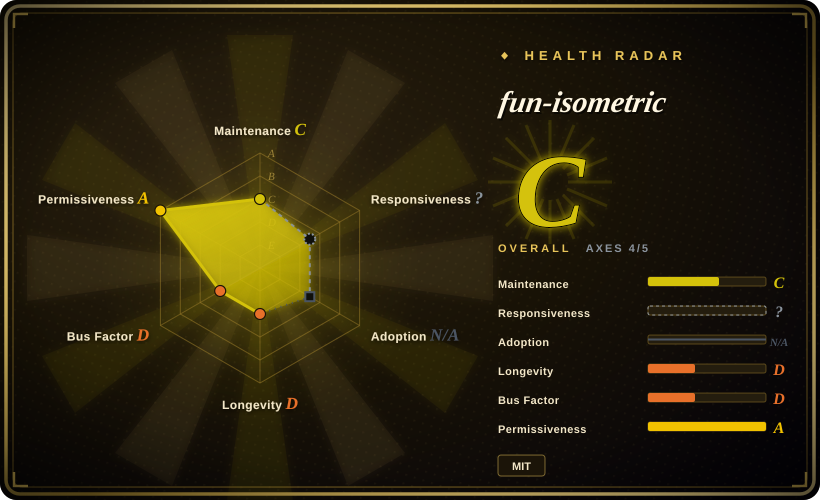
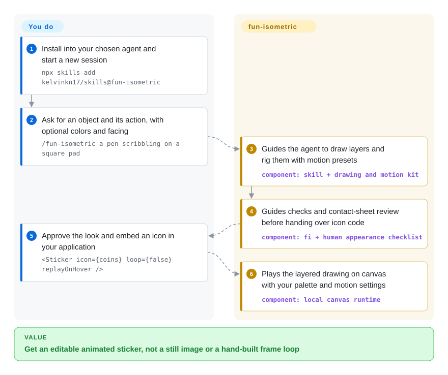
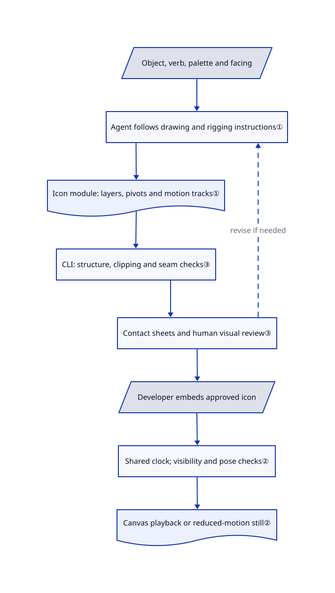

# fun-isometric

You ask an agent for a moving mailbox icon and get a flat picture with a generic wobble. fun-isometric gives it a drawing kit, hinged parts and reusable motion keys, so it can deliver an editable sticker module rather than another image-model prompt.

## When to use

You are building onboarding, an empty state or a feature page and need a small object that actually does something: a lock opens, a pen scribbles, a mailbox jolts. You already use a coding agent and want the drawing, palette and motion to stay editable in your application. The `kelvinkn17/skills` repository currently contains this one skill, plus its TypeScript canvas runtime, worked icons, React adapter and rendering/checking CLI.

Choose it over a general animation engine when you want the agent to author the object and its rig, not just animate shapes you already made. Choose it over a still-image recipe when runtime recoloring, articulated parts and transparent looping video matter more than a wide choice of art styles. Its 24 worked icons establish one thick-outline, extruded-slab look; they are examples for new code, not a model trained to reproduce arbitrary imagery.

## When NOT to use

- **You need DOM transitions, scroll choreography or arbitrary SVG animation.** Choose [Anime.js](../../frontend-animation/anime.md). This kit draws a specific sticker scene into a canvas; it is not a general page-motion engine.
- **The deliverable is a narrated or multi-scene video composition.** Start with [Remotion Agent Skills](../vendor-collections/product-vendors/remotion-skills.md), checking that page's license caveat before redistribution. fun-isometric exports one icon loop, not a video editor, soundtrack or composition timeline.
- **You want many illustration aesthetics or photoreal pixels.** Choose [handraw-style](handraw-style.md) for image-model prompts. This skill deliberately constrains drawings to slabs, flat role-based fills and preset motions; it does not generate raster imagery through an image model.
- **Your execution environment cannot download a browser or run native media tools.** Prefer [Anime.js](../../frontend-animation/anime.md) for live web motion with no sticker-rendering CLI. The live canvas runtime itself has no Lottie-player dependency, but the supplied checking/rendering path uses Bun and Chromium; contact sheets, not only video exports, invoke ffmpeg. First use can install Playwright and download Chromium.
- **You need a mature, versioned animation API or a guarantee that every agent follows the workflow.** Prefer [Anime.js](../../frontend-animation/anime.md) for an established library surface. This repository was created a day before verification and has no releases; drawing rules and completion checks are instructions to the agent, not an enforced orchestration engine.

## Comparison

| Alternative | In index | Our verdict | Tradeoff |
|---|---|---|---|
| [Anime.js](../../frontend-animation/anime.md) | ✅ | Choose Anime.js when you already own the DOM/SVG artwork and need timeline or scroll control; choose fun-isometric when an agent should draw and rig a new sticker in its house style. | A general animation engine leaves asset authoring to you; the sticker skill supplies drawing examples and presets but restricts both appearance and scene format. |
| [Remotion Agent Skills](../vendor-collections/product-vendors/remotion-skills.md) | ✅ | Choose Remotion's skills for React video compositions spanning scenes and media; choose fun-isometric for an embeddable object loop that also has an alpha-video export path. | Remotion guidance assumes its separate rendering framework and has a skill-license caveat in the linked page; this kit ships its own canvas player but no full video-production workflow. |
| [handraw-style](handraw-style.md) | ✅ | Choose handraw-style when changing illustration aesthetics is the task; choose fun-isometric when the deliverable must be editable drawing code with moving parts rather than a prompt handed to an image model. | Broad image-style selection and model-dependent pixels versus one constrained aesthetic with explicit layers, palette slots and motion tracks. |

## Quick start

The [documented install](https://github.com/kelvinkn17/skills/blob/7c8a7526306e09855c0d4f66130cbaa87422cb8d/README.md#L13-L20) is `npx skills add kelvinkn17/skills@fun-isometric` on Node 22 or newer; choose the target agent and installation scope, then start a new session. Ask `/fun-isometric a pen scribbling on a square pad`, or use `$fun-isometric` in Codex, with optional palette and facing instructions. The skill tells the agent to copy the runtime and motion kit beside your icon module, draw and rig the parts, render a contact sheet and iterate on its checks; you still approve the result and integrate it using the [actual React example](https://github.com/kelvinkn17/skills/blob/7c8a7526306e09855c0d4f66130cbaa87422cb8d/skills/fun-isometric/SKILL.md#L163-L185) or the plain-canvas player. Rendering/checking needs Bun, may install Playwright/Chromium, and needs ffmpeg for contact sheets and exports; your agent account supplies the model and its costs, with no bundled model or mandatory hosted generator. The output is TypeScript icon code for live playback, or an exported WebM and PNG poster; transparent HEVC MP4 is macOS-only in the reviewed CLI. Keep the root MIT copyright and permission notice with copied code: the [ZIP builder](https://github.com/kelvinkn17/skills/blob/7c8a7526306e09855c0d4f66130cbaa87422cb8d/skills/fun-isometric/bin/pack.mjs#L8-L30) packages only the skill subtree, which has an MIT frontmatter label but no copy of the root `LICENSE` text.

<!-- flow-steps:begin (generated from flows/fun-isometric.json by tools/flow_card.py — do not edit) -->

Text version of the flow

1. **You**: Install into your chosen agent and start a new session — `npx skills add kelvinkn17/skills@fun-isometric`
2. **You**: Ask for an object and its action, with optional colors and facing — `/fun-isometric a pen scribbling on a square pad`
3. **fun-isometric**: Guides the agent to draw layers and rig them with motion presets — component: `skill + drawing and motion kit`
4. **fun-isometric**: Guides checks and contact-sheet review before handing over icon code — component: `fi + human appearance checklist`
5. **You**: Approve the look and embed an icon in your application — `<Sticker icon={coins} loop={false} replayOnHover />`
6. **fun-isometric**: Plays the layered drawing on canvas with your palette and motion settings — component: `local canvas runtime`

**Value**: Get an editable animated sticker, not a still image or a hand-built frame loop

<!-- flow-steps:end -->

## Key techniques

<!-- mechanism:begin (generated from mechanisms/fun-isometric.json by tools/mechanism_card.py; do not edit) -->

Text version of the mechanism

- Object, verb, palette and facing
- Agent follows drawing and rigging instructions①
- Icon module: layers, pivots and motion tracks①
- CLI: structure, clipping and seam checks③
- Contact sheets and human visual review③
- Developer embeds approved icon
- Shared clock; visibility and pose checks②
- Canvas playback or reduced-motion still②

- Object, verb, palette and facing → Agent follows drawing and rigging instructions①
- Agent follows drawing and rigging instructions① → Icon module: layers, pivots and motion tracks①
- Icon module: layers, pivots and motion tracks① → CLI: structure, clipping and seam checks③
- CLI: structure, clipping and seam checks③ → Contact sheets and human visual review③
- Contact sheets and human visual review③ → Agent follows drawing and rigging instructions① (revise if needed) [optional/fallback]
- Contact sheets and human visual review③ → Developer embeds approved icon
- Developer embeds approved icon → Shared clock; visibility and pose checks②
- Shared clock; visibility and pose checks② → Canvas playback or reduced-motion still②

<!-- mechanism:end -->

### 1. Separate the drawing's rest pose from reusable motion tracks

- **Problem:** Redrawing an object or replacing its palette should not require inventing another animation curve or moving every part in lockstep.
- **How:** Icons contain layered paths, pivot points and parent links. Motion tracks add position/rotation offsets over that rest pose, with amplitude and start-frame controls for follower lag; cubic-bezier easing and sampled arc-length paths interpolate the presets. Semantic color slots let the same drawing take another palette.
- **Limits:** The format is not a general Lottie JSON importer. Morph paths must have matching commands, and the runtime's similarity to Lottie interpolation does not establish bit-identical playback. Preset selection and sensible hinges still depend on the authoring agent.
- **Source:** [layer and track types](https://github.com/kelvinkn17/skills/blob/7c8a7526306e09855c0d4f66130cbaa87422cb8d/skills/fun-isometric/kit/fun.ts#L3-L86), [interpolation](https://github.com/kelvinkn17/skills/blob/7c8a7526306e09855c0d4f66130cbaa87422cb8d/skills/fun-isometric/kit/fun.ts#L90-L201), [layer composition](https://github.com/kelvinkn17/skills/blob/7c8a7526306e09855c0d4f66130cbaa87422cb8d/skills/fun-isometric/kit/fun.ts#L237-L264), [worked folder rig](https://github.com/kelvinkn17/skills/blob/7c8a7526306e09855c0d4f66130cbaa87422cb8d/skills/fun-isometric/kit/icons.ts#L25-L49).

### 2. Share a clock while skipping invisible or unchanged paints

- **Problem:** A page of stickers should not need a separate frame loop per icon or repaint a still hold continually.
- **How:** Players register in one live set and use one animation-frame callback. Intersection and resize observers supply visibility and size; a scene fingerprint avoids repainting unchanged poses. The reduced-motion query selects the icon's still frame, and the React adapter unregisters a player on effect cleanup.
- **Limits:** Skipping paint is not the same as doing no work: visible players still compute scenes and fingerprints, and the shared callback runs while registered players remain. Browser canvas support and sensible icon complexity are still required; no device-performance result was measured here.
- **Source:** [scene fingerprint](https://github.com/kelvinkn17/skills/blob/7c8a7526306e09855c0d4f66130cbaa87422cb8d/skills/fun-isometric/kit/fun.ts#L308-L340), [clock, observers and cleanup](https://github.com/kelvinkn17/skills/blob/7c8a7526306e09855c0d4f66130cbaa87422cb8d/skills/fun-isometric/kit/fun.ts#L674-L739), [React lifecycle](https://github.com/kelvinkn17/skills/blob/7c8a7526306e09855c0d4f66130cbaa87422cb8d/skills/fun-isometric/kit/Sticker.tsx#L15-L38).

### 3. Combine structural lint, frame sampling and human visual review

- **Problem:** Valid TypeScript can still contain a dangling parent, a cut-off swinging part or a visibly jumping loop seam.
- **How:** The CLI bundles icons into a browser page, checks IDs, clipping references, palette slots and compatible morph commands, then paints every frame at 200 pixels to detect edge contact. A separate 300-pixel luminance comparison tests the loop seam; contact sheets and peak-frame images support the skill's manual appearance checklist.
- **Limits:** The edge and seam thresholds are heuristics, not aesthetic or animation correctness proofs. Arbitrary icon modules execute in the rendering page, so do not feed it untrusted code. A passing check does not replace looking at requested colors, silhouettes and hinges.
- **Source:** [browser bundling and structural checks](https://github.com/kelvinkn17/skills/blob/7c8a7526306e09855c0d4f66130cbaa87422cb8d/skills/fun-isometric/bin/fi.mjs#L65-L163), [command dispatch and seam test](https://github.com/kelvinkn17/skills/blob/7c8a7526306e09855c0d4f66130cbaa87422cb8d/skills/fun-isometric/bin/fi.mjs#L182-L234), [human checklist](https://github.com/kelvinkn17/skills/blob/7c8a7526306e09855c0d4f66130cbaa87422cb8d/skills/fun-isometric/SKILL.md#L154-L161).

## Health & viability

- **Maintenance, 2026-10-27:** created 2026-10-26; the API returns seven commits by one contributor, no releases and no issues in the sampled endpoints. Changes include the discovery index, packaging and Chromium-install handling. This is an initial project, not an established release cadence; an empty issue list cannot establish responsiveness.
- **Governance and backing, 2026-10-27:** user-owned by `kelvinkn17`; the fixed tree has no CONTRIBUTING, GOVERNANCE, SECURITY or CODEOWNERS file. The author distributes a site and agent plugin, but no foundation or team-governance contract appears in the reviewed artifacts.
- **Age and selection judgment, 2026-10-27:** one day of history provides essentially no Lindy evidence. [推断：based on age, single-contributor history and absent releases] Treat it as a small, inspectable asset-authoring kit worth pinning and adapting, not a stable animation platform promised to last.
- **License and provenance, 2026-10-27:** the root MIT text names `kelvinkn17`, and the single skill retains `license: MIT`. The README explicitly credits Slush as visual inspiration and the runtime describes Lottie-like interpolation. No files are blob-identical to the two checked upstream trees, Anthropic Skills and lottie-web; that narrow check is not proof of independent authorship or clearance of Slush-related artwork rights. Preserve the root license when redistributing subtree content.
- **Adoption and operational risk, 2026-10-27:** a public install command, 24 coded examples and 30 stars are discoverability signals, not verified production use. The preview site's production entry enables Vercel analytics and speed insights; the copied `kit/` runtime does not import them. The CLI can install Playwright into a persistent home cache and overwrite chosen output paths with ffmpeg's `-y`, so approve network/tool installation and output locations separately.

## Caveats (unverified)

- [未验证：upstream execution, installation and browser use were prohibited for this intake] Agent activation, generated-art quality, browser compatibility, video encoding and checks were reviewed statically, not run. No performance gain or pixel-equivalence to Lottie is claimed.
- [未验证：the source comparison covered two named public trees, not a global provenance or legal audit] No exact blob reuse was found there; the provenance of every motion coordinate and the rights behind the credited Slush inspiration were not independently established. The root MIT license is not a grant from Slush.
- [推断：based on the opened indexed pages and this kit's source boundaries] Comparison verdicts concern output and integration shape, not measured animation quality or cost.
- [未验证：no uninstall contract or failure-injection test is present] Complete recovery of temporary directories after interrupted rendering, shared browser-download cleanup and cross-agent installer removal were not verified. Stop mounted players, preserve editable sources and posters, and remove only installation/cache/output paths you own.
