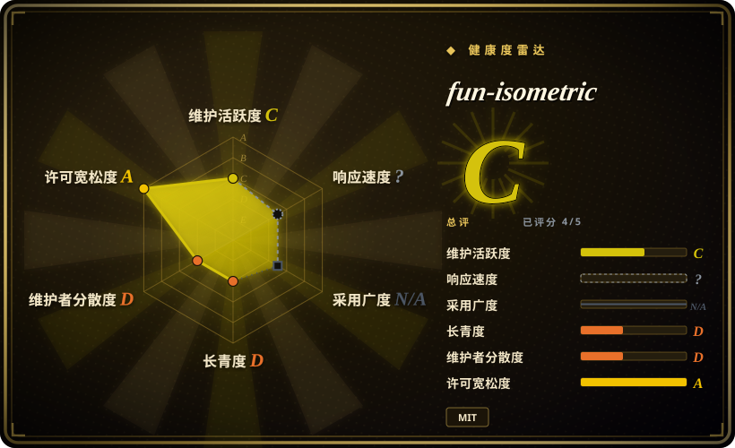
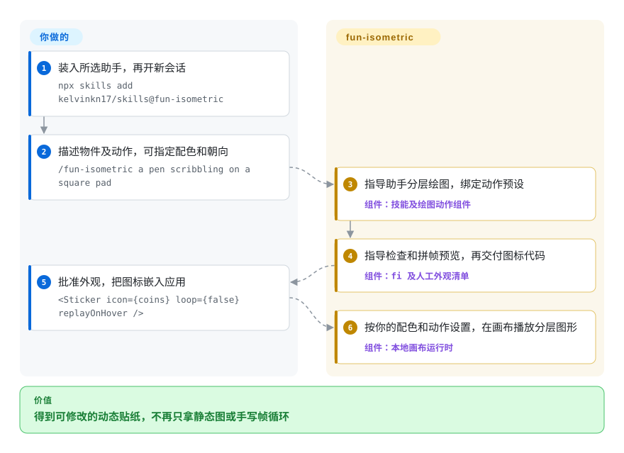
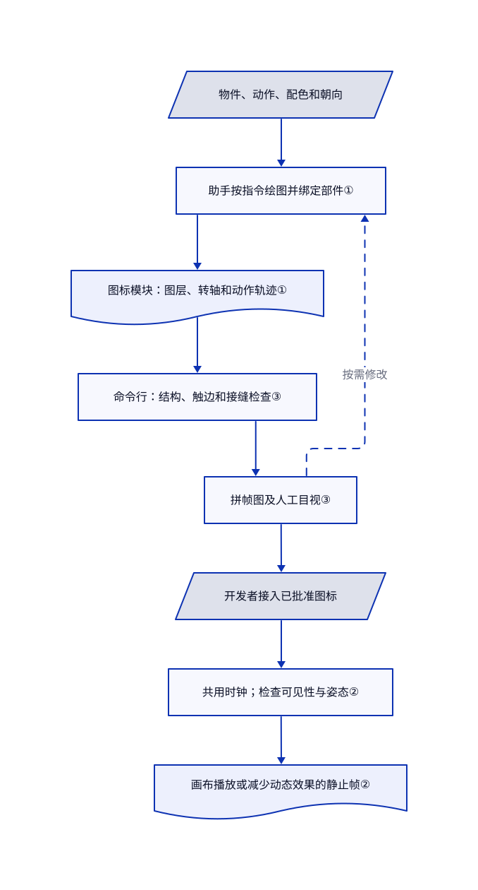

# fun-isometric

你让助手画一个会动的信箱，它却交出平面图加通用晃动。fun-isometric 提供绘图组件、部件转轴和可复用的动作帧，让助手交付可修改的贴纸代码，而不是再写一段生图提示词。

## 何时使用

你在做新手引导、空状态或功能页，需要小物件真的做一个动作：锁打开、笔涂写、信箱抖一下。你已经使用编码助手，希望图形、配色和动作都能在应用里继续修改。`kelvinkn17/skills` 当前只包含这一套技能，另附 TypeScript 画布运行时、示例图标、React 适配组件和渲染检查命令行。

当你要让助手连物件和转轴一起创作，而非只让现有图形动起来时，选它而非通用动画引擎。当运行时换色、分部件运动和透明循环视频比多种画风更重要时，选它而非静态生图配方。二十四个代码示例规定了粗描边、挤出厚度的统一外观；它们是新代码的参考，不是能复现任意图像的训练模型。

## 何时不用

- **你需要页面过渡、滚动编排或任意 SVG 动画。** 选 [Anime.js](../../frontend-animation/anime.zh.md)。这里的组件把特定贴纸场景画进画布，不是通用页面动画引擎。
- **交付物是带解说或多个场景的视频。** 从 [Remotion Agent Skills](../vendor-collections/product-vendors/remotion-skills.zh.md) 入手，再分发前注意该页的技能许可提醒。fun-isometric 导出单个图标循环，不提供视频编辑器、音轨或合成时间线。
- **你想切换多种插画风格，或生成写实像素。** 用 [handraw-style](handraw-style.zh.md) 组织生图提示词。本技能有意限定厚片造型、按语义配色的平涂和预设动作，不通过生图模型生成位图。
- **执行环境不能下载浏览器或运行本机媒体工具。** 仅需网页实时动画时，优先选不依赖贴纸渲染命令的 [Anime.js](../../frontend-animation/anime.zh.md)。实时画布组件本身不依赖 Lottie 播放器，但所附检查和渲染路径需要 Bun、Chromium；拼帧预览图也调用 ffmpeg，并非只有视频导出才需要。首次使用可能安装 Playwright 并下载 Chromium。
- **你需要成熟、带版本承诺的动画接口，或保证助手严格执行流程。** 优先看 [Anime.js](../../frontend-animation/anime.zh.md) 的成熟库接口。此仓库在核验前一天才创建，尚无发布；绘图与验收规则是给助手的指令，不是强制执行的编排引擎。

## 横向对比

| 替代品 | 是否收录 | 我们的评价 | 取舍 |
|---|---|---|---|
| [Anime.js](../../frontend-animation/anime.zh.md) | 已收录 | 已有网页或 SVG 图形、需要时间线和滚动控制时，选 Anime.js；需要助手按固定外观新画并绑定贴纸时，选 fun-isometric。 | 通用引擎把素材创作留给你；贴纸技能提供绘图示例和动作，但限定外观与场景格式。 |
| [Remotion Agent Skills](../vendor-collections/product-vendors/remotion-skills.zh.md) | 已收录 | 需要跨场景和媒体的 React 视频合成时，选 Remotion 技能；只需可嵌入页面、还能导出透明视频的物件循环时，选 fun-isometric。 | Remotion 指导依赖独立渲染框架，所链页面另有技能许可提醒；本套件自带画布播放器，却没有完整视频制作流程。 |
| [handraw-style](handraw-style.zh.md) | 已收录 | 任务在于切换插画风格时，选 handraw-style；交付必须是能修改、分部件运动的绘图代码，而非交给生图模型的提示词时，选 fun-isometric。 | 多种画风和依赖模型的像素，对比单一受限外观及明确的图层、配色槽和动作轨迹。 |

## 快速上手

[文档安装方式](https://github.com/kelvinkn17/skills/blob/7c8a7526306e09855c0d4f66130cbaa87422cb8d/README.md#L13-L20) 是在 Node 22 或更新版本上执行 `npx skills add kelvinkn17/skills@fun-isometric`，选择目标助手和安装范围，再开新会话。提出 `/fun-isometric a pen scribbling on a square pad`，在 Codex 中改用 `$fun-isometric`，还可指定配色和朝向。技能要求助手把运行时与动作组件放到图标模块旁边，绘制并绑定部件，生成拼帧图再迭代检查；最终外观仍由你批准，并按 [真实 React 示例](https://github.com/kelvinkn17/skills/blob/7c8a7526306e09855c0d4f66130cbaa87422cb8d/skills/fun-isometric/SKILL.md#L163-L185) 或普通画布播放器接入。渲染和检查需要 Bun，可能安装 Playwright／Chromium；拼帧图和导出需要 ffmpeg；模型及费用来自你的助手账号，没有内置模型，也不强制使用托管生成器。结果是可实时播放的 TypeScript 图标代码，或导出的 WebM 和 PNG 封面；核验的命令行只在 macOS 导出透明 HEVC MP4。复制代码时保留根目录 MIT 版权及授权正文：[ZIP 打包器](https://github.com/kelvinkn17/skills/blob/7c8a7526306e09855c0d4f66130cbaa87422cb8d/skills/fun-isometric/bin/pack.mjs#L8-L30) 只打包技能子树，其中虽有 MIT 元数据标签，却没有根目录的 `LICENSE` 正文。

<!-- flow-steps:begin (generated from flows/fun-isometric.json by tools/flow_card.py — do not edit) -->

流程文字版

1. **你**：装入所选助手，再开新会话 — `npx skills add kelvinkn17/skills@fun-isometric`
2. **你**：描述物件及动作，可指定配色和朝向 — `/fun-isometric a pen scribbling on a square pad`
3. **fun-isometric**：指导助手分层绘图，绑定动作预设 — 组件：`技能及绘图动作组件`
4. **fun-isometric**：指导检查和拼帧预览，再交付图标代码 — 组件：`fi 及人工外观清单`
5. **你**：批准外观，把图标嵌入应用 — `<Sticker icon={coins} loop={false} replayOnHover />`
6. **fun-isometric**：按你的配色和动作设置，在画布播放分层图形 — 组件：`本地画布运行时`

**价值**：得到可修改的动态贴纸，不再只拿静态图或手写帧循环

<!-- flow-steps:end -->

## 技术要点

<!-- mechanism:begin (generated from mechanisms/fun-isometric.json by tools/mechanism_card.py; do not edit) -->

机制文字版

- 物件、动作、配色和朝向
- 助手按指令绘图并绑定部件①
- 图标模块：图层、转轴和动作轨迹①
- 命令行：结构、触边和接缝检查③
- 拼帧图及人工目视③
- 开发者接入已批准图标
- 共用时钟；检查可见性与姿态②
- 画布播放或减少动态效果的静止帧②

- 物件、动作、配色和朝向 → 助手按指令绘图并绑定部件①
- 助手按指令绘图并绑定部件① → 图标模块：图层、转轴和动作轨迹①
- 图标模块：图层、转轴和动作轨迹① → 命令行：结构、触边和接缝检查③
- 命令行：结构、触边和接缝检查③ → 拼帧图及人工目视③
- 拼帧图及人工目视③ → 助手按指令绘图并绑定部件①（按需修改）〔可选／兜底〕
- 拼帧图及人工目视③ → 开发者接入已批准图标
- 开发者接入已批准图标 → 共用时钟；检查可见性与姿态②
- 共用时钟；检查可见性与姿态② → 画布播放或减少动态效果的静止帧②

<!-- mechanism:end -->

### 1. 把静止造型与复用动作轨迹分开

- **解决：** 重画物件或换配色，不应要求重新发明动画曲线，更不应让所有部件齐步晃动。
- **做法：** 图标包含分层路径、转轴和父子关系。动作轨迹在静止姿态上叠加位置及旋转偏移，通过幅度和起始帧控制跟随延迟；三次贝塞尔缓动与按弧长采样的路径负责插值。语义配色槽让同一图形换用另一套颜色。
- **边界：** 该格式不是通用 Lottie JSON 导入器。变形路径必须有匹配的命令序列，采用类似 Lottie 的插值也不证明逐像素一致。预设选择和合理转轴仍依赖创作助手。
- **源码：** [图层与轨迹类型](https://github.com/kelvinkn17/skills/blob/7c8a7526306e09855c0d4f66130cbaa87422cb8d/skills/fun-isometric/kit/fun.ts#L3-L86)、[插值](https://github.com/kelvinkn17/skills/blob/7c8a7526306e09855c0d4f66130cbaa87422cb8d/skills/fun-isometric/kit/fun.ts#L90-L201)、[图层合成](https://github.com/kelvinkn17/skills/blob/7c8a7526306e09855c0d4f66130cbaa87422cb8d/skills/fun-isometric/kit/fun.ts#L237-L264)、[文件夹绑定示例](https://github.com/kelvinkn17/skills/blob/7c8a7526306e09855c0d4f66130cbaa87422cb8d/skills/fun-isometric/kit/icons.ts#L25-L49)。

### 2. 共用时钟，跳过不可见或未变的绘制

- **解决：** 一页贴纸不应每个都开独立帧循环，也不应在静止停顿时不断重画。
- **做法：** 播放器注册到同一个集合，使用一个动画帧回调。可见性与尺寸观察器提供状态，场景指纹避免重画未变姿态。减少动态效果的系统设置会选中图标静止帧，React 适配器在副作用清理时注销播放器。
- **边界：** 跳过绘制不等于零工作，可见播放器仍计算场景和指纹；只要还注册着播放器，共用回调就继续运行。仍需浏览器画布能力和合理的图标复杂度，本轮未测设备性能。
- **源码：** [场景指纹](https://github.com/kelvinkn17/skills/blob/7c8a7526306e09855c0d4f66130cbaa87422cb8d/skills/fun-isometric/kit/fun.ts#L308-L340)、[时钟、观察器与清理](https://github.com/kelvinkn17/skills/blob/7c8a7526306e09855c0d4f66130cbaa87422cb8d/skills/fun-isometric/kit/fun.ts#L674-L739)、[React 生命周期](https://github.com/kelvinkn17/skills/blob/7c8a7526306e09855c0d4f66130cbaa87422cb8d/skills/fun-isometric/kit/Sticker.tsx#L15-L38)。

### 3. 组合结构检查、逐帧采样与人工目视

- **解决：** 有效 TypeScript 仍可能包含失效父节点、摆动时被裁掉的部件，或明显跳变的循环接缝。
- **做法：** 命令行把图标打包进浏览器页面，检查标识、裁切引用、配色槽和变形命令兼容性，再以二百像素逐帧绘制检查触边。另用三百像素亮度差比较接缝；拼帧图和动作峰值图支撑技能中的人工外观清单。
- **边界：** 触边和接缝阈值是启发式检查，不是审美或动作正确性的证明。图标模块会在渲染页执行，不要输入不可信代码。检查通过不能替代查看指定配色、轮廓和转轴。
- **源码：** [浏览器打包和结构检查](https://github.com/kelvinkn17/skills/blob/7c8a7526306e09855c0d4f66130cbaa87422cb8d/skills/fun-isometric/bin/fi.mjs#L65-L163)、[命令分发与接缝检查](https://github.com/kelvinkn17/skills/blob/7c8a7526306e09855c0d4f66130cbaa87422cb8d/skills/fun-isometric/bin/fi.mjs#L182-L234)、[人工清单](https://github.com/kelvinkn17/skills/blob/7c8a7526306e09855c0d4f66130cbaa87422cb8d/skills/fun-isometric/SKILL.md#L154-L161)。

## 健康度与可持续性

- **维护，2026-10-27：** 2026-10-26 创建，接口返回一位贡献者的七次提交，发布和问题抽样接口均为空。改动包括发现索引、打包和 Chromium 安装处理。这是初始项目，不是成熟发布节奏；问题列表为空也不能证明响应及时。
- **治理与支持，2026-10-27：** 归用户 `kelvinkn17` 所有。固定源码树没有贡献、治理、安全政策或代码负责人文件。作者分发网站及助手插件，但已读材料没有基金会或团队治理契约。
- **年龄与判断，2026-10-27：** 一天历史基本没有长期存续证据。[推断：依据是年龄、单贡献者历史及尚无发布] 把它当作值得固定版本、自行修改的小型素材创作组件，不当作承诺长期稳定的动画平台。
- **许可与来源，2026-10-27：** 根 MIT 正文署名 `kelvinkn17`，唯一技能保留 `license: MIT`。README 明确感谢 Slush 的视觉启发，运行时说明采用类似 Lottie 的插值。与本次检查的 Anthropic Skills、lottie-web 两棵源码树相比，没有同 blob 文件；此检查不证明独立原创，也不证明 Slush 相关美术权利已获清理。再分发子树内容时应保留根许可。
- **采用与运行风险，2026-10-27：** 公开安装命令、二十四个代码示例和三十颗星是可发现信号，不是经核验的生产采用。预览站的生产入口启用 Vercel 分析及速度统计，复制的 `kit/` 运行时没有导入它们。命令行可能把 Playwright 安装进家目录持久缓存，并用 ffmpeg 的 `-y` 覆盖指定输出，应分别批准联网安装及输出位置。

## 存疑（未验证）

- [未验证：本轮禁止执行上游、安装和浏览器操作] 助手激活、生成外观、浏览器兼容性、视频编码和检查仅作静态核验，未实际运行。不声称性能收益或与 Lottie 逐像素一致。
- [未验证：来源对比只覆盖两棵指定公开源码树，不是全网来源或法律审计] 两者均未发现同 blob 复用；每个动作坐标的来源及所感谢的 Slush 启发背后的权利，均未独立确认。根 MIT 许可不是 Slush 的授权。
- [推断：依据是实际打开的索引页及本套件的源码边界] 对比结论针对输出和集成形态，不是动画质量或费用实测。
- [未验证：仓库没有卸载契约或中断故障测试] 渲染中断后的临时目录完全恢复、共享浏览器下载清理和跨助手安装移除均未核验。应停止挂载的播放器，保留可编辑源码和封面，只移除自己拥有的安装、缓存及输出路径。
