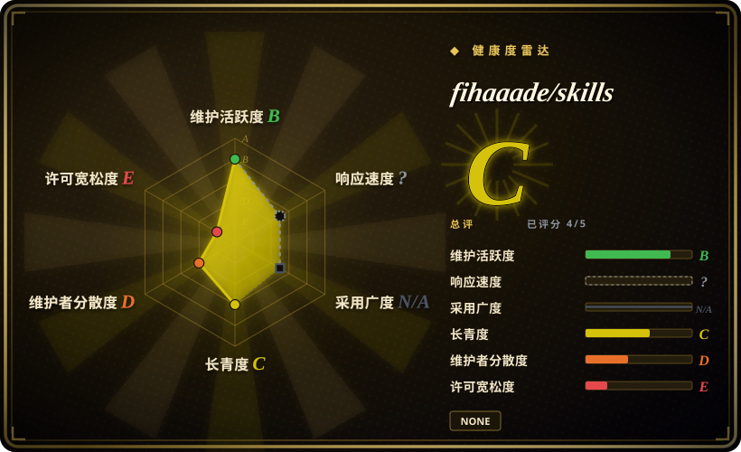
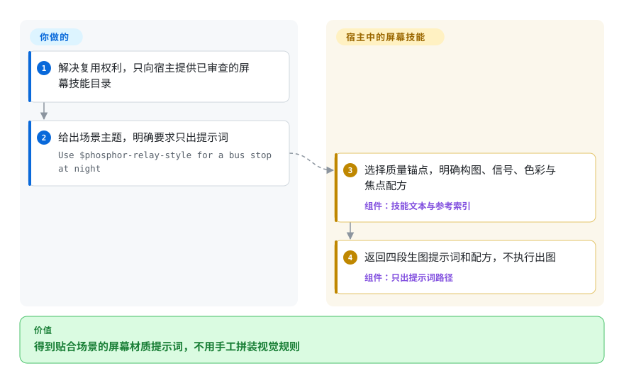
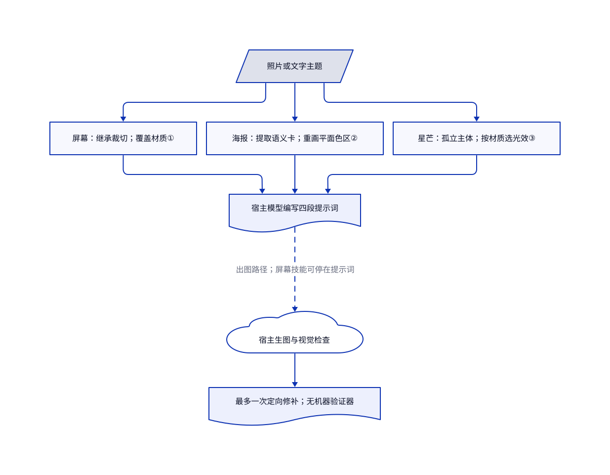

# fihaaade/skills

你想给照片换一种画法，模型却只会加复古滤镜。这个合集拆出三套明确规则：发光屏幕重摄、平面民俗海报、蓝色夜场中的悬浮物体。

> **仅作介绍，不构成复制或商用许可。** 已查整树没有许可授权。包内屏幕参考图来自足球转播，其原作者及复用权利未核清。仓库持有人不等于提示词或图片的已证原创作者。

## 何时使用

你在做海报或编辑配图，“复古一点”却总变成干净剪贴画或随意胶片颗粒。你想研究几套具体视觉语法，不想浏览数百种编号画风。本页按**整仓**介绍，[固定提交 `1aa85f4`](https://github.com/fihaaade/skills/tree/1aa85f4a0f426e985659b202efb33c3f7e01e48c) 包含三套技能：`phosphor-relay-style` 保留照片构图，强制施加屏幕材质；`outsider-art` 丢弃照片像素，以平面纹理色区重建场景；`starlit-relic` 把主体放进有颗粒的蓝色空场，用少量热点照亮。根说明只列第一套，另两套确实存在于目录树。

当你要研究**窄范围的美术方向**时考虑它，不要把它当成权利已清的素材库。相较 handraw-style 的大画廊或 hand-drawn-styles 的原样配方，这三套提示词把细节用在场景决策、视觉排除规则和一次定向修补。正式采用前，你仍须解决复用权利，并准备具备所需图像工具的宿主。

## 何时不用

- **要商用权利已清的素材或可再分发技能包。** 已查整树无许可，屏幕参考图还涉及转播来源。应在 [ComfyUI](../../../on-device-ml/local-image-generation/comfyui.zh.md) 中使用自有且权利已清的素材；别的仓库的代码许可同样不能替第三方美术授权。
- **要大画风菜单，或原样取出固定配方。** 选 [handraw-style](handraw-style.zh.md) 浏览画廊，或用 [hand-drawn-styles](hand-drawn-styles.zh.md) 的配方渲染器。这里由宿主模型编写提示词，没有脚本锁定最终文字。
- **要离线生图、批处理调度或可复现像素。** 选 [ComfyUI](../../../on-device-ml/local-image-generation/comfyui.zh.md)，固定权重和流程。本仓没有模型、生图客户端、可执行脚本或运行时测试；宿主能力、费用和数据处理由你负责。
- **人脸或原图裁切必须满足合同要求。** 用经过审查的 [ComfyUI](../../../on-device-ml/local-image-generation/comfyui.zh.md) 流程，另建验收测试。屏幕技能禁止可辨认真人，平面海报使用无脸人物。星芒技能自相矛盾：输入规则禁止人脸，人物语法和 v1.4 记录却允许。保留构图也只是屏幕技能的文字指令，不是硬保证。

## 横向对比

| 替代品 | 是否收录 | 我们的评价 | 取舍 |
|---|---|---|---|
| [handraw-style](handraw-style.zh.md) | 已收录 | 需要靠编号画风、版面和配色发现方向时选它；已经定下屏幕材质、平面民俗场景或夜场圣物时，再研究本合集。 | 大画廊和模型激活记录，对比三套深入展开的工作流；包内美术权利仍须单独核查。 |
| [hand-drawn-styles](hand-drawn-styles.zh.md) | 已收录 | 多次请求必须保留同一套验证过的措辞时选它；每个场景要重新编场景卡或材质配方时，把本合集当美术方向参考。 | 确定性的文字提取器，对比模型编写提示词和视觉检查；两者都不保证像素确定性。 |
| [ComfyUI](../../../on-device-ml/local-image-generation/comfyui.zh.md) | 已收录 | 必须掌控渲染、权重和可重复任务配置时选它；本合集仅提供三种画法的提示词指导。 | 持续维护的生图运行时需要硬件和流程维护；本合集只有指令文本，没有后端或许可授权。 |

## 快速上手

上游只给调用范例，没有安装器，也没有跨宿主的设置流程。解决复用权利后，才通过宿主自身的技能机制提供选中的已审查目录；本次没有安装。以下用屏幕技能作代表：使用[文档中的请求](https://github.com/fihaaade/skills/blob/1aa85f4a0f426e985659b202efb33c3f7e01e48c/phosphor-relay-style/EXAMPLES.md#L79-L97)，明确要求 `prompt-only`，只取提示词和配方，不生成图片。技能要求宿主模型选择构图和信号参数，再编写四段提示词；它自身不提供生图工具。若以后授权出图，生成和看图能力由宿主提供，模型费用与照片传输由你确认；上游文字中的同意假设不能代替宿主授权规则。

<!-- flow-steps:begin (generated from flows/fihaaade-skills.json by tools/flow_card.py — do not edit) -->

流程文字版

1. **你**：解决复用权利，只向宿主提供已审查的屏幕技能目录
2. **你**：给出场景主题，明确要求只出提示词 — `Use $phosphor-relay-style for a bus stop at night`
3. **fihaaade/skills**：选择质量锚点，明确构图、信号、色彩与焦点配方 — 组件：`技能文本与参考索引`
4. **fihaaade/skills**：返回四段生图提示词和配方，不执行出图 — 组件：`只出提示词路径`

**价值**：得到贴合场景的屏幕材质提示词，不用手工拼装视觉规则

<!-- flow-steps:end -->

## 技术要点

<!-- mechanism:begin (generated from mechanisms/fihaaade-skills.json by tools/mechanism_card.py; do not edit) -->

机制文字版

- 照片或文字主题
- 屏幕：继承裁切；覆盖材质①
- 海报：提取语义卡；重画平面色区②
- 星芒：孤立主体；按材质选光效③
- 宿主模型编写四段提示词
- 宿主生图与视觉检查
- 最多一次定向修补；无机器验证器

- 照片或文字主题 → 屏幕：继承裁切；覆盖材质①
- 照片或文字主题 → 海报：提取语义卡；重画平面色区②
- 照片或文字主题 → 星芒：孤立主体；按材质选光效③
- 屏幕：继承裁切；覆盖材质① → 宿主模型编写四段提示词
- 海报：提取语义卡；重画平面色区② → 宿主模型编写四段提示词
- 星芒：孤立主体；按材质选光效③ → 宿主模型编写四段提示词
- 宿主模型编写四段提示词 → 宿主生图与视觉检查（出图路径；屏幕技能可停在提示词）〔可选／兜底〕
- 宿主生图与视觉检查 → 最多一次定向修补；无机器验证器

<!-- mechanism:end -->

### 1. 把照片继承项与屏幕材质覆盖项分开

- **解决：** 给暖色锐利照片叠扫描线，并不等于屏幕重摄。
- **做法：** 屏幕技能的 Treat 模式继承主体、裁切和瞬间，强制覆盖色彩、明暗、焦点和网格。配方选定信号状态与色彩事件，参考锚点记录三项保留规则和三项变化轴。只出提示词的路径在编完配方和提示词后停止。
- **边界：** 这是宿主模型的文字工作流，不是图像处理算法。出图模式要求检查高光、阴影和中间调，最多修补一次并披露残留缺陷；没有机器检查执行门禁。交付时省略来源的指令也不能解决参考图权利。
- **源码：** [照片模式分工与配方](https://github.com/fihaaade/skills/blob/1aa85f4a0f426e985659b202efb33c3f7e01e48c/phosphor-relay-style/SKILL.md#L28-L48)、[锚点、编译与修补](https://github.com/fihaaade/skills/blob/1aa85f4a0f426e985659b202efb33c3f7e01e48c/phosphor-relay-style/SKILL.md#L133-L209)。

### 2. 重建照片语义，不保留摄影像素

- **解决：** 民俗海报容易回到相机透视、混合纹理或装饰性亮色。
- **做法：** 平面海报先提取场景卡，列出地点、二至五个空间带、原生色彩、活动和高亮候选。随后丢弃原构图与像素，每个色区只配一种纹理，用唯一饱和色承担明确构图任务。地面像地图，物体则用平立面竖起。
- **边界：** 与屏幕 Treat 不同，它刻意不保留原图构图。平面投影、无脸人物、色彩数量和一次修补上限都是提示词规则，不是验证器或像素变换。
- **源码：** [场景卡与投影](https://github.com/fihaaade/skills/blob/1aa85f4a0f426e985659b202efb33c3f7e01e48c/outsider-art/SKILL.md#L47-L112)、[高亮选择与工作流](https://github.com/fihaaade/skills/blob/1aa85f4a0f426e985659b202efb33c3f7e01e48c/outsider-art/SKILL.md#L132-L225)。

### 3. 根据物体材质选择空场中的光效语法

- **解决：** “加闪粉”常只得到蓝底产品照，而非悬浮、主体大半处于暗部的图像。
- **做法：** 星芒技能先建圣物卡和舍弃清单，去掉周围环境，再让材质决定主导光效：离散反光点用星芒，粗糙暗金属用单闪光，哑光形体用轮廓光。位置、阴影比例和受限粒子区域进入四段提示词。
- **边界：** 风格档案描述十三张未随包提供的图片，无法从本树独立复核测量值。人脸规则在第 54 行与第 90 行冲突，边距也同时出现 6% 和 8%。不能把这些提示词当成一致的策略引擎。
- **源码：** [圣物卡、摆放与光效](https://github.com/fihaaade/skills/blob/1aa85f4a0f426e985659b202efb33c3f7e01e48c/starlit-relic/SKILL.md#L38-L129)、[编译与修补](https://github.com/fihaaade/skills/blob/1aa85f4a0f426e985659b202efb33c3f7e01e48c/starlit-relic/SKILL.md#L142-L184)、[风格档案](https://github.com/fihaaade/skills/blob/1aa85f4a0f426e985659b202efb33c3f7e01e48c/starlit-relic/references/style-anatomy.md#L1-L16)。

## 健康度与可持续性

- **维护情况，截至 2026-10-30：** 创建于 2026-07-26，默认分支最后提交为 2026-08-27。GitHub 未返回标签、发布或议题。三个技能文档共 763 行，另有参考资料、元数据和示例图，不是空演示。
- **治理与支持：** 仓库归个人账号持有，贡献者接口只列出 fihaaade。多个提交带有 AI 协作署名。已查整树无治理、安全或资助文档，未建立团队支持证据。
- **年龄与采用：** 核验时约三个月历史，有 81 星、六个分叉。[推断：依据是短历史与两个月提交间隔] 更适合当个人配方快照，不宜当长期维护的依赖；林迪先验目前支撑很弱。
- **权利与完整性：** 整树无许可或版权通知。[屏幕技能说明](https://github.com/fihaaade/skills/blob/1aa85f4a0f426e985659b202efb33c3f7e01e48c/phosphor-relay-style/README.md#L75-L77) 承认参考图来自足球转播画面的屏幕重摄，但未提供原作者署名或权利授权。本页不据此声称原创、完整溯源或商用许可。
- **接入质量：** 根文档漏列两套技能。平面海报界面写 v1.1，正文写 v1.2；星芒的人脸和边距指令冲突。屏幕技能的元数据关闭隐式调用，须明确选择。本次研究没有加载或执行上游技能、钩子或生图工具。

## 存疑（未验证）

- [未验证：已查树中没有许可授权或参考素材权利文件] 提示词作者身份、转播参考图的原作者，以及未附带星芒参考图的权利链仍未核清。缺授权必须披露，不能换成默认开源许可。
- [未验证：本次授权不含上游执行] 未实测技能激活、生图、付费模型或图片上传。跨宿主兼容性、画面忠实度和作者的验证记录未获实操确认。
- [推断：仓库创建于 2026 年 7 月，最后提交在 8 月] 相比长期支持依赖，更适合固定版本研究美术方向；星数不能证明未来维护。
