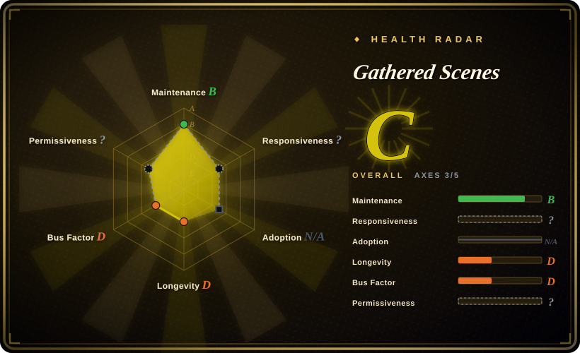
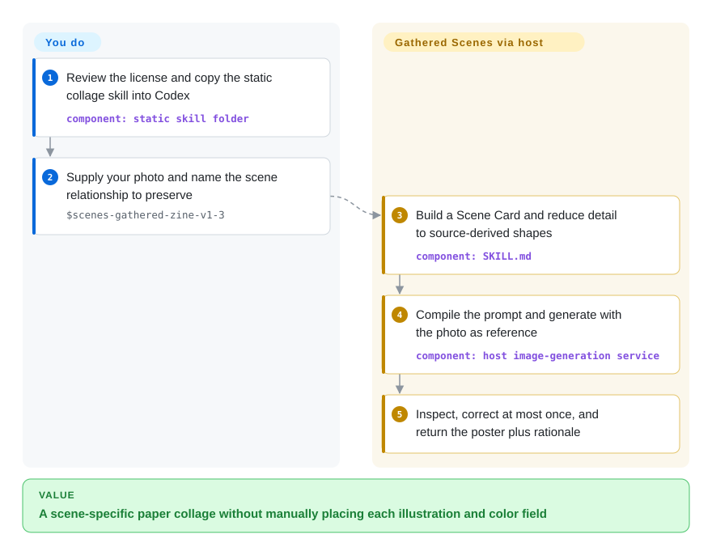
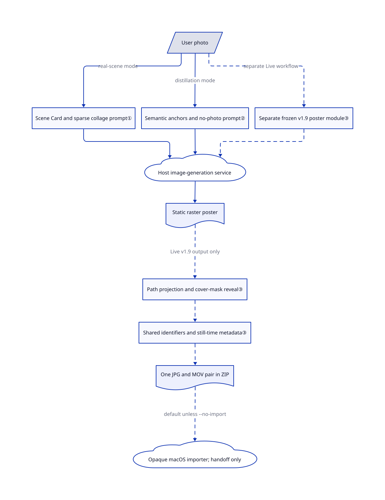

# Gathered Scenes

Your travel photo becomes a generic illustration and loses the relationship between a person and the horizon. This pack makes the agent identify that relationship before composing a paper collage, or deliberately discard photographic material for an abstract reinterpretation.

**License boundary:** source-available, not an OSI open-source grant. The [personal non-commercial license](https://github.com/Zeejay0/gathered-scenes-zine-skill/blob/b9edb836c9dd5c5d80995e89ebcaba34b75fd58f/LICENSE#L10-L61) excludes work for companies, clients, nonprofits and other organizations, and commercial use of generated outputs. Obtain written permission before those uses.

## When to use

You are making a personal travel journal from your own photos. A church tower must remain in front of the city, but you want the dense buildings reduced to broad printed shapes rather than another filter over the whole picture. Choose the real-scene skill when those source relationships matter more than a reusable HTML layout. It tells the agent to keep a photographic anchor, enlarge a quiet illustration field and use one source-derived bright hue to connect them.

Choose the separate distillation skill when the gesture or emotion matters but the photograph itself must disappear from the artwork. The same repository also contains a typography-led cinematic-poster skill and a macOS Live Photo workflow. These are additional entry points, not one uniform renderer; the root README describes only the two original photo-to-zine paths.

## When NOT to use

- **You are making client work or monetized content.** Use an independently authored workflow in [ComfyUI](../../../on-device-ml/local-image-generation/comfyui.md), subject to its software and model licenses, or obtain written permission here. This license restricts organizational use even without a fee; attribution alone does not clear it.
- **You need editable text, exact layout or repeatable typography.** Choose [Guizang Social Card Skill](../guizang-social-card.md) for HTML-to-PNG cards. These static zines are model-generated raster images; instructions to preserve faces, text and photographic areas are not pixel-level enforcement.
- **The photo cannot go to a generation service.** Choose local ComfyUI with reviewed local weights and no networked nodes. Both main zine prompts explicitly send the required reference and prompt to the host's generation service; their privacy instructions are not a technical egress barrier.
- **You only want a style recipe to paste into another model.** Choose [hand-drawn-styles](hand-drawn-styles.md). This pack defaults to generation and hides the full prompt unless requested; it also instructs the host to append promotional website text after the first three successful generations.
- **You require a fully inspectable Photos importer or cross-platform Live Photo support.** Prefer Guizang Social Card Skill's file-delivery workflow, after checking its platform requirements. This repository bundles an Apple-silicon importer executable without corresponding application source in the reviewed tree; the Python builder opens it by default unless `--no-import` is supplied. Static zine generation does not need that executable.
- **You expect every mode to perform visual QA.** Choose Guizang's HTML path and explicitly request its validator for measurable layout checks. Here real-scene v1.3 asks for inspection and at most one correction, distillation explicitly skips inspection, and the Live workflow skips review gates. None proves visual correctness automatically.

## Comparison

| Alternative | In index | Our verdict | Tradeoff |
| --- | --- | --- | --- |
| [Guizang Social Card Skill](../guizang-social-card.md) | indexed | Choose Guizang when precise copy and platform-sized editable card layouts decide; choose Gathered Scenes for a personal photo transformed into paper-like illustration. | HTML and optional DOM checks versus generative raster composition; Guizang's AGPL obligations still need review. |
| [hand-drawn-styles](hand-drawn-styles.md) | indexed | Choose hand-drawn-styles when you want to select and preserve a recipe across prompts; choose Gathered Scenes when the source photo should determine the composition. | Verbatim recipe extraction leaves generation to you; Gathered Scenes asks the host to analyze relationships and generate, under a personal-only license. |
| [ComfyUI](../../../on-device-ml/local-image-generation/comfyui.md) | indexed | Choose ComfyUI when local photo handling or a saved inference graph is mandatory; choose Gathered Scenes for a personal experiment inside an image-capable agent. | Model, hardware and node upkeep buy pipeline control; this pack supplies art-direction instructions, not an inference engine. |

## Quick start

The [README installation path](https://github.com/Zeejay0/gathered-scenes-zine-skill/blob/b9edb836c9dd5c5d80995e89ebcaba34b75fd58f/README.md#L146-L169) clones the repository and copies the selected static skill folder into `~/.codex/skills/`; restart Codex if discovery needs it. After reviewing the license and prompt instructions, provide your own photo and invoke `$scenes-gathered-zine-v1-3`, naming the relationship and text language to preserve. The host must already provide image generation, including any account, service charge and reference-upload permission; this repository supplies neither model weights nor a generation API client for the two main static skills. The agent compiles a scene-specific prompt and returns a raster poster plus a short rationale. Use `$scene-distillation-zine-v1-3` instead for a newly illustrated image without photographic material; the optional Live branch separately needs Python with NumPy/Pillow, FFmpeg and macOS Swift frameworks, and `--no-import` prevents automatic importer launch.

<!-- flow-steps:begin (generated from flows/gathered-scenes-zine-skill.json by tools/flow_card.py — do not edit) -->

Text version of the flow

1. **You**: Review the license and copy the static collage skill into Codex — component: `static skill folder`
2. **You**: Supply your photo and name the scene relationship to preserve — `$scenes-gathered-zine-v1-3`
3. **Gathered Scenes**: Build a Scene Card and reduce detail to source-derived shapes — component: `SKILL.md`
4. **Gathered Scenes**: Compile the prompt and generate with the photo as reference — component: `host image-generation service`
5. **Gathered Scenes**: Inspect, correct at most once, and return the poster plus rationale

**Value**: A scene-specific paper collage without manually placing each illustration and color field

<!-- flow-steps:end -->

## Key techniques

<!-- mechanism:begin (generated from mechanisms/gathered-scenes-zine-skill.json by tools/mechanism_card.py; do not edit) -->

Text version of the mechanism

- User photo
- Scene Card and sparse collage prompt①
- Semantic anchors and no-photo prompt②
- Host image-generation service
- Static raster poster
- Separate frozen v1.9 poster module③
- Path projection and cover-mask reveal③
- Shared identifiers and still-time metadata③
- One JPG and MOV pair in ZIP
- Opaque macOS importer; handoff only

- User photo → Scene Card and sparse collage prompt① (real-scene mode)
- User photo → Semantic anchors and no-photo prompt② (distillation mode)
- Scene Card and sparse collage prompt① → Host image-generation service
- Semantic anchors and no-photo prompt② → Host image-generation service
- Host image-generation service → Static raster poster
- User photo → Separate frozen v1.9 poster module③ (separate Live workflow) [optional/fallback]
- Separate frozen v1.9 poster module③ → Host image-generation service [optional/fallback]
- Static raster poster → Path projection and cover-mask reveal③ (Live v1.9 output only) [optional/fallback]
- Path projection and cover-mask reveal③ → Shared identifiers and still-time metadata③ [optional/fallback]
- Shared identifiers and still-time metadata③ → One JPG and MOV pair in ZIP [optional/fallback]
- One JPG and MOV pair in ZIP → Opaque macOS importer; handoff only (default unless --no-import) [optional/fallback]

<!-- mechanism:end -->

### 1. Compile relationships into a sparse collage

- **Problem:** Applying a style everywhere can erase the source's spatial identity or reproduce all its clutter.
- **How:** A Scene Card records subjects, spatial invariants, direction, visual weight and a semantic minimum. A retain/merge/omit/transform/expose map compresses detail, then a four-paragraph prompt binds the photographic anchor, illustration, one added hue and torn-paper transition to shared source shapes.
- **Limits:** These are instructions to a host model, not image masks or tests. Real-scene v1.3 asks for one inspection and at most one targeted regeneration; preservation and numeric area ranges remain model-dependent.
- **Source:** [Scene Card and abstraction:40–146](https://github.com/Zeejay0/gathered-scenes-zine-skill/blob/b9edb836c9dd5c5d80995e89ebcaba34b75fd58f/skills/scenes-gathered-zine-v1-3/SKILL.md#L40-L146), [composition and generation:320–359](https://github.com/Zeejay0/gathered-scenes-zine-skill/blob/b9edb836c9dd5c5d80995e89ebcaba34b75fd58f/skills/scenes-gathered-zine-v1-3/SKILL.md#L320-L359), [documented tower/city example](https://github.com/Zeejay0/gathered-scenes-zine-skill/blob/b9edb836c9dd5c5d80995e89ebcaba34b75fd58f/examples/real-scene-collage/01-where-stone-meets-sky/README.md#L11-L17).

### 2. Distill meaning instead of retaining a photo layer

- **Problem:** A poster can preserve everything visible yet communicate no idea beyond the photograph.
- **How:** The distillation skill keeps two to four semantic anchors, chooses one tension and one visual metaphor, and compiles five prompt sections with explicit no-photographic-material instructions. An exact trigger selects a single connected saturated color field; otherwise the accent policy permits a smaller concentrated or distributed accent.
- **Limits:** The no-photo rule is prompt text, not a pixel detector. This mode explicitly delivers without inspection or automatic regeneration, and its typography is deliberately unrestricted; do not import real-scene v1.3's short-text or QA rules into it.
- **Source:** [semantic card and expression chain:37–124](https://github.com/Zeejay0/gathered-scenes-zine-skill/blob/b9edb836c9dd5c5d80995e89ebcaba34b75fd58f/skills/scene-distillation-zine-v1-3/SKILL.md#L37-L124), [color policy and compiler:266–400](https://github.com/Zeejay0/gathered-scenes-zine-skill/blob/b9edb836c9dd5c5d80995e89ebcaba34b75fd58f/skills/scene-distillation-zine-v1-3/SKILL.md#L266-L400), [inspection exclusion:18](https://github.com/Zeejay0/gathered-scenes-zine-skill/blob/b9edb836c9dd5c5d80995e89ebcaba34b75fd58f/skills/scene-distillation-zine-v1-3/SKILL.md#L18).

### 3. Reveal a frozen poster and pair its local media

- **Problem:** Turning a finished poster into motion can redraw faces or fail Apple Live Photo pairing.
- **How:** The Live branch first uses a frozen v1.9 static module, whose pigment-dissolution boundary differs from v1.3's torn edge. The renderer resizes proportionally, projects pixels onto a chosen path, adds low-frequency edge noise and animates a cover mask over the frozen base. Swift writes a shared JPEG MakerApple identifier and MOV content identifier plus timed still-image metadata; Python zips exactly one JPG/MOV pair.
- **Limits:** Defaults are three seconds, 30 fps and a 720-pixel short edge, not full-resolution preservation. The scene-aware path is authored by the agent, not inferred by the renderer. A successful `open` command establishes handoff only; importer validation, Photos insertion and iCloud sync are outside this source path. Renderer frame cleanup runs only at successful completion.
- **Source:** [frozen static module and stages:7–94](https://github.com/Zeejay0/gathered-scenes-zine-skill/blob/b9edb836c9dd5c5d80995e89ebcaba34b75fd58f/skills/scenes-gathered-zine-live-flow-v1-0/SKILL.md#L7-L94), [path fields and mask:122–214](https://github.com/Zeejay0/gathered-scenes-zine-skill/blob/b9edb836c9dd5c5d80995e89ebcaba34b75fd58f/skills/scenes-gathered-zine-live-flow-v1-0/scripts/render_adaptive_flat_tear.py#L122-L214), [render and cleanup:236–306](https://github.com/Zeejay0/gathered-scenes-zine-skill/blob/b9edb836c9dd5c5d80995e89ebcaba34b75fd58f/skills/scenes-gathered-zine-live-flow-v1-0/scripts/render_adaptive_flat_tear.py#L236-L306), [pair metadata:53–161](https://github.com/Zeejay0/gathered-scenes-zine-skill/blob/b9edb836c9dd5c5d80995e89ebcaba34b75fd58f/skills/scenes-gathered-zine-live-flow-v1-0/scripts/pair_live_photo.swift#L53-L161), [ZIP and launch:108–159](https://github.com/Zeejay0/gathered-scenes-zine-skill/blob/b9edb836c9dd5c5d80995e89ebcaba34b75fd58f/skills/scenes-gathered-zine-live-flow-v1-0/scripts/build_live_zip_and_import.py#L108-L159).

## Health & viability

- **Maintenance, 2026-10-30:** created 2026-08-01, not archived, last push 2026-09-03; the API returned no tags or releases. Skill version names are not release guarantees. The reviewed tree has four top-level skills, a nested frozen static module and three scripts totaling 703 lines.
- **Governance:** a personal account owns the repository; the contributor endpoint lists only Zeejay0. No governance, contribution policy, security policy or institutional backing declaration appears in the tree. Public issues include generation and licensing questions; their existence is not evidence of resolution.
- **Age and adoption:** roughly three months old with 5,573 stars and 525 forks on the verification date. [推断：based on repository age and push dates] Its short, recently quiet history supplies little durability evidence; popularity does not establish model compatibility or production use.
- **License and distribution:** the actual license is personal non-commercial v1.0, copyright Zeejay0; its only visible license-history commit says the license was added after history cleanup. Do not reconstruct earlier rights from that message. In [issue 12](https://github.com/Zeejay0/gathered-scenes-zine-skill/issues/12), the author declined free authorization for a web product and requested removal. The README promotes a hosted site and account-recharge services; these are not required dependencies of the static skill, nor evidence of lawful account services. The machine's license axis remains unknown because it cannot parse this custom license, not because the license is missing; responsiveness is also unknown with reason `type_na`.
- **Operational risk:** the main prompts contain service-upload and promotional-response instructions. The Live package includes an opaque application executable, opens it unless opted out, and skips visual review in the established full flow. Treat the pack as reviewed instructions for a bounded personal task, not as a trusted unattended harness.

## Caveats (unverified)

- [未验证：no upstream execution or service use was authorized] Image fidelity, text accuracy, image-host compatibility and generation cost were not measured; source inspection and the author's examples do not establish them.
- [未验证：the reviewed tree contains the importer executable but no corresponding application source] Its permissions, network behavior, Photos writes, code-signature trust and iCloud outcome were not verified. No application was launched.
- [未验证：no independent rights audit or original-photo chain was available] Copyright notices plausibly match the account, but the photos, brand art and typography reference were not independently cleared. The current license text is not proof of every asset's provenance.
- [推断：repository created in August and last pushed in September 2026] Durability is uncertain; stars and forks are not an operational adoption measure.
