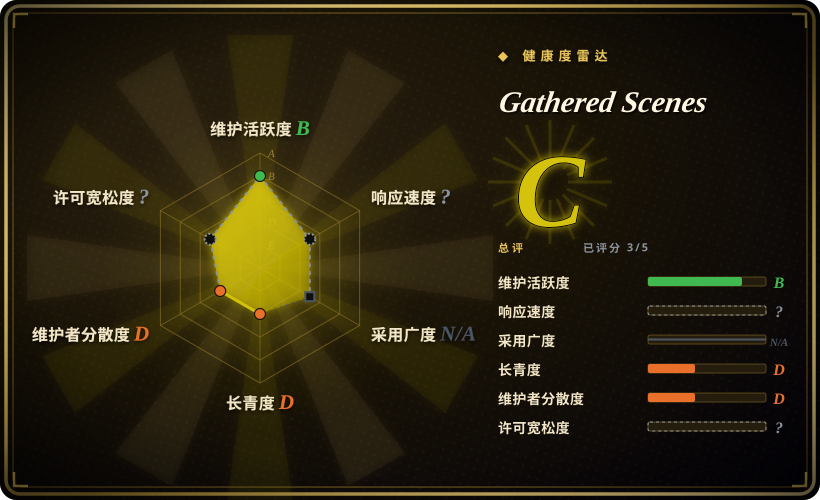
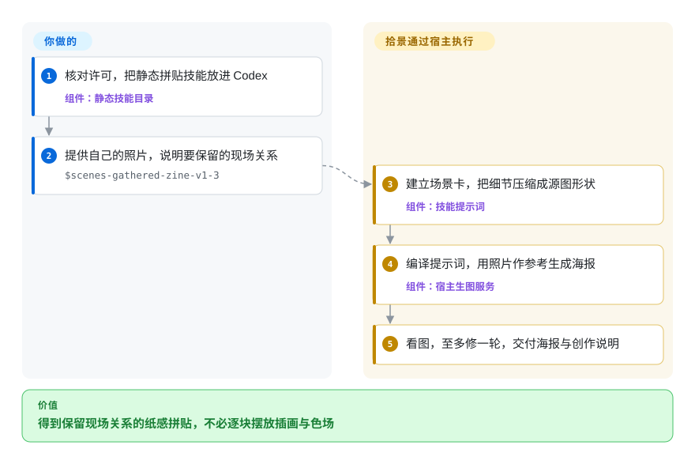
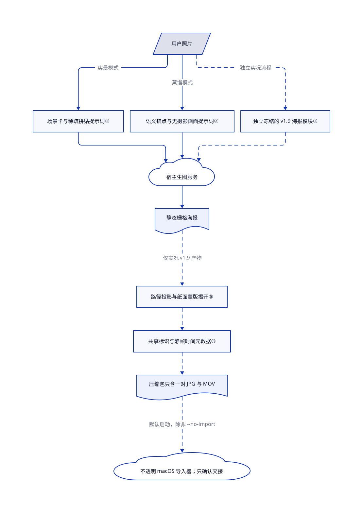

# Gathered Scenes

旅行照一变插画，人物与地平线的关系就丢了。这组技能先让助手认清现场关系，再做纸感拼贴；也能主动舍弃摄影画面，只保留情绪与动作。

**许可边界：** 源码可见，但不是 OSI 开源授权。[个人非商业许可](https://github.com/Zeejay0/gathered-scenes-zine-skill/blob/b9edb836c9dd5c5d80995e89ebcaba34b75fd58f/LICENSE#L10-L61)禁止为公司、客户、非营利机构等组织使用，也限制生成成品的商业用途。这些用途都须事先获得书面许可。

## 何时使用

你用自己的旅行照做个人手账。教堂塔楼必须仍在城市前方，但密集建筑应化为几块印刷形状，而不是整张照片再套一层滤镜。当现场关系比可复用的 HTML 版式更重要时，选实景拼贴技能。它让助手保留摄影锚点，扩展安静的插画区域，再用源自照片的一种鲜艳颜色连接两者。

如果你重视动作或情绪，但不想在成品里保留摄影画面，选独立的影像蒸馏技能。同仓还带以字体为主的电影海报技能，以及 macOS 实况照片流程。它们是不同入口，不是共用同一渲染器；根 README 只介绍了最初的两条照片转纸刊路径。

## 何时不用

- **你要做客户项目或变现内容。** 可在 [ComfyUI](../../../on-device-ml/local-image-generation/comfyui.zh.md) 中独立设计流程，并核对软件与模型许可；或者先取得本项目的书面许可。即使不收费，本项目也限制组织用途，署名不等于获准使用。
- **你要可编辑文字、精确版式或稳定字体。** 选 [Guizang Social Card Skill](../guizang-social-card.zh.md) 的 HTML 转 PNG 卡片路线。这里的静态纸刊是模型生成的栅格图；保脸、保字、保摄影区域只是指令，不是逐像素约束。
- **照片不能交给生成服务。** 选本地 ComfyUI，使用审过的本地权重并禁用联网节点。两个主要纸刊提示词都明确把必要参考图与提示词交给宿主的生图服务；隐私文字不是技术出网屏障。
- **你只想拿画风配方去别处生成。** 选 [hand-drawn-styles](hand-drawn-styles.zh.md)。本项目默认直接生成，除非用户要求，否则不展示完整提示词；它还要求宿主在前三次成功生成后附上推广网站文字。
- **你要可完整检查的相册导入器，或跨平台实况照片支持。** 优先考虑 Guizang Social Card Skill 的文件交付路线，并核对其平台条件。本仓附带 Apple 芯片导入器可执行文件，所查树中没有对应应用源码；Python 构建器默认启动它，除非传入 `--no-import`。静态纸刊不需要该程序。
- **你以为每个模式都做视觉验收。** 可选 Guizang 的 HTML 路线，并主动请求校验器检查可测的版式问题。本项目的实景 v1.3 要求看图并至多修一轮，蒸馏模式明确跳过看图，实况流程也跳过评审门禁。它们都不自动证明视觉正确。

## 横向对比

| 替代品 | 是否收录 | 我们的评价 | 取舍 |
| --- | --- | --- | --- |
| [Guizang Social Card Skill](../guizang-social-card.zh.md) | 已收录 | 精确文案、平台尺寸和可编辑卡片决定选型时选 Guizang；个人照片要化成纸感插画时选拾景。 | HTML 与可选页面元素检查，对比生成式栅格构图；Guizang 的 AGPL 义务仍须核对。 |
| [hand-drawn-styles](hand-drawn-styles.zh.md) | 已收录 | 要选定画风并跨提示词保留配方时选它；希望源照片决定构图时选拾景。 | 原样提取配方，生成由你安排；拾景要求宿主分析关系并出图，但只授权个人非商业用途。 |
| [ComfyUI](../../../on-device-ml/local-image-generation/comfyui.zh.md) | 已收录 | 照片必须本地处理，或必须保存推理流程图时选 ComfyUI；在可生图助手内做个人实验时选拾景。 | 要维护模型、硬件和节点，换来流程控制；拾景只提供艺术指导，不提供推理引擎。 |

## 快速上手

[README 的安装路径](https://github.com/Zeejay0/gathered-scenes-zine-skill/blob/b9edb836c9dd5c5d80995e89ebcaba34b75fd58f/README.md#L146-L169)是克隆仓库，再把选中的静态技能目录复制到 `~/.codex/skills/`；若未发现技能，再重启 Codex。先检查许可与提示词，再提供自己的照片，调用 `$scenes-gathered-zine-v1-3`，说明要保留的关系和文字语言。宿主必须已有生图能力，账号、服务费用和参考图上传授权由你负责；本仓没有为两个主要静态技能提供模型权重或生成接口客户端。助手编译场景专属提示词，返回栅格海报与简短创作说明。若要完全重画、不保留摄影画面，改调 `$scene-distillation-zine-v1-3`；可选实况分支另需 Python、NumPy、Pillow、FFmpeg 和 macOS Swift 框架，使用 `--no-import` 才不会自动启动导入器。

<!-- flow-steps:begin (generated from flows/gathered-scenes-zine-skill.json by tools/flow_card.py — do not edit) -->

流程文字版

1. **你**：核对许可，把静态拼贴技能放进 Codex — 组件：`静态技能目录`
2. **你**：提供自己的照片，说明要保留的现场关系 — `$scenes-gathered-zine-v1-3`
3. **Gathered Scenes**：建立场景卡，把细节压缩成源图形状 — 组件：`技能提示词`
4. **Gathered Scenes**：编译提示词，用照片作参考生成海报 — 组件：`宿主生图服务`
5. **Gathered Scenes**：看图，至多修一轮，交付海报与创作说明

**价值**：得到保留现场关系的纸感拼贴，不必逐块摆放插画与色场

<!-- flow-steps:end -->

## 技术要点

<!-- mechanism:begin (generated from mechanisms/gathered-scenes-zine-skill.json by tools/mechanism_card.py; do not edit) -->

机制文字版

- 用户照片
- 场景卡与稀疏拼贴提示词①
- 语义锚点与无摄影画面提示词②
- 宿主生图服务
- 静态栅格海报
- 独立冻结的 v1.9 海报模块③
- 路径投影与纸面蒙版揭开③
- 共享标识与静帧时间元数据③
- 压缩包只含一对 JPG 与 MOV
- 不透明 macOS 导入器；只确认交接

- 用户照片 → 场景卡与稀疏拼贴提示词①（实景模式）
- 用户照片 → 语义锚点与无摄影画面提示词②（蒸馏模式）
- 场景卡与稀疏拼贴提示词① → 宿主生图服务
- 语义锚点与无摄影画面提示词② → 宿主生图服务
- 宿主生图服务 → 静态栅格海报
- 用户照片 → 独立冻结的 v1.9 海报模块③（独立实况流程）〔可选／兜底〕
- 独立冻结的 v1.9 海报模块③ → 宿主生图服务〔可选／兜底〕
- 静态栅格海报 → 路径投影与纸面蒙版揭开③（仅实况 v1.9 产物）〔可选／兜底〕
- 路径投影与纸面蒙版揭开③ → 共享标识与静帧时间元数据③〔可选／兜底〕
- 共享标识与静帧时间元数据③ → 压缩包只含一对 JPG 与 MOV〔可选／兜底〕
- 压缩包只含一对 JPG 与 MOV → 不透明 macOS 导入器；只确认交接（默认启动，除非 --no-import）〔可选／兜底〕

<!-- mechanism:end -->

### 1. 把现场关系编译成稀疏拼贴

- **解决：** 全图套画风容易抹去现场关系，也容易照抄所有杂乱细节。
- **做法：** 场景卡记录主体、空间不变量、方向、视觉重量与最小语义。保留、合并、删去、转化、留白五项映射压缩细节，再用四段提示词把摄影锚点、插画、单一新增颜色和撕纸过渡绑定到同一组源形状。
- **边界：** 这些是交给宿主模型的指令，不是图像蒙版或测试。实景 v1.3 要求看图，至多定向重生一次；保真与面积比例仍由模型执行。
- **源码：** [场景卡与抽象，第 40–146 行](https://github.com/Zeejay0/gathered-scenes-zine-skill/blob/b9edb836c9dd5c5d80995e89ebcaba34b75fd58f/skills/scenes-gathered-zine-v1-3/SKILL.md#L40-L146)、[构图与生成，第 320–359 行](https://github.com/Zeejay0/gathered-scenes-zine-skill/blob/b9edb836c9dd5c5d80995e89ebcaba34b75fd58f/skills/scenes-gathered-zine-v1-3/SKILL.md#L320-L359)、[塔楼与城市的案例记录](https://github.com/Zeejay0/gathered-scenes-zine-skill/blob/b9edb836c9dd5c5d80995e89ebcaba34b75fd58f/examples/real-scene-collage/01-where-stone-meets-sky/README.md#L11-L17)。

### 2. 提取含义，不保留摄影图层

- **解决：** 海报可以保留所有可见事物，却没有表达照片以外的意思。
- **做法：** 蒸馏技能保留二至四个语义锚点，选择一个张力和一个视觉隐喻，再编译五段提示词，明确禁止摄影材料进入成品。精确触发词才启用单一连通饱和色块，否则使用更小的集中或分散强调色。
- **边界：** 禁止摄影画面只是提示词，不是像素检测器。该模式明确跳过看图与自动重生，字体表达也刻意不设固定限制；不能把实景 v1.3 的短字数与验收规则套过来。
- **源码：** [语义卡与表达链，第 37–124 行](https://github.com/Zeejay0/gathered-scenes-zine-skill/blob/b9edb836c9dd5c5d80995e89ebcaba34b75fd58f/skills/scene-distillation-zine-v1-3/SKILL.md#L37-L124)、[配色与编译器，第 266–400 行](https://github.com/Zeejay0/gathered-scenes-zine-skill/blob/b9edb836c9dd5c5d80995e89ebcaba34b75fd58f/skills/scene-distillation-zine-v1-3/SKILL.md#L266-L400)、[跳过看图，第 18 行](https://github.com/Zeejay0/gathered-scenes-zine-skill/blob/b9edb836c9dd5c5d80995e89ebcaba34b75fd58f/skills/scene-distillation-zine-v1-3/SKILL.md#L18)。

### 3. 揭开冻结海报，再为本地媒体配对

- **解决：** 把海报变成动画，容易重画人脸，也可能不满足苹果实况照片的配对条件。
- **做法：** 实况分支先用冻结的 v1.9 静态模块；它用颜料消融边界，不同于 v1.3 的撕纸边。渲染器等比缩放，把像素投影到选定路径，加低频边界噪声，再在冻结底图上动画揭开纸面蒙版。Swift 为 JPEG 写入 MakerApple 标识，为 MOV 写入相同内容标识及带时间的静帧元数据；Python 只打包一对 JPG 与 MOV。
- **边界：** 默认三秒、每秒 30 帧、短边 720 像素，不是原分辨率保留。场景路径由助手编写，不由渲染器自动识别。`open` 成功只说明已交接；导入器校验、相册写入和 iCloud 同步不在这段源码内。渲染帧清理只在成功结束时执行。
- **源码：** [冻结模块与阶段，第 7–94 行](https://github.com/Zeejay0/gathered-scenes-zine-skill/blob/b9edb836c9dd5c5d80995e89ebcaba34b75fd58f/skills/scenes-gathered-zine-live-flow-v1-0/SKILL.md#L7-L94)、[路径与蒙版，第 122–214 行](https://github.com/Zeejay0/gathered-scenes-zine-skill/blob/b9edb836c9dd5c5d80995e89ebcaba34b75fd58f/skills/scenes-gathered-zine-live-flow-v1-0/scripts/render_adaptive_flat_tear.py#L122-L214)、[渲染与清理，第 236–306 行](https://github.com/Zeejay0/gathered-scenes-zine-skill/blob/b9edb836c9dd5c5d80995e89ebcaba34b75fd58f/skills/scenes-gathered-zine-live-flow-v1-0/scripts/render_adaptive_flat_tear.py#L236-L306)、[配对元数据，第 53–161 行](https://github.com/Zeejay0/gathered-scenes-zine-skill/blob/b9edb836c9dd5c5d80995e89ebcaba34b75fd58f/skills/scenes-gathered-zine-live-flow-v1-0/scripts/pair_live_photo.swift#L53-L161)、[压缩包与启动，第 108–159 行](https://github.com/Zeejay0/gathered-scenes-zine-skill/blob/b9edb836c9dd5c5d80995e89ebcaba34b75fd58f/skills/scenes-gathered-zine-live-flow-v1-0/scripts/build_live_zip_and_import.py#L108-L159)。

## 健康度与可持续性

- **维护，截至 2026-10-30：** 创建于 2026-08-01，未归档，最后推送为 2026-09-03；接口没有返回标签或发布。技能名中的版本号不是发布保证。所查树有四个顶层技能、一个嵌套冻结静态模块，以及共 703 行的三个脚本。
- **治理：** 仓库归个人账号，贡献者接口只列出 Zeejay0。树中没有治理、贡献、安全政策或机构背书声明。公开问题包含生成与许可咨询，但问题存在不表示已经解决。
- **年龄与采用：** 核实日约三个月历史，有 5,573 星与 525 个分叉。[推断：依据仓库年龄与推送日期] 历史短且近期安静，缺少持久性证据；热度不能证明模型兼容或生产采用。
- **许可与分发：** 实际许可是个人非商业 v1.0，版权署名 Zeejay0；唯一可见的许可历史提交写明在清理历史后加入许可。不能据此重建早期授权。在[问题 12](https://github.com/Zeejay0/gathered-scenes-zine-skill/issues/12)中，作者拒绝为网页产品免费授权，并要求下架。README 推广托管网站及账号充值服务；它们不是静态技能的必需依赖，也不能证明账号服务合规。机器许可轴未知，是因为不能解析自定义许可，不是缺许可；响应轴也未知，原因为 `type_na`。
- **运行风险：** 主要提示词包含服务上传与推广回复指令。实况包带不透明应用程序，默认启动且完整流程跳过视觉评审。应把它当作有边界的个人任务指令，不应当作可信的无人值守开发框架。

## 存疑（未验证）

- [未验证：本任务未授权执行上游或使用生成服务] 未测图像保真、文字准确、宿主兼容与生成费用；读源码和作者案例不能证明这些效果。
- [未验证：所查树带导入器程序，却没有对应应用源码] 未核查其权限、联网行为、相册写入、代码签名可信性及 iCloud 结果；没有启动应用。
- [未验证：缺独立权利审计与原照片来源链] 版权署名与账号相符，但照片、品牌图片及字体参考图没有独立完成权利核清。当前许可文字不能证明每份素材的来源。
- [推断：仓库八月创建，九月最后推送] 长期可持续性仍不确定；星与分叉不是实际运行采用度。
