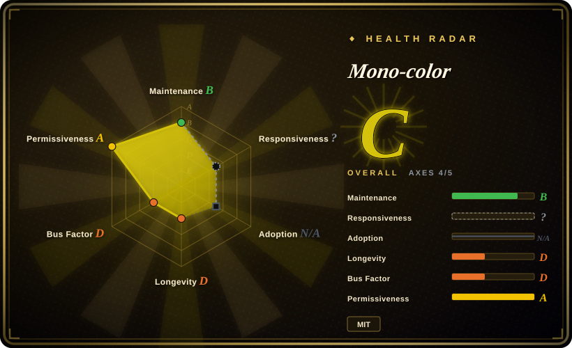
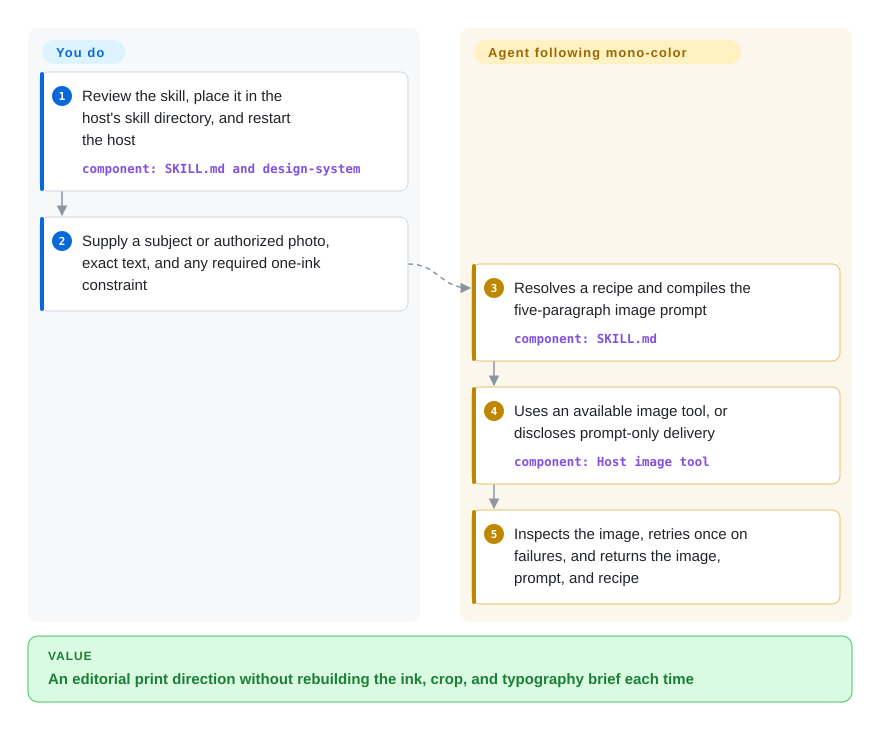
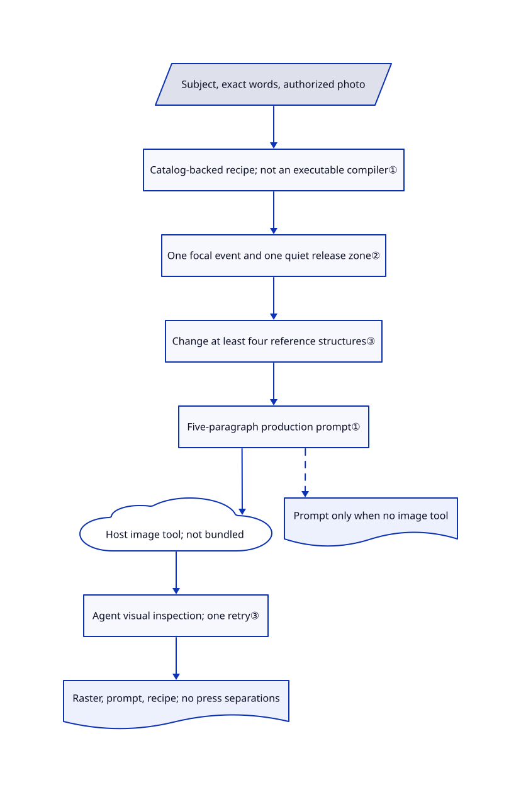

# Mono-color

Your poster request keeps coming back as a tinted photograph with a detached headline. Mono-color tells the agent to assign at most two ink plates, cut paper-shaped gaps through the image, and make one object collide with the typography.

## When to use

You are making a small exhibition poster, zine cover, or cultural article image from a photograph and an exact headline. Asking for “risograph” keeps adding beige paper, grunge, and extra decorative colors, even when you need a contemporary print look. Choose mono-color when you want the agent to decide the crop, ink roles, visible paper, and type relationship together rather than choosing a preset hand-drawn style or laying out an HTML card.

The useful constraint is a visual grammar, not a template: a dominant object, one focal event, a quieter region, and no more than two assigned inks. Despite the repository name, the current default is controlled two-ink; explicitly request one ink for a monochrome result. You bring the generation tool and accept a raster image rather than editable typography or actual press separations.

## When NOT to use

- **Exact text or an editable platform card is the deliverable.** Choose [Guizang Social Card Skill](../guizang-social-card.md) for HTML-to-PNG composition. Mono-color asks an image model to draw words; after one failed retry it instructs the agent to deliver a text-light image and recommend a separate text overlay.
- **You need a local inference pipeline with pinned weights and sampling controls.** Choose [ComfyUI](../../../on-device-ml/local-image-generation/comfyui.md). This repository supplies instructions and catalogs, not an image model, GPU runtime, API credentials, or privacy boundary for uploaded photographs.
- **You want several hand-drawn looks instead of one print grammar.** Choose [hand-drawn-styles](hand-drawn-styles.md) for named recipes. Mono-color deliberately excludes sticker collages, glossy scenes, full-color photography, and more than two inks.
- **You want to reuse the bundled artwork commercially.** Use your own cleared images in ComfyUI instead. The MIT grant covers software and instructions, not original example images; third-party references have separate rights and some incomplete attribution. The originality checklist does not grant those rights.
- **The printer needs verified plate files or physical color accuracy.** Use an editable composition workflow such as Guizang for layout, then a printer-approved prepress process. Mono-color returns a raster image and prompt; its ink percentages and simulated registration drift are instructions, not measured print separations.

## Comparison

| Alternative | In index | Our verdict | Tradeoff |
|---|---|---|---|
| [Guizang Social Card Skill](../guizang-social-card.md) | ✅ | Choose Guizang when dates and long copy must stay editable in platform-sized cards; choose mono-color when an image-led print composition matters more than DOM-controlled type. | HTML templates and browser rendering require a Node/browser setup; mono-color leaves the generation backend to the host and can stop at a prompt. |
| [hand-drawn-styles](hand-drawn-styles.md) | ✅ | Choose hand-drawn-styles when you already picked a numbered drawing recipe and want it copied verbatim; choose mono-color when subject, ink roles, and editorial layout should be resolved together. | Fixed recipes reduce agent paraphrasing; mono-color adapts a single grammar but depends on the model following a longer procedure. |
| [ComfyUI](../../../on-device-ml/local-image-generation/comfyui.md) | ✅ | Choose ComfyUI when local models and a saved generation graph decide the job; choose mono-color when art direction is missing but your image tool already exists. | ComfyUI adds model, hardware, and node upkeep; mono-color has no inference engine and cannot enforce its visual rules through sampling. |

## Quick start

The README installs the repository into `~/.claude/skills/mono-color` and asks you to restart Claude Code; other hosts can read `SKILL.md` as their entry point. Review those instructions before enabling them: the skill requests generated files under `~/Desktop/Claude skills/mono-color/`, which you should reconcile with your own output policy. Supply a subject or authorized photograph, exact wording, and an explicit one-ink request if required. The agent compiles a prompt and uses an image tool already available in its host, returning the raster image, exact prompt, and recipe; without that tool it must disclose prompt-only delivery. You remain responsible for the provider account, any generation charges, source-image rights, text proofing, and print preparation; no upstream installation or image generation was executed for this review.

<!-- flow-steps:begin (generated from flows/mono-color-skill.json by tools/flow_card.py — do not edit) -->

Text version of the flow

1. **You**: Review the skill, place it in the host's skill directory, and restart the host — component: `SKILL.md and design-system`
2. **You**: Supply a subject or authorized photo, exact text, and any required one-ink constraint
3. **Mono-color**: Resolves a recipe and compiles the five-paragraph image prompt — component: `SKILL.md`
4. **Mono-color**: Uses an available image tool, or discloses prompt-only delivery — component: `Host image tool`
5. **Mono-color**: Inspects the image, retries once on failures, and returns the image, prompt, and recipe

**Value**: An editorial print direction without rebuilding the ink, crop, and typography brief each time

<!-- flow-steps:end -->

## Key techniques

<!-- mechanism:begin (generated from mechanisms/mono-color-skill.json by tools/mechanism_card.py; do not edit) -->

Text version of the mechanism

- Subject, exact words, authorized photo
- Catalog-backed recipe; not an executable compiler①
- One focal event and one quiet release zone②
- Change at least four reference structures③
- Five-paragraph production prompt①
- Host image tool; not bundled
- Agent visual inspection; one retry③
- Raster, prompt, recipe; no press separations
- Prompt only when no image tool

- Subject, exact words, authorized photo → Catalog-backed recipe; not an executable compiler①
- Catalog-backed recipe; not an executable compiler① → One focal event and one quiet release zone②
- One focal event and one quiet release zone② → Change at least four reference structures③
- Change at least four reference structures③ → Five-paragraph production prompt①
- Five-paragraph production prompt① → Host image tool; not bundled
- Host image tool; not bundled → Agent visual inspection; one retry③
- Agent visual inspection; one retry③ → Raster, prompt, recipe; no press separations
- Five-paragraph production prompt① → Prompt only when no image tool [optional/fallback]

<!-- mechanism:end -->

### 1. Resolve a catalog-backed recipe before writing the prompt

- **Problem:** Rephrasing the same brief can change color, layout, and wording between retries.
- **How:** `SKILL.md` first resolves a recipe with subject, exact text, substrate, palette ID, plate roles, layout, and an imperfection seed. It gives catalog values precedence over prose, then compiles five paragraphs covering canvas, composition, subject, typography, and material constraints.
- **Limits:** This is an agent instruction, not an executable compiler or seeded image sampler. The JSON evaluation validator checks stored cases, not generated prompts or pixels; case 9 says complementary duotone while its Cyan + Brick Red catalog entry says overprint duotone, as reported in open issue 4.
- **Source:** [Recipe Manifest and Prompt Compiler](https://github.com/yanliudesign/mono-color-skill/blob/c8ff70597ddedcd65f21a0b528f6a70c35690b0a/SKILL.md), [palette catalog](https://github.com/yanliudesign/mono-color-skill/blob/c8ff70597ddedcd65f21a0b528f6a70c35690b0a/design-system/colors.json), [stored cases](https://github.com/yanliudesign/mono-color-skill/blob/c8ff70597ddedcd65f21a0b528f6a70c35690b0a/evals/evals.json), [validator](https://github.com/yanliudesign/mono-color-skill/blob/c8ff70597ddedcd65f21a0b528f6a70c35690b0a/scripts/validate_evals.py), [issue 4](https://github.com/yanliudesign/mono-color-skill/issues/4).

### 2. Concentrate energy instead of making everything quiet

- **Problem:** “Relaxed editorial” can collapse into small pale elements separated by empty space.
- **How:** The rhythm catalog requires one focal event and one release zone: for example, a giant cropped wheel crossed by the title, surrounded by quieter paper. The prompt separates stable composition from bounded print imperfections, with a seed derived from subject, text, palette, and layout.
- **Limits:** The host model must interpret these directions. The assertive rhythm and some composition ranges allow 20% empty paper, while the final prose gate asks for 25–55%; catalog precedence does not remove this inconsistent acceptance instruction. No pixel measurement enforces either range.
- **Source:** [rhythm profiles](https://github.com/yanliudesign/mono-color-skill/blob/c8ff70597ddedcd65f21a0b528f6a70c35690b0a/design-system/rhythm.json), [composition ranges](https://github.com/yanliudesign/mono-color-skill/blob/c8ff70597ddedcd65f21a0b528f6a70c35690b0a/design-system/compositions.json), [bounded imperfections](https://github.com/yanliudesign/mono-color-skill/blob/c8ff70597ddedcd65f21a0b528f6a70c35690b0a/design-system/imperfections.json), [Final Quality Gate](https://github.com/yanliudesign/mono-color-skill/blob/c8ff70597ddedcd65f21a0b528f6a70c35690b0a/SKILL.md).

### 3. Pair an originality checklist with bounded visual retry

- **Problem:** A reference-driven image can copy the source arrangement, while a plausible draft can still contain unreadable text.
- **How:** The prompt asks for at least four structural departures from supplied references, such as crop, grid, title placement, and type pairing. The agent inspects full-size and thumbnail images, regenerates once on stated failures, and falls back to a text-light base if exact lettering still fails.
- **Limits:** This is model-led inspection, not a similarity detector, legal clearance, OCR gate, or guaranteed preservation of a person's identity. The two board-building scripts are auxiliary demos, not a general generator; the design-system board still references old typography IDs absent from the current catalog.
- **Source:** [Originality Firewall and Generation and Inspection](https://github.com/yanliudesign/mono-color-skill/blob/c8ff70597ddedcd65f21a0b528f6a70c35690b0a/SKILL.md), [board builder](https://github.com/yanliudesign/mono-color-skill/blob/c8ff70597ddedcd65f21a0b528f6a70c35690b0a/scripts/build_design_system_board.py), [current typography IDs](https://github.com/yanliudesign/mono-color-skill/blob/c8ff70597ddedcd65f21a0b528f6a70c35690b0a/design-system/typography.json), [asset restrictions](https://github.com/yanliudesign/mono-color-skill/blob/c8ff70597ddedcd65f21a0b528f6a70c35690b0a/ASSET-LICENSE.md).

## Health & viability

- **Maintenance, 2026-10-30:** created 2026-08-19; last default-branch commit 2026-09-02. The README advertises v1.2.0, but GitHub has no tags or releases. Treat the pinned commit as the reproducible distribution reference, not the badge as a release channel.
- **Governance and longevity:** the contributor endpoint lists one contributor with 42 commits under a personal account. About 72 days of history and nearly two months without a default-branch commit give little Lindy evidence; stars do not establish maintenance resilience.
- **Adoption:** GitHub reports 3,550 stars and 109 forks on the verification date. These measure attention, not successful generated posters or use by print shops; the available examples are the author's demonstrations.
- **Risk and viability judgment:** useful as a small inspectable direction pack, not a production-quality guarantee. Issue 4 and its unmerged PR 5 document a real catalog/eval mismatch. The reviewed tree has no plugin manifest or host hook, and PR 2's proposed plugin packaging was closed unmerged. Software is MIT; artwork remains explicitly outside that grant.

## Caveats (unverified)

- [未验证：image tools were intentionally not run] Visual fidelity, exact text rendering, subject preservation, and provider/host compatibility were not reproduced; the review checks the published instruction and script paths only.
- [推断：based on 72 days of history, one contributor, and the last commit date] Continued availability depends heavily on the individual maintainer; no long-term maintenance commitment was established.
- [未验证：REFERENCES.md lacks several original creators and URLs] Third-party reference-image rights were not independently cleared. The prompt's structural-change rule is not a legal safe harbor, and it does not authorize redistribution of bundled artwork.
