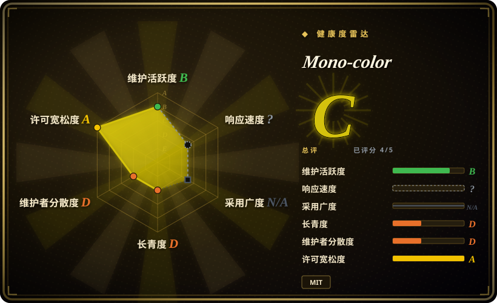
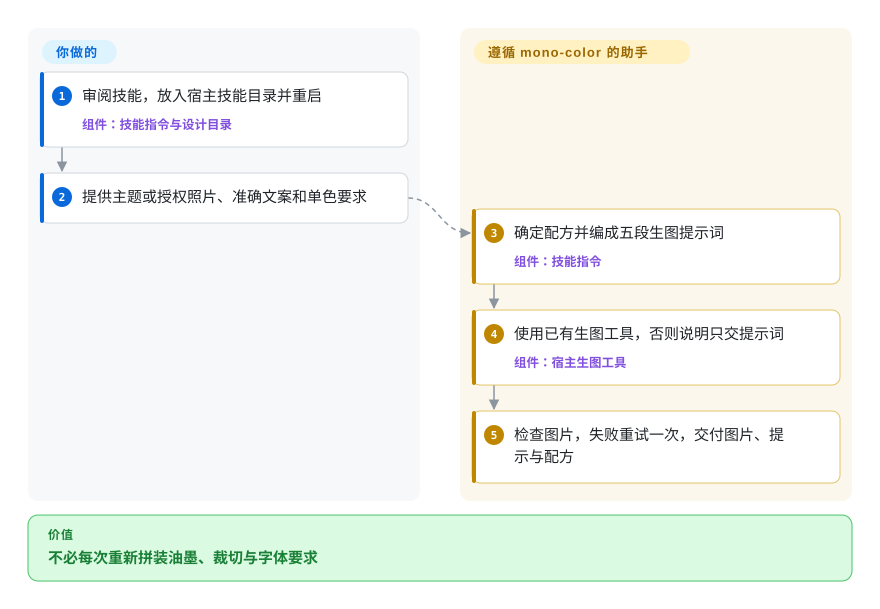
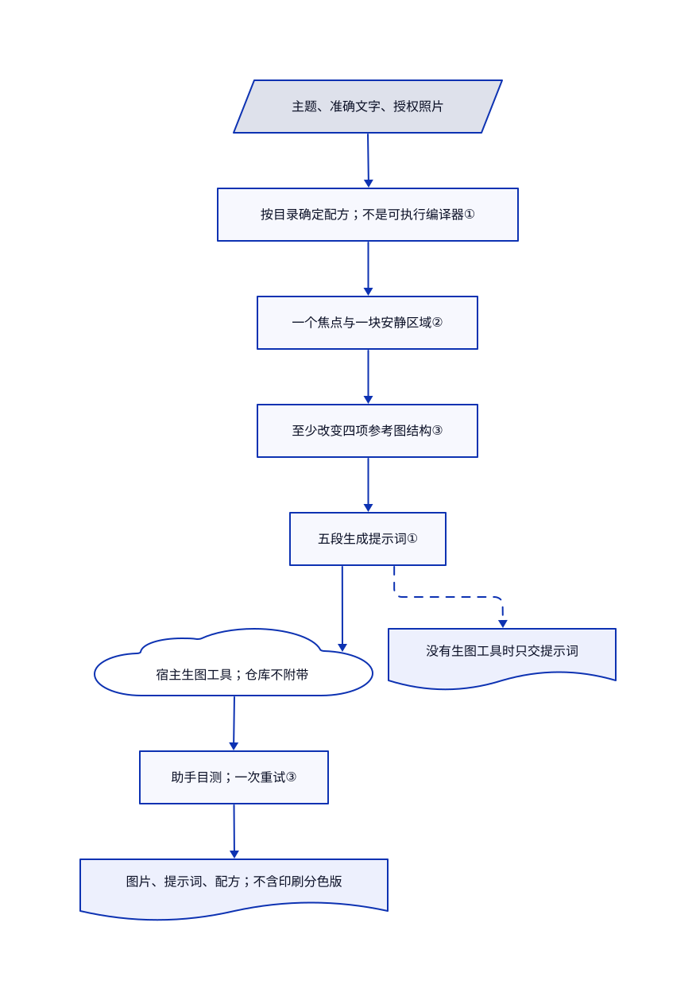

# Mono-color

你想做印刷感海报，模型却总交付一张套色照片，再把标题孤零零放在旁边。Mono-color 要求助手先分配最多两块油墨版，让纸面穿过图像，再让一个主体与文字产生碰撞。

## 何时使用

你拿着一张照片和确定的标题，要做小型展览海报、独立刊物封面或文化文章配图。只说“孔版印刷”，模型就加上米色纸、做旧和多余点缀色，但你想要的是当代印刷视觉。需要助手一起决定裁切、油墨职责、露纸和字图关系时，选 mono-color；若只是选择手绘画风或排一张 HTML 卡片，不必用这套规则。

它固定的是视觉语法，不是模板：一个主导物体、一个视觉焦点、一块安静区域，最多两种各司其职的油墨。仓库虽叫单色，当前默认却是受控双色；需要纯单色时必须明确提出。你自备生图工具，并接受交付栅格图片，而非可编辑文字或真正印刷分色版。

## 何时不用

- **必须保证准确文字或交付可编辑平台卡片。** 选 [Guizang Social Card Skill](../guizang-social-card.zh.md) 的 HTML 到 PNG 排版。Mono-color 让图像模型画字；一次重试仍失败后，它要求交付少文字底图，并建议另行叠字。
- **需要固定权重与采样控制的本地推理流程。** 选 [ComfyUI](../../../on-device-ml/local-image-generation/comfyui.zh.md)。本仓库提供指令和目录规则，不提供图像模型、显卡运行时、接口凭据，也不替上传的照片建立隐私边界。
- **需要多种手绘画风，不是同一套印刷语法。** 选 [hand-drawn-styles](hand-drawn-styles.zh.md) 的具名配方。Mono-color 明确排除贴纸拼贴、光滑场景、全彩照片和两种以上油墨。
- **想把仓库自带美术直接拿去商用。** 改用 ComfyUI 处理你已获授权的素材。MIT 覆盖软件和指令，不覆盖原创示例图；第三方参考图另有权利，部分署名仍不完整。原创性清单不会授予这些权利。
- **印厂需要经过验证的分色版与实体色彩。** 用 Guizang 一类可编辑排版流程，再走印厂认可的印前处理。Mono-color 交付图片和提示词；油墨比例与模拟套印偏移只是指令，不是测量后的分色文件。

## 横向对比

| 替代品 | 是否收录 | 我们的评价 | 取舍 |
|---|---|---|---|
| [Guizang Social Card Skill](../guizang-social-card.zh.md) | 已收录 | 平台卡片的日期和长文必须保持可编辑时选 Guizang；图像主导的印刷构图比受控文字排版更重要时选 mono-color。 | HTML 模板与浏览器渲染需要 Node 和浏览器环境；mono-color 依靠宿主生图工具，也可只交提示词。 |
| [hand-drawn-styles](hand-drawn-styles.zh.md) | 已收录 | 已选定编号画风、只想原样复用配方时选 hand-drawn-styles；要一起决定主体、油墨职责和编辑版面时选 mono-color。 | 固定配方减少助手改写；mono-color 会调整同一套语法，但更依赖模型遵守长流程。 |
| [ComfyUI](../../../on-device-ml/local-image-generation/comfyui.zh.md) | 已收录 | 本地模型与可保存的生成节点图是硬条件时选 ComfyUI；已有生图工具、只缺美术指导时选 mono-color。 | ComfyUI 增加模型、硬件和节点维护；mono-color 没有推理引擎，不能在采样时强制视觉规则。 |

## 快速上手

README 把仓库装入 `~/.claude/skills/mono-color`，并要求重启 Claude Code；其他宿主可把 `SKILL.md` 当作入口。启用前先审指令：技能要求把产物放进 `~/Desktop/Claude skills/mono-color/`，你应让它服从自己的输出目录政策。提供主题或获授权的照片、准确文案，需要单色时明确提出。助手编译提示词，再调用宿主已有的生图工具，交付图片、准确提示词和配方；没有工具时必须说明只交提示词。服务账号、生图费用、素材授权、文字校对和印前处理仍由你负责；本次研究未安装或执行上游，也未实际生图。

<!-- flow-steps:begin (generated from flows/mono-color-skill.json by tools/flow_card.py — do not edit) -->

流程文字版

1. **你**：审阅技能，放入宿主技能目录并重启 — 组件：`技能指令与设计目录`
2. **你**：提供主题或授权照片、准确文案和单色要求
3. **Mono-color**：确定配方并编成五段生图提示词 — 组件：`技能指令`
4. **Mono-color**：使用已有生图工具，否则说明只交提示词 — 组件：`宿主生图工具`
5. **Mono-color**：检查图片，失败重试一次，交付图片、提示与配方

**价值**：不必每次重新拼装油墨、裁切与字体要求

<!-- flow-steps:end -->

## 技术要点

<!-- mechanism:begin (generated from mechanisms/mono-color-skill.json by tools/mechanism_card.py; do not edit) -->

机制文字版

- 主题、准确文字、授权照片
- 按目录确定配方；不是可执行编译器①
- 一个焦点与一块安静区域②
- 至少改变四项参考图结构③
- 五段生成提示词①
- 宿主生图工具；仓库不附带
- 助手目测；一次重试③
- 图片、提示词、配方；不含印刷分色版
- 没有生图工具时只交提示词

- 主题、准确文字、授权照片 → 按目录确定配方；不是可执行编译器①
- 按目录确定配方；不是可执行编译器① → 一个焦点与一块安静区域②
- 一个焦点与一块安静区域② → 至少改变四项参考图结构③
- 至少改变四项参考图结构③ → 五段生成提示词①
- 五段生成提示词① → 宿主生图工具；仓库不附带
- 宿主生图工具；仓库不附带 → 助手目测；一次重试③
- 助手目测；一次重试③ → 图片、提示词、配方；不含印刷分色版
- 五段生成提示词① → 没有生图工具时只交提示词〔可选／兜底〕

<!-- mechanism:end -->

### 1. 先按目录确定配方，再写生图提示词

- **解决：** 同一需求稍作改写，重试时配色、版式和文案就漂移。
- **做法：** `SKILL.md` 先确定主体、准确文案、纸底、配色编号、油墨职责、构图和瑕疵种子；明确值以目录为准。随后编成画布、构图、主体、字体和材质五段提示词。
- **边界：** 这是助手指令，不是可执行编译器或固定种子的图像采样器。JSON 验证器只检查已存案例，不检查生成提示词或像素；第九例把青蓝与砖红写成互补双色，目录却写叠印双色，公开问题 4 仍未关闭。
- **源码：** [配方清单与提示词编译规则](https://github.com/yanliudesign/mono-color-skill/blob/c8ff70597ddedcd65f21a0b528f6a70c35690b0a/SKILL.md)、[配色目录](https://github.com/yanliudesign/mono-color-skill/blob/c8ff70597ddedcd65f21a0b528f6a70c35690b0a/design-system/colors.json)、[案例数据](https://github.com/yanliudesign/mono-color-skill/blob/c8ff70597ddedcd65f21a0b528f6a70c35690b0a/evals/evals.json)、[验证器](https://github.com/yanliudesign/mono-color-skill/blob/c8ff70597ddedcd65f21a0b528f6a70c35690b0a/scripts/validate_evals.py)、[问题 4](https://github.com/yanliudesign/mono-color-skill/issues/4)。

### 2. 集中一个强焦点，而非让一切都安静

- **解决：** “松弛编辑感”容易变成几块小而淡的元素，中间留很多空白。
- **做法：** 节奏目录要求一个焦点和一块安静区域，例如让标题穿过巨大裁切车轮，周围纸面退让。规则把稳定构图与有界印刷瑕疵分开，并按主体、文字、配色和构图确定种子。
- **边界：** 宿主模型负责解释规则。强势节奏和部分构图允许露纸比例低至 20%，最终文字门禁却要求 25–55%；目录优先规则没有消除验收指令的不一致。两种范围都没有像素测量器强制执行。
- **源码：** [节奏配置](https://github.com/yanliudesign/mono-color-skill/blob/c8ff70597ddedcd65f21a0b528f6a70c35690b0a/design-system/rhythm.json)、[构图范围](https://github.com/yanliudesign/mono-color-skill/blob/c8ff70597ddedcd65f21a0b528f6a70c35690b0a/design-system/compositions.json)、[有界瑕疵](https://github.com/yanliudesign/mono-color-skill/blob/c8ff70597ddedcd65f21a0b528f6a70c35690b0a/design-system/imperfections.json)、[最终质量门禁](https://github.com/yanliudesign/mono-color-skill/blob/c8ff70597ddedcd65f21a0b528f6a70c35690b0a/SKILL.md)。

### 3. 原创性清单配合有界目测重试

- **解决：** 参考图容易被照抄，初稿看似合理却仍可能有错字。
- **做法：** 提示词要求至少改变四项结构变量，例如裁切、网格、标题位置和字体搭配。助手检查原尺寸和缩略图，遇到列出的失败条件重生一次；准确文字仍失败就退为少文字底图。
- **边界：** 这是模型目测，不是相似度检测、法律授权、文字识别门禁或人像保真保证。两份制图脚本只是辅助示例，不是通用生图引擎；设计系统总览脚本仍引用当前字体目录已不存在的旧编号。
- **源码：** [原创性与生成检查规则](https://github.com/yanliudesign/mono-color-skill/blob/c8ff70597ddedcd65f21a0b528f6a70c35690b0a/SKILL.md)、[总览图脚本](https://github.com/yanliudesign/mono-color-skill/blob/c8ff70597ddedcd65f21a0b528f6a70c35690b0a/scripts/build_design_system_board.py)、[现有字体编号](https://github.com/yanliudesign/mono-color-skill/blob/c8ff70597ddedcd65f21a0b528f6a70c35690b0a/design-system/typography.json)、[素材许可限制](https://github.com/yanliudesign/mono-color-skill/blob/c8ff70597ddedcd65f21a0b528f6a70c35690b0a/ASSET-LICENSE.md)。

## 健康度与可持续性

- **维护状态，截至 2026-10-30：** 仓库创建于 2026-08-19，默认分支最后提交于 2026-09-02。README 标注 v1.2.0，但 GitHub 没有标签或正式发布。应以固定提交作为复现依据，不把徽章当发布渠道。
- **治理与年限：** 贡献者接口列出一位贡献者和 42 次提交，归个人账号所有。历史约 72 天，默认分支近两个月没有新提交，尚无充分的长期存续证据；星数不能证明维护韧性。
- **采用信号：** 核验日 GitHub 显示 3550 星和 109 个分叉。这些衡量关注度，不代表成功出图量或印厂采用情况；现有示例是作者演示。
- **风险与选型判断：** 可作为小型、可审阅的美术指导包，不应当作生产质量保证。问题 4 与未合入的请求 5 记录了配色和案例冲突。所读树没有插件清单或宿主钩子，请求 2 的插件打包方案也已关闭且未合入。软件采用 MIT，美术明确不在该授权内。

## 存疑（未验证）

- [未验证：本次按要求不执行生图工具] 未复现视觉保真、准确文字、人像保留和宿主兼容性；研究只核对公开指令与脚本路径。
- [推断：依据为 72 天历史、单一贡献者与最后提交日期] 后续可用性高度依赖个人维护者，未建立长期维护承诺。
- [未验证：REFERENCES.md 缺少部分原作者与原始网址] 未独立澄清第三方参考图权利。提示词的结构变化规则不是法律安全港，也不授权再分发仓库美术。
