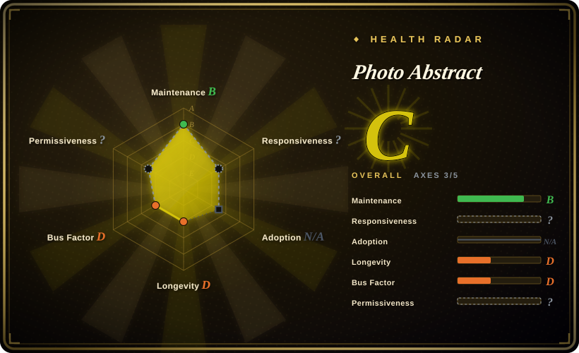
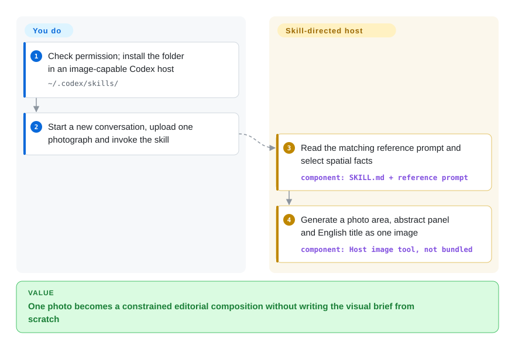
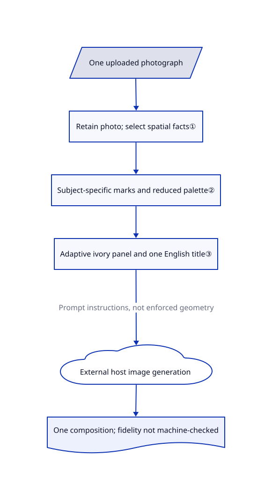

# Photo Abstract

You want your photograph beside a few abstract marks that still recall its scene, but an image model keeps repainting the photograph or adding unrelated decoration. Photo Abstract Editorial supplies bilingual instructions for a vertical photo-and-abstraction composition, not a renderer or a pixel-preservation guarantee.

**Rights restriction:** this is a publicly readable, source-available prompt pack, not an unrestricted open-source license. The [actual license](https://github.com/ZzzLc0405/photo-abstract-editorial/blob/49e55073d6d0330274d31f75d27f5dd6eb35fd6d/LICENSE.md) permits personal, educational, research and noncommercial use; commercial use requires prior authorization. The README's CC BY-NC-SA 4.0 badge does not match that custom text; do not assume Creative Commons redistribution or share-alike permissions.

## When to use

You are making a personal travel-photo poster. Your bridge photograph should remain above a sparse ivory panel, while a few horizontal marks recall its span and the spacing of people below it. A request such as "make it artistic" instead gives you a repainted bridge, paper texture and an unrelated sun. Choose this pack when you want the model to select relationships from that particular photograph, not borrow a look from a style gallery.

Compared with [handraw-style](handraw-style.md), you give up hundreds of switchable looks for one constrained photo-to-abstract treatment. Compared with [Guizang Social Card Skill](../guizang-social-card.md), you give up editable HTML and platform-sized cards for a finished image generated by your own image-capable host. Use it only within the noncommercial permission or after obtaining authorization.

## When NOT to use

- **Commercial client or enterprise work without permission.** The license explicitly includes client projects and enterprise applications among uses requiring authorization. For an independently authored card workflow, consider [Guizang Social Card Skill](../guizang-social-card.md), after reviewing its separate AGPL obligations; do not transplant this pack's wording into it.
- **The photograph must remain mechanically intact.** "Do not redraw" is a prompt instruction; there is no compositing program, mask, image comparison or automated acceptance check. Use [Guizang Social Card Skill](../guizang-social-card.md) to compose your original image as a file-backed HTML asset and verify the exported result yourself, rather than ask a model to reproduce the entire composition.
- **You need many looks or prompts rather than this diptych.** Pick [handraw-style](handraw-style.md) for a browsable style/layout palette, or [hand-drawn-styles](hand-drawn-styles.md) for extracted recipes. This pack defaults to one finished photo-plus-panel image, not a menu or a standalone abstract panel; issue #13's proposed split mode is absent from the reviewed tree.
- **Your agent has no image-generation capability.** The pack contains no model, API client or image tool installer. For file-and-browser agents that can render HTML but cannot generate images, [Guizang Social Card Skill](../guizang-social-card.md) is the more direct composition route. [Issue #1](https://github.com/ZzzLc0405/photo-abstract-editorial/issues/1) records host-level image-tool availability problems.

## Comparison

| Alternative | In index | Our verdict | Tradeoff |
|---|---|---|---|
| [handraw-style](handraw-style.md) | ✅ | Choose handraw-style to discover a style and layout by number; choose this pack when the abstraction must derive from the supplied photograph rather than a selected aesthetic. | A broad gallery and model-capability routing versus one bilingual photo-relationship brief; neither makes model output deterministic. |
| [hand-drawn-styles](hand-drawn-styles.md) | ✅ | Choose hand-drawn-styles when the deliverable is a stable, extracted recipe for your image backend; choose this pack for a single photo-plus-abstract artwork with title placement already specified. | Recipe extraction and some anchor/acceptance contracts versus a short instruction pack with no script or output validator. |
| [Guizang Social Card Skill](../guizang-social-card.md) | ✅ | Choose Guizang for editable, platform-sized cards built around original image files; choose this pack for a noncommercial, model-generated abstract interpretation rather than a reusable HTML layout. | Local HTML-to-PNG rendering and its browser setup versus an external image-capable host, variable fidelity and a custom commercial-use restriction. |

## Quick start

First review the custom license and keep any use within its permission. The README instructs you to copy the complete folder into `~/.codex/skills/`, start a new Codex conversation, upload one photograph and request the skill by name. Supply a host that can actually generate images; this repository does not provide that tool, an account or its usage budget. The skill tells the agent to read the matching English or Chinese reference prompt and return one vertical composition with a photo area, abstract panel and English title. You remain responsible for photo rights, the host's upload/privacy policy, generation costs and visual inspection; the alternative documented entry path is to paste the reference prompt into your own image tool.

<!-- flow-steps:begin (generated from flows/photo-abstract-editorial.json by tools/flow_card.py — do not edit) -->

Text version of the flow

1. **You**: Check permission; install the folder in an image-capable Codex host — `~/.codex/skills/`
2. **You**: Start a new conversation, upload one photograph and invoke the skill
3. **Photo Abstract**: Read the matching reference prompt and select spatial facts — component: `SKILL.md + reference prompt`
4. **Photo Abstract**: Generate a photo area, abstract panel and English title as one image — component: `Host image tool, not bundled`

**Value**: One photo becomes a constrained editorial composition without writing the visual brief from scratch

<!-- flow-steps:end -->

## Key techniques

<!-- mechanism:begin (generated from mechanisms/photo-abstract-editorial.json by tools/mechanism_card.py; do not edit) -->

Text version of the mechanism

- One uploaded photograph
- Retain photo; select spatial facts①
- Subject-specific marks and reduced palette②
- Adaptive ivory panel and one English title③
- External host image generation
- One composition; fidelity not machine-checked

- One uploaded photograph → Retain photo; select spatial facts①
- Retain photo; select spatial facts① → Subject-specific marks and reduced palette②
- Subject-specific marks and reduced palette② → Adaptive ivory panel and one English title③
- Adaptive ivory panel and one English title③ → External host image generation (Prompt instructions, not enforced geometry)
- External host image generation → One composition; fidelity not machine-checked

<!-- mechanism:end -->

### 1. Separate the source photo from relationship extraction

- **Problem:** A request to abstract a photo can turn into a redrawn scene or a miniature tracing.
- **How:** The workflow assigns the photo two roles: retain it in the upper region, and inspect it for three to six spatial facts. The reference prompt discards surface detail while retaining scale, axes, spacing, overlap and rhythm for the lower motif.
- **Limits:** Selection and photo preservation are instructions to the host model, not enforced operations. There is no saved intermediate scene description or pixel check.
- **Source:** [Skill workflow, lines 12-15](https://github.com/ZzzLc0405/photo-abstract-editorial/blob/49e55073d6d0330274d31f75d27f5dd6eb35fd6d/SKILL.md#L12-L15), [two input roles and decomposition, lines 5-28](https://github.com/ZzzLc0405/photo-abstract-editorial/blob/49e55073d6d0330274d31f75d27f5dd6eb35fd6d/references/photo-abstract-editorial-prompt.en.md#L5-L28).

### 2. Constrain marks by subject and color role

- **Problem:** Generic decorative icons can erase what made the photograph recognizable.
- **How:** The prompt permits one primary mark family and at most two supporting families. People become continuous short marks; landmarks retain one to three identity cues. It reduces photo colors to dominant, dark-structure and light roles, with at most two small accents.
- **Limits:** These are semantic rules, not measured counts. An ivory panel is separately specified, so "colors only from the photo" should not be read as a literal whole-canvas color validator.
- **Source:** [Subject and mark rules, lines 30-64](https://github.com/ZzzLc0405/photo-abstract-editorial/blob/49e55073d6d0330274d31f75d27f5dd6eb35fd6d/references/photo-abstract-editorial-prompt.en.md#L30-L64), [palette roles, lines 103-114](https://github.com/ZzzLc0405/photo-abstract-editorial/blob/49e55073d6d0330274d31f75d27f5dd6eb35fd6d/references/photo-abstract-editorial-prompt.en.md#L103-L114).

### 3. Adapt the panel rather than force a fixed canvas

- **Problem:** Equal halves and paper effects can overwhelm a small abstract motif or crop the photo aggressively.
- **How:** The reference gives separate height ranges for landscape, tall and balanced photos, then permits adjustment for harmony. It specifies generous ivory whitespace, a two-to-five-word English title in the panel, two title alignments and a CLEAN rule excluding texture, gradients and shadows.
- **Limits:** Proportions are guidance, not layout-engine constraints. Typography, title spelling and a uniform background still depend on the image backend; there is no editable document or bundled font.
- **Source:** [Adaptive geometry, lines 66-101](https://github.com/ZzzLc0405/photo-abstract-editorial/blob/49e55073d6d0330274d31f75d27f5dd6eb35fd6d/references/photo-abstract-editorial-prompt.en.md#L66-L101), [title and CLEAN rules, lines 116-171](https://github.com/ZzzLc0405/photo-abstract-editorial/blob/49e55073d6d0330274d31f75d27f5dd6eb35fd6d/references/photo-abstract-editorial-prompt.en.md#L116-L171).

## Health & viability

- **Maintenance, checked 2026-10-30:** the repository was created 2026-08-04 and last pushed 2026-08-19. The API returns 52 commits, no tags and no releases. Treat the reviewed commit as the version, not a promised release channel.
- **Governance and backing:** one API-listed contributor and a personal account own the pack. The tree has no governance, contribution or security policy; README donation links are not evidence of a maintenance team.
- **Age and adoption:** at about 87 days old, with 6019 stars and 359 forks, this is an attention signal without a long-lived maintenance record. [推断：based on repository age, recent history and absent release channel] Use it as a small, inspectable creative brief, not infrastructure whose host compatibility is proven by popularity.
- **Risks:** the custom license restricts commercial use despite the CC badge. Open issue #11 reports different outcomes between direct prompting and skill invocation; the author acknowledges model randomness. Issue #13 and PR #4 describe proposed split/gallery changes, but the reviewed default tree does not contain them.

## Caveats (unverified)

- [未验证：upstream execution and installation were outside this intake's authorization] No host or image model was run. Photo fidelity, title spelling, panel cleanliness, output formats and host compatibility remain untested; source rules describe intended behavior.
- [未验证：the repository provides no independent ownership evidence for every image] The README says the example photos were taken by the author. This intake authenticated file blobs and read the text, not the underlying photography rights.
- [推断：repository age, one listed contributor and no releases are the available signals] Small scope makes manual inspection feasible, but does not establish future maintenance or independent production adoption.
