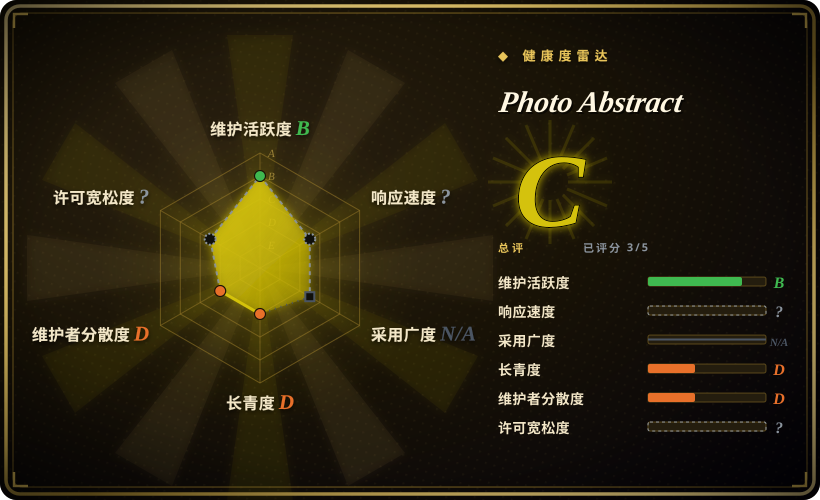
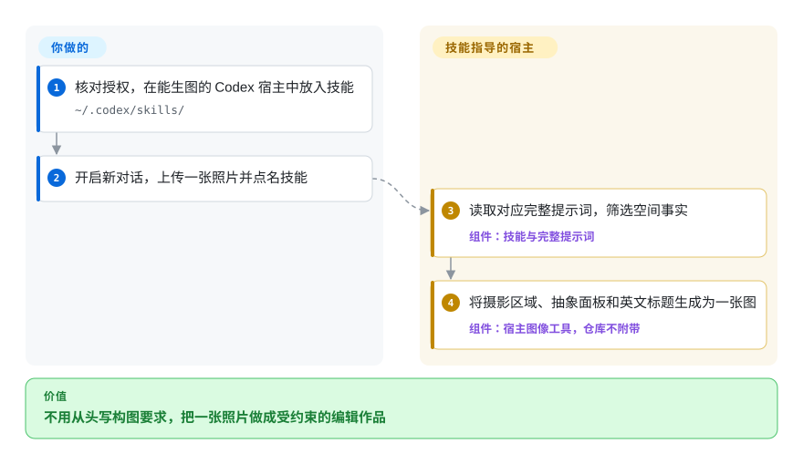
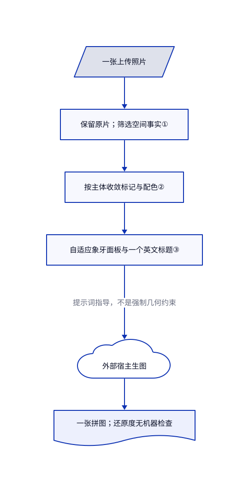

# Photo Abstract

你想把照片配上几笔仍能唤起原场景的抽象图，生图模型却把原片重画，还加上无关装饰。Photo Abstract Editorial 提供双语竖版构图提示词，不带渲染器，也不保证原片像素不变。

**权利限制：**这是可公开阅读的提示词包，不采用允许自由商用的开源许可。[许可正文](https://github.com/ZzzLc0405/photo-abstract-editorial/blob/49e55073d6d0330274d31f75d27f5dd6eb35fd6d/LICENSE.md)允许个人、学习、研究及非商业用途；商业使用必须事先授权。README 的 CC BY-NC-SA 4.0 徽章与自定义条款不一致，不能据此假定取得知识共享许可中的再分发或相同方式共享权利。

## 何时使用

你在制作个人旅行照片海报。桥梁照片要留在上方，下方用象牙色底和几条横线呼应桥的跨度与人群间距。只说“艺术一点”，模型却重画了桥，补上纸纹和原片没有的太阳。你需要的是从这张照片提炼关系，而不是从画风库借一套外观，这时可以考虑本包。

与 [handraw-style](handraw-style.zh.md) 相比，你放弃数百种可切换画风，换取一种受约束的照片抽象构图。与 [Guizang Social Card Skill](../guizang-social-card.zh.md) 相比，你放弃可编辑 HTML 和平台尺寸卡片，让自备生图宿主直接生成成品。使用须在非商业许可范围内，或先取得作者授权。

## 何时不用

- **未授权的商业客户或企业项目。**许可明确把客户项目和企业应用列入需授权范围。如需独立创作的卡片流程，可考虑 [Guizang Social Card Skill](../guizang-social-card.zh.md)，另行评估其 AGPL 义务；不要把本包文字搬过去规避授权。
- **原照片必须由程序保证不被改写。**“不得重画”只是提示词，没有合成程序、蒙版、图像比对或自动验收。可用 [Guizang Social Card Skill](../guizang-social-card.zh.md) 把原片文件放进 HTML 排版，并自行检查导出结果，不要让模型重现整幅拼接图。
- **想要多种画风，或只要提示词。**浏览画风与版式选 [handraw-style](handraw-style.zh.md)；原样提取配方选 [hand-drawn-styles](hand-drawn-styles.zh.md)。本包默认交付一张摄影与抽象面板拼接图，不是菜单或独立抽象图；议题 #13 提出的拆分模式不在所读版本中。
- **宿主没有生图能力。**本包不含模型、API 客户端或图像工具安装器。能操作文件和浏览器、但不能生图的助手，可改用 [Guizang Social Card Skill](../guizang-social-card.zh.md) 进行排版。[议题 #1](https://github.com/ZzzLc0405/photo-abstract-editorial/issues/1)记录了宿主缺少图像工具的问题。

## 横向对比

| 替代品 | 是否收录 | 我们的评价 | 取舍 |
|---|---|---|---|
| [handraw-style](handraw-style.zh.md) | 已收录 | 要按编号挑画风和版式，选 handraw-style；要让抽象关系来自当前照片，而非指定美术风格，选本包。 | 大型画风库和模型能力路由，对比一种双语照片关系提示词；两者都不能让模型输出确定。 |
| [hand-drawn-styles](hand-drawn-styles.zh.md) | 已收录 | 要稳定提取配方再交给自己的生图后端，选 hand-drawn-styles；要预先约定标题位置的摄影抽象拼图，选本包。 | 配方提取器及部分锚图与验收约束，对比没有脚本和结果验证器的短指令包。 |
| [Guizang Social Card Skill](../guizang-social-card.zh.md) | 已收录 | 要围绕原始图片文件生成可编辑、符合平台尺寸的卡片，选归藏；要非商业用途的模型抽象演绎，而非复用 HTML 版式，选本包。 | 本地 HTML 转 PNG 及浏览器环境，对比自备生图宿主、可变还原度和自定义商用限制。 |

## 快速上手

先读自定义许可，确认使用在授权范围内。README 要求把完整文件夹放进 `~/.codex/skills/`，开启新 Codex 对话，上传一张照片并点名调用技能。你须提供真正能生图的宿主；仓库不提供图像工具、账号或使用额度。技能要求助手读取对应的中英文完整提示词，再返回包含原片区域、抽象面板和英文标题的一张竖版作品。照片权利、宿主的上传与隐私政策、生成费用和成品检查仍由你负责；文档另允许把完整提示词直接粘贴进自备生图工具。

<!-- flow-steps:begin (generated from flows/photo-abstract-editorial.json by tools/flow_card.py — do not edit) -->

流程文字版

1. **你**：核对授权，在能生图的 Codex 宿主中放入技能 — `~/.codex/skills/`
2. **你**：开启新对话，上传一张照片并点名技能
3. **Photo Abstract**：读取对应完整提示词，筛选空间事实 — 组件：`技能与完整提示词`
4. **Photo Abstract**：将摄影区域、抽象面板和英文标题生成为一张图 — 组件：`宿主图像工具，仓库不附带`

**价值**：不用从头写构图要求，把一张照片做成受约束的编辑作品

<!-- flow-steps:end -->

## 技术要点

<!-- mechanism:begin (generated from mechanisms/photo-abstract-editorial.json by tools/mechanism_card.py; do not edit) -->

机制文字版

- 一张上传照片
- 保留原片；筛选空间事实①
- 按主体收敛标记与配色②
- 自适应象牙面板与一个英文标题③
- 外部宿主生图
- 一张拼图；还原度无机器检查

- 一张上传照片 → 保留原片；筛选空间事实①
- 保留原片；筛选空间事实① → 按主体收敛标记与配色②
- 按主体收敛标记与配色② → 自适应象牙面板与一个英文标题③
- 自适应象牙面板与一个英文标题③ → 外部宿主生图（提示词指导，不是强制几何约束）
- 外部宿主生图 → 一张拼图；还原度无机器检查

<!-- mechanism:end -->

### 1. 将原片保留与关系提炼分开

- **解决：**要求抽象化照片，容易得到重画的场景或缩小描摹。
- **做法：**流程给原片两个角色：在上方保留照片，同时从中识别三至六个空间事实。完整提示词要求删掉表面细节，把比例、轴线、间距、遮挡和节奏留给下方面板。
- **边界：**事实筛选和照片保留都是对宿主模型的指令，不是强制执行的图像操作。仓库没有保存中间场景描述，也不做像素检查。
- **源码：**[技能流程第 12–15 行](https://github.com/ZzzLc0405/photo-abstract-editorial/blob/49e55073d6d0330274d31f75d27f5dd6eb35fd6d/SKILL.md#L12-L15)、[输入角色与拆解第 5–28 行](https://github.com/ZzzLc0405/photo-abstract-editorial/blob/49e55073d6d0330274d31f75d27f5dd6eb35fd6d/references/photo-abstract-editorial-prompt.en.md#L5-L28)。

### 2. 按主体与色彩角色限制标记

- **解决：**通用装饰图标容易抹掉照片原有的辨识线索。
- **做法：**提示词允许一种主要标记家族和最多两种辅助家族。人物变成连续短标记，地标只留一至三个身份线索；照片色彩收敛为主色、深结构色和浅色，最多再加两种小面积强调色。
- **边界：**这些是语义规则，不是机器计数。提示词另外指定象牙色面板，因此“颜色只来自照片”不能当成整张画布的逐色验证规则。
- **源码：**[主体与标记第 30–64 行](https://github.com/ZzzLc0405/photo-abstract-editorial/blob/49e55073d6d0330274d31f75d27f5dd6eb35fd6d/references/photo-abstract-editorial-prompt.en.md#L30-L64)、[色彩角色第 103–114 行](https://github.com/ZzzLc0405/photo-abstract-editorial/blob/49e55073d6d0330274d31f75d27f5dd6eb35fd6d/references/photo-abstract-editorial-prompt.en.md#L103-L114)。

### 3. 自适应面板，不强套固定画布

- **解决：**上下等分和纸张效果容易挤压抽象母题，或逼迫原片大幅裁切。
- **做法：**完整提示词分别给横图、高耸主体和平衡构图设高度范围，再允许为协调调整。它指定象牙色大留白、面板内二至五词英文标题、两种标题对齐方式，并以 CLEAN 规则禁止纹理、渐变与阴影。
- **边界：**比例是指导，不是排版引擎的硬约束。字体、标题拼写和背景均匀度仍取决于生图后端；仓库没有可编辑文档或附带字体。
- **源码：**[自适应几何第 66–101 行](https://github.com/ZzzLc0405/photo-abstract-editorial/blob/49e55073d6d0330274d31f75d27f5dd6eb35fd6d/references/photo-abstract-editorial-prompt.en.md#L66-L101)、[标题与 CLEAN 规则第 116–171 行](https://github.com/ZzzLc0405/photo-abstract-editorial/blob/49e55073d6d0330274d31f75d27f5dd6eb35fd6d/references/photo-abstract-editorial-prompt.en.md#L116-L171)。

## 健康度与可持续性

- **维护，核实于 2026-10-30：**仓库创建于 2026-08-04，最后推送于 2026-08-19。API 返回 52 次提交，没有标签或发布。应把所读提交当作版本，不要假定存在稳定发布渠道。
- **治理与支持：**个人账号持有仓库，API 只列出一名贡献者。目录没有治理、贡献或安全政策；README 的打赏链接不能证明维护团队存在。
- **年龄与采用：**约 87 天历史，6019 星、359 个分叉，代表关注而非长期维护记录。[推断：依据仓库年龄、近期提交和缺失发布渠道]适合作为可逐条阅读的小型创作要求，不宜凭热度推定宿主兼容性已有保障。
- **风险：**尽管有 CC 徽章，自定义许可仍限制商用。未关闭的议题 #11 报告直接提示与技能调用效果不同，作者回复承认模型随机性。议题 #13 和 PR #4 描述拆分与示例修订提案，但所读默认分支不含这些修改。

## 存疑（未验证）

- [未验证：本次收录未获授权执行或安装上游]未运行任何宿主或生图模型。照片还原、标题拼写、面板干净程度、输出格式及跨宿主兼容性未实测；源码规则只表明预期行为。
- [未验证：仓库没有逐张照片的独立权属证据]README 称示例原片由作者拍摄。本次认证了文件 blob 并读过文字，没有核清底层摄影权利。
- [推断：可用信号是仓库年龄、一名所列贡献者和没有发布]内容小便于人工检查，不代表未来维护或独立生产采用已经成立。
