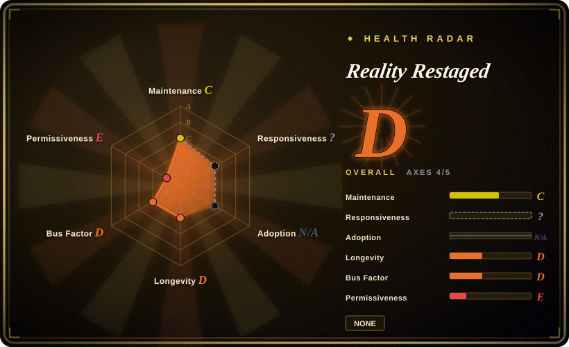
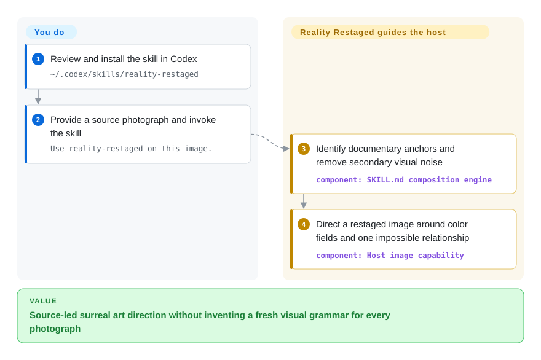
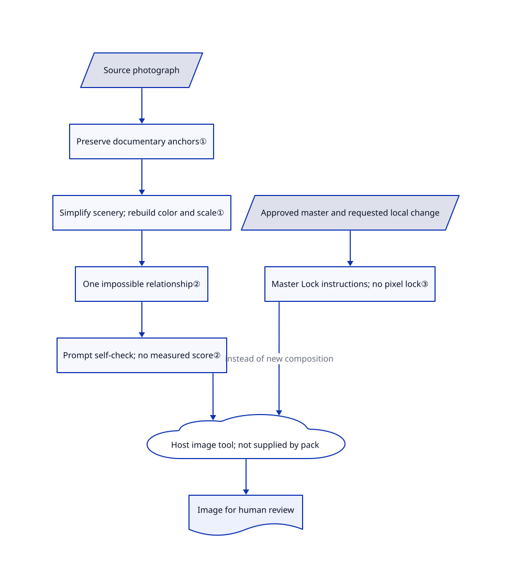

# Reality Restaged

Your travel-photo edit keeps becoming a generic fantasy scene, losing the people and gestures that made the picture yours. Reality Restaged directs an agent to preserve those anchors while rebuilding the surrounding space with large color fields and one impossible relationship.

## When to use

You are a photographer turning a travel series into surreal editorial images. Asking for a giant animal or a strange sky leaves the original clutter untouched, while stronger edits erase the distinctive clothing or the relationship between two people. You want a coherent visual language across different photographs, not a new random effect for every shot.

Choose this skill when you already have an image-capable Codex environment and need art direction rather than another rendering application. Its prompt makes the agent identify documentary anchors, remove visual noise, and rebuild composition around color and scale. Unlike ComfyUI or InvokeAI, it supplies a particular photographic grammar, not a model runtime, editing canvas, or reproducible generation pipeline.

## When NOT to use

- **You must keep the photograph as documentary evidence.** New compositions explicitly move subjects, change horizons, and remove scenery. Keep the original; use a conventional editor such as [PhotoCraft](../../../photo-editing/photocraft.md) only for non-generative corrections, accounting for its early-alpha status, rather than presenting a restaged image as reportage.
- **You need actual masks or enforceable local edits.** Master Lock is an instruction to preserve an approved composition, not a pixel lock. Choose [InvokeAI](https://github.com/invoke-ai/InvokeAI) for a canvas with brush-based inpainting and outpainting; inspect its outputs too.
- **You need offline inference or a versioned model pipeline.** Choose [ComfyUI](../../../on-device-ml/local-image-generation/comfyui.md) and manage model files and workflows yourself. This repository contains no renderer, model weights, provider configuration, or image-tool adapter.
- **You need explanatory drawings rather than transformed photographs.** Choose [ian-xiaohei-illustrations](ian-illustrations.md) for article-driven hand-drawn scenes; this skill deliberately seeks photographic surfaces and documentary subjects.
- **Your organization needs an explicit reuse grant.** The reviewed tree has no LICENSE and neither text file supplies licensing terms. Prefer a workflow with reviewed licenses, such as ComfyUI plus appropriately licensed models, or obtain permission before redistributing this pack or its example artwork.

## Comparison

| Alternative | In index | Our verdict | Tradeoff |
|---|---|---|---|
| [ComfyUI](../../../on-device-ml/local-image-generation/comfyui.md) | Indexed | Choose ComfyUI when you must control model, conditioning and generation stages; choose Reality Restaged when the missing piece is a source-led surreal composition brief. | ComfyUI supplies executable graphs and local inference but requires hardware, models and workflow design; this pack supplies artistic constraints without that infrastructure. |
| [InvokeAI](https://github.com/invoke-ai/InvokeAI) | not indexed | Choose InvokeAI when revising a particular region with a brush matters more than automatically rethinking the whole photograph. | Its local canvas provides inpainting, outpainting and workflow management, not this documentary-first visual grammar; not added in this tab batch. |
| [ian-xiaohei-illustrations](ian-illustrations.md) | Indexed | Choose ian-xiaohei-illustrations for conceptual article figures; choose Reality Restaged when real clothing, gestures and photographic texture must remain the visual anchors. | The former trades photographic identity for a consistent recurring drawn character; both depend on the host for image generation. |

## Quick start

The [README](https://github.com/traveler0621/reality-restaged/blob/9a5533cb656bba6163714a6f5fc2217a1e6607fb/README.md) documents cloning the repository into `~/.codex/skills/reality-restaged` and reopening Codex if needed. In an authorized installation, review the skill first, then provide a source photo and ask `Use reality-restaged on this image.` The skill supplies composition instructions; your host must separately provide image understanding and generation or editing capability. You remain responsible for photograph rights, consent, provider privacy and charges, and judging whether faces and cultural details survived. The repository does not specify a model, tool-call contract, output path, or export format, so installation alone does not establish an end-to-end rendering setup.

<!-- flow-steps:begin (generated from flows/reality-restaged.json by tools/flow_card.py — do not edit) -->

Text version of the flow

1. **You**: Review and install the skill in Codex — `~/.codex/skills/reality-restaged`
2. **You**: Provide a source photograph and invoke the skill — `Use reality-restaged on this image.`
3. **Reality Restaged**: Identify documentary anchors and remove secondary visual noise — component: `SKILL.md composition engine`
4. **Reality Restaged**: Direct a restaged image around color fields and one impossible relationship — component: `Host image capability`

**Value**: Source-led surreal art direction without inventing a fresh visual grammar for every photograph

<!-- flow-steps:end -->

## Key techniques

<!-- mechanism:begin (generated from mechanisms/reality-restaged.json by tools/mechanism_card.py; do not edit) -->

Text version of the mechanism

- Source photograph
- Preserve documentary anchors①
- Simplify scenery; rebuild color and scale①
- One impossible relationship②
- Prompt self-check; no measured score②
- Host image tool; not supplied by pack
- Approved master and requested local change
- Master Lock instructions; no pixel lock③
- Image for human review

- Source photograph → Preserve documentary anchors①
- Preserve documentary anchors① → Simplify scenery; rebuild color and scale①
- Simplify scenery; rebuild color and scale① → One impossible relationship②
- One impossible relationship② → Prompt self-check; no measured score②
- Prompt self-check; no measured score② → Host image tool; not supplied by pack
- Approved master and requested local change → Master Lock instructions; no pixel lock③
- Master Lock instructions; no pixel lock③ → Host image tool; not supplied by pack (instead of new composition)
- Host image tool; not supplied by pack → Image for human review

<!-- mechanism:end -->

### 1. Convert documentary anchors into a new spatial structure

- **Problem:** A background swap can preserve clutter while a wholesale remake erases the photograph's distinctive people and relationships.
- **How:** The composition engine asks the agent to preserve selected gestures, clothing and cultural details, suppress secondary scenery, and extract two to four source colors into spatial planes. It can move the horizon and subject rather than merely recoloring the existing scene.
- **Limits:** Preservation and abstraction are prompt instructions, not segmentation, identity matching, or a geometry solver. A new composition intentionally changes the source's factual spatial relationships.
- **Source:** [Composition engine](https://github.com/traveler0621/reality-restaged/blob/9a5533cb656bba6163714a6f5fc2217a1e6607fb/SKILL.md#L30-L186), [cultural integrity](https://github.com/traveler0621/reality-restaged/blob/9a5533cb656bba6163714a6f5fc2217a1e6607fb/SKILL.md#L872-L905).

### 2. Budget surrealism to one relationship and critique the structure

- **Problem:** Adding moons, doors and giant objects produces a pile of effects instead of a coherent image series.
- **How:** The prompt chooses one dominant impossible relationship, such as scale or folded space. Its transformation test rejects a scene that remains essentially the original photograph without the added prop; the final checklist asks about composition, color, anatomy and series consistency.
- **Limits:** These are model self-checks without measured thresholds, external scoring, enforced retries or an independent reviewer. The one-second viewing test is an instruction, not a timed perception experiment.
- **Source:** [One spatial logic](https://github.com/traveler0621/reality-restaged/blob/9a5533cb656bba6163714a6f5fc2217a1e6607fb/SKILL.md#L562-L670), [minimum transformation](https://github.com/traveler0621/reality-restaged/blob/9a5533cb656bba6163714a6f5fc2217a1e6607fb/SKILL.md#L770-L801), [final checklist](https://github.com/traveler0621/reality-restaged/blob/9a5533cb656bba6163714a6f5fc2217a1e6607fb/SKILL.md#L1467-L1546).

### 3. Give approved masters priority over default recomposition

- **Problem:** Asking to fix a fish tail can otherwise trigger a redesign of the sea, lighting and subject scale.
- **How:** Phrases such as “use this as the master” activate instructions to lock composition, perspective, accepted colors and texture, modifying only the requested element. Aspect-ratio changes prefer extending the canvas instead of compressing bodies or moving approved elements.
- **Limits:** There is no mask, image-difference check, stored master state or rollback implementation. The host image model may still alter unrequested pixels; the user must compare the result with the approved image.
- **Source:** [Master Lock and aspect-ratio rules](https://github.com/traveler0621/reality-restaged/blob/9a5533cb656bba6163714a6f5fc2217a1e6607fb/SKILL.md#L1163-L1242).

## Health & viability

- **Maintenance, 2026-10-30:** GitHub shows 16 commits, all on 2026-08-12, no releases, and no issues or pull requests. The repository is not archived, but this snapshot does not demonstrate sustained maintenance.
- **Governance, 2026-10-30:** The owner is an individual and the contributor endpoint lists only traveler0621. No GOVERNANCE, CONTRIBUTING, SECURITY or funding file appears in the reviewed tree; the README describes a personal travel-photography workflow.
- **Age and adoption, 2026-10-30:** Created 2026-08-12, only 79 days before review, with 305 stars and 20 forks. [推断：based on the short history and single-day commit activity] Treat it as an experimental art-direction reference, not a durable maintained platform; stars do not validate output fidelity.
- **License and deployment boundary:** No license grant was found. The reusable artifact is one 36,451-byte Markdown skill plus a README and seven unique example PNGs, duplicated between the root and examples directory. There is no bundled executable or project hook; loading the prompt into a host is nevertheless a separate trust decision.

## Caveats (unverified)

- [未验证：image generation was not run, as the intake forbids executing or installing upstream] Identity preservation, photographic quality, visual consistency and Master Lock fidelity have not been independently reproduced.
- [未验证：the reviewed tree and both text files contain no licensing terms] Permission to redistribute the prompts or example photographs, including commercial reuse, remains unresolved; a public GitHub repository is not a license grant.
- [未验证：no model or provider contract is supplied] The required image tool, generation price, data retention, output format and cross-host compatibility depend on the chosen host and were not tested.
- [推断：based on the repository age and all visible commits falling on its creation day] Long-term maintenance and bus-factor resilience are unproven; this is not a forecast that the project will be abandoned.
