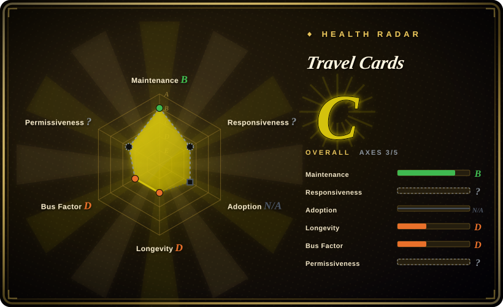
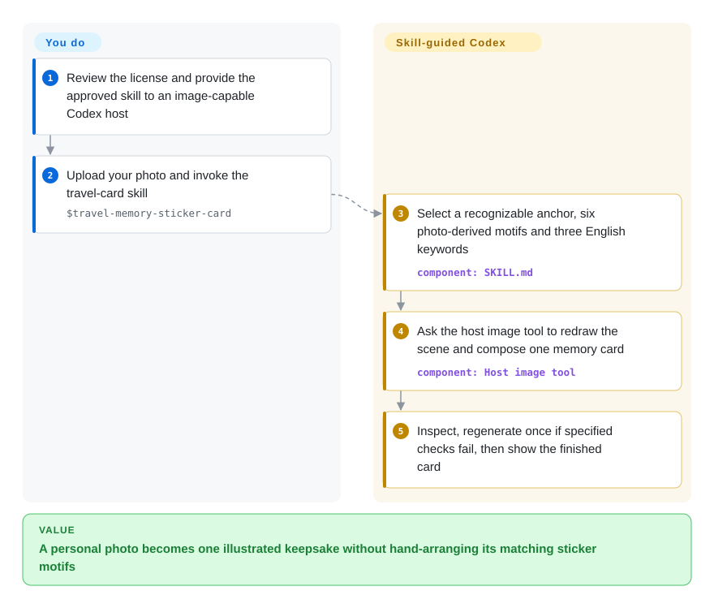
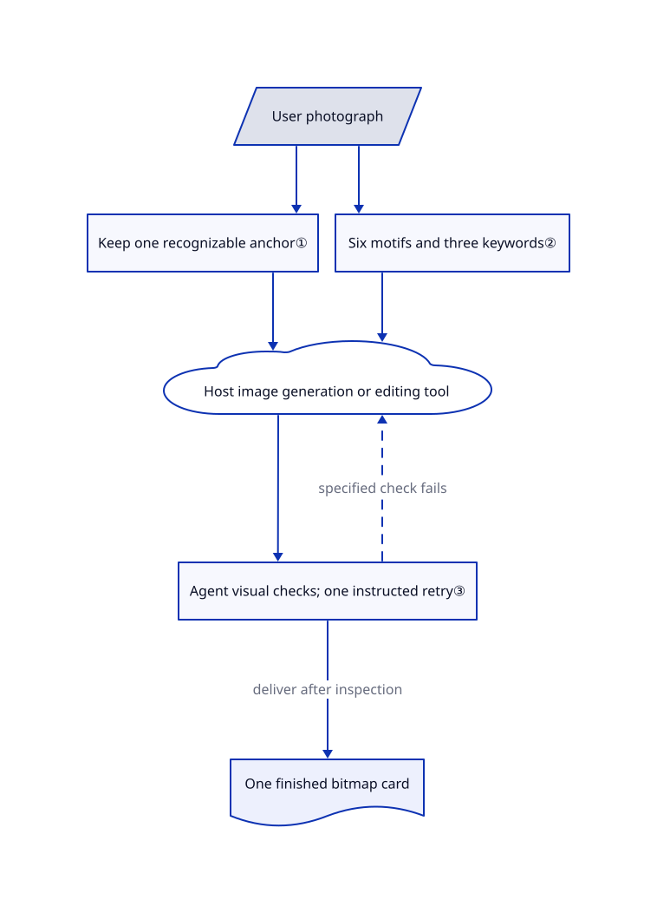

# Travel Cards

Your trip photo has a memorable corner, but a generic redraw loses what made it yours. Travel Memory Sticker Card is a Codex skill that asks an image tool to keep one recognizable anchor and turn the scene into a paper-textured card with six matching sticker motifs.

**License boundary:** this is source-available, not open source. The [personal-use license](https://github.com/carolinaaafy/travel-memory-sticker-card/blob/25ac9753bae206e452f1501c9a57f93f853df408/LICENSE) permits individual non-commercial use and modification, but prohibits redistribution and republishing as a template, workflow, plugin or community resource without written permission. This page describes the project; it does not redistribute the skill.

## When to use

You are making a private travel scrapbook from your own street or landscape photo. A normal image edit keeps too much photographic detail, while a broad style library leaves you deciding where every element belongs. Choose this skill when you specifically want one 3:2 horizontal keepsake: a dominant simplified scene, a small English keyword footer and six matching sticker fragments. You supply the photograph; the agent chooses a recognizable subject or place anchor before redrawing it in the same flat, grainy medium as the rest.

The deciding tradeoff is a ready-made visual system rather than a style menu or editable layout engine. It fits personal experimentation where you can inspect the generated bitmap and accept model variation. It is not a source of reusable commercial templates.

## When NOT to use

- **You are packaging a skill, workflow or client service.** This license does not grant that use. For a redistributable prompt-recipe starting point, consider [hand-drawn-styles](hand-drawn-styles.md), whose code and recipe text use MIT; separately clear source-photo and style rights.
- **You need detachable transparent sticker files.** This repository delivers one finished card, not an independently exported sticker sheet. The same author's [Travel Memory Card Duo](https://github.com/carolinaaafy/travel-memory-card-duo) specifies a second RGBA PNG, but also has restrictive personal-use terms.
- **You need exact text, independently editable objects or platform-sized card batches.** Choose [Guizang Social Card Skill](../guizang-social-card.md) for an HTML-to-PNG composition workflow. Here, keyword spelling and sticker count are checked by the agent, not a layout validator.
- **Your photo has only two distinctive subjects, or you want fewer stickers.** The reviewed main branch still requires six. Draft [PR #1](https://github.com/carolinaaafy/travel-memory-sticker-card/pull/1) proposes three to six and discusses duplicated motifs, but is not merged. Use [hand-drawn-styles](hand-drawn-styles.md) to supply your own composition instead of assuming that proposal exists in this skill.

## Comparison

| Alternative | In index | Our verdict | Tradeoff |
|---|---|---|---|
| [Travel Memory Card Duo](https://github.com/carolinaaafy/travel-memory-card-duo) | not indexed | Choose Duo when you need the card plus a separately usable transparent sticker image; choose this skill when a single personal keepsake is sufficient. | Duo adds a second output and real alpha-channel requirements, not a more permissive license; not added in this tab batch. |
| [hand-drawn-styles](hand-drawn-styles.md) | ✅ | Choose this skill for a photo-led keepsake with one predetermined composition; choose hand-drawn-styles when selecting and preserving one of several prompt recipes matters more. | Its MIT recipe text and renderer are easier to reuse, but most paths deliver a prompt rather than a finished photo-derived card; artwork/style rights remain separate. |
| [Guizang Social Card Skill](../guizang-social-card.md) | ✅ | Choose Guizang when social publishing needs text-led, editable card layouts; choose this skill for a private illustrated memory rather than a platform carousel. | HTML and browser rendering give inspectable composition and platform dimensions, at the cost of a Node/browser environment and AGPL obligations; this pack delegates drawing to an image tool. |

## Quick start

First review the license and make the approved skill files available to a Codex host with image generation/editing capability; this repository supplies no installer, dependency manifest or image backend. Its [Codex metadata](https://github.com/carolinaaafy/travel-memory-sticker-card/blob/25ac9753bae206e452f1501c9a57f93f853df408/agents/openai.yaml) documents invocation with `$travel-memory-sticker-card` and an uploaded photo. You provide a photograph you may use, approve any image-service handling and pay any host or generation charges; the pack defines no pricing. The agent follows the [workflow](https://github.com/carolinaaafy/travel-memory-sticker-card/blob/25ac9753bae206e452f1501c9a57f93f853df408/SKILL.md), chooses scene anchors, sticker subjects and keywords, then calls the host's image tool rather than a filter script. It inspects the bitmap and is instructed to regenerate once when specified checks fail, then shows the result and reports a saved path when available. Host installation and image generation were not executed for this entry; there is no bundled exporter or guarantee of a particular file format.

<!-- flow-steps:begin (generated from flows/travel-memory-sticker-card.json by tools/flow_card.py — do not edit) -->

Text version of the flow

1. **You**: Review the license and provide the approved skill to an image-capable Codex host
2. **You**: Upload your photo and invoke the travel-card skill — `$travel-memory-sticker-card`
3. **Travel Cards**: Select a recognizable anchor, six photo-derived motifs and three English keywords — component: `SKILL.md`
4. **Travel Cards**: Ask the host image tool to redraw the scene and compose one memory card — component: `Host image tool`
5. **Travel Cards**: Inspect, regenerate once if specified checks fail, then show the finished card

**Value**: A personal photo becomes one illustrated keepsake without hand-arranging its matching sticker motifs

<!-- flow-steps:end -->

## Key techniques

<!-- mechanism:begin (generated from mechanisms/travel-memory-sticker-card.json by tools/mechanism_card.py; do not edit) -->

Text version of the mechanism

- User photograph
- Keep one recognizable anchor①
- Six motifs and three keywords②
- Host image generation or editing tool
- Agent visual checks; one instructed retry③
- One finished bitmap card

- User photograph → Keep one recognizable anchor①
- User photograph → Six motifs and three keywords②
- Keep one recognizable anchor① → Host image generation or editing tool
- Six motifs and three keywords② → Host image generation or editing tool
- Host image generation or editing tool → Agent visual checks; one instructed retry③
- Agent visual checks; one instructed retry③ → Host image generation or editing tool (specified check fails) [optional/fallback]
- Agent visual checks; one instructed retry③ → One finished bitmap card (deliver after inspection)

<!-- mechanism:end -->

### 1. Preserve identity without leaving photographic patches

- **Problem:** A full stylization can erase the detail that identifies the remembered place or subject.
- **How:** The workflow selects one compact anchor and asks the image tool to preserve its shape, position, relationships and characteristic colors in the same medium as the surrounding scene. It allows at most one genuinely place-defining source text item, rather than retaining all signage.
- **Limits:** These are generation instructions, not segmentation or text-recognition code. Recognition and exact lettering still depend on the model and visual review.
- **Source:** [Identification and landmark-text rules](https://github.com/carolinaaafy/travel-memory-sticker-card/blob/25ac9753bae206e452f1501c9a57f93f853df408/SKILL.md#L28-L31), [shape and material reference](https://github.com/carolinaaafy/travel-memory-sticker-card/blob/25ac9753bae206e452f1501c9a57f93f853df408/references/style-guide.md#L7-L18).

### 2. Derive the card and sticker subjects from one photograph

- **Problem:** A scene and unrelated decorative stickers read as two disconnected illustrations.
- **How:** The skill first chooses six visible motifs and three scene-grounded English keywords. Its fixed composition reserves the larger left area for the scene and footer, while the right column uses varied-size fragments in the same paper-and-flat-color treatment.
- **Limits:** There is no programmatic object inventory or count validator. The main branch's six-motif requirement is unchanged by the unmerged configurable-count proposal, so sparse photos need particular scrutiny for invented or repeated details.
- **Source:** [Fixed card system](https://github.com/carolinaaafy/travel-memory-sticker-card/blob/25ac9753bae206e452f1501c9a57f93f853df408/SKILL.md#L19-L26), [motif selection](https://github.com/carolinaaafy/travel-memory-sticker-card/blob/25ac9753bae206e452f1501c9a57f93f853df408/SKILL.md#L44-L48), [composition reference](https://github.com/carolinaaafy/travel-memory-sticker-card/blob/25ac9753bae206e452f1501c9a57f93f853df408/references/style-guide.md#L20-L24), [draft proposal](https://github.com/carolinaaafy/travel-memory-sticker-card/pull/1).

### 3. Check the generated image against explicit visual failures

- **Problem:** A plausible prompt can yield a busy image, residual photographic texture or incorrect lettering.
- **How:** The workflow requires inspection after generation and one regeneration when the image prioritizes detail, looks photographic or painterly, has the wrong sticker count, or has incorrect required text. Delivery includes the chosen anchor, sticker subjects and keywords so the user can inspect the intent alongside the image.
- **Limits:** This is an agent-directed review with one instructed retry, not a measured quality threshold or a loop that guarantees acceptance. No tests, scoring implementation or generation script are present in the reviewed tree.
- **Source:** [Workflow](https://github.com/carolinaaafy/travel-memory-sticker-card/blob/25ac9753bae206e452f1501c9a57f93f853df408/SKILL.md#L10-L17), [quality checks and delivery](https://github.com/carolinaaafy/travel-memory-sticker-card/blob/25ac9753bae206e452f1501c9a57f93f853df408/SKILL.md#L54-L64), [complete reviewed tree](https://github.com/carolinaaafy/travel-memory-sticker-card/tree/25ac9753bae206e452f1501c9a57f93f853df408).

## Health & viability

- **Maintenance, 2026-10-30:** the repository was created on 2026-08-12 and has eight commits, last updated on 2026-08-26. There are no releases or tags. The final three commits add the personal-use license and notices, rather than a new rendering capability ([history](https://github.com/carolinaaafy/travel-memory-sticker-card/commits/main/)).
- **Governance and backing:** all eight commits are attributed to one contributor on a personal account. The five-file tree contains no governance, contribution or security policy, and the README names no institutional sponsor. The one draft PR is open with no comments at verification; this is too little evidence to promise support.
- **Age and Lindy:** only 79 days old and quiet for 65 days at verification. [推断: based on creation date, commit history and no releases] Treat it as a small personal design recipe, not a proven long-lived generation interface.
- **Adoption:** the GitHub snapshot reports 625 stars and 42 forks. The README shows six example images, but the tree provides no benchmark, automated tests or evidence that independent users obtain the same quality.
- **License risk:** the actual LICENSE names carolinaaafy and became effective on 2026-08-26. GitHub reports `NOASSERTION`; the personal-use-only text, not that detector result, controls the reuse boundary. The automated health block leaves this axis unknown because it cannot parse the custom license, not because no terms exist. It is unsuitable for a shared skill catalog or commercial pipeline without additional permission.

## Caveats (unverified)

- [未验证: no upstream skill or image-service execution] Generated fidelity, sticker-count accuracy, spelling and the effectiveness of the one-regeneration instruction were not reproduced; README images are author-provided examples.
- [未验证: no provider or model version specified upstream] Provider costs, retention, photo transmission and host compatibility depend on the Codex environment you choose; this pack does not supply an offline or privacy guarantee.
- [推断: based on 79-day age, 65-day quiet period and one contributor] Long-term support is unproven. That judgment does not establish abandonment.
- [未验证: no independent third-party rights audit] The license holder matches the repository owner, but ownership of every depicted photo, likeness or artistic element is not independently established. The skill license is not a clearance for those inputs or outputs.
