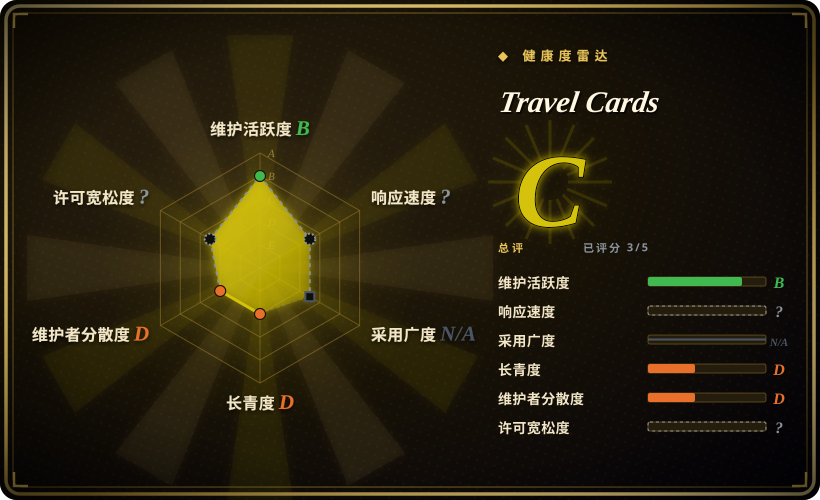
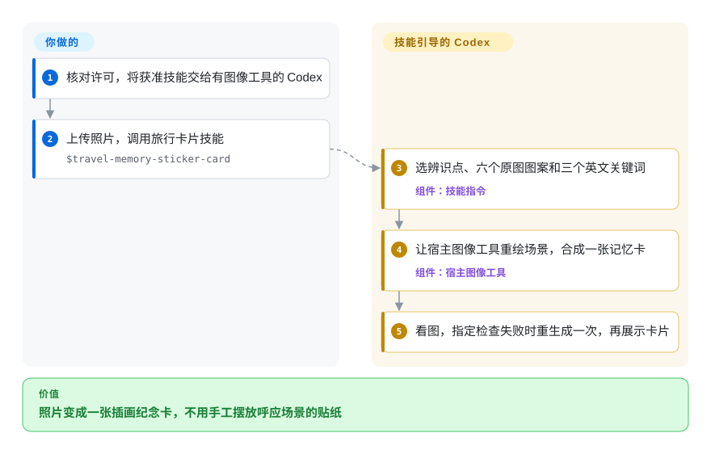
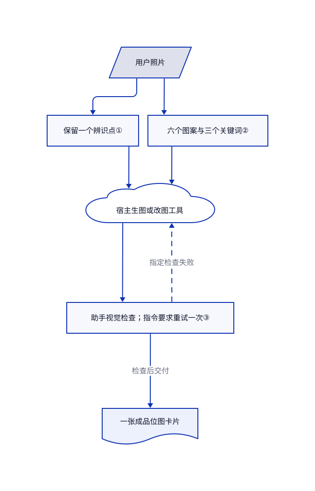

# Travel Cards

旅行照片里那个让你记住的街角，常在普通重绘中变得面目全非。Travel Memory Sticker Card 是一个 Codex 技能，要求图像工具保留一个辨识点，再把场景画成带六枚同款贴纸的纸纹记忆卡。

**许可边界：** 这是源码可见项目，不是开源项目。[个人使用许可](https://github.com/carolinaaafy/travel-memory-sticker-card/blob/25ac9753bae206e452f1501c9a57f93f853df408/LICENSE)允许个人非商用使用和修改，但未经书面授权，禁止再分发或作为模板、工作流、插件、社区资源重新发布。本页只介绍项目，不分发技能内容。

## 何时使用

你想用自己拍的街景或风景，做一本私人旅行手账。普通图片编辑保留太多摄影细节，通用画风库又让你从头决定每块内容的位置。当你明确想要一张 `3:2` 横版纪念卡，包含占主导的简化场景、低调的英文关键词页脚，以及六枚呼应场景的贴纸时，可以考虑它。你提供照片，助手先选出能辨认人物、物体或地点的特征，再用统一的平涂纸纹画法重绘。

决定性取舍是现成的视觉系统，而不是画风菜单或可编辑排版引擎。它适合能人工看图、接受模型变化的个人实验，不适合作为可商用模板的来源。

## 何时不用

- **要打包技能、工作流或客户服务。** 当前许可不授予这些用途。若需要可再分发的提示词配方起点，可看 [hand-drawn-styles](hand-drawn-styles.zh.md)，其代码与配方文字采用 MIT；照片和画风权利仍须另行核实。
- **要独立的透明贴纸文件。** 本仓库交付一张成品卡，不单独导出贴纸。作者的 [Travel Memory Card Duo](https://github.com/carolinaaafy/travel-memory-card-duo)明确要求第二张 RGBA PNG，但同样限个人使用。
- **文字必须准确、元素须独立编辑，或要批量生成平台尺寸卡片。** 选 [Guizang Social Card Skill](../guizang-social-card.zh.md)的 HTML 转 PNG 排版流程。本技能靠助手检查文字和贴纸数量，没有排版验证器。
- **照片只有两个明显主体，或想减少贴纸。** 已读主分支仍固定六枚。[草稿 PR #1](https://github.com/carolinaaafy/travel-memory-sticker-card/pull/1)提出三至六枚，并讨论了重复图案，但尚未合并。可用 [hand-drawn-styles](hand-drawn-styles.zh.md)自行定义构图，不要把提案当作已有功能。

## 横向对比

| 替代品 | 是否收录 | 我们的评价 | 取舍 |
|---|---|---|---|
| [Travel Memory Card Duo](https://github.com/carolinaaafy/travel-memory-card-duo) | 未收录 | 需要卡片和可单独使用的透明贴纸图时选 Duo；只要一张私人纪念卡时选本技能。 | Duo 增加第二份交付与真实透明通道要求，不代表许可更宽松；未在本批标签收录。 |
| [hand-drawn-styles](hand-drawn-styles.zh.md) | 已收录 | 要把照片放进固定纪念卡构图时选本技能；更在意挑选并保留多套画风配方时选 hand-drawn-styles。 | MIT 配方文字与渲染器更便于复用，但多数路径只交付提示词，不交付照片衍生卡片；美术与画风权利另算。 |
| [Guizang Social Card Skill](../guizang-social-card.zh.md) | 已收录 | 面向社交发布、需要文字主导的可修改排版时选 Guizang；做私人插画记忆卡，而非平台轮播图时选本技能。 | HTML 与浏览器渲染提供可检查的版面和平台尺寸，但要维护 Node 与浏览器环境，并遵守 AGPL；本技能把绘画交给图像工具。 |

## 快速上手

先读许可，再将获准使用的技能文件交给具备生图或改图能力的 Codex 宿主；本仓库没有安装器、依赖清单或图像后端。[Codex 配置](https://github.com/carolinaaafy/travel-memory-sticker-card/blob/25ac9753bae206e452f1501c9a57f93f853df408/agents/openai.yaml)给出了通过 `$travel-memory-sticker-card` 和上传照片调用的方式。你负责照片使用权、图像服务的数据处理授权，以及宿主或生成费用；包内没有定价。助手按[工作流](https://github.com/carolinaaafy/travel-memory-sticker-card/blob/25ac9753bae206e452f1501c9a57f93f853df408/SKILL.md)选辨识点、贴纸主体和关键词，再调用宿主图像工具，不用滤镜脚本模拟。指令要求它看图，遇到指定问题重生成一次，随后展示结果，并在有保存路径时报告路径。本次没有安装宿主或执行生图；仓库不提供导出器，也不保证某种文件格式。

<!-- flow-steps:begin (generated from flows/travel-memory-sticker-card.json by tools/flow_card.py — do not edit) -->

流程文字版

1. **你**：核对许可，将获准技能交给有图像工具的 Codex
2. **你**：上传照片，调用旅行卡片技能 — `$travel-memory-sticker-card`
3. **Travel Cards**：选辨识点、六个原图图案和三个英文关键词 — 组件：`技能指令`
4. **Travel Cards**：让宿主图像工具重绘场景，合成一张记忆卡 — 组件：`宿主图像工具`
5. **Travel Cards**：看图，指定检查失败时重生成一次，再展示卡片

**价值**：照片变成一张插画纪念卡，不用手工摆放呼应场景的贴纸

<!-- flow-steps:end -->

## 技术要点

<!-- mechanism:begin (generated from mechanisms/travel-memory-sticker-card.json by tools/mechanism_card.py; do not edit) -->

机制文字版

- 用户照片
- 保留一个辨识点①
- 六个图案与三个关键词②
- 宿主生图或改图工具
- 助手视觉检查；指令要求重试一次③
- 一张成品位图卡片

- 用户照片 → 保留一个辨识点①
- 用户照片 → 六个图案与三个关键词②
- 保留一个辨识点① → 宿主生图或改图工具
- 六个图案与三个关键词② → 宿主生图或改图工具
- 宿主生图或改图工具 → 助手视觉检查；指令要求重试一次③
- 助手视觉检查；指令要求重试一次③ → 宿主生图或改图工具（指定检查失败）〔可选／兜底〕
- 助手视觉检查；指令要求重试一次③ → 一张成品位图卡片（检查后交付）

<!-- mechanism:end -->

### 1. 保留辨识点，不留下摄影补丁

- **解决：** 全面风格化容易抹掉能辨认地点或主体的特征。
- **做法：** 工作流先选一个紧凑辨识点，要求图像工具保留其形状、位置、关系和标志色，并与周围场景使用同一画法。最多保留一处真正定义地点的原图文字，而不是留下所有招牌。
- **边界：** 这些是生成指令，不是分割或文字识别代码。主体是否可辨、字是否准确，仍依赖模型和看图复核。
- **源码：** [辨识点与地标文字规则](https://github.com/carolinaaafy/travel-memory-sticker-card/blob/25ac9753bae206e452f1501c9a57f93f853df408/SKILL.md#L28-L31)、[形状与材质参考](https://github.com/carolinaaafy/travel-memory-sticker-card/blob/25ac9753bae206e452f1501c9a57f93f853df408/references/style-guide.md#L7-L18)。

### 2. 从同一照片提取场景与贴纸主体

- **解决：** 场景旁贴上无关装饰，会像两套互不相干的插画。
- **做法：** 技能先选六个可见图案和三个贴合场景的英文关键词。固定构图把较大的左侧留给场景和页脚，右侧用大小错落的碎片呼应，并统一纸纹与平涂处理。
- **边界：** 没有程序化物体清单或数量验证器。未合并的可配置数量提案不改变主分支六枚要求，因此素材稀疏的照片尤其要检查虚构和重复细节。
- **源码：** [固定卡片系统](https://github.com/carolinaaafy/travel-memory-sticker-card/blob/25ac9753bae206e452f1501c9a57f93f853df408/SKILL.md#L19-L26)、[图案选择](https://github.com/carolinaaafy/travel-memory-sticker-card/blob/25ac9753bae206e452f1501c9a57f93f853df408/SKILL.md#L44-L48)、[构图参考](https://github.com/carolinaaafy/travel-memory-sticker-card/blob/25ac9753bae206e452f1501c9a57f93f853df408/references/style-guide.md#L20-L24)、[草稿提案](https://github.com/carolinaaafy/travel-memory-sticker-card/pull/1)。

### 3. 按明确的视觉失败项检查成图

- **解决：** 提示词看起来合理，成图仍可能过密、残留摄影质感或拼错文字。
- **做法：** 流程要求生成后看图；若细节抢过大形、画面偏摄影或绘画滤镜、贴纸数量错误，或必需文字错误，就重生成一次。交付时说明辨识点、贴纸主体和关键词，让用户对照意图看图。
- **边界：** 这是助手执行的检查和一次重试指令，不是量化质量门槛，也不是保证验收的循环。已读目录没有测试、评分实现或生图脚本。
- **源码：** [工作流](https://github.com/carolinaaafy/travel-memory-sticker-card/blob/25ac9753bae206e452f1501c9a57f93f853df408/SKILL.md#L10-L17)、[质量检查与交付](https://github.com/carolinaaafy/travel-memory-sticker-card/blob/25ac9753bae206e452f1501c9a57f93f853df408/SKILL.md#L54-L64)、[已读完整文件树](https://github.com/carolinaaafy/travel-memory-sticker-card/tree/25ac9753bae206e452f1501c9a57f93f853df408)。

## 健康度与可持续性

- **维护，2026-10-30：** 仓库创建于 2026-08-12，共八次提交，最后提交为 2026-08-26。没有发布或标签。最后三次提交添加个人使用许可及声明，并未新增渲染能力，见[提交史](https://github.com/carolinaaafy/travel-memory-sticker-card/commits/main/)。
- **治理与支持：** 八次提交均归于一个个人账号贡献者。五文件目录没有治理、贡献或安全策略，README 没有机构赞助声明。核实时唯一草稿 PR 仍开放且无评论，证据不足以承诺支持。
- **年龄与林迪效应：** 核实时仓龄仅 79 天，已有 65 天无新提交。[推断：依据是创建日、提交史和没有版本发布] 应把它当个人设计配方，不是经过长期考验的生图接口。
- **采用情况：** GitHub 快照为 625 星、42 个复刻。README 展示六张示例图，但目录没有基准、自动测试或独立用户达到同等质量的证据。
- **许可风险：** LICENSE 正文署名 carolinaaafy，生效日为 2026-08-26。GitHub 检测为 `NOASSERTION`；真正决定复用边界的是个人使用条款，不是检测结果。自动健康度块把该轴留为未知，只因无法解析自定义许可，不代表没有条款。未取得另行授权前，不适合共享技能目录或商业流水线。

## 存疑（未验证）

- [未验证：未调用上游技能或图像服务] 没有复现还原度、贴纸计数、文字准确度和一次重生成的效果；README 图像只是作者示例。
- [未验证：仓库未指定图像服务和模型版本] 费用、留存、照片传输和宿主兼容性取决于所选 Codex 环境；本包不提供离线或隐私保证。
- [推断：依据是 79 天仓龄、65 天无新提交及单一贡献者] 长期支持尚无实证；这不等于确认项目已弃置。
- [未验证：未完成第三方权属审计] 许可署名与仓库所有者一致，但每张照片、肖像和美术元素的权属没有独立核清。技能许可不等于输入或输出的权利许可。
