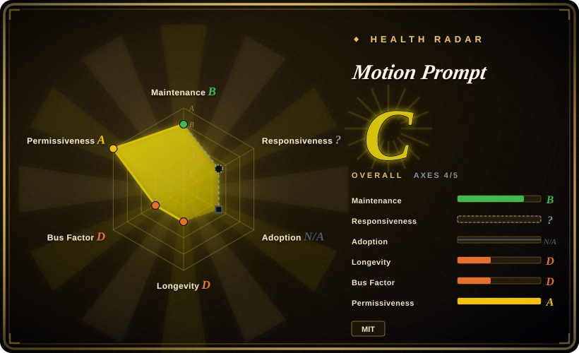
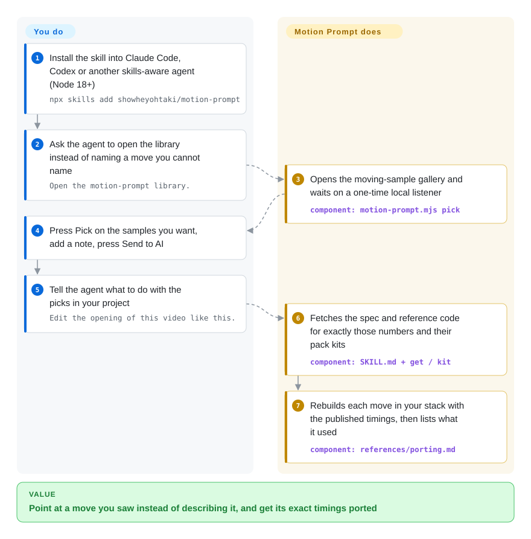
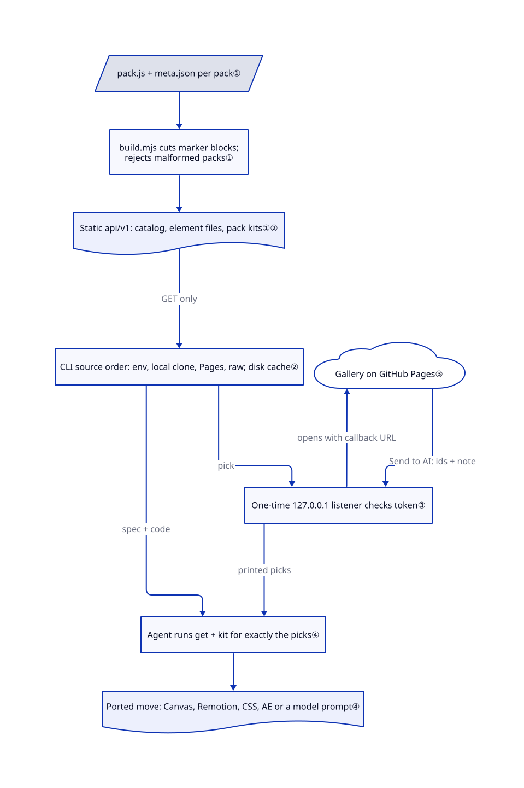

# Motion Prompt

You want "that thing where the title slides out from behind a line", but you don't know it is called a mask reveal, so you get a generic fade from your agent. Motion Prompt is a numbered gallery of 240 named moves, each with a moving sample, a timing spec and Canvas code. You pick by eye, and the agent copies those exact numbers into your project.

## When to use

You edit product videos, landing pages or slide decks with a coding agent (Claude Code, Codex), and the hard part is no longer building things: it is saying what you want. You type "make the opening feel more pro" and get back a 0.3 s opacity fade. Motion Prompt gives the missing vocabulary — motion-graphics moves, camera moves and transitions, UI part names, web scroll/hover effects, photo looks, art styles and slide diagrams, 24 per pack — and its skill lets you click samples in a browser gallery so the agent receives `#005 Mask reveal` with its durations, easing curve and reference code instead of your paraphrase.

Pick it over a full video-production skill when your project and pipeline already exist and you only need precise, named moves dropped into them; pick it over a runtime animation library when you want the agent to rebuild the move in whatever stack you already use (Canvas, Remotion, CSS, After Effects expressions or a Veo/Sora prompt) rather than adding a new dependency. The deciding trade: precise shared names plus reference timings, but no renderer, no production pipeline and only 24 options per field.

## When NOT to use

- **You need a whole video from a brief — script, assets, edit, render.** Use [video-shotcraft](../../video-production/creation-workflows/video-shotcraft.md) for product promos or [Remotion Agent Skills](../vendor-collections/product-vendors/remotion-skills.md) for writing Remotion compositions. Motion Prompt covers one move per scene; its skill explicitly leaves what the video says, the layout and each scene's length to you.
- **You want a dependency you import and call at runtime.** Use [Anime.js](../../frontend-animation/anime.md). Motion Prompt elements are loop-shaped reference snippets that need their pack's "kit" and an agent to port them; there is no npm package, no versioned API and no tagged release.
- **You need production web components with themes, keyboard support and reduced motion built in.** Look at Lucian UX/UI Prompt (`Seokwoooo/lucian-uxui`, not indexed), the project this one credits for its gallery-plus-skill design, which ships about 400 HTML/CSS/JS elements. Motion Prompt's `ui` and `lp` packs are Canvas drawings that name a pattern; the skill tells the agent to rebuild them with your own components.
- **You want a wide choice of image styles.** Use [handraw-style](image-art-direction/handraw-style.md) (279 numbered hand-drawn styles with per-model prompt strategy). The `artstyle` pack has 24 general styles shown on one base sketch, and `photo` is prompt vocabulary, not image code.
- **Your agent runs headless, in CI or in a network-blocked sandbox.** `pick` opens a browser and waits up to 15 minutes for a person; use `search`/`get` instead, or pin a clone and set `MOTION_PROMPT_BASE`. Without a clone, every lookup needs HTTPS to `showheyohtaki.github.io` or `raw.githubusercontent.com` (exit code 3 otherwise).
- **You need a stable, long-lived dependency.** The repository was about five weeks old at verification, has one maintainer and no releases. Copy the element files you use into your repository with their license line, rather than relying on live fetches.

## Comparison

| Alternative | In index | Our verdict | Tradeoff |
|---|---|---|---|
| [video-shotcraft](../../video-production/creation-workflows/video-shotcraft.md) | ✅ | Choose video-shotcraft when the agent should produce a whole product promo from real page captures; choose Motion Prompt when you already have the video and want to swap in named moves you picked by eye. | Shot recipes plus a validated Remotion template and sound design, at the cost of Remotion's licence gate; versus single moves with no renderer that port into any stack. |
| [Remotion Agent Skills](../vendor-collections/product-vendors/remotion-skills.md) | ✅ | Choose Remotion's skills when the problem is writing correct Remotion code; choose Motion Prompt when the problem is knowing which move to ask for — the two combine, since porting to Remotion is one of its documented targets. | Framework-correctness guidance with no visual catalog and no declared license, versus a visual catalog with no framework expertise. |
| Lucian UX/UI Prompt (`Seokwoooo/lucian-uxui`) | not indexed | For web interface parts and sections, prefer Lucian's larger themed element library; keep Motion Prompt for video, camera and slide vocabulary that Lucian does not cover. | Not added in this tab batch. About 400 accessible HTML/CSS/JS elements served from `lucianlabs.dev`; versus 48 web-pattern names drawn in Canvas. |
| [handraw-style](image-art-direction/handraw-style.md) | ✅ | Choose handraw-style when the deliverable is an image prompt with a specific hand-drawn look; choose Motion Prompt when image styles are a side need next to motion and camera vocabulary. | 279 styles with per-model fallbacks to reference images, versus 24 general art styles in a broader, shallower catalog. |
| [Anime.js](../../frontend-animation/anime.md) | ✅ | Choose Anime.js when you want to write and run web animations yourself with timelines and scroll control; choose Motion Prompt to decide what the motion should be and hand the agent exact numbers. | A mature runtime engine without named presets, versus named presets without a runtime. |

## Quick start

Install with `npx skills add showheyohtaki/motion-prompt` (Node.js 18 or later), or as a Claude Code plugin through `/plugin marketplace add showheyohtaki/motion-prompt`. Then ask your agent to "open the motion-prompt library": the skill's script opens the gallery in your browser, you press Pick on samples, optionally add a note such as "for the opening title", and press Send to AI. Then you say what to do with them. The agent fetches the spec and reference code for exactly those numbers and the shared "kit" (each pack's constants and helper functions), rebuilds each move in your project's own method and lists the numbers it used. You still decide scene content, layout and length, review the result, and keep the `// Motion Prompt #ID · MIT License …` line in ported code. Without the skill, look a name up in the [lists](https://github.com/showheyohtaki/motion-prompt/blob/683ecca0548a1754ada141d10dc3a009d4c59bef/packs/README.md) and use it in any prompt, or press "Copy picks" and paste. Model and video-generation costs are your agent's.

<!-- flow-steps:begin (generated from flows/motion-prompt.json by tools/flow_card.py — do not edit) -->

Text version of the flow

1. **You**: Install the skill into Claude Code, Codex or another skills-aware agent (Node 18+) — `npx skills add showheyohtaki/motion-prompt`
2. **You**: Ask the agent to open the library instead of naming a move you cannot name — `Open the motion-prompt library.`
3. **Motion Prompt**: Opens the moving-sample gallery and waits on a one-time local listener — component: `motion-prompt.mjs pick`
4. **You**: Press Pick on the samples you want, add a note, press Send to AI
5. **You**: Tell the agent what to do with the picks in your project — `Edit the opening of this video like this.`
6. **Motion Prompt**: Fetches the spec and reference code for exactly those numbers and their pack kits — component: `SKILL.md + get / kit`
7. **Motion Prompt**: Rebuilds each move in your stack with the published timings, then lists what it used — component: `references/porting.md`

**Value**: Point at a move you saw instead of describing it, and get its exact timings ported

<!-- flow-steps:end -->

## Key techniques

<!-- mechanism:begin (generated from mechanisms/motion-prompt.json by tools/mechanism_card.py; do not edit) -->

Text version of the mechanism

- pack.js + meta.json per pack①
- build.mjs cuts marker blocks; rejects malformed packs①
- Static api/v1: catalog, element files, pack kits①②
- CLI source order: env, local clone, Pages, raw; disk cache②
- Gallery on GitHub Pages③
- One-time 127.0.0.1 listener checks token③
- Agent runs get + kit for exactly the picks④
- Ported move: Canvas, Remotion, CSS, AE or a model prompt④

- pack.js + meta.json per pack① → build.mjs cuts marker blocks; rejects malformed packs①
- build.mjs cuts marker blocks; rejects malformed packs① → Static api/v1: catalog, element files, pack kits①②
- Static api/v1: catalog, element files, pack kits①② → CLI source order: env, local clone, Pages, raw; disk cache② (GET only)
- CLI source order: env, local clone, Pages, raw; disk cache② → One-time 127.0.0.1 listener checks token③ (pick)
- One-time 127.0.0.1 listener checks token③ → Gallery on GitHub Pages③ (opens with callback URL)
- Gallery on GitHub Pages③ → One-time 127.0.0.1 listener checks token③ (Send to AI: ids + note)
- One-time 127.0.0.1 listener checks token③ → Agent runs get + kit for exactly the picks④ (printed picks)
- CLI source order: env, local clone, Pages, raw; disk cache② → Agent runs get + kit for exactly the picks④ (spec + code)
- Agent runs get + kit for exactly the picks④ → Ported move: Canvas, Remotion, CSS, AE or a model prompt④

<!-- mechanism:end -->

### 1. Each element is a pure function of time, cut into standalone files

- **Problem:** A sample that reads the clock or random numbers cannot be reproduced frame by frame, and a whole pack file is too large to paste into an agent's context.
- **How:** Every element is `cells[i] = (ctx, w, h, u) => …`: it draws one Canvas 2D card from `u`, the seconds into its cycle, with no clock, no draw-time randomness and no state between calls. Authors mark blocks with `// @kit`, `// @element NN` and `// @shared`; `tools/build.mjs` cuts on those exact lines, rejects malformed or out-of-order markers, and writes one element file (license line, spec, code) per ID plus one kit per pack.
- **Limits:** Purity is an authoring contract checked by `tools/check.mjs` in a real browser, which needs Playwright and is not run in any CI workflow in the repository. Elements are not standalone: they need their pack's kit.
- **Source:** [pack.js contract](https://github.com/showheyohtaki/motion-prompt/blob/683ecca0548a1754ada141d10dc3a009d4c59bef/FORMAT.md#L48-L95), [marker cutting](https://github.com/showheyohtaki/motion-prompt/blob/683ecca0548a1754ada141d10dc3a009d4c59bef/tools/build.mjs#L79-L120), [generated API layout](https://github.com/showheyohtaki/motion-prompt/blob/683ecca0548a1754ada141d10dc3a009d4c59bef/FORMAT.md#L152-L165).

### 2. A static file API with local-first lookup and a versioned cache

- **Problem:** An agent needs specs and code on demand, but a server or database would be one more thing to host, and sandboxes often block the network.
- **How:** The CLI reads plain files under `api/v1`. It tries `MOTION_PROMPT_BASE` first, then a local clone three folders above the script, then GitHub Pages, then `raw.githubusercontent.com`. Downloads are cached on disk under a key of the source list; the catalog is trusted for six hours, element files are stored under the catalog version, and a stale cached copy is used when every source fails. `search` is plain keyword scoring over names, tags, summary and spec; `get` returns at most eight IDs per call.
- **Limits:** Only GET requests are sent and nothing from your project is uploaded, but the default path still depends on the author's Pages site staying up. Search is word matching, not semantic retrieval, so "make it feel premium" finds little.
- **Source:** [source order and cache](https://github.com/showheyohtaki/motion-prompt/blob/683ecca0548a1754ada141d10dc3a009d4c59bef/skills/motion-prompt/scripts/motion-prompt.mjs#L85-L237), [search scoring](https://github.com/showheyohtaki/motion-prompt/blob/683ecca0548a1754ada141d10dc3a009d4c59bef/skills/motion-prompt/scripts/motion-prompt.mjs#L296-L326).

### 3. A browser-to-agent hand-off through a one-time local listener

- **Problem:** A person chooses by looking, but the agent lives in a terminal; copying numbers by hand loses order and notes.
- **How:** `pick` opens an HTTP listener on `127.0.0.1` with a random port and a 128-bit random token, then opens the gallery with that callback address. "Send to AI" navigates the tab to the callback (an https page may not `fetch()` a loopback address). The listener checks the Host header against DNS rebinding, compares the token in constant time, accepts only `NNN,NNN` IDs that exist in the catalog (up to 60) and a cleaned note, prints them, and closes.
- **Limits:** It needs a person and a browser within the timeout (900 s by default); exit code 4 means nothing was picked. The gallery accepts only an `http://127.0.0.1` or `localhost` callback, but the gallery itself is served from GitHub Pages unless you use `--local` with a full clone.
- **Source:** [listener and checks](https://github.com/showheyohtaki/motion-prompt/blob/683ecca0548a1754ada141d10dc3a009d4c59bef/skills/motion-prompt/scripts/motion-prompt.mjs#L527-L636), [gallery callback validation](https://github.com/showheyohtaki/motion-prompt/blob/683ecca0548a1754ada141d10dc3a009d4c59bef/assets/site.js#L553-L600).

### 4. A porting contract: keep the numbers, swap the content

- **Problem:** Agents "improve" a reference move — changing timing or easing — until it no longer looks like the sample the person chose.
- **How:** The skill tells the agent to use exactly the picked elements, keep durations, delays, easing, overshoot and distances, replace only text, colors and images, and end with a list of the numbers used. The porting guide maps `u` to looping, play-once and fixed-slot use (stretch the hold, not the motion) and gives recipes for Canvas, Remotion, CSS/SVG/Lottie, After Effects and video-model prompts.
- **Limits:** These are instructions, not enforcement; nothing checks that the port matches the sample. Video-generation models treat timings as guidance, so a prompt port is approximate, as the skill itself says.
- **Source:** [pick and workflow rules](https://github.com/showheyohtaki/motion-prompt/blob/683ecca0548a1754ada141d10dc3a009d4c59bef/skills/motion-prompt/SKILL.md#L34-L80), [time mapping and fitting](https://github.com/showheyohtaki/motion-prompt/blob/683ecca0548a1754ada141d10dc3a009d4c59bef/skills/motion-prompt/references/porting.md#L21-L30).

## Health & viability

- **Maintenance, 2026-11-18:** first commit 2026-10-13, repository created 2026-10-14, last push 2026-11-16. Five new packs have been added since launch (`motion2` 10-19, `lp2` 10-23, `camera2` 10-29, `artstyle` 11-13, `diagram` 11-16). That is a busy first month, not yet a cadence; there are no tagged releases, and the plugin manifest says 0.1.0.
- **Governance and bus factor, 2026-11-18:** a personal repository of Shohei Ohtaki (company named in the README: 株式会社デイトラ). Three translators contributed; the author re-applied two of their pull requests by hand instead of merging them and closed a Korean pull request without merging. CONTRIBUTING and issue templates (contribution, example, removal) exist; there is no CI workflow, SECURITY or CODEOWNERS file.
- **Age and Lindy, 2026-11-18:** about five weeks old, so there is no Lindy evidence. 2,301 stars and 211 forks in that time follow viral posts on X — a discovery signal, not proof of production use. [推断：based on age, a single maintainer and no releases] Treat it as a reference catalog to copy from, not as infrastructure.
- **Stability promise:** FORMAT.md says published numbers are never renumbered and names are not renamed, so `#012` should keep meaning the same move. That matters because prompts and ported code cite the numbers.
- **License and provenance, 2026-11-18:** the MIT LICENSE names the author; every element and kit carries an MIT header line. THIRD-PARTY-NOTICES credits Lucian UX/UI Prompt for the skill and CLI design and reproduces its MIT notice; the skill files are not blob-identical to `Seokwoooo/lucian-uxui`. The `artstyle` sample images were made by an image model from one base sketch and are released under MIT; see Caveats.

## Caveats (unverified)

- [未验证：no agent run in this review] Install via `npx skills add` or the plugin marketplace, agent activation and the quality of ported moves were not exercised. The CLI was run against a local clone only: `info` (240 elements), `search`, `list` and the eight-ID limit on `get` behaved as documented; `pick` and network fetches were not run.
- [未验证：copyright status of AI-generated images varies by jurisdiction] The `artstyle` pack images are described as image-model output from the author's sketch; whether the MIT grant covers them fully was not assessed.
- [推断：from the repository's growth pattern] The 24-per-pack cap and the "append only, never renumber" rule mean later fixes arrive as new packs rather than edits, so overlap between packs (e.g. `lp`/`lp2`) can grow.
- [未验证：the provenance check compared three skill files against one tree] The names themselves are common industry terms; no check was made that every spec or sample is original, beyond the author's statement that `lp`, `ui` and `photo` were made new for the repository.
- [推断：based on the opened indexed pages] Comparison verdicts compare scope and integration shape, not measured output quality.
