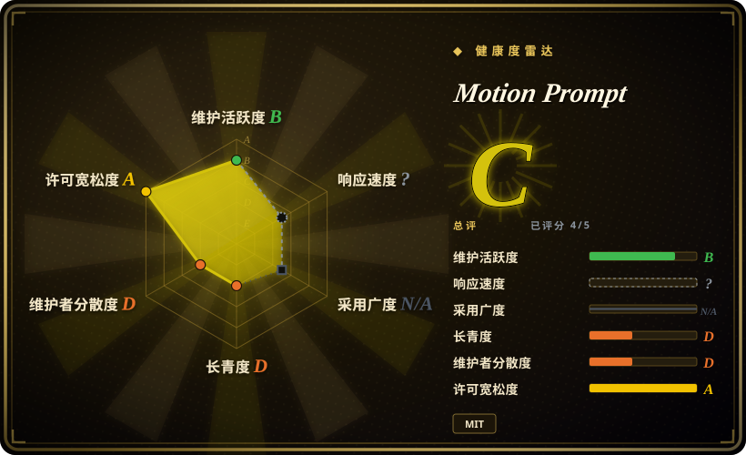
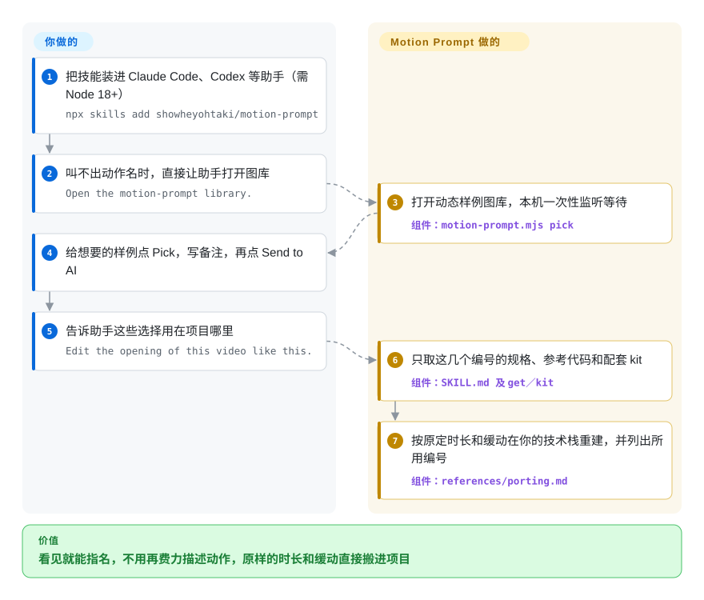
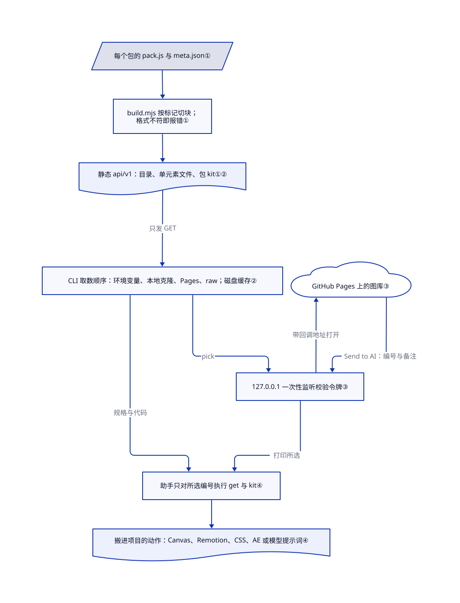

# Motion Prompt

你想要“标题从一条线后面滑出来”的那种效果，却不知道它叫“遮罩显现”，于是助手给你一个普通的淡入。Motion Prompt 是一个带编号的动作图库：240 个有名字的动作，每个都有动态样例、时长规格和 Canvas 代码；你用眼睛挑，助手把这几个编号原样搬进你的项目。

## 何时使用

你用编码助手（Claude Code、Codex）剪产品视频、做落地页或幻灯片，难的已经不是做出来，而是说清楚要什么。你输入“把开场弄得专业一点”，拿回来的是一个 0.3 秒的透明度淡入。Motion Prompt 补上缺的词汇：动态图形动作、运镜与转场、UI 部件名、网页滚动／悬停效果、照片质感、画风和幻灯片图表，每个包 24 个。它的技能让你在浏览器图库里点选样例，助手收到的是 `#005 Mask reveal` 及其时长、缓动曲线和参考代码，而不是你的转述。

如果项目和流水线已经有了，只差把精确、有名字的动作放进去，就选它而不是整套视频制作技能；如果你希望助手在你现有的技术栈里重建动作（Canvas、Remotion、CSS、After Effects 表达式，或者 Veo／Sora 提示词），而不是多引入一个依赖，就选它而不是运行时动画库。决定性的取舍：你得到共享的精确名称和参考时长，但没有渲染器、没有制作流水线，每个领域也只有 24 个选项。

## 何时不用

- **你要从一句需求直接做出整条视频：脚本、素材、剪辑、渲染。** 产品宣传片用 [video-shotcraft](../../video-production/creation-workflows/video-shotcraft.zh.md)，写 Remotion 合成用 [Remotion Agent Skills](../vendor-collections/product-vendors/remotion-skills.zh.md)。Motion Prompt 每个场景只管一个动作；它的技能明确把视频讲什么、版面和每个场景多长留给你决定。
- **你要一个运行时导入调用的依赖。** 用 [Anime.js](../../frontend-animation/anime.zh.md)。Motion Prompt 的元素是循环形式的参考片段，要配合所在包的 kit 并由助手移植；没有 npm 包、没有版本化 API，也没有打过标签的发行版。
- **你要自带主题、键盘支持和减少动态效果的生产级网页组件。** 去看 Lucian UX/UI Prompt（`Seokwoooo/lucian-uxui`，未收录）。本项目在致谢里说明图库加技能的设计来自它，它提供约 400 个 HTML／CSS／JS 元素。Motion Prompt 的 `ui` 和 `lp` 包是 Canvas 画出来的示意，只负责给模式命名，技能会让助手用你自己的组件重建。
- **你要大量可选的图像画风。** 用 [handraw-style](image-art-direction/handraw-style.zh.md)（279 种编号手绘风格，按模型给提示词策略）。`artstyle` 包只有 24 种通用画风，都画在同一张底稿上；`photo` 是提示词词汇，不是图像代码。
- **你的助手无界面运行、跑在 CI 里，或者处在断网沙箱中。** `pick` 会打开浏览器，最多等一个人 15 分钟；改用 `search`／`get`，或者固定一份克隆并设置 `MOTION_PROMPT_BASE`。没有克隆时，每次查询都要能用 HTTPS 访问 `showheyohtaki.github.io` 或 `raw.githubusercontent.com`，否则退出码为 3。
- **你需要稳定、长期可依赖的东西。** 核实时仓库约五周大，只有一位维护者，没有发行版。把用到的元素文件连同许可行一起复制进自己的仓库，不要依赖在线拉取。

## 横向对比

| 替代品 | 是否收录 | 我们的评价 | 取舍 |
|---|---|---|---|
| [video-shotcraft](../../video-production/creation-workflows/video-shotcraft.zh.md) | ✅ | 要助手用真实页面截图做出整条产品宣传片，选 video-shotcraft；视频已经有了，只想换上你亲眼挑中的有名动作，选 Motion Prompt。 | 前者有镜头配方、验证过的 Remotion 模板和音效设计，代价是 Remotion 的许可门槛；后者只有单个动作、没有渲染器，但能移植到任何技术栈。 |
| [Remotion Agent Skills](../vendor-collections/product-vendors/remotion-skills.zh.md) | ✅ | 问题在于写对 Remotion 代码，选 Remotion 官方技能；问题在于不知道该要哪个动作，选 Motion Prompt。两者可以叠用，移植到 Remotion 本来就是它文档里的目标之一。 | 前者是框架正确性指导，没有可视目录，也没有声明许可；后者是可视目录，不懂框架细节。 |
| Lucian UX/UI Prompt（`Seokwoooo/lucian-uxui`） | 未收录 | 网页界面部件和区块优先用 Lucian 更大、带主题的元素库；视频、运镜和幻灯片词汇它不覆盖，这部分留给 Motion Prompt。 | 本批标签未收录。约 400 个可访问的 HTML／CSS／JS 元素，由 `lucianlabs.dev` 提供；对比 Motion Prompt 只有 48 个用 Canvas 画出来的网页模式名。 |
| [handraw-style](image-art-direction/handraw-style.zh.md) | ✅ | 交付物是某种手绘风格的图像提示词，选 handraw-style；画风只是动作和运镜词汇之外的附带需求，选 Motion Prompt。 | 279 种风格并按模型回退到参考图；对比 24 种通用画风，目录更广但更浅。 |
| [Anime.js](../../frontend-animation/anime.zh.md) | ✅ | 想自己写并运行网页动画、要时间线和滚动控制，选 Anime.js；想先定下动作是什么、把准确数字交给助手，选 Motion Prompt。 | 成熟的运行时引擎但没有命名预设；对比有命名预设但没有运行时。 |

## 快速上手

用 `npx skills add showheyohtaki/motion-prompt` 安装（需 Node.js 18 或更高），或作为 Claude Code 插件用 `/plugin marketplace add showheyohtaki/motion-prompt` 添加。然后让助手“打开 motion-prompt 图库”：技能脚本会在浏览器里打开图库，你给样例点 Pick，可选地写一句备注，比如“用于开场标题”，再点 Send to AI。接着告诉助手怎么用这些选择。助手只拉取这几个编号的规格和参考代码，以及共享的 kit（每个包的常量和辅助函数），用你项目自己的方式重建每个动作，最后列出用到的编号。场景内容、版面和时长仍由你决定，结果要你审，移植后的代码要保留 `// Motion Prompt #ID · MIT License …` 这一行。不装技能也能用：在[名称列表](https://github.com/showheyohtaki/motion-prompt/blob/683ecca0548a1754ada141d10dc3a009d4c59bef/packs/README.md)里查到名字，写进任何提示词；或者点“Copy picks”复制后粘贴。模型和视频生成的费用由你的助手账户承担。

<!-- flow-steps:begin (generated from flows/motion-prompt.json by tools/flow_card.py — do not edit) -->

流程文字版

1. **你**：把技能装进 Claude Code、Codex 等助手（需 Node 18+） — `npx skills add showheyohtaki/motion-prompt`
2. **你**：叫不出动作名时，直接让助手打开图库 — `Open the motion-prompt library.`
3. **Motion Prompt**：打开动态样例图库，本机一次性监听等待 — 组件：`motion-prompt.mjs pick`
4. **你**：给想要的样例点 Pick，写备注，再点 Send to AI
5. **你**：告诉助手这些选择用在项目哪里 — `Edit the opening of this video like this.`
6. **Motion Prompt**：只取这几个编号的规格、参考代码和配套 kit — 组件：`SKILL.md 及 get／kit`
7. **Motion Prompt**：按原定时长和缓动在你的技术栈重建，并列出所用编号 — 组件：`references/porting.md`

**价值**：看见就能指名，不用再费力描述动作，原样的时长和缓动直接搬进项目

<!-- flow-steps:end -->

## 技术要点

<!-- mechanism:begin (generated from mechanisms/motion-prompt.json by tools/mechanism_card.py; do not edit) -->

机制文字版

- 每个包的 pack.js 与 meta.json①
- build.mjs 按标记切块； 格式不符即报错①
- 静态 api/v1：目录、单元素文件、包 kit①②
- CLI 取数顺序：环境变量、本地克隆、Pages、raw；磁盘缓存②
- GitHub Pages 上的图库③
- 127.0.0.1 一次性监听校验令牌③
- 助手只对所选编号执行 get 与 kit④
- 搬进项目的动作：Canvas、Remotion、CSS、AE 或模型提示词④

- 每个包的 pack.js 与 meta.json① → build.mjs 按标记切块； 格式不符即报错①
- build.mjs 按标记切块； 格式不符即报错① → 静态 api/v1：目录、单元素文件、包 kit①②
- 静态 api/v1：目录、单元素文件、包 kit①② → CLI 取数顺序：环境变量、本地克隆、Pages、raw；磁盘缓存②（只发 GET）
- CLI 取数顺序：环境变量、本地克隆、Pages、raw；磁盘缓存② → 127.0.0.1 一次性监听校验令牌③（pick）
- 127.0.0.1 一次性监听校验令牌③ → GitHub Pages 上的图库③（带回调地址打开）
- GitHub Pages 上的图库③ → 127.0.0.1 一次性监听校验令牌③（Send to AI：编号与备注）
- 127.0.0.1 一次性监听校验令牌③ → 助手只对所选编号执行 get 与 kit④（打印所选）
- CLI 取数顺序：环境变量、本地克隆、Pages、raw；磁盘缓存② → 助手只对所选编号执行 get 与 kit④（规格与代码）
- 助手只对所选编号执行 get 与 kit④ → 搬进项目的动作：Canvas、Remotion、CSS、AE 或模型提示词④

<!-- mechanism:end -->

### 1. 每个元素都是时间的纯函数，并切成独立文件

- **解决：** 读时钟或随机数的样例无法逐帧复现；整个包的源文件又太大，塞不进助手的上下文。
- **做法：** 每个元素是 `cells[i] = (ctx, w, h, u) => …`：根据 `u`（循环内的秒数）在 Canvas 2D 上画一张卡片，不读时钟、绘制时不用随机数、调用之间不留状态。作者用 `// @kit`、`// @element NN`、`// @shared` 标记代码块；`tools/build.mjs` 按这些精确的行切分，标记格式不对或编号乱序就报错，并为每个编号写出一个元素文件（许可行、规格、代码），每个包写出一个 kit。
- **边界：** 纯函数只是创作约定，靠 `tools/check.mjs` 在真实浏览器里检查；它需要 Playwright，仓库里也没有任何 CI 流程运行它。元素不能单独运行，需要所在包的 kit。
- **源码：** [pack.js 约定](https://github.com/showheyohtaki/motion-prompt/blob/683ecca0548a1754ada141d10dc3a009d4c59bef/FORMAT.md#L48-L95)、[按标记切分](https://github.com/showheyohtaki/motion-prompt/blob/683ecca0548a1754ada141d10dc3a009d4c59bef/tools/build.mjs#L79-L120)、[生成的 API 布局](https://github.com/showheyohtaki/motion-prompt/blob/683ecca0548a1754ada141d10dc3a009d4c59bef/FORMAT.md#L152-L165)。

### 2. 静态文件 API：本地优先查找，加带版本的缓存

- **解决：** 助手要按需拿到规格和代码，但多一个服务器或数据库就多一样要托管的东西，而沙箱常常不让联网。
- **做法：** CLI 读取 `api/v1` 下的纯文本文件。先看 `MOTION_PROMPT_BASE`，再看脚本上方三层的本地克隆，然后是 GitHub Pages，最后是 `raw.githubusercontent.com`。下载内容按来源列表算出的键缓存在磁盘上；目录信任六小时，元素文件按目录版本存放，所有来源都失败时使用过期的缓存副本。`search` 是对名称、标签、摘要和规格的普通关键词打分；`get` 每次最多返回八个编号。
- **边界：** 只发 GET 请求，不上传项目里的任何东西，但默认路径依赖作者的 Pages 站点一直在线。搜索是字词匹配而不是语义检索，“让它显得高级”基本搜不到东西。
- **源码：** [来源顺序与缓存](https://github.com/showheyohtaki/motion-prompt/blob/683ecca0548a1754ada141d10dc3a009d4c59bef/skills/motion-prompt/scripts/motion-prompt.mjs#L85-L237)、[搜索打分](https://github.com/showheyohtaki/motion-prompt/blob/683ecca0548a1754ada141d10dc3a009d4c59bef/skills/motion-prompt/scripts/motion-prompt.mjs#L296-L326)。

### 3. 通过一次性本地监听，把浏览器里的选择交给助手

- **解决：** 人是看着挑的，助手却在终端里；手抄编号会丢掉顺序和备注。
- **做法：** `pick` 在 `127.0.0.1` 上用随机端口和 128 位随机令牌开一个 HTTP 监听，再带着这个回调地址打开图库。点 Send to AI 时，标签页直接跳到回调地址（https 页面不能用 `fetch()` 访问本机回环地址）。监听端检查 Host 头以防 DNS 重绑定，用恒定时间比较令牌，只接受目录里存在的 `NNN,NNN` 形式编号（最多 60 个）和清洗过的备注，打印出来后关闭。
- **边界：** 需要有人在超时前（默认 900 秒）用浏览器操作；退出码 4 表示没选任何东西。图库只接受 `http://127.0.0.1` 或 `localhost` 回调，但图库本身由 GitHub Pages 提供，除非你在完整克隆里用 `--local`。
- **源码：** [监听与校验](https://github.com/showheyohtaki/motion-prompt/blob/683ecca0548a1754ada141d10dc3a009d4c59bef/skills/motion-prompt/scripts/motion-prompt.mjs#L527-L636)、[图库回调校验](https://github.com/showheyohtaki/motion-prompt/blob/683ecca0548a1754ada141d10dc3a009d4c59bef/assets/site.js#L553-L600)。

### 4. 移植约定：数字不动，只换内容

- **解决：** 助手会“优化”参考动作，改时长、改缓动，最后和用户挑中的样例不再相像。
- **做法：** 技能要求助手只用被选中的元素，保留时长、延迟、缓动、过冲和位移，只替换文字、颜色和图片，最后列出用到的编号。移植指南说明如何把 `u` 映射到循环播放、播放一次和固定时段替换（拉长停顿，不拉长动作），并给出 Canvas、Remotion、CSS／SVG／Lottie、After Effects 和视频模型提示词的做法。
- **边界：** 这些是指令，不是强制约束；没有任何东西检查移植结果是否和样例一致。视频生成模型只把时长当参考，所以提示词形式的移植只能接近，技能自己也这么说。
- **源码：** [挑选与工作流规则](https://github.com/showheyohtaki/motion-prompt/blob/683ecca0548a1754ada141d10dc3a009d4c59bef/skills/motion-prompt/SKILL.md#L34-L80)、[时间映射与适配](https://github.com/showheyohtaki/motion-prompt/blob/683ecca0548a1754ada141d10dc3a009d4c59bef/skills/motion-prompt/references/porting.md#L21-L30)。

## 健康度与可持续性

- **维护（2026-11-18）：** 首个提交 2026-10-13，仓库创建于 2026-10-14，最近推送 2026-11-16。上线后新增了五个包（`motion2` 10-19、`lp2` 10-23、`camera2` 10-29、`artstyle` 11-13、`diagram` 11-16）。第一个月很活跃，但还谈不上稳定节奏；没有打标签的发行版，插件清单写的是 0.1.0。
- **治理与巴士因子（2026-11-18）：** Shohei Ohtaki 的个人仓库（README 里写的公司是株式会社デイトラ）。三位译者贡献过翻译；其中两个拉取请求作者没有合并，而是手动重新应用，一个韩语拉取请求未合并就关闭了。有 CONTRIBUTING 和问题模板（贡献、示例、删除申请）；没有 CI 流程、SECURITY 或 CODEOWNERS 文件。
- **年龄与林迪效应（2026-11-18）：** 约五周大，没有林迪证据。这段时间里的 2,301 星和 211 个分叉来自 X 上的爆款帖子，是曝光信号，不证明有人用于生产。[推断：依据是仓库年龄、单一维护者和没有发行版] 把它当作可以复制的参考目录，而不是基础设施。
- **稳定承诺：** FORMAT.md 写明已发布的编号永不重排、名称不改，所以 `#012` 应当一直指同一个动作。这一点重要，因为提示词和移植后的代码都会引用编号。
- **许可与来源（2026-11-18）：** MIT LICENSE 署名为作者本人；每个元素和 kit 都带 MIT 头行。THIRD-PARTY-NOTICES 致谢 Lucian UX/UI Prompt 提供技能和 CLI 设计思路，并转载其 MIT 声明；技能文件与 `Seokwoooo/lucian-uxui` 没有逐字节相同的文件。`artstyle` 样例图由图像模型根据作者的一张底稿生成，以 MIT 发布；见存疑。

## 存疑（未验证）

- [未验证：本次没有实际运行助手] 通过 `npx skills add` 或插件市场安装、助手触发技能、移植动作的质量都没有实测。CLI 只在本地克隆上跑过：`info`（240 个元素）、`search`、`list` 以及 `get` 的八个编号上限都与文档一致；`pick` 和联网拉取没有运行。
- [未验证：AI 生成图像的版权归属因司法辖区而异] `artstyle` 包的图片据称是图像模型根据作者底稿生成的；MIT 授权能否完全覆盖这些图片没有评估。
- [推断：依据仓库的增长方式] 每包 24 个的上限加上“只追加、永不重排”的规则，意味着后续修正会以新包出现而不是改旧包，包之间的重叠（如 `lp`／`lp2`）可能越来越多。
- [未验证：来源检查只把三个技能文件和一棵源码树做了比对] 名称本身是行业通用术语；除作者声明 `lp`、`ui`、`photo` 为本仓库新做之外，没有逐一核实每条规格和样例的原创性。
- [推断：依据已打开的收录页面] 横向对比的评价比较的是范围和接入方式，不是实测的产出质量。
