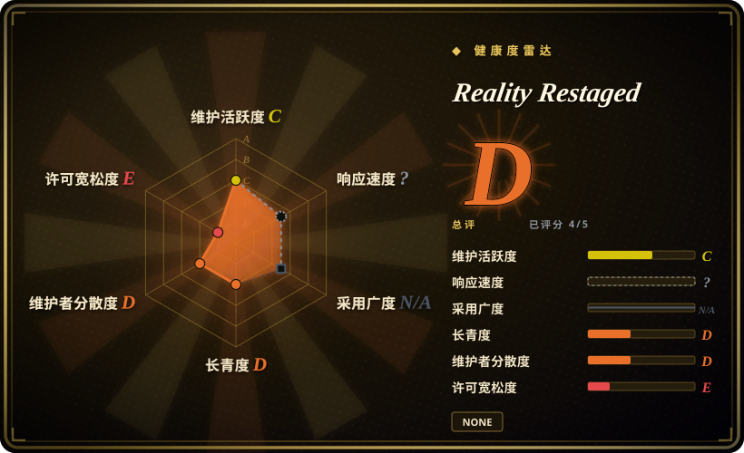
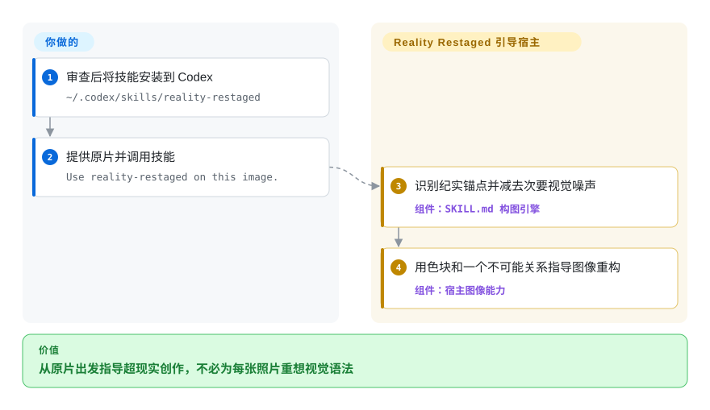
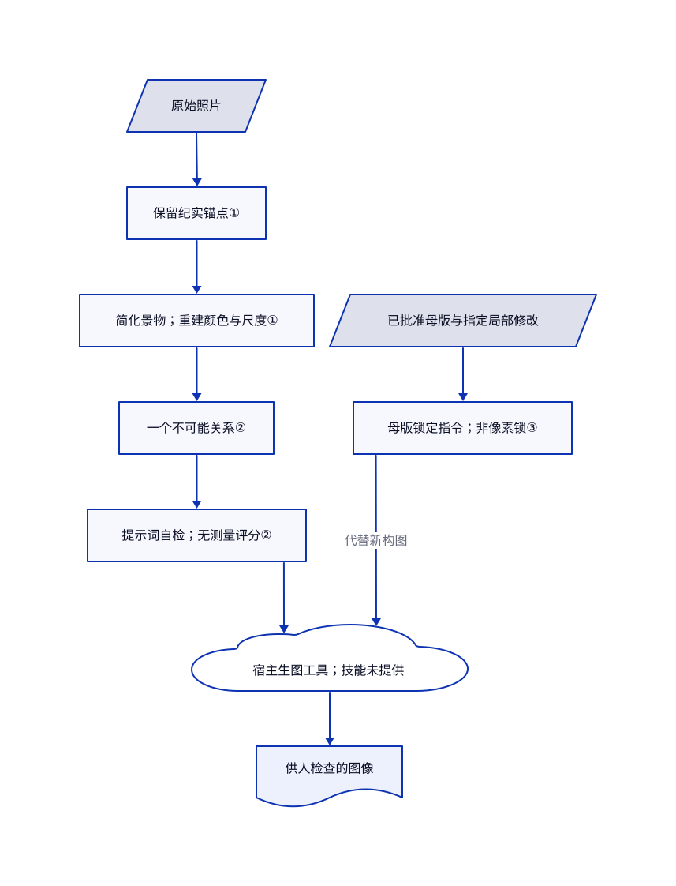

# Reality Restaged

旅行照一加超现实效果，人物动作和现场关系就被改没了。Reality Restaged 让助手保留这些记忆锚点，再用大色块和一个不可能的关系重搭周围空间。

## 何时使用

你是一名摄影师，想把旅行组照改成超现实的编辑作品。只要求加入巨兽或奇异天空，原片的杂乱背景仍在；改得更狠，独特服饰和两个人的互动又消失了。你需要一组照片共享视觉语言，而不是每张随机叠一种特效。

当你已有能处理和生成图片的 Codex 环境，缺的是艺术指导，而非另一个渲染软件时，可以考虑这个技能。它让助手先找纪实锚点，再减去视觉噪声，用颜色和尺度重建构图。与 ComfyUI 或 InvokeAI 相比，它提供特定的摄影语法，不提供模型运行时、修图画布或可复现的生成管线。

## 何时不用

- **照片必须保留纪实证据价值。** 新构图规则明确允许移动人物、改变地平线和删除景物。保留原片，用 [PhotoCraft](../../photo-editing/photocraft.zh.md) 这类常规编辑器仅做非生成式校正，同时注意它尚属早期测试版；不要把重构图当作新闻纪实。
- **你需要真正的蒙版或可强制执行的局部修改。** 母版锁定只是保留已批准构图的指令，不是像素锁。需要画笔局部重绘和画布外扩时，选 [InvokeAI](https://github.com/invoke-ai/InvokeAI)，同时检查生成结果。
- **你需要离线推理或可版本化的模型管线。** 选 [ComfyUI](../../on-device-ml/local-image-generation/comfyui.zh.md)，自行管理模型文件与工作流。本仓库没有渲染器、模型权重、供应商配置或生图工具适配器。
- **你要解释概念的插画，而非改造照片。** 选 [ian-xiaohei-illustrations](ian-illustrations.zh.md) 生成文章驱动的手绘场景；本技能刻意保留摄影质感和纪实主体。
- **组织要求明确的复用授权。** 已审树中没有 LICENSE，两份文本也未提供许可条款。优先选择许可已核实的工作流，例如 ComfyUI 加上授权合适的模型；转发本技能或示例作品前，应取得许可。

## 横向对比

| 替代品 | 是否收录 | 我们的评价 | 取舍 |
|---|---|---|---|
| [ComfyUI](../../on-device-ml/local-image-generation/comfyui.zh.md) | 已收录 | 必须控制模型、条件输入和生成环节时选 ComfyUI；缺少的是从原片出发的超现实构图方案时选 Reality Restaged。 | ComfyUI 提供可执行节点图和本地推理，但要自备硬件、模型与工作流；本技能只提供艺术约束，不承担这些基础设施。 |
| [InvokeAI](https://github.com/invoke-ai/InvokeAI) | 未收录 | 用画笔反复修改指定区域，比自动重构整张照片更重要时，选 InvokeAI。 | 本地画布提供局部重绘、外扩与工作流管理，但不自带这套纪实优先的视觉语法；本标签批次不新增该仓库。 |
| [ian-xiaohei-illustrations](ian-illustrations.zh.md) | 已收录 | 需要概念型文章配图时选 ian-xiaohei-illustrations；必须以真实服饰、动作和摄影表面为锚点时选 Reality Restaged。 | 前者放弃照片身份，换取固定手绘角色的一致性；两者都依靠宿主完成生图。 |

## 快速上手

[README](https://github.com/traveler0621/reality-restaged/blob/9a5533cb656bba6163714a6f5fc2217a1e6607fb/README.md) 的安装方式是克隆到 `~/.codex/skills/reality-restaged`，必要时重新打开 Codex。在获准安装的环境中，应先审查技能，再提供原片并说 `Use reality-restaged on this image.`。技能负责提供构图指令，宿主另行提供看图、生图或修图能力。你负责照片权利、人物同意、供应商隐私与费用，也要检查人脸和文化细节是否保留。仓库没有指定模型、工具调用契约、输出路径或导出格式，因此安装成功不代表已经接通完整生图链路。

<!-- flow-steps:begin (generated from flows/reality-restaged.json by tools/flow_card.py — do not edit) -->

流程文字版

1. **你**：审查后将技能安装到 Codex — `~/.codex/skills/reality-restaged`
2. **你**：提供原片并调用技能 — `Use reality-restaged on this image.`
3. **Reality Restaged**：识别纪实锚点并减去次要视觉噪声 — 组件：`SKILL.md 构图引擎`
4. **Reality Restaged**：用色块和一个不可能关系指导图像重构 — 组件：`宿主图像能力`

**价值**：从原片出发指导超现实创作，不必为每张照片重想视觉语法

<!-- flow-steps:end -->

## 技术要点

<!-- mechanism:begin (generated from mechanisms/reality-restaged.json by tools/mechanism_card.py; do not edit) -->

机制文字版

- 原始照片
- 保留纪实锚点①
- 简化景物；重建颜色与尺度①
- 一个不可能关系②
- 提示词自检；无测量评分②
- 宿主生图工具；技能未提供
- 已批准母版与指定局部修改
- 母版锁定指令；非像素锁③
- 供人检查的图像

- 原始照片 → 保留纪实锚点①
- 保留纪实锚点① → 简化景物；重建颜色与尺度①
- 简化景物；重建颜色与尺度① → 一个不可能关系②
- 一个不可能关系② → 提示词自检；无测量评分②
- 提示词自检；无测量评分② → 宿主生图工具；技能未提供
- 已批准母版与指定局部修改 → 母版锁定指令；非像素锁③
- 母版锁定指令；非像素锁③ → 宿主生图工具；技能未提供（代替新构图）
- 宿主生图工具；技能未提供 → 供人检查的图像

<!-- mechanism:end -->

### 1. 把纪实锚点转成新的空间结构

- **解决：** 只换背景容易保留杂乱，整图重做又会抹去独特人物与关系。
- **做法：** 构图引擎要求保留选定动作、服饰和文化细节，压低次要景物，再把原片的二至四色扩展为空间平面。它允许移动地平线和人物，而不只是给原场景换色。
- **边界：** 保留与抽象都是提示词要求，不是分割、身份匹配或几何求解器。新构图会主动改变原片的真实空间关系。
- **源码：** [构图引擎](https://github.com/traveler0621/reality-restaged/blob/9a5533cb656bba6163714a6f5fc2217a1e6607fb/SKILL.md#L30-L186)、[文化完整性](https://github.com/traveler0621/reality-restaged/blob/9a5533cb656bba6163714a6f5fc2217a1e6607fb/SKILL.md#L872-L905)。

### 2. 只留一个不可能关系，再检查结构

- **解决：** 不断叠加月亮、门和巨型物件，只会堆出效果，难以形成连贯组图。
- **做法：** 提示词只选择一个主导的不可能关系，例如尺度或折叠空间。最低改造测试拒绝那种去掉奇异道具后仍基本等同原片的方案；最终清单检查构图、色彩、解剖和组图一致性。
- **边界：** 这些是模型自检，没有测量阈值、外部评分、强制重试或独立审稿者。一秒观看测试也是指令，不是计时感知实验。
- **源码：** [单一空间逻辑](https://github.com/traveler0621/reality-restaged/blob/9a5533cb656bba6163714a6f5fc2217a1e6607fb/SKILL.md#L562-L670)、[最低改造要求](https://github.com/traveler0621/reality-restaged/blob/9a5533cb656bba6163714a6f5fc2217a1e6607fb/SKILL.md#L770-L801)、[最终检查清单](https://github.com/traveler0621/reality-restaged/blob/9a5533cb656bba6163714a6f5fc2217a1e6607fb/SKILL.md#L1467-L1546)。

### 3. 已批准母版优先于默认重构

- **解决：** 要求修鱼尾，可能连海面、光线和人物尺度都被重新设计。
- **做法：** 用户说“用这张当母版”等话语后，技能要求锁定构图、透视、已认可配色和质感，只改指定元素。改变宽高比时，优先向外扩画布，不压缩身体或移动已认可元素。
- **边界：** 仓库没有蒙版、图片差异检查、母版状态存储或回滚实现。宿主模型仍可能改动未指定像素，用户必须对照母版检查。
- **源码：** [母版锁定与宽高比规则](https://github.com/traveler0621/reality-restaged/blob/9a5533cb656bba6163714a6f5fc2217a1e6607fb/SKILL.md#L1163-L1242)。

## 健康度与可持续性

- **维护，2026-10-30：** GitHub 显示 16 次提交，全部发生在 2026-08-12，没有发布版本，也没有议题或拉取请求。仓库未归档，但当前快照不能证明持续维护。
- **治理，2026-10-30：** 所有者为个人，贡献者接口只列出 traveler0621。已审树中没有 GOVERNANCE、CONTRIBUTING、SECURITY 或资助文件；README 将它描述为个人旅行摄影工作流。
- **年龄与采用，2026-10-30：** 仓库创建于 2026-08-12，审查时仅 79 天，拥有 305 星和 20 个分叉。[推断：依据是历史短且可见提交集中在一天] 应将它作为实验性艺术指导参考，而非持久维护的平台；星数不能证明成图保真度。
- **许可与部署边界：** 未找到许可授权。可复用主体是一份 36,451 字节的 Markdown 技能，另有 README 和七张独立示例 PNG，图片在根目录与示例目录重复存放。没有捆绑可执行程序或项目钩子，但让宿主加载提示词仍是另一项信任决策。

## 存疑（未验证）

- [未验证：本次收录禁止安装或执行上游，因此未跑生图] 身份保留、摄影质量、系列一致性和母版锁定保真度均未独立复现。
- [未验证：已审树及两份文本均无许可条款] 提示词和示例照片的再分发权限，包括商用复用，仍未解决；GitHub 公开不等于许可授权。
- [未验证：仓库未提供模型或供应商契约] 所需生图工具、费用、数据保留、输出格式和跨宿主兼容性依赖所选环境，本次未测试。
- [推断：依据是仓库年龄，以及全部可见提交均发生在创建当天] 长期维护与单维护者风险抵御能力尚未得到证明，不代表断言项目将被放弃。
