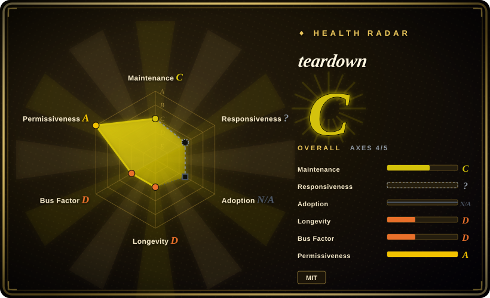
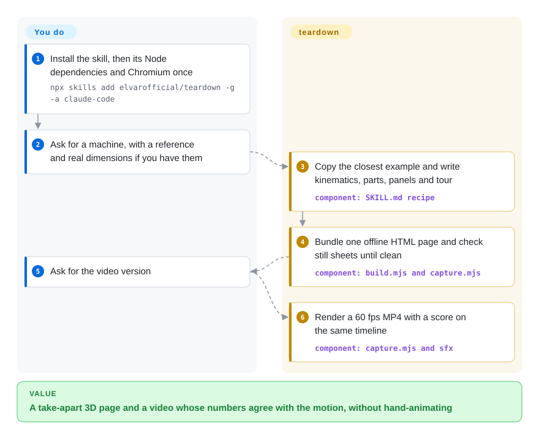
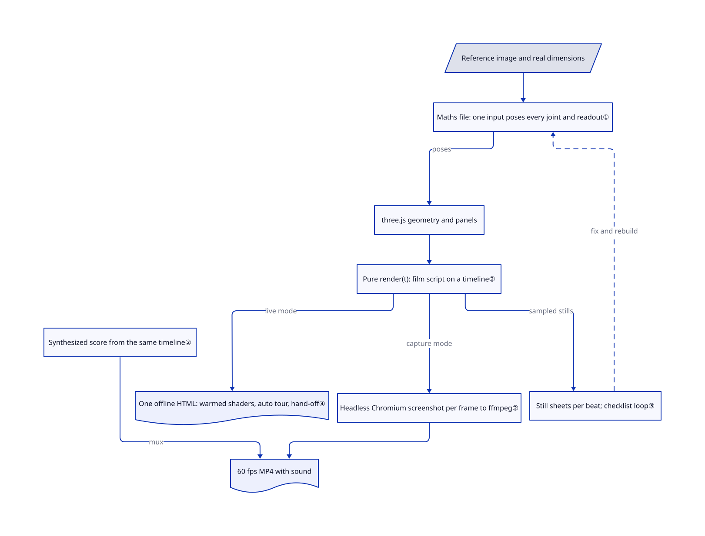

# teardown

Ask an agent how a V8 engine works and you may get paragraphs or gauges unrelated to moving pistons. teardown guides an agent to build an offline machine explainer, with shared calculations for parts and readouts, then record a 60 fps tour with sound; that consistency remains an authoring rule, not an enforced guarantee.

## When to use

You make technical explainers — a mechanical-engineering teacher, a hardware startup's marketing engineer, or a YouTuber covering how things work. You want a landing gear folding up, or Theo Jansen's walking Strandbeest, as something a viewer can click into: press "valvetrain" and the cam opens up while a chart tracks the crank angle. Then you want the same scene as a clean 20-second clip for social media. Choose teardown when you already use Claude Code and want both outputs from one model: the skill tells the agent to start from a real reference and real dimensions, drive everything from one input such as crank angle, and check stills of the render before calling it done. Its three worked examples (a V8, a Cessna 337 landing gear and a 20-leg Strandbeest) are the templates the agent copies. [Rules](https://github.com/elvarofficial/teardown/blob/a91262ac1109051e014662d42ecb0b7bc1f113b1/SKILL.md#L53-L61).

Against a general animation skill, the deciding difference is shared kinematics: poses and readouts are intended to use the same calculation in the page and film. This reduces duplicated animation logic, but the instruction does not enforce consistency in a new agent-generated machine. Against a ready-made physics engine, you get an explainer template, not a simulation certified for engineering.

## When NOT to use

- **You need engineering-grade physics.** The examples compute poses from closed-form kinematics and simple models (a chamber-pressure curve, a rack-and-pinion stroke); there is no force, stress or fluid solver. Use a CAD or multibody-dynamics tool for design work.
- **You want a general motion-graphics or UI video.** teardown is specialized for machines. For title cards, product demos and data stories, use [Remotion Agent Skills](../vendor-collections/product-vendors/remotion-skills.md) or claude-motion (not indexed), the general kit this project was built from.
- **You are teaching school maths or physics problems.** A geometry or kinematics exercise is better served by [edulab](../../education-tutoring/edulab.md), which ships symbolic-computation kernels and lesson templates for that job.
- **You need a quick, light animated asset.** Rendering takes headless Chromium, a real GPU, ffmpeg and Python, and capture screenshots every frame. For a small looping sticker use [fun-isometric](fun-isometric.md).
- **You will publish pages that must carry third-party notices.** The bundler inlines three.js and two web fonts into one HTML file with `legalComments: 'none'`, so their licence comments are stripped; you must add the notices yourself. [Bundler settings](https://github.com/elvarofficial/teardown/blob/a91262ac1109051e014662d42ecb0b7bc1f113b1/sims/build.mjs#L97-L109).
- **You need a maintained dependency.** Two commits in two days, no releases, and a brand-new account. Pin a commit and treat it as a template you own, or wait to see whether it is maintained.

## Comparison

| Alternative | In index | Our verdict | Tradeoff |
|---|---|---|---|
| claude-motion (whaleyxbt/claude-motion) | not indexed | Choose claude-motion for general agent-made motion graphics and Remotion scenes; choose teardown when the subject is a working machine with live gauges. | claude-motion is the MIT parent whose runtime, capture and sound engine teardown reuses; teardown adds the machine recipe, three worked machines and the live-page auto tour. Not added in this tab batch. |
| [Remotion Agent Skills](../vendor-collections/product-vendors/remotion-skills.md) | ✅ | Choose Remotion's skills to produce React-based videos with a maintained vendor framework; choose teardown when you also need an interactive 3D page. | Remotion's skills follow a maintained vendor framework but the skills repo ships no LICENSE file; teardown outputs an offline page plus video but is a two-day-old single-author repo. |
| [edulab](../../education-tutoring/edulab.md) | ✅ | Choose edulab for curriculum problems that need correct symbolic maths and narrated lessons; choose teardown for 3D machines taken apart. | edulab centres on computation kernels and teaching templates; teardown centres on three.js mechanisms, cutaways and a film. |
| [fun-isometric](fun-isometric.md) | ✅ | Choose fun-isometric for small editable animated stickers; choose teardown for a full 3D explainer page and a 1080p film. | Lighter output and setup versus a GPU-rendered scene with Playwright, ffmpeg and Python. |

## Quick start

Install the skill globally for Claude Code with `npx skills add elvarofficial/teardown -g -a claude-code`, then, once, in the installed folder run `npm install && npx playwright install chromium` to fetch three.js, esbuild, fonts and a headless browser. You need Node.js 20+, plus `ffmpeg` for video and Python 3 for sound. Then ask in plain words, for example "Build me a simulator of a 4-stroke motorcycle engine I can take apart." Give it a reference photo or drawing and the real dimensions if you have them. The agent copies the closest example, writes the kinematics, geometry, panels and tour, bundles one offline HTML file into `teardown-out/dist/`, renders review sheets of stills, and, on request, a 60 fps MP4 with a synthesized score. You review the result for accuracy; Claude usage, GPU time and the facts in the panels are yours to check. [Install and use](https://github.com/elvarofficial/teardown/blob/a91262ac1109051e014662d42ecb0b7bc1f113b1/README.md#L13-L43).

<!-- flow-steps:begin (generated from flows/teardown.json by tools/flow_card.py — do not edit) -->

Text version of the flow

1. **You**: Install the skill, then its Node dependencies and Chromium once — `npx skills add elvarofficial/teardown -g -a claude-code`
2. **You**: Ask for a machine, with a reference and real dimensions if you have them
3. **teardown**: Copy the closest example and write kinematics, parts, panels and tour — component: `SKILL.md recipe`
4. **teardown**: Bundle one offline HTML page and check still sheets until clean — component: `build.mjs and capture.mjs`
5. **You**: Ask for the video version
6. **teardown**: Render a 60 fps MP4 with a score on the same timeline — component: `capture.mjs and sfx`

**Value**: A take-apart 3D page and film designed to share motion and readout calculations

<!-- flow-steps:end -->

## Key techniques

<!-- mechanism:begin (generated from mechanisms/teardown.json by tools/mechanism_card.py; do not edit) -->

Text version of the mechanism

- Reference image and real dimensions
- Maths file: one input poses every joint and readout①
- three.js geometry and panels
- Pure render(t); film script on a timeline②
- Still sheets per beat; checklist loop③
- One offline HTML: warmed shaders, auto tour, hand-off④
- Headless Chromium screenshot per frame to ffmpeg②
- Synthesized score from the same timeline②
- 60 fps MP4 with sound

- Reference image and real dimensions → Maths file: one input poses every joint and readout①
- Maths file: one input poses every joint and readout① → three.js geometry and panels (poses)
- three.js geometry and panels → Pure render(t); film script on a timeline②
- Pure render(t); film script on a timeline② → Still sheets per beat; checklist loop③ (sampled stills)
- Still sheets per beat; checklist loop③ → Maths file: one input poses every joint and readout① (fix and rebuild) [optional/fallback]
- three.js geometry and panels → One offline HTML: warmed shaders, auto tour, hand-off④ (real-time loop replays film script, not render(t))
- Pure render(t); film script on a timeline② → Headless Chromium screenshot per frame to ffmpeg② (capture mode)
- Headless Chromium screenshot per frame to ffmpeg② → 60 fps MP4 with sound
- Synthesized score from the same timeline② → 60 fps MP4 with sound (mux)

<!-- mechanism:end -->

### 1. Pose every part and every readout from one input

- **Problem:** Hand-keyframed 3D animation drifts: a gauge says 3,000 rpm while the pistons move at another speed, or a leg passes through the ground.
- **How:** Each machine has a maths file with real dimensions and no 3D code. One input — crank angle, gear stroke or wind — produces every joint position and every panel value. The Strandbeest solves each joint of Jansen's 11-link leg by intersecting two circles, then samples the foot path at 720 points to move the body without slipping.
- **Limits:** This is kinematics, not dynamics: masses, forces and wear are not simulated. Accuracy depends on correct dimensions. Both "real references first" and "one input drives everything" are instructions, not checked invariants; the bundled live page integrates its own real-time state.
- **Source:** [Machine layout and rules:37–61](https://github.com/elvarofficial/teardown/blob/a91262ac1109051e014662d42ecb0b7bc1f113b1/SKILL.md#L37-L61), [linkage solver:1–67](https://github.com/elvarofficial/teardown/blob/a91262ac1109051e014662d42ecb0b7bc1f113b1/sims/strandbeest-shared/jansen.js#L1-L67).

### 2. Make rendering a pure function of time, then capture frame by frame

- **Problem:** Screen-recording a WebGL page drops frames and never gives the same video twice.
- **How:** Every film exposes `render(t)`, which draws time `t` from scratch with no `Math.random`, `Date` or carried state; anything simulated is precomputed at load. The capture script opens the page in headless Chromium with GPU flags, calls `render` for each 1/60 s, takes a JPEG screenshot and pipes it into ffmpeg (libx264, CRF 16). The score reads the same `timeline.json` and is mastered to −14 LUFS.
- **Limits:** A screenshot per frame is slow and needs a real GPU; capture prints the renderer so a software fallback is visible. Purity is a convention the agent must follow; nothing enforces it.
- **Source:** [render(t) contract:69–85](https://github.com/elvarofficial/teardown/blob/a91262ac1109051e014662d42ecb0b7bc1f113b1/SKILL.md#L69-L85), [capture loop:175–196](https://github.com/elvarofficial/teardown/blob/a91262ac1109051e014662d42ecb0b7bc1f113b1/sims/capture.mjs#L175-L196), [capture hook:57–132](https://github.com/elvarofficial/teardown/blob/a91262ac1109051e014662d42ecb0b7bc1f113b1/sims/kit/runtime.js#L57-L132), [GPU flags](https://github.com/elvarofficial/teardown/blob/a91262ac1109051e014662d42ecb0b7bc1f113b1/paths.mjs).

### 3. Let the agent review contact sheets, because it cannot watch video

- **Problem:** A model that only writes code reports a scene as done while parts clip through each other or labels cover the machine.
- **How:** The skill requires a stills sheet with one labelled tile per timeline beat, a checklist (contact, composition, type size, bloom, hold time), zoomed stills for transitions, and a final sheet taken from the encoded MP4. It loops until a full pass finds nothing.
- **Limits:** The model judges still images, so motion artifacts between sampled frames can slip through, and the checklist does not verify the physics against a source.
- **Source:** [Review loop and checklist:101–117](https://github.com/elvarofficial/teardown/blob/a91262ac1109051e014662d42ecb0b7bc1f113b1/SKILL.md#L101-L117).

### 4. Ship one offline page that tours itself and hands over control

- **Problem:** A 3D page that freezes on first draw, weighs 15 MB, or sits still until clicked loses viewers before the machine moves.
- **How:** esbuild bundles the scene, three.js, fonts and CSS into one HTML file that opens from `file://`; large models can be kept outside it. The live page compiles all shader programs in parallel before the first frame, offers quality tiers for integrated GPUs, and plays the film's script as an automatic tour until a click, drag, wheel or key; after 25 seconds of quiet the tour resumes.
- **Limits:** The under-1-MB target is a rule for the agent, not a build check. Stripped legal comments leave third-party notices to you.
- **Source:** [Live-page rules:63–67](https://github.com/elvarofficial/teardown/blob/a91262ac1109051e014662d42ecb0b7bc1f113b1/SKILL.md#L63-L67), [bundler:1–14](https://github.com/elvarofficial/teardown/blob/a91262ac1109051e014662d42ecb0b7bc1f113b1/sims/build.mjs#L1-L14), [shader warm-up:1–40](https://github.com/elvarofficial/teardown/blob/a91262ac1109051e014662d42ecb0b7bc1f113b1/sims/kit/warm.js#L1-L40), [tour hand-off:1–15](https://github.com/elvarofficial/teardown/blob/a91262ac1109051e014662d42ecb0b7bc1f113b1/sims/strandbeest-shared/live.js#L1-L15).

## Health & viability

- **2026-11-01:** created 2026-10-30 by an account opened 15 minutes earlier; two commits, no releases or tags, one public repository on that account.
- **Attention versus history:** 803 stars and 139 forks in about two days. That is a hype signal, not evidence of use, and Lindy gives no support at this age.
- **Provenance:** seven of 73 files are byte-identical to whaleyxbt/claude-motion (MIT), and the README, SKILL.md and LICENSE credit it; the 12 audio samples are identical to Barty-Bart/motion-graphics copies of CC0 Freesound recordings, with sources listed. The three machines, the machine recipe and the live-page code are new here.
- **License:** MIT, with copyright lines for both elvarofficial and whaleyxbt.
- **Judgment:** worth using as a template you copy and own; do not depend on upstream fixes yet.

## Caveats (unverified)

- [未验证: no installation or upstream rendering] Output quality, render time and the claim that pages stay near 800 KB were not reproduced; the page is based on reading the source.
- [推断: two-day star growth and a new account, without a star-source audit] The star count may reflect a social-media spike rather than sustained use.
- [未验证: API list and count disagree] The repository reports three open issues, but the issues API returned none on 2026-11-01.
- [未验证: individual Freesound pages not opened] The CC0 status of the 12 samples rests on the upstream SOURCES.md check dated 2026-10-18.
