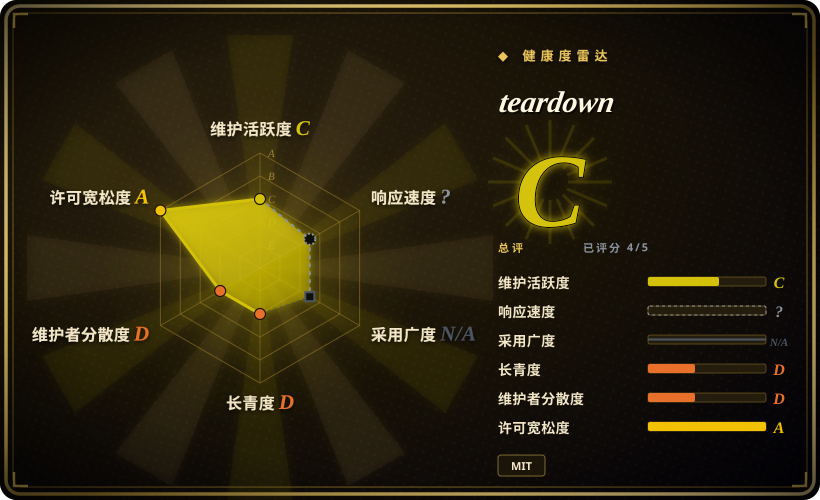
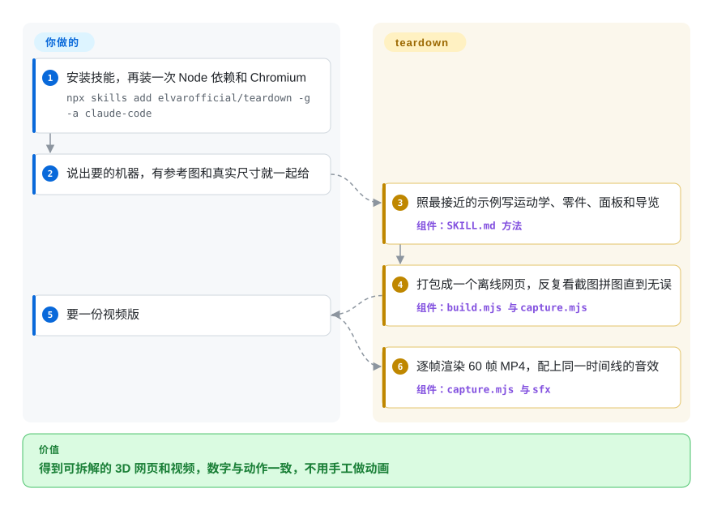
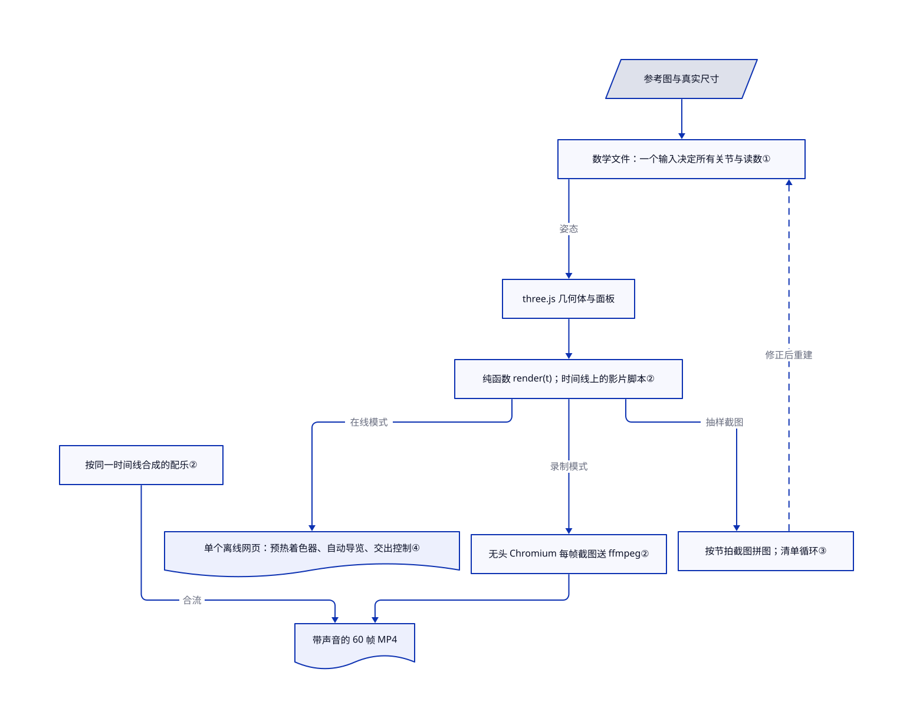

# teardown

问 agent“V8 发动机怎么工作”，可能只得到文字，或与活塞动作无关的仪表。teardown 指导 agent 制作离线机器讲解网页，让零件与读数共享计算，再录成带声音的 60 帧导览；一致性仍是编写规则，不是强制保证。

## 何时使用

你做技术讲解内容——机械工程老师、硬件创业公司的市场工程师，或者讲“东西是怎么工作的”的视频作者。你想让观众点开一个正在收起的起落架，或 Theo Jansen 会走路的仿生兽（Strandbeest）：按下“配气机构”，凸轮剖开，旁边的图表实时跟着曲轴转角走。然后还要把同一个场景导出成干净的 20 秒短视频。已经在用 Claude Code、想从同一个模型同时拿到这两样产出时选 teardown：技能要求 agent 先找真实参考和真实尺寸，用一个输入（比如曲轴转角）驱动一切，交付前先看渲染截图。三个完整示例（V8 发动机、塞斯纳 337 起落架、20 条腿的仿生兽）就是 agent 照着改的模板。[规则](https://github.com/elvarofficial/teardown/blob/a91262ac1109051e014662d42ecb0b7bc1f113b1/SKILL.md#L53-L61)。

和通用动画技能比，决定性的区别是共享运动学：网页和影片的姿态与读数按约定使用同一套计算，减少重复动画逻辑。但这条指令不强制新生成的机器保持一致。和现成物理引擎比，你拿到的是讲解模板，不是经过工程认证的仿真。

## 何时不用

- **需要工程级的物理计算。** 示例用闭式运动学和简单模型（燃烧室压力曲线、齿条齿轮行程）算姿态，没有力、应力或流体求解器。做设计请用 CAD 或多体动力学工具。
- **要做通用动效或界面演示视频。** teardown 专做机器。片头、产品演示和数据故事，请用 [Remotion Agent Skills](../vendor-collections/product-vendors/remotion-skills.zh.md)，或本项目所基于的通用工具包 claude-motion（未收录）。
- **要讲中小学数学或物理题。** 几何、运动学习题更适合 [edulab](../../education-tutoring/edulab.zh.md)，它带符号计算内核和课件模板。
- **只要一个轻量的小动画素材。** 渲染要无头 Chromium、真实 GPU、ffmpeg 和 Python，录制时每一帧都要截一次图。小的循环贴纸请用 [fun-isometric](fun-isometric.zh.md)。
- **要发布的网页必须带第三方许可声明。** 打包器把 three.js 和两套网页字体内联进一个 HTML，并设置 `legalComments: 'none'`，它们的许可注释会被删掉；你得自己补上声明。[打包设置](https://github.com/elvarofficial/teardown/blob/a91262ac1109051e014662d42ecb0b7bc1f113b1/sims/build.mjs#L97-L109)。
- **需要一个有人维护的依赖。** 两天两次提交、没有发布版本、账号是新建的。请固定某个提交，把它当成你自己维护的模板，或者再观察一段时间看它是否有人维护。

## 横向对比

| 替代品 | 是否收录 | 我们的评价 | 取舍 |
|---|---|---|---|
| claude-motion（whaleyxbt/claude-motion） | 未收录 | 要让 agent 做通用动效和 Remotion 场景时选 claude-motion；主题是带实时仪表的运转机器时选 teardown。 | claude-motion 是 teardown 复用其运行时、录制和音效引擎的 MIT 上游；teardown 增加了造机器的方法、三台完整机器和网页自动导览。本批标签收录未加入。 |
| [Remotion Agent Skills](../vendor-collections/product-vendors/remotion-skills.zh.md) | ✅ | 要基于有厂商维护的框架用 React 做视频时选 Remotion 技能；还需要一个可交互的 3D 网页时选 teardown。 | Remotion 技能跟随有人维护的厂商框架，但技能仓库没有 LICENSE 文件；teardown 同时产出离线网页和视频，但只是一个两天大的单作者仓库。 |
| [edulab](../../education-tutoring/edulab.zh.md) | ✅ | 课程习题需要正确的符号计算和带讲解的课件时选 edulab；要把 3D 机器拆开讲时选 teardown。 | edulab 的核心是计算内核和教学模板；teardown 的核心是 three.js 机构、剖切视图和影片。 |
| [fun-isometric](fun-isometric.zh.md) | ✅ | 要小巧、可编辑的动画贴纸时选 fun-isometric；要完整的 3D 讲解网页加 1080p 影片时选 teardown。 | 产出和安装都更轻，对比的是一个靠 GPU 渲染、需要 Playwright、ffmpeg 和 Python 的场景。 |

## 快速上手

用 `npx skills add elvarofficial/teardown -g -a claude-code` 把技能全局装进 Claude Code，然后在安装目录里运行一次 `npm install && npx playwright install chromium`，下载 three.js、esbuild、字体和一个无头浏览器。你需要 Node.js 20 以上；录视频还要 `ffmpeg`，配音效要 Python 3。之后直接用大白话提要求，比如“Build me a simulator of a 4-stroke motorcycle engine I can take apart.”，有参考照片、图纸或真实尺寸就一并给它。agent 会挑最接近的示例照着改，写好运动学、几何、面板和导览，把一个离线 HTML 打包进 `teardown-out/dist/`，渲染截图供检查；你要的话，再输出带合成配乐的 60 帧 MP4。准确性由你把关；Claude 用量、GPU 时间和面板里的数据都要你自己核对。[安装与使用](https://github.com/elvarofficial/teardown/blob/a91262ac1109051e014662d42ecb0b7bc1f113b1/README.md#L13-L43)。

<!-- flow-steps:begin (generated from flows/teardown.json by tools/flow_card.py — do not edit) -->

流程文字版

1. **你**：安装技能，再装一次 Node 依赖和 Chromium — `npx skills add elvarofficial/teardown -g -a claude-code`
2. **你**：说出要的机器，有参考图和真实尺寸就一起给
3. **teardown**：照最接近的示例写运动学、零件、面板和导览 — 组件：`SKILL.md 方法`
4. **teardown**：打包成一个离线网页，反复看截图拼图直到无误 — 组件：`build.mjs 与 capture.mjs`
5. **你**：要一份视频版
6. **teardown**：逐帧渲染 60 帧 MP4，配上同一时间线的音效 — 组件：`capture.mjs 与 sfx`

**价值**：得到可拆解 3D 网页和影片，按规则共享动作与读数计算

<!-- flow-steps:end -->

## 技术要点

<!-- mechanism:begin (generated from mechanisms/teardown.json by tools/mechanism_card.py; do not edit) -->

机制文字版

- 参考图与真实尺寸
- 数学文件：一个输入决定所有关节与读数①
- three.js 几何体与面板
- 纯函数 render(t)；时间线上的影片脚本②
- 按节拍截图拼图；清单循环③
- 单个离线网页：预热着色器、自动导览、交出控制④
- 无头 Chromium 每帧截图送 ffmpeg②
- 按同一时间线合成的配乐②
- 带声音的 60 帧 MP4

- 参考图与真实尺寸 → 数学文件：一个输入决定所有关节与读数①
- 数学文件：一个输入决定所有关节与读数① → three.js 几何体与面板（姿态）
- three.js 几何体与面板 → 纯函数 render(t)；时间线上的影片脚本②
- 纯函数 render(t)；时间线上的影片脚本② → 按节拍截图拼图；清单循环③（抽样截图）
- 按节拍截图拼图；清单循环③ → 数学文件：一个输入决定所有关节与读数①（修正后重建）〔可选／兜底〕
- three.js 几何体与面板 → 单个离线网页：预热着色器、自动导览、交出控制④（实时循环回放影片脚本，不经 render(t)）
- 纯函数 render(t)；时间线上的影片脚本② → 无头 Chromium 每帧截图送 ffmpeg②（录制模式）
- 无头 Chromium 每帧截图送 ffmpeg② → 带声音的 60 帧 MP4
- 按同一时间线合成的配乐② → 带声音的 60 帧 MP4（合流）

<!-- mechanism:end -->

### 1. 每个零件的姿态和每个读数都由同一个输入算出

- **解决：** 手工打关键帧的 3D 动画会漂：仪表显示 3000 转，活塞却按另一个速度动，或者腿穿进了地面。
- **做法：** 每台机器有一个只放数学、不含 3D 代码的文件，里面是真实尺寸。一个输入——曲轴转角、起落架行程或风速——算出每个关节位置和每个面板数值。仿生兽的腿由 Jansen 的 11 根连杆组成，每个关节靠两圆求交算出；脚的轨迹预先采样 720 个点，用来让身体前进时脚不打滑。
- **边界：** 这是运动学，不是动力学：质量、受力和磨损都不模拟。准确度取决于尺寸正确；“从真实参考出发”和“一个输入驱动全部”都是指令，不是已检查的不变量。随附实时网页独立积分自己的状态。
- **源码：** [机器结构与规则第 37–61 行](https://github.com/elvarofficial/teardown/blob/a91262ac1109051e014662d42ecb0b7bc1f113b1/SKILL.md#L37-L61)、[连杆求解第 1–67 行](https://github.com/elvarofficial/teardown/blob/a91262ac1109051e014662d42ecb0b7bc1f113b1/sims/strandbeest-shared/jansen.js#L1-L67)。

### 2. 让渲染成为时间的纯函数，再逐帧录制

- **解决：** 直接录 WebGL 网页的屏幕会掉帧，而且两次录出来不一样。
- **做法：** 每部影片暴露一个 `render(t)`，从零画出时刻 `t` 的画面，不许用 `Math.random`、`Date`，也不许跨帧保留状态；需要模拟的东西在加载时预先算好。录制脚本用带 GPU 参数的无头 Chromium 打开页面，每 1/60 秒调用一次 `render`，截一张 JPEG，管道送进 ffmpeg（libx264，CRF 16）。配乐读同一份 `timeline.json`，母带响度定在 −14 LUFS。
- **边界：** 每帧截图很慢，而且需要真实 GPU；录制脚本会打印实际用到的渲染器，退化成软件渲染时看得出来。纯函数只是约定，要靠 agent 遵守，没有任何东西强制。
- **源码：** [render(t) 约定第 69–85 行](https://github.com/elvarofficial/teardown/blob/a91262ac1109051e014662d42ecb0b7bc1f113b1/SKILL.md#L69-L85)、[录制循环第 175–196 行](https://github.com/elvarofficial/teardown/blob/a91262ac1109051e014662d42ecb0b7bc1f113b1/sims/capture.mjs#L175-L196)、[录制接口第 57–132 行](https://github.com/elvarofficial/teardown/blob/a91262ac1109051e014662d42ecb0b7bc1f113b1/sims/kit/runtime.js#L57-L132)、[GPU 参数](https://github.com/elvarofficial/teardown/blob/a91262ac1109051e014662d42ecb0b7bc1f113b1/paths.mjs)。

### 3. agent 看不了视频，就让它看拼图截图来自查

- **解决：** 只会写代码的模型，会在零件互相穿模、标签挡住机器时就宣布完成。
- **做法：** 技能要求按时间线每个节拍生成一张带时间标签的截图拼图，对照清单检查（接触、构图、字号、泛光、停留时长），过渡段再放大截图，最后还要从编码后的 MP4 再截一次图。循环到完整检查一遍什么问题都没有为止。
- **边界：** 模型看的是静态图，采样帧之间的运动瑕疵可能漏掉；清单也不会拿物理数据去对照来源。
- **源码：** [检查循环与清单第 101–117 行](https://github.com/elvarofficial/teardown/blob/a91262ac1109051e014662d42ecb0b7bc1f113b1/SKILL.md#L101-L117)。

### 4. 交付一个会自己导览、能交出控制权的离线网页

- **解决：** 3D 网页首帧卡住、体积 15 MB，或者不点就不动，观众在机器动起来之前就走了。
- **做法：** esbuild 把场景、three.js、字体和 CSS 打包成一个能从 `file://` 打开的 HTML；大模型可以放在文件外。在线页面在首帧前并行编译所有着色器程序，为集成显卡准备了画质档位，并把影片脚本当作自动导览播放，直到有人点击、拖动、滚动或按键；安静 25 秒后导览恢复。
- **边界：** “小于 1 MB”是给 agent 的规则，构建时不检查。被删掉的许可注释，需要你自己补上第三方声明。
- **源码：** [在线页面规则第 63–67 行](https://github.com/elvarofficial/teardown/blob/a91262ac1109051e014662d42ecb0b7bc1f113b1/SKILL.md#L63-L67)、[打包器第 1–14 行](https://github.com/elvarofficial/teardown/blob/a91262ac1109051e014662d42ecb0b7bc1f113b1/sims/build.mjs#L1-L14)、[着色器预热第 1–40 行](https://github.com/elvarofficial/teardown/blob/a91262ac1109051e014662d42ecb0b7bc1f113b1/sims/kit/warm.js#L1-L40)、[导览交接第 1–15 行](https://github.com/elvarofficial/teardown/blob/a91262ac1109051e014662d42ecb0b7bc1f113b1/sims/strandbeest-shared/live.js#L1-L15)。

## 健康度与可持续性

- **2026-11-01：** 2026-10-30 创建，账号在仓库创建前 15 分钟才注册；两次提交，没有发布版本和标签，账号下只有这一个公开仓库。
- **关注度与历史：** 大约两天内 803 颗星、139 个 fork。这是热度信号，不是使用证据；这么新的项目，Lindy 先验无从谈起。
- **来源：** 73 个文件中有 7 个与 whaleyxbt/claude-motion（MIT）逐字节相同，README、SKILL.md 和 LICENSE 都注明了出处；12 个音频样本与 Barty-Bart/motion-graphics 里 Freesound 的 CC0 录音副本相同，并列出了来源。三台机器、造机器的方法和在线页面代码是这里新写的。
- **许可：** MIT，同时列出 elvarofficial 和 whaleyxbt 两条版权声明。
- **判断：** 适合当作复制后自己维护的模板；暂时别指望上游修复。

## 存疑（未验证）

- [未验证：未安装或渲染] 输出质量、渲染耗时和“页面约 800 KB”的说法都没有复现；本页基于源码阅读。
- [推断：依据是两天内的星标数和新建账号，没核查星标来源] 星标数可能来自一次社交媒体传播，而不是持续使用。
- [未验证：GitHub API 列表与计数不一致] 仓库显示有 3 个未关闭 issue，但 2026-11-01 issues API 返回为空。
- [未验证：未逐一打开 Freesound 页面] 12 个样本的 CC0 状态，依据的是上游 SOURCES.md 在 2026-10-18 的核对记录。
