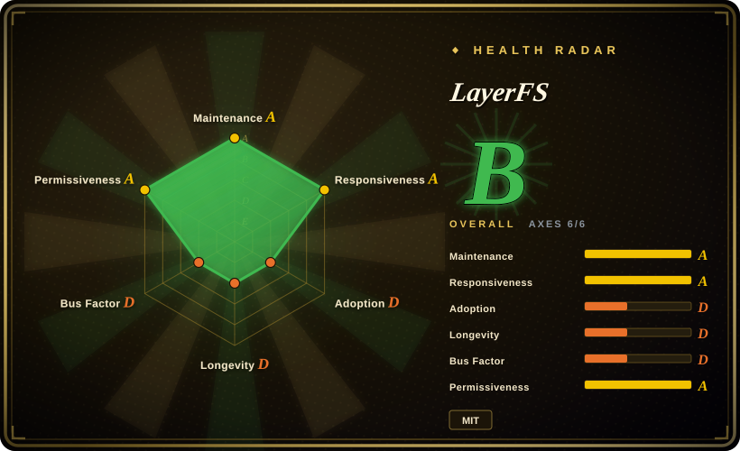
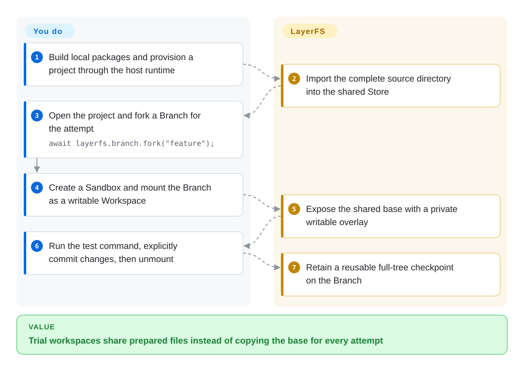
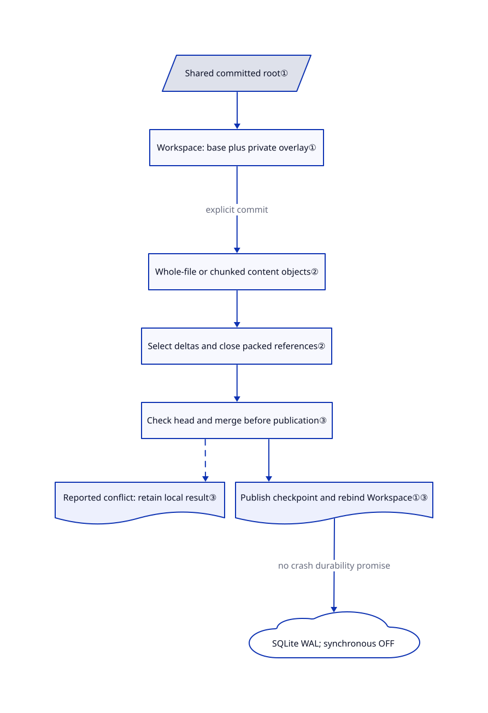

# LayerFS

Each parallel agent needs the same installed dependencies, but copying the whole project for every trial wastes disk. LayerFS gives each trial a writable view of shared files and saves its changes as branch history.

## When to use

You build a coding-agent host that forks ten repair attempts from one prepared project. Git worktrees separate tracked source, but each attempt still needs ignored dependencies and build output; copying those directories repeats the expensive part. LayerFS imports the whole directory, then mounts each attempt over shared committed content without copying the base. Choose it when full-tree experimental checkpoints matter more than retaining an ordinary Git-only workflow.

Your integration chooses a Branch, creates a Sandbox and mounts a Workspace. File-tool writes can commit directly through the SDK; shell commands use the mounted view and require an explicit Commit afterwards. This is a recoverable-work experiment, not a primary storage system: the current public route uses the Disposable Store profile.

## When NOT to use

- **The only copy of valuable data would live here.** Use Git with an independently backed-up working directory, or a durable filesystem such as Btrfs, instead. The current Store uses SQLite WAL with `synchronous=OFF`; even acknowledged checkpoints carry no crash or power-loss durability promise. A `Durable` enum in [lower-level source](https://github.com/Ephemeral-AI-Lab/layerfs/blob/35d36575c1eb4d23d4b54534a7030d855db890e7/engine/crates/layerfs-persistence/src/backend/sqlite/profile.rs#L1-L74) does not make the public runtime durable.
- **You need to trust a successful merge without reviewing its content.** Prefer Git worktrees for source integration. [Open issue #517](https://github.com/Ephemeral-AI-Lab/layerfs/issues/517) reports `Merged` while losing an edit inside another branch's large changed span. The reviewed source confirms bounded diff coarsening, not the reported end-to-end failure. [未验证：upstream execution was prohibited; the issue reproduction was read, not run] Do not treat this as already fixed or as a universal 1023-line file-size limit.
- **You need hostile tenants separated by a kernel or VM boundary.** Evaluate [gVisor](../../sandboxing/gvisor.md) or a VM-based sandbox platform instead. LayerFS Workspaces are filesystem views inside Docker Sandboxes; a Sandbox can hold multiple Workspaces. The daemon receives `CAP_SYS_ADMIN` and `/dev/fuse`, with AppArmor unconfined and a custom mostly-allow seccomp policy. Branches are not tenant security boundaries, and this setup does not establish an egress allowlist.
- **You only keep a few long-lived source checkouts.** Prefer [Git worktrees](https://github.com/git/git): no FUSE daemon, native Node addon or Store orchestration. If you only need to inspect one trusted Linux command's file changes before applying them, [try](https://github.com/binpash/try) has a narrower overlay workflow; it is not a hostile-code sandbox either.
- **You need full POSIX storage or transparent publishing.** Keep an ordinary filesystem and Git. LayerFS omits FIFOs, sockets, device nodes and set-id bits. Publishing a stale Branch can skip newer `main` Layers; merge `main` first and inspect the result and `overwrote`. `.lww` rules and merge units deliberately choose a winning side rather than preserving both edits.

## Comparison

| Alternative | In index | Our verdict | Tradeoff |
| --- | --- | --- | --- |
| [Git worktrees](https://github.com/git/git) | not indexed | Pick Git for ordinary code branches and reviewable source integration; pick LayerFS only when ignored dependencies and per-operation full-tree history justify a separate storage model. | Git shares repository objects, not installed working-directory contents; LayerFS adds whole-tree sharing but also Docker/FUSE operations and Disposable storage. Not added in this tab batch. |
| [try](https://github.com/binpash/try) | not indexed | Pick try to preview and accept one trusted command's local file effects; pick LayerFS when many attempts must branch from saved filesystem checkpoints. | try uses Linux namespaces and overlays without LayerFS's shared content Store; neither project should be mistaken for a complete hostile-code security policy. Not added in this tab batch. |
| [Cloudflare Computer](../../sandboxing/cloudflare-computer.md) | Indexed | Pick Computer for a Workers-hosted agent whose files must survive requests without self-hosting; pick LayerFS for locally operated branchable full-tree experiments. | Computer binds the workspace to Cloudflare's preview runtime; LayerFS exposes local Docker and SQLite operations but currently disclaims crash durability. |

## Quick start

Use the [source checkout's JavaScript packages](https://github.com/Ephemeral-AI-Lab/layerfs/blob/35d36575c1eb4d23d4b54534a7030d855db890e7/api/README.md), not an assumed public npm install: the agent package is private and the CLI is not published. Link the local packages with `npm --prefix api install`, then build the native Node bridge with `npm --prefix api run build:native` after provisioning the documented Rust inputs. You supply Node 20+, a Linux Docker Engine, the built daemon, an immutable runtime image digest and a project volume; on macOS or Windows, the runtime package starts a worker that performs Store calls on Linux. Initialize the project through the host runtime's `project.start_init`, configure its resulting volume and Store path, then open it with `LayerFS.open`, fork a Branch, create a Sandbox and mount that Branch. Execute your test command, explicitly commit the changed Workspace, then unmount it; LayerFS preserves that checkpoint, while you still own test interpretation, merge review, backup and external side effects. [Issue #513](https://github.com/Ephemeral-AI-Lab/layerfs/issues/513) reports that bare macOS CLI Init lacks the runtime's volume provisioning, so do not present `layerfs init` as a complete cross-platform installer.

<!-- flow-steps:begin (generated from flows/layerfs.json by tools/flow_card.py — do not edit) -->

Text version of the flow

1. **You**: Build local packages and provision a project through the host runtime
2. **LayerFS**: Import the complete source directory into the shared Store
3. **You**: Open the project and fork a Branch for the attempt — `await layerfs.branch.fork("feature");`
4. **You**: Create a Sandbox and mount the Branch as a writable Workspace
5. **LayerFS**: Expose the shared base with a private writable overlay
6. **You**: Run the test command, explicitly commit changes, then unmount
7. **LayerFS**: Retain a reusable full-tree checkpoint on the Branch

**Value**: Trial workspaces share prepared files instead of copying the base for every attempt

<!-- flow-steps:end -->

## Key techniques

<!-- mechanism:begin (generated from mechanisms/layerfs.json by tools/mechanism_card.py; do not edit) -->

Text version of the mechanism

- Shared committed root①
- Workspace: base plus private overlay①
- Whole-file or chunked content objects②
- Select deltas and close packed references②
- Check head and merge before publication③
- Reported conflict: retain local result③
- Publish checkpoint and rebind Workspace①③
- SQLite WAL; synchronous OFF

- Shared committed root① → Workspace: base plus private overlay①
- Workspace: base plus private overlay① → Whole-file or chunked content objects② (explicit commit)
- Whole-file or chunked content objects② → Select deltas and close packed references②
- Select deltas and close packed references② → Check head and merge before publication③
- Check head and merge before publication③ → Reported conflict: retain local result③ [optional/fallback]
- Check head and merge before publication③ → Publish checkpoint and rebind Workspace①③
- Publish checkpoint and rebind Workspace①③ → SQLite WAL; synchronous OFF (no crash durability promise)

<!-- mechanism:end -->

### 1. Bind an immutable base beneath a private overlay

- **Problem:** A trial needs a complete directory, but eagerly copying dependencies makes each fork expensive.
- **How:** Workspace reads first inspect the local overlay, then demand missing entries from the retained immutable base. Commit prepares a new root and installs it only against the expected binding; it does not materialize an entire new tree just to rebind.
- **Limits:** This separates filesystem mutations, not tenants or external effects. Writes outside the Workspace remain container scratch rather than Branch history; uncommitted overlay state does not become a checkpoint merely because `exec` succeeded.
- **Source:** [Overlay-first lookup](https://github.com/Ephemeral-AI-Lab/layerfs/blob/35d36575c1eb4d23d4b54534a7030d855db890e7/engine/crates/layerfs-workspace/src/workspace/view.rs#L92-L157), [checked base installation](https://github.com/Ephemeral-AI-Lab/layerfs/blob/35d36575c1eb4d23d4b54534a7030d855db890e7/engine/crates/layerfs-workspace/src/workspace/install.rs#L22-L85), [scratch lifetime](https://github.com/Ephemeral-AI-Lab/layerfs/blob/35d36575c1eb4d23d4b54534a7030d855db890e7/api/docs/agent.md#L216-L243).

### 2. Construct reusable content objects before publishing history

- **Problem:** Saving a rewritten dependency tree as full copies repeats unchanged bytes across attempts.
- **How:** The content constructor chooses a whole-file object for small files and a chunked extent tree for larger files. Storage selects physical delta representations from predecessor candidates, packs objects, and closes references before history publication; the shared Store reuses content identities across checkpoints.
- **Limits:** Compression and deduplication ratios depend on data and edit patterns. Bounded batches constrain pending object memory, not total Store growth; append-only history is not a retention or backup policy.
- **Source:** [Whole-file versus chunked construction](https://github.com/Ephemeral-AI-Lab/layerfs/blob/35d36575c1eb4d23d4b54534a7030d855db890e7/core/crates/layerfs-content/src/file/construction/bytes.rs#L241-L309), [delta and pack selection](https://github.com/Ephemeral-AI-Lab/layerfs/blob/35d36575c1eb4d23d4b54534a7030d855db890e7/core/crates/layerfs-storage/src/save/select.rs#L18-L158), [bounded producer batch](https://github.com/Ephemeral-AI-Lab/layerfs/blob/35d36575c1eb4d23d4b54534a7030d855db890e7/core/crates/layerfs-storage/src/save/batch.rs#L15-L69).

### 3. Separate content construction from branch-head publication

- **Problem:** Two agents can construct changes from the same old head and finish at different times.
- **How:** Commit captures the Workspace, constructs and finishes its content, then checks the Branch head around a short publication lane. A moved head triggers merge processing; reported conflicts prevent history publication and retain a local result for resolution. Unknown outcomes retain custody rather than blindly replaying the operation.
- **Limits:** Publication coordination does not prove text-merge correctness. The diff table caps at `1 << 20` cells and collapses an oversized changed middle to one removed/added block; issue #517 reports a loss through this path. `publish` also replaces the visible main view rather than implicitly merging newer Layers.
- **Source:** [Two-stage merge and publication](https://github.com/Ephemeral-AI-Lab/layerfs/blob/35d36575c1eb4d23d4b54534a7030d855db890e7/engine/crates/layerfs-store-service/src/store/commit.rs#L184-L419), [bounded diff fallback](https://github.com/Ephemeral-AI-Lab/layerfs/blob/35d36575c1eb4d23d4b54534a7030d855db890e7/core/crates/layerfs-content/src/compare/text.rs#L1-L79), [publish semantics](https://github.com/Ephemeral-AI-Lab/layerfs/blob/35d36575c1eb4d23d4b54534a7030d855db890e7/.agents/skills/layerfs-js-sdk/references/methods/branch.md#L149-L184).

## Tech stack

- Rust workspace, with content, storage and history algorithms separated from engine, FUSE, Docker and API composition. JavaScript packages provide agent calls, backend reads and host lifecycle management.
- Embedded SQLite through `rusqlite`; content identities use BLAKE3. FUSE uses a locally patched `fuser` 0.18.0; the [root MIT license](https://github.com/Ephemeral-AI-Lab/layerfs/blob/35d36575c1eb4d23d4b54534a7030d855db890e7/LICENSE) and the [retained vendor MIT notices](https://github.com/Ephemeral-AI-Lab/layerfs/blob/35d36575c1eb4d23d4b54534a7030d855db890e7/engine/vendor/fuser-0.18.0/LICENSE.md) cover different authors and must be preserved.
- Reviewed baseline: [`35d36575c1eb4d23d4b54534a7030d855db890e7`](https://github.com/Ephemeral-AI-Lab/layerfs/tree/35d36575c1eb4d23d4b54534a7030d855db890e7). It is newer than the v1.1.0 tag; this page describes that fixed main snapshot, not every released artifact.

## Dependencies

- Node 20+ and the native addon; the documented source build uses Cargo 1.85.1 with offline locked inputs. There is no required model, API key or GPU for filesystem operations. Your agent or test command supplies any such dependencies separately.
- Docker Engine API v1.48 or newer, a local Unix socket, `/dev/fuse`, a built Linux daemon, runtime image digest and a local project volume. Store calls run on Linux local storage; macOS uses a container worker and Windows uses WSL2 with its Linux Docker Engine.
- Host access is significant: the runtime manages Docker volumes and workers. Sandbox creation adds `CAP_SYS_ADMIN`, disables AppArmor confinement and substitutes a user-namespace-focused seccomp filter; command identities are nonroot, but this is not a blanket least-privilege claim. See [actual container encoding](https://github.com/Ephemeral-AI-Lab/layerfs/blob/35d36575c1eb4d23d4b54534a7030d855db890e7/engine/crates/layerfs-sandbox/src/backend/docker/container.rs#L11-L40) and [filter](https://github.com/Ephemeral-AI-Lab/layerfs/blob/35d36575c1eb4d23d4b54534a7030d855db890e7/engine/crates/layerfs-sandbox/src/backend/docker/topology.rs#L8-L23).

## Ops difficulty

**High for a personal harness; medium-to-high for an existing Docker host platform.** You operate images, native builds, FUSE daemons, workers, Store space and lifecycle records rather than merely installing a Git helper. Version 1.1 breaks the 1.0 JavaScript API, and old Disposable Store formats are rejected without migration. `close()` releases the client but leaves mounted Workspaces; explicitly commit or discard, unmount, then close Sandboxes. Container removal deletes scratch, not the shared Store volume; runtime project removal requires confirmation and refuses active consumers unless explicitly asked to stop them. Rewinding a checkpoint cannot undo network requests, external database writes or charges.

## Health & viability

- **Maintenance, 2026-10-30:** not archived; main pushed today. Releases include v0.1.7 on October 15, v1.0.0 on October 21 and v1.1.0 on October 24. Fast delivery also brings public API and Store-format churn.
- **Governance, 2026-10-30:** organization-owned, but the contributors API shows 4130 contributions for the leading account and 20 for the next. [推断：based on that attribution snapshot, not a funding or employment audit] Treat maintenance as concentrated, not foundation-backed durability.
- **Age and adoption:** created August 10, 2026; roughly eleven weeks old with 2553 stars at verification. This is attention, not a long-lived still-active Lindy record or proof of production safety. The DSH integration and source SDK provide concrete integration paths, not verified independent deployment counts.
- **Risk verdict:** suitable for controlled experiments with rebuildable inputs and independent source history. MIT licensing is clear from the actual root license and retained fuser license; crash durability, merge review and operational complexity decide this choice more than the star count. The measured health radar is not an endorsement of data safety.

## Caveats (unverified)

- [未验证：upstream execution was prohibited] Neither the runtime nor its tests or benchmarks were run here. README benchmark receipts describe v1.0 measurements at an older commit, not independently confirmed v1.1 performance.
- [未验证：issue reproduction was read, not run] Issue #517 reports silent merge loss and #513 reports incomplete macOS CLI Init orchestration. Both were open on 2026-10-30; source inspection corroborates relevant boundaries but does not establish every reported outcome on this snapshot.
- [推断：contributors API attribution is the evidence] Maintainer concentration is a bus-factor warning, not a verified account of the organization's staffing, funding or future commitment.
- [未验证：no adversarial runtime audit was authorized] Container settings were inspected, but no escape, cross-Workspace access, network confinement or power-loss experiment was performed. Do not derive a security or durability guarantee from the diagrams.
