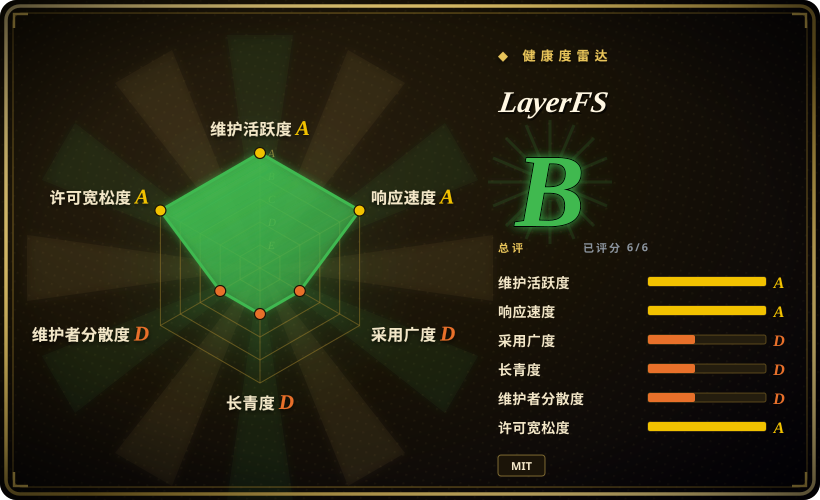
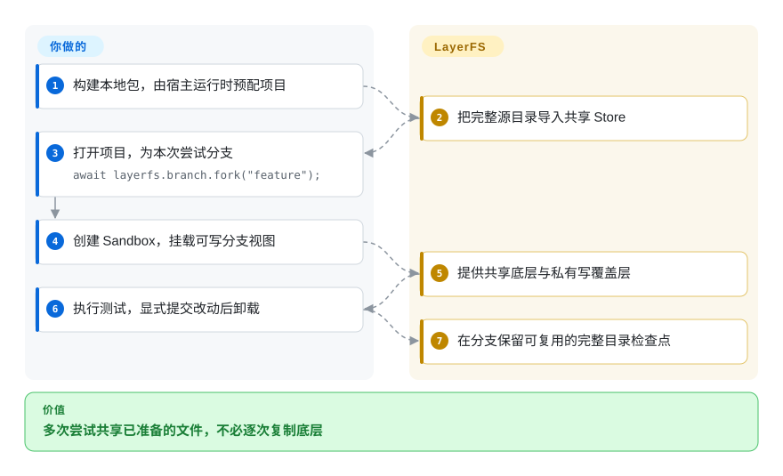
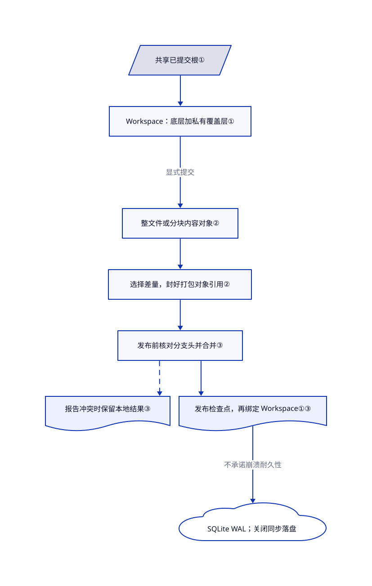

# LayerFS

十个 agent 各试一种修法，却要复制十份依赖目录。LayerFS 让每次尝试共用已保存的文件，各自写入改动，再留下可分支的检查点。

## 何时使用

你在开发编码 agent 的宿主，要从同一个装好依赖的项目分出十次修复尝试。Git worktree 能分开受版本控制的源码，却不会替你共享忽略目录里的依赖和构建产物；复制这些目录才是重复开销。LayerFS 先导入整个目录，再给各次尝试挂载完整可写视图，不复制底层已提交内容。只有当完整目录检查点比保持纯 Git 工作流更重要时，才考虑它。

你负责选 Branch（分支）、创建 Sandbox（运行守护进程的容器）、挂载 Workspace（分支的文件视图）。文件工具可通过 SDK 直接提交；Shell 命令先改挂载视图，再由你显式提交。它面向可重建工作的试验，不是主存储：当前公开运行路径使用 Disposable 存储配置。

## 何时不用

- **这里会放重要数据的唯一副本。** 改用 Git 加独立备份的工作目录，或 Btrfs 等具备耐久性的文件系统。当前 Store 使用 SQLite WAL，设置 `synchronous=OFF`；即使已返回检查点成功，也不承诺崩溃或断电后保留。[底层源码](https://github.com/Ephemeral-AI-Lab/layerfs/blob/35d36575c1eb4d23d4b54534a7030d855db890e7/engine/crates/layerfs-persistence/src/backend/sqlite/profile.rs#L1-L74)存在 `Durable` 枚举，不等于公开运行时已支持耐久模式。
- **你想直接相信“合并成功”，不复核文件。** 源码集成优先用 Git worktree。[开放问题 #517](https://github.com/Ephemeral-AI-Lab/layerfs/issues/517) 报告：一个分支的修改跨度过大时，合并返回 `Merged`，却丢掉跨度内另一分支的改动。已读源码确认差异比较有粗化回退，未确认端到端丢失。[未验证：本轮禁止执行上游，只读取了问题复现] 不应写成已修复，也不是所有文件超过 1023 行都会失败。
- **你需要按内核或虚拟机边界分隔恶意租户。** 先评估 [gVisor](../../sandboxing/gvisor.zh.md) 或虚拟机沙箱平台。LayerFS 的 Workspace 是 Docker Sandbox 内的文件视图，一个 Sandbox 可容纳多个 Workspace。守护进程获得 `CAP_SYS_ADMIN` 和 `/dev/fuse`，AppArmor 不限制，自定义 seccomp 大体放行。分支不是租户安全边界，这套设置也不能证明已有出站白名单。
- **你只有几个长期源码副本。** 选 [Git worktree](https://github.com/git/git)，省去 FUSE 守护进程、原生 Node 插件和 Store 编排。如果只需预览一个可信 Linux 命令的文件改动，再决定接受与否，[try](https://github.com/binpash/try) 的覆盖层工作流更窄；它也不是运行恶意代码的完整沙箱。
- **你需要完整 POSIX 语义或透明发布。** 保留普通文件系统和 Git。LayerFS 不保存 FIFO、套接字、设备节点和 set-id 位。发布落后的 Branch 可能跳过更新的 `main` Layer；应先合并 `main`，检查结果和 `overwrote`。`.lww` 规则与合并单元会有意选择一方，而不是保留两边全部修改。

## 横向对比

| 替代品 | 是否收录 | 我们的评价 | 取舍 |
| --- | --- | --- | --- |
| [Git worktree](https://github.com/git/git) | 未收录 | 普通代码分支和源码评审选 Git；只有忽略目录和逐操作完整目录历史足以抵消独立存储成本时，才选 LayerFS。 | Git 共享仓库对象，不共享装好的工作目录；LayerFS 增加完整目录共享，也增加 Docker、FUSE 和无崩溃耐久承诺的存储。本批未补收录。 |
| [try](https://github.com/binpash/try) | 未收录 | 预览并接受一个可信命令的本机文件改动选 try；多个尝试要从保存的文件系统检查点分叉时，选 LayerFS。 | try 使用 Linux 命名空间和覆盖层，不引入 LayerFS 的共享内容 Store；两者都不能冒充完整的恶意代码安全策略。本批未补收录。 |
| [Cloudflare Computer](../../sandboxing/cloudflare-computer.zh.md) | 已收录 | agent 已在 Workers 上、希望文件跨请求保留且不自运维时选 Computer；自管可分支完整目录试验时选 LayerFS。 | Computer 绑定 Cloudflare 的预览运行时；LayerFS 暴露本地 Docker 和 SQLite 运维，但当前明确不保证崩溃耐久性。 |

## 快速上手

从[源码里的 JavaScript 包](https://github.com/Ephemeral-AI-Lab/layerfs/blob/35d36575c1eb4d23d4b54534a7030d855db890e7/api/README.md)开始，不要假设已有公开 npm 安装包：agent 包标为私有，CLI 尚未发布。先用 `npm --prefix api install` 连接本地包，准备文档规定的 Rust 构建输入，再用 `npm --prefix api run build:native` 构建 Node 原生桥接。你提供 Node 20+、Linux Docker Engine、已构建的守护进程、固定摘要的运行镜像和项目卷；macOS 或 Windows 由 runtime 包启动 worker，在 Linux 中处理 Store 调用。宿主先用 `project.start_init` 初始化项目，配置返回的卷和 Store 路径，再用 `LayerFS.open` 打开项目、分支、创建 Sandbox 并挂载。执行测试后显式提交改动，再卸载视图；LayerFS 保存检查点，你仍负责判断测试、复核合并、备份和外部副作用。[问题 #513](https://github.com/Ephemeral-AI-Lab/layerfs/issues/513) 报告 macOS 裸 CLI 初始化缺少 runtime 的卷预配，因此不能把 `layerfs init` 写成完整跨平台安装器。

<!-- flow-steps:begin (generated from flows/layerfs.json by tools/flow_card.py — do not edit) -->

流程文字版

1. **你**：构建本地包，由宿主运行时预配项目
2. **LayerFS**：把完整源目录导入共享 Store
3. **你**：打开项目，为本次尝试分支 — `await layerfs.branch.fork("feature");`
4. **你**：创建 Sandbox，挂载可写分支视图
5. **LayerFS**：提供共享底层与私有写覆盖层
6. **你**：执行测试，显式提交改动后卸载
7. **LayerFS**：在分支保留可复用的完整目录检查点

**价值**：多次尝试共享已准备的文件，不必逐次复制底层

<!-- flow-steps:end -->

## 技术要点

<!-- mechanism:begin (generated from mechanisms/layerfs.json by tools/mechanism_card.py; do not edit) -->

机制文字版

- 共享已提交根①
- Workspace：底层加私有覆盖层①
- 整文件或分块内容对象②
- 选择差量，封好打包对象引用②
- 发布前核对分支头并合并③
- 报告冲突时保留本地结果③
- 发布检查点，再绑定 Workspace①③
- SQLite WAL；关闭同步落盘

- 共享已提交根① → Workspace：底层加私有覆盖层①
- Workspace：底层加私有覆盖层① → 整文件或分块内容对象②（显式提交）
- 整文件或分块内容对象② → 选择差量，封好打包对象引用②
- 选择差量，封好打包对象引用② → 发布前核对分支头并合并③
- 发布前核对分支头并合并③ → 报告冲突时保留本地结果③〔可选／兜底〕
- 发布前核对分支头并合并③ → 发布检查点，再绑定 Workspace①③
- 发布检查点，再绑定 Workspace①③ → SQLite WAL；关闭同步落盘（不承诺崩溃耐久性）

<!-- mechanism:end -->

### 1. 不可变底层加私有写覆盖层

- **解决：** 每个尝试都要完整目录，但提前复制依赖会放大分支成本。
- **做法：** Workspace 读取先查本地覆盖层，未命中才从保留的不可变底层按需取数据。提交先准备新根，再核对原绑定后安装，不为换根而重新铺开整棵目录树。
- **边界：** 这只分开文件改动，不隔离租户或外部副作用。Workspace 外的写入属于容器临时层，不进分支历史；`exec` 成功也不会自动把未提交内容变成检查点。
- **源码：** [覆盖层优先查找](https://github.com/Ephemeral-AI-Lab/layerfs/blob/35d36575c1eb4d23d4b54534a7030d855db890e7/engine/crates/layerfs-workspace/src/workspace/view.rs#L92-L157)、[核对底层绑定后安装](https://github.com/Ephemeral-AI-Lab/layerfs/blob/35d36575c1eb4d23d4b54534a7030d855db890e7/engine/crates/layerfs-workspace/src/workspace/install.rs#L22-L85)、[容器临时层寿命](https://github.com/Ephemeral-AI-Lab/layerfs/blob/35d36575c1eb4d23d4b54534a7030d855db890e7/api/docs/agent.md#L216-L243)。

### 2. 先构造可复用内容对象，再发布历史

- **解决：** 每次保存重写后的依赖目录，容易重复存储未变字节。
- **做法：** 内容构造器把小文件存成整文件对象，大文件存成分块区间树。存储层从前驱候选中选择物理差量表示并打包，确认引用完整后才发布历史；共享 Store 通过内容标识复用检查点之间的对象。
- **边界：** 压缩率和去重率取决于数据及修改方式。有界批次限制待处理对象内存，不限制 Store 总增长；追加历史不是保留策略，也不是备份策略。
- **源码：** [整文件与分块构造](https://github.com/Ephemeral-AI-Lab/layerfs/blob/35d36575c1eb4d23d4b54534a7030d855db890e7/core/crates/layerfs-content/src/file/construction/bytes.rs#L241-L309)、[差量与打包选择](https://github.com/Ephemeral-AI-Lab/layerfs/blob/35d36575c1eb4d23d4b54534a7030d855db890e7/core/crates/layerfs-storage/src/save/select.rs#L18-L158)、[有界生产批次](https://github.com/Ephemeral-AI-Lab/layerfs/blob/35d36575c1eb4d23d4b54534a7030d855db890e7/core/crates/layerfs-storage/src/save/batch.rs#L15-L69)。

### 3. 内容构造与分支头发布分开

- **解决：** 两个 agent 都从旧分支头修改，完成时间却不同。
- **做法：** 提交捕获 Workspace，构造并封好内容，再围绕短发布通道核对分支头。分支头移动会触发合并；检测到冲突就不发布历史，并保留本地结果供解决。结果不确定时保留原状态，不盲目重放操作。
- **边界：** 发布协调不证明文本合并正确。差异表最多 `1 << 20` 个单元，过大的修改中段会变成整块删除再添加；问题 #517 报告这条路径会丢改动。`publish` 还会替换可见主分支视图，而非隐式合并更新的 Layer。
- **源码：** [两阶段合并与发布](https://github.com/Ephemeral-AI-Lab/layerfs/blob/35d36575c1eb4d23d4b54534a7030d855db890e7/engine/crates/layerfs-store-service/src/store/commit.rs#L184-L419)、[有界差异回退](https://github.com/Ephemeral-AI-Lab/layerfs/blob/35d36575c1eb4d23d4b54534a7030d855db890e7/core/crates/layerfs-content/src/compare/text.rs#L1-L79)、[发布语义](https://github.com/Ephemeral-AI-Lab/layerfs/blob/35d36575c1eb4d23d4b54534a7030d855db890e7/.agents/skills/layerfs-js-sdk/references/methods/branch.md#L149-L184)。

## 技术栈

- Rust 工作区把内容、存储和历史算法，与引擎、FUSE、Docker、API 组合层分开。JavaScript 包分别负责 agent 调用、后端读取和宿主生命周期。
- `rusqlite` 接嵌入式 SQLite，BLAKE3 生成内容标识。FUSE 使用本地修补的 `fuser` 0.18.0；[根目录 MIT](https://github.com/Ephemeral-AI-Lab/layerfs/blob/35d36575c1eb4d23d4b54534a7030d855db890e7/LICENSE) 和[保留的 vendor MIT 通知](https://github.com/Ephemeral-AI-Lab/layerfs/blob/35d36575c1eb4d23d4b54534a7030d855db890e7/engine/vendor/fuser-0.18.0/LICENSE.md)覆盖不同作者，分发时均需保留。
- 本页读取固定基线 [`35d36575c1eb4d23d4b54534a7030d855db890e7`](https://github.com/Ephemeral-AI-Lab/layerfs/tree/35d36575c1eb4d23d4b54534a7030d855db890e7)。它晚于 v1.1.0 标签；本页描述这份主分支快照，不代表每个已发布产物。

## 依赖

- Node 20+ 和原生插件；文档构建路径使用 Cargo 1.85.1 及离线锁定输入。文件系统操作不要求模型、API key 或 GPU；agent 或测试命令需要的依赖另算。
- Docker Engine API 至少 v1.48、本地 Unix socket、`/dev/fuse`、已构建的 Linux 守护进程、运行镜像摘要和本地项目卷。Store 调用运行在 Linux 本地存储上；macOS 用容器 worker，Windows 用 WSL2 及其 Linux Docker Engine。
- 宿主权限不可忽略：runtime 管理 Docker 卷和 worker。Sandbox 创建增加 `CAP_SYS_ADMIN`，放开 AppArmor，替换为主要限制用户命名空间的 seccomp 过滤；命令用非 root 身份，不代表整体符合最小权限。见[实际容器编码](https://github.com/Ephemeral-AI-Lab/layerfs/blob/35d36575c1eb4d23d4b54534a7030d855db890e7/engine/crates/layerfs-sandbox/src/backend/docker/container.rs#L11-L40)和[过滤器](https://github.com/Ephemeral-AI-Lab/layerfs/blob/35d36575c1eb4d23d4b54534a7030d855db890e7/engine/crates/layerfs-sandbox/src/backend/docker/topology.rs#L8-L23)。

## 运维难度

**个人 harness 接入偏高，现有 Docker 宿主平台接入中高。** 你要管理镜像、原生构建、FUSE 守护进程、worker、Store 空间和生命周期记录，而不只是安装 Git 辅助工具。1.1 版打破 1.0 JavaScript API，旧 Disposable Store 格式直接拒绝、不做迁移。`close()` 仅释放客户端，已挂载 Workspace 仍在；应明确提交或丢弃，再卸载、关闭 Sandbox。删容器只删临时层，不删共享 Store 卷；runtime 删除项目要求确认，有活跃使用者时拒绝，除非明确要求停止。回到旧检查点不能撤销网络请求、外部数据库写入或费用。

## 健康度与可持续性

- **维护情况，截至 2026-10-30：** 未归档，主分支今天仍有推送。最近正式版本为 10 月 15 日 v0.1.7、10 月 21 日 v1.0.0、10 月 24 日 v1.1.0。交付密集，也伴随公开 API 和 Store 格式变化。
- **治理，截至 2026-10-30：** 组织持有仓库，但贡献者 API 显示第一账户贡献数 4130，第二位为 20。[推断：依据是贡献归属快照，未审计资金和雇佣关系] 应按维护集中看待，不能当作基金会保障。
- **年龄与采用：** 仓库创建于 2026-08-10，核验时约十一周、2553 星。这说明有关注，不构成“长寿且仍活跃”的林迪记录，也不证明生产安全。DSH 集成和源码 SDK 提供实际接入路径，不等于独立部署数量已核实。
- **选型风险：** 适合输入可重建、另有源码历史的受控试验。已读根许可和保留的 fuser 许可，MIT 边界清楚；崩溃耐久性、合并复核和运维复杂度比星数更影响决定。机器健康度雷达不是数据安全背书。

## 存疑（未验证）

- [未验证：本轮禁止执行上游] 未运行产品、上游测试或基准。README 的基准回执属于旧提交上的 v1.0 测量，不是独立验证的 v1.1 性能。
- [未验证：仅读取问题复现，未执行] #517 报告合并静默丢改动，#513 报告 macOS CLI 初始化编排不完整。2026-10-30 两者仍开放；源码核对支持相关边界，但不能证明本快照的每个报告结果。
- [推断：证据是贡献者 API 归属] 维护集中度是人员依赖风险信号，不是已核实的组织人员、资金或未来承诺。
- [未验证：未授权对抗运行审计] 只读过容器设置，未做逃逸、跨 Workspace 访问、网络隔离或断电试验。不能从图中推导安全或耐久保证。
