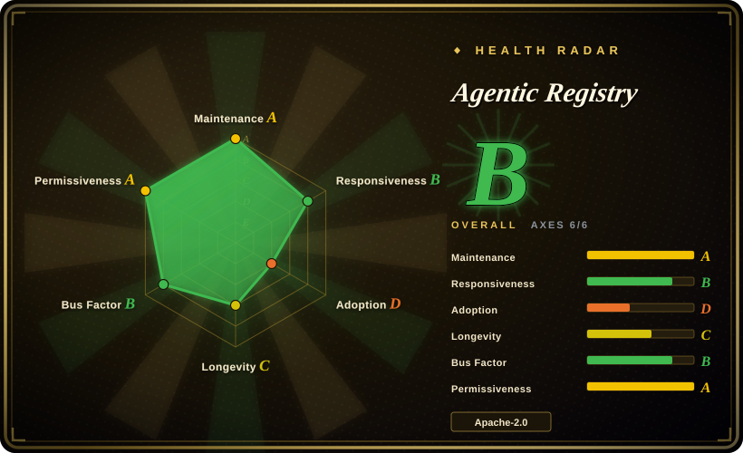
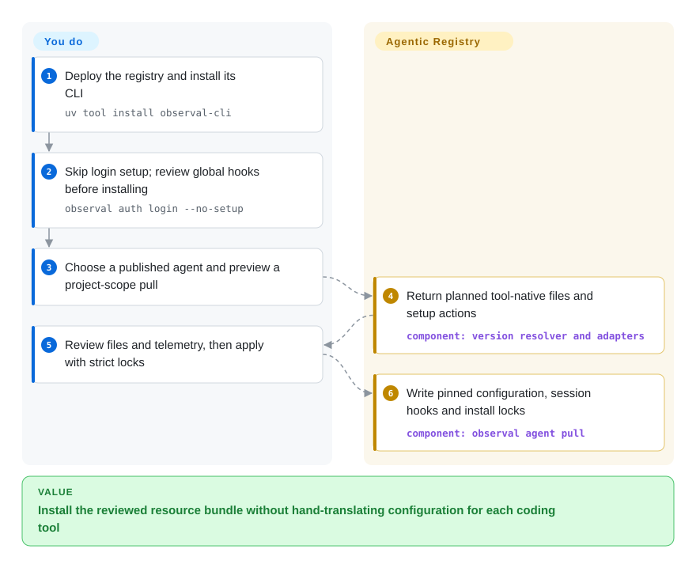
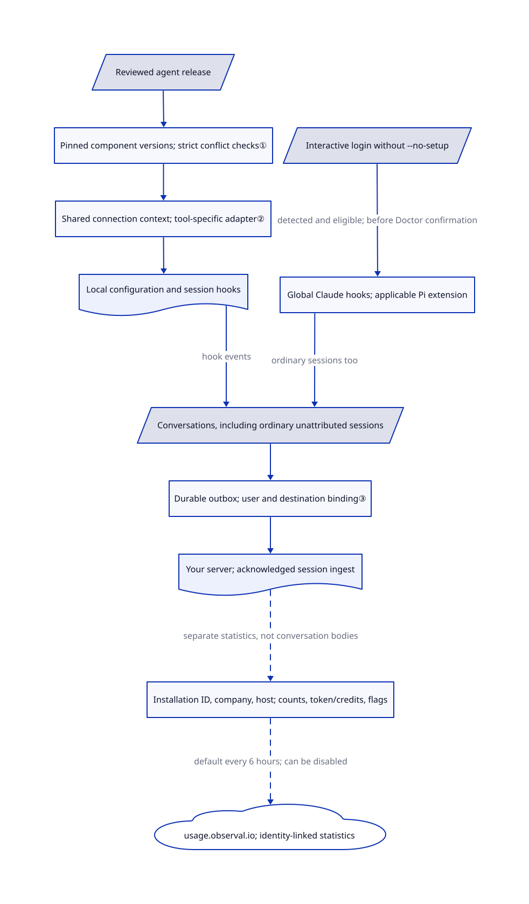

# Agentic Resource Registry

Your team has three different copies of its security-review agent, and nobody knows which skills each copy installs. Agentic Resource Registry stores reviewed resource versions and generates each coding tool's configuration from pinned components.

## When to use

You run a platform team whose developers use Claude Code, Cursor, Codex and other coding tools. A reviewer approves one agent configuration, but colleagues keep copying its prompt, MCP connections and skills into different folders. Choose this registry when you need a shared submission/review/publishing workflow and an installable agent assembled from exact component versions, rather than just distributing `SKILL.md` folders. Its CLI still uses the former product name, `observal`.

The additional reason to operate it is a team feedback loop: installed hooks can upload conversations to your server for replay and usage analysis. That is a data-collection decision, not a free extra. [README and usage path](https://github.com/AgenticResourceRegistry/AgenticResourceRegistry/blob/b6019d687393e3e23cf3babafbd78c6262fa1c5b/README.md#L96-L180).

## When NOT to use

- **You require project-only or registry-agent-only collection.** Successful ordinary interactive login without `--no-setup` runs post-login setup. If `~/.claude` exists or `claude` is on PATH, it immediately attempts to install global session hooks in `~/.claude/settings.json`, before Doctor asks for confirmation. Detected Pi installations are also checked and installed/refreshed without a prompt at `~/.pi/agent/extensions/observal.ts`, when their state calls for it. Collection is independent of registry attribution: ordinary, unattributed sessions can also be captured. Reviewing only a project pull or declining Doctor is therefore not a collection boundary. Choose a reviewed local-library workflow instead unless you approve this wider scope. [Login gate](https://github.com/AgenticResourceRegistry/AgenticResourceRegistry/blob/b6019d687393e3e23cf3babafbd78c6262fa1c5b/observal_cli/cmd_auth.py#L283-L314), [setup before Doctor](https://github.com/AgenticResourceRegistry/AgenticResourceRegistry/blob/b6019d687393e3e23cf3babafbd78c6262fa1c5b/observal_cli/cmd_auth.py#L1494-L1519), [global Claude path](https://github.com/AgenticResourceRegistry/AgenticResourceRegistry/blob/b6019d687393e3e23cf3babafbd78c6262fa1c5b/observal_cli/cmd_doctor.py#L1372-L1395), [ordinary-session capture](https://github.com/AgenticResourceRegistry/AgenticResourceRegistry/blob/b6019d687393e3e23cf3babafbd78c6262fa1c5b/observal_cli/harness/base.py#L292-L299).
- **You only want to install public skills.** Choose [Vercel Skills](vercel-skills.md), without operating this registry's API, worker and three databases. This project distributes complete agent configurations, not just skill folders.
- **You need a personal desktop skill library.** Choose [Skills Hub](skills-hub.md) for local selection and device synchronization. A shared server and review roles add work when one person owns every resource.
- **You only need local conversation search.** Choose [AgentsView](../session-history/agentsview.md), with its outbound options configured appropriately. Registry-installed hooks can report prompts, tool arguments and outputs to the configured server, including hooks installed by `agent pull` without a separate Doctor patch.
- **Your policy forbids unapproved identity-linked reporting.** Start with an audited local-library workflow such as Skills Hub instead. By default every six hours, the server posts to `https://usage.observal.io/api/v1/usage-pings`. The payload includes a stable installation ID, administrator-supplied company name, deployment hostname, component/session counts, token/credit totals and feature flags. Supplied identity is not anonymized; missing company/hostname settings use placeholders. This is a separate stream from conversation uploads to your own registry: the statistics builder does not include prompt/tool bodies or credential values. The first upgrade that runs migration 045 in 1.15.1 or later resets reporting on even if disabled. Disable it as super administrator and verify egress before use; no leak was reproduced for this entry. [Destination and fallback identity](https://github.com/AgenticResourceRegistry/AgenticResourceRegistry/blob/b6019d687393e3e23cf3babafbd78c6262fa1c5b/observal-server/services/usage_ping.py#L46-L125), [metrics and identity-bearing payload](https://github.com/AgenticResourceRegistry/AgenticResourceRegistry/blob/b6019d687393e3e23cf3babafbd78c6262fa1c5b/observal-server/services/usage_ping.py#L175-L358), [migration reset](https://github.com/AgenticResourceRegistry/AgenticResourceRegistry/blob/b6019d687393e3e23cf3babafbd78c6262fa1c5b/observal-server/alembic/versions/045_usage_ping_default_on.py#L26-L38).
- **You expect review or a digest to make third-party code harmless.** Prefer an explicitly reviewed local allowlist with Vercel Skills if you do not need the server. Here, installation can add executable hooks, skills and MCP setup commands. Pinning identifies content; it does not sandbox it, prove quality or replace the coding tool's permissions.

## Comparison

| Alternative | In index | Our verdict | Tradeoff |
|---|---|---|---|
| [Vercel Skills](vercel-skills.md) | Yes | Choose Vercel Skills for scriptable skill-only distribution; choose this registry for reviewed, versioned bundles of agents and components. | No server operation versus shared publishing policy and generated tool-specific configurations. |
| [Skills Hub](skills-hub.md) | Yes | Choose Skills Hub for one person's visual skill library across tools and devices; choose this registry when multiple authors need shared release review. | Local library and git synchronization versus server identities, review state and centralized session data. |
| [AgentsView](../session-history/agentsview.md) | Yes | Choose AgentsView when finding past conversations is the goal; choose this registry when resource distribution and team feedback must share one system. | Local-first indexing versus installed instrumentation and a multi-service team deployment. |

## Quick start

Deploy the server using its reviewed Compose package and release-verification instructions; the documented prerequisites are Docker Engine 24+ and Compose v2. After reviewing installation and data policy, install the developer CLI with `uv tool install observal-cli`.

**Do not use bare interactive login as an approval checkpoint.** It attempts global Claude hooks and applicable Pi extension installation before Doctor confirmation. For a login that skips this post-login setup, use `observal auth login --no-setup` and select your server. The login implementation propagates this choice through bootstrap, password and device-flow login; JSON login also skips setup. This flag does not make login read-only, remove existing hooks, or prevent later `agent pull`/Doctor commands from installing instrumentation. Review and approve those separately. Pi's target and adjacent manifest are user-global; foreign unmanaged extension files are not overwritten. [Login gate and propagation](https://github.com/AgenticResourceRegistry/AgenticResourceRegistry/blob/b6019d687393e3e23cf3babafbd78c6262fa1c5b/observal_cli/cmd_auth.py#L404-L590), [finish-login guard](https://github.com/AgenticResourceRegistry/AgenticResourceRegistry/blob/b6019d687393e3e23cf3babafbd78c6262fa1c5b/observal_cli/cmd_auth.py#L210-L231), [Pi pre-confirmation step](https://github.com/AgenticResourceRegistry/AgenticResourceRegistry/blob/b6019d687393e3e23cf3babafbd78c6262fa1c5b/observal_cli/cmd_auth.py#L1599-L1624), [Pi paths and ownership](https://github.com/AgenticResourceRegistry/AgenticResourceRegistry/blob/b6019d687393e3e23cf3babafbd78c6262fa1c5b/observal_cli/pi_extension.py#L66-L75), [Pi state and writes](https://github.com/AgenticResourceRegistry/AgenticResourceRegistry/blob/b6019d687393e3e23cf3babafbd78c6262fa1c5b/observal_cli/pi_extension.py#L165-L275).

After an author submits resources and reviewers publish an agent version, preview a project install with `observal agent pull alice/reviewer --harness claude-code --scope project --dry-run --no-prompt --output json`, replacing the reference with yours. Review planned files, setup commands and `reports_sessions`; only after separate approval apply the pull without `--dry-run`, adding `--strict` when lock conflicts must stop it. You supply model/MCP credentials, review executable content, operate storage and TLS, and pay enabled model-provider costs. These are source-read instructions; no upstream CLI, login, hook or upload was run for this entry. [Install path](https://github.com/AgenticResourceRegistry/AgenticResourceRegistry/blob/b6019d687393e3e23cf3babafbd78c6262fa1c5b/README.md#L96-L158), [pull contract](https://github.com/AgenticResourceRegistry/AgenticResourceRegistry/blob/b6019d687393e3e23cf3babafbd78c6262fa1c5b/docs/cli/pull.md#L20-L168).

<!-- flow-steps:begin (generated from flows/agentic-resource-registry.json by tools/flow_card.py — do not edit) -->

Text version of the flow

1. **You**: Deploy the registry and install its CLI — `uv tool install observal-cli`
2. **You**: Skip login setup; review global hooks before installing — `observal auth login --no-setup`
3. **You**: Choose a published agent and preview a project-scope pull
4. **Agentic Registry**: Return planned tool-native files and setup actions — component: `version resolver and adapters`
5. **You**: Review files and telemetry, then apply with strict locks
6. **Agentic Registry**: Write pinned configuration, session hooks and install locks — component: `observal agent pull`

**Value**: Install the reviewed resource bundle without hand-translating configuration for each coding tool

<!-- flow-steps:end -->

## Key techniques

<!-- mechanism:begin (generated from mechanisms/agentic-resource-registry.json by tools/mechanism_card.py; do not edit) -->

Text version of the mechanism

- Reviewed agent release
- Pinned component versions; strict conflict checks①
- Shared connection context; tool-specific adapter②
- Local configuration and session hooks
- Interactive login without --no-setup
- Global Claude hooks; applicable Pi extension
- Conversations, including ordinary unattributed sessions
- Durable outbox; user and destination binding③
- Your server; acknowledged session ingest
- Installation ID, company, host; counts, token/credits, flags
- usage.observal.io; identity-linked statistics

- Reviewed agent release → Pinned component versions; strict conflict checks①
- Pinned component versions; strict conflict checks① → Shared connection context; tool-specific adapter②
- Shared connection context; tool-specific adapter② → Local configuration and session hooks
- Local configuration and session hooks → Conversations, including ordinary unattributed sessions (hook events)
- Interactive login without --no-setup → Global Claude hooks; applicable Pi extension (detected and eligible; before Doctor confirmation)
- Global Claude hooks; applicable Pi extension → Conversations, including ordinary unattributed sessions (ordinary sessions too)
- Conversations, including ordinary unattributed sessions → Durable outbox; user and destination binding③
- Durable outbox; user and destination binding③ → Your server; acknowledged session ingest
- Your server; acknowledged session ingest → Installation ID, company, host; counts, token/credits, flags (separate statistics, not conversation bodies) [optional/fallback]
- Installation ID, company, host; counts, token/credits, flags → usage.observal.io; identity-linked statistics (default every 6 hours; can be disabled) [optional/fallback]

<!-- mechanism:end -->

### 1. Two levels of pins separate agent releases from component updates

- **Problem:** Updating a shared skill should not silently change every previously reviewed agent installation.
- **How:** An agent release records component version identifiers and content digests. Config generation reads pinned version content while preserving resource identity; the CLI also keeps the selected agent version in a project lock and local installation state.
- **Limits:** Legacy unpinned components can fall back with warnings, and ordinary mode can continue on some digest/status problems. Use strict mode to refuse those reported conflicts; a digest still does not certify safe behavior.
- **Source:** [Pinned listing and fallback handling](https://github.com/AgenticResourceRegistry/AgenticResourceRegistry/blob/b6019d687393e3e23cf3babafbd78c6262fa1c5b/observal-server/services/agent_lock.py#L692-L805), [CLI strict and digest checks](https://github.com/AgenticResourceRegistry/AgenticResourceRegistry/blob/b6019d687393e3e23cf3babafbd78c6262fa1c5b/observal_cli/cmd_pull.py#L3643-L3700), [version-selection contract](https://github.com/AgenticResourceRegistry/AgenticResourceRegistry/blob/b6019d687393e3e23cf3babafbd78c6262fa1c5b/docs/cli/pull.md#L58-L107).

### 2. Normalize components before rendering tool-specific files

- **Problem:** One MCP connection needs different file layouts and syntax in different coding tools.
- **How:** The server builds a shared connection context containing command, arguments, environment, transport and headers, then delegates formatting to the selected harness adapter. The CLI resolves generated project paths and rejects paths that escape the target before applying the install plan.
- **Limits:** Adapters translate configuration, not identical runtime semantics. User scope permits explicit home paths; installation can run MCP setup commands, and the whole pull is not one atomic transaction, so late failures can leave partial state.
- **Source:** [Connection normalization and adapter dispatch](https://github.com/AgenticResourceRegistry/AgenticResourceRegistry/blob/b6019d687393e3e23cf3babafbd78c6262fa1c5b/observal-server/services/config_generator.py#L105-L196), [project path resolution](https://github.com/AgenticResourceRegistry/AgenticResourceRegistry/blob/b6019d687393e3e23cf3babafbd78c6262fa1c5b/observal_cli/cmd_pull.py#L1279-L1307), [installation stages and partial failures](https://github.com/AgenticResourceRegistry/AgenticResourceRegistry/blob/b6019d687393e3e23cf3babafbd78c6262fa1c5b/docs/cli/pull.md#L138-L168).

### 3. Spool conversations before network delivery

- **Problem:** A hook process or network connection can end before the latest conversation records reach the server.
- **How:** The shared exporter reads complete records after its cursor, persists batches to an outbox bound to server and user, then advances delivery state from acknowledgements. Hook finalization and reconciliation can retry pending records; permanent rejections are quarantined and logged.
- **Limits:** This is eventual delivery, not proof that every tool action was observed. Deleted source records cannot be recovered before capture; outbox limits and rejected records need operator attention. Global hooks can collect ordinary sessions without a registry-agent identity; neither project-pull review nor declining Doctor limits those preinstalled hooks. Login's `--no-setup` skips that login's setup, not later installs. Separately, default-on external statistics carry installation/company/hostname identity, not conversation bodies.
- **Source:** [Outbox delivery and rejection handling](https://github.com/AgenticResourceRegistry/AgenticResourceRegistry/blob/b6019d687393e3e23cf3babafbd78c6262fa1c5b/observal_cli/sessions/base.py#L486-L585), [spool before send](https://github.com/AgenticResourceRegistry/AgenticResourceRegistry/blob/b6019d687393e3e23cf3babafbd78c6262fa1c5b/observal_cli/sessions/base.py#L615-L808), [scope and recovery triggers](https://github.com/AgenticResourceRegistry/AgenticResourceRegistry/blob/b6019d687393e3e23cf3babafbd78c6262fa1c5b/observal_cli/hooks/session_push.py#L47-L108), [ordinary-session scope](https://github.com/AgenticResourceRegistry/AgenticResourceRegistry/blob/b6019d687393e3e23cf3babafbd78c6262fa1c5b/observal_cli/harness/base.py#L292-L299), [pre-confirmation setup](https://github.com/AgenticResourceRegistry/AgenticResourceRegistry/blob/b6019d687393e3e23cf3babafbd78c6262fa1c5b/observal_cli/cmd_auth.py#L1494-L1519), [external reporting](https://github.com/AgenticResourceRegistry/AgenticResourceRegistry/blob/b6019d687393e3e23cf3babafbd78c6262fa1c5b/observal-server/services/usage_ping.py#L323-L453).

## Tech stack

Python 3.11+, FastAPI, SQLAlchemy/Alembic, Strawberry GraphQL and arq on the server; Typer/Rich/httpx in the CLI. React 19, TypeScript, Vite and TanStack Router provide the web UI. The reviewed source Compose uses PostgreSQL 18, ClickHouse 26.6, Redis 8 and nginx; the README's PostgreSQL 16 table is stale relative to that file. [Manifests and Compose](https://github.com/AgenticResourceRegistry/AgenticResourceRegistry/blob/b6019d687393e3e23cf3babafbd78c6262fa1c5b/docker/docker-compose.yml#L104-L255).

## Dependencies

Operate the registry API, background worker, web frontend, PostgreSQL, ClickHouse and Redis. Developer machines need a supported coding tool and either the standalone CLI or Python 3.11+; MCP processes and models have their own dependencies and credentials. Insights use a separately configured model provider through LiteLLM; basic registry installation is not model-weight training and has no documented GPU requirement. The hardware guide lists 4 GB RAM for developer use and 12 GB for 10–50 users, as planning guidance rather than measured capacity. [Requirements](https://github.com/AgenticResourceRegistry/AgenticResourceRegistry/blob/b6019d687393e3e23cf3babafbd78c6262fa1c5b/docs/self-hosting/requirements.md#L11-L73).

## Ops difficulty

**Medium to high.** A shared deployment needs TLS, identity/review policies, upgrades, database migrations, retention and backups of registry and transcript data. The source Compose publishes web/load-balancer ports without loopback-only host bindings; do not transfer the server-package's loopback-default claim to every deployment. Doctor cleanup removes managed telemetry instrumentation, not agent-owned gated hooks, installed resources or server data. Stopping containers or uninstalling the CLI does not delete database volumes or already delivered reports. [Cleanup scope](https://github.com/AgenticResourceRegistry/AgenticResourceRegistry/blob/b6019d687393e3e23cf3babafbd78c6262fa1c5b/docs/cli/doctor.md#L94-L116), [backup guide](https://github.com/AgenticResourceRegistry/AgenticResourceRegistry/blob/b6019d687393e3e23cf3babafbd78c6262fa1c5b/docs/self-hosting/backup-and-restore.md).

## Health & viability

- **2026-10-30:** repository created March 30, unarchived, with latest stable release v1.16.0 on October 29; reviewed main is already `1.17.0-dev.0`. Keep release behavior distinct from this moving source snapshot.
- **Responsiveness:** the machine scorer measured a 141.9-hour median first response across 27 qualifying issues in its scoring window. Active development does not imply immediate support.
- **Governance:** organization-owned, with named contributors in source headers and a required contributor license agreement. The scorer found 65 active contributors and 44.4% of commits from the leading contributor in its 12-month window. Organization ownership is not evidence of foundation backing or a support commitment. [Contribution terms](https://github.com/AgenticResourceRegistry/AgenticResourceRegistry/blob/b6019d687393e3e23cf3babafbd78c6262fa1c5b/CLA.md).
- **Judgment:** seven months of active history justify an isolated team pilot, not a strong longevity prior. Stars and forks show attention, not verified production adoption or resource safety.
- **License/risk:** the root license and reviewed implementation headers are Apache-2.0; bundled ARD assets retain their own Apache text, and font assets have separate OFL notices. This is not blanket permission for resources users upload or third-party MCP packages. Default reporting and instrumentation deserve an explicit deployment decision. [License scope](https://github.com/AgenticResourceRegistry/AgenticResourceRegistry/blob/b6019d687393e3e23cf3babafbd78c6262fa1c5b/docs/licensing.md), [asset notices](https://github.com/AgenticResourceRegistry/AgenticResourceRegistry/blob/b6019d687393e3e23cf3babafbd78c6262fa1c5b/REUSE.toml).

## Caveats (unverified)

- [未验证：未安装上游或启动服务] Cross-tool installations, cleanup, concurrent delivery and deployment capacity were source-read, not exercised. The page does not certify each supported tool or release artifact.
- [未验证：未复核全部依赖与用户上传内容的权属] Apache-2.0 describes the reviewed project source, not an independent rights audit of every dependency, asset or registry resource.
