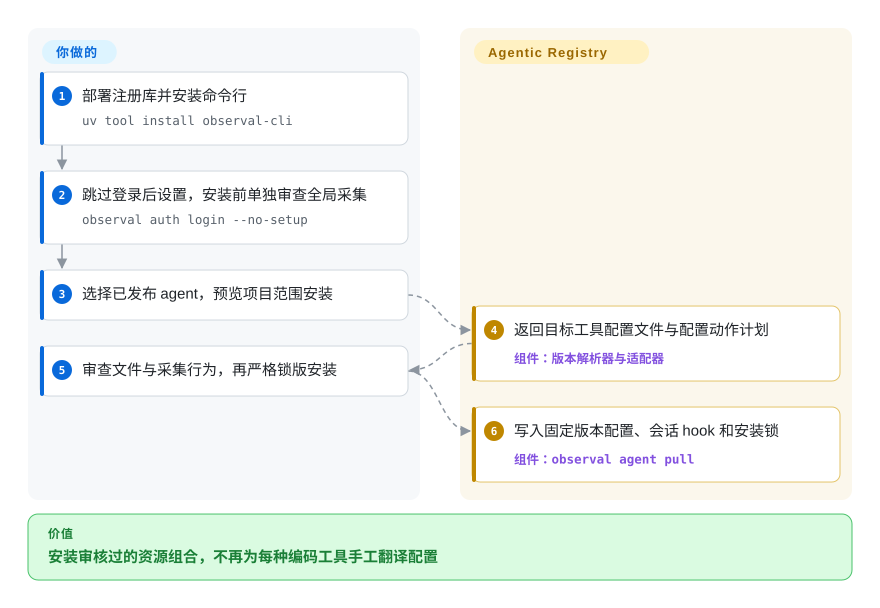
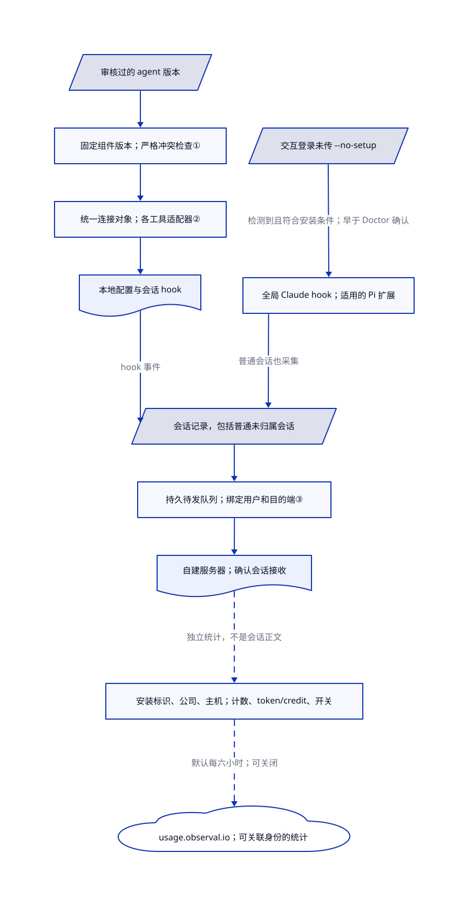

# Agentic Resource Registry

团队有三份不同的安全审查 agent，没人说得清各自安装了哪些技能。Agentic Resource Registry 保存审核过的资源版本，再按固定组件生成各编码工具的配置。

## 何时使用

你负责的平台团队同时使用 Claude Code、Cursor、Codex 等编码工具。审查者批准了一份 agent 配置，同事却仍把提示词、MCP 工具连接和技能分别复制到不同目录。需要共享的提交、审查、发布流程，并把固定组件版本组成可安装的 agent 时，选这个注册库，而不是只分发 `SKILL.md` 文件夹。命令行仍沿用旧产品名 `observal`。

另一个理由是团队反馈：安装的 hook 可以把会话上传到自建服务器，供回放和用量分析。这是数据采集决策，不是没有代价的附赠功能。[说明与使用路径](https://github.com/AgenticResourceRegistry/AgenticResourceRegistry/blob/b6019d687393e3e23cf3babafbd78c6262fa1c5b/README.md#L96-L180)。

## 何时不用

- **要求只采当前项目或注册 agent 的会话。** 普通交互登录成功且未传 `--no-setup` 时，会运行登录后设置。若检测到 `~/.claude` 或 PATH 中的 `claude`，会立即尝试向 `~/.claude/settings.json` 安装全局会话 hook，早于 Doctor 的确认提示。检测到 Pi 且状态需要安装或刷新时，也会在确认前无提示处理 `~/.pi/agent/extensions/observal.ts`。采集不依赖注册 agent 归属，普通未归属会话也可被采。因此，只审项目拉取或拒绝 Doctor，都不是采集边界。不能批准这种范围时，改用审查过的本地技能库流程。[登录开关](https://github.com/AgenticResourceRegistry/AgenticResourceRegistry/blob/b6019d687393e3e23cf3babafbd78c6262fa1c5b/observal_cli/cmd_auth.py#L283-L314)、[早于 Doctor 的设置](https://github.com/AgenticResourceRegistry/AgenticResourceRegistry/blob/b6019d687393e3e23cf3babafbd78c6262fa1c5b/observal_cli/cmd_auth.py#L1494-L1519)、[Claude 全局路径](https://github.com/AgenticResourceRegistry/AgenticResourceRegistry/blob/b6019d687393e3e23cf3babafbd78c6262fa1c5b/observal_cli/cmd_doctor.py#L1372-L1395)、[普通会话采集](https://github.com/AgenticResourceRegistry/AgenticResourceRegistry/blob/b6019d687393e3e23cf3babafbd78c6262fa1c5b/observal_cli/harness/base.py#L292-L299)。
- **只想安装公开技能。** 选 [Vercel Skills](vercel-skills.zh.md)，不用维护这个注册库的接口服务、后台任务和三种数据库。本项目分发完整 agent 配置，不只是技能文件夹。
- **需要个人桌面技能库。** 选 [Skills Hub](skills-hub.zh.md)，在本地选技能并跨设备同步。所有资源都由一个人管理时，共享服务和审查角色反而增加工作。
- **只需要本地会话搜索。** 选 [AgentsView](../session-history/agentsview.zh.md)，并按要求配置其外发选项。注册库安装的 hook 可以向配置的服务器报告提示词、工具参数和输出；只执行 `agent pull`、没有另跑 Doctor 修补，也可能装入采集 hook。
- **禁止未经批准、可关联身份的上报。** 优先采用 Skills Hub 这类经过审查的本地库流程。服务器默认每六小时向 `https://usage.observal.io/api/v1/usage-pings` 发送数据，包含稳定安装标识、管理员填写的公司名、部署主机名、组件与会话计数、token 与 credit 总量和功能开关。已填写身份不会匿名化；公司名或主机设置缺失时才使用占位值。这与向自建注册库上传会话原文是不同的数据流；统计构造器不放入提示词正文、工具正文或凭据值。首次升级并运行 1.15.1 或更高版本的 045 迁移时，会把此前关闭的上报重新打开。使用前由超级管理员关闭，并验证出口；本次没有复现泄漏。[接收地址与身份回退](https://github.com/AgenticResourceRegistry/AgenticResourceRegistry/blob/b6019d687393e3e23cf3babafbd78c6262fa1c5b/observal-server/services/usage_ping.py#L46-L125)、[统计与带身份的请求体](https://github.com/AgenticResourceRegistry/AgenticResourceRegistry/blob/b6019d687393e3e23cf3babafbd78c6262fa1c5b/observal-server/services/usage_ping.py#L175-L358)、[迁移重置](https://github.com/AgenticResourceRegistry/AgenticResourceRegistry/blob/b6019d687393e3e23cf3babafbd78c6262fa1c5b/observal-server/alembic/versions/045_usage_ping_default_on.py#L26-L38)。
- **以为审核或摘要哈希能让第三方代码无害。** 不需要服务器时，优先用 Vercel Skills 配合人工审查的本地白名单。这里的安装可能添加可执行 hook、技能和 MCP 配置命令。固定版本只识别内容，不隔离执行、不证明质量，也不替代编码工具权限。

## 横向对比

| 替代品 | 是否收录 | 我们的评价 | 取舍 |
|---|---|---|---|
| [Vercel Skills](vercel-skills.zh.md) | 已收录 | 只需脚本化分发技能时选 Vercel Skills；需要审核过的 agent 与组件版本组合时选本项目。 | 免服务器运维，对比共享发布策略和按编码工具生成配置。 |
| [Skills Hub](skills-hub.zh.md) | 已收录 | 一个人跨工具、设备管理可视化技能库时选 Skills Hub；多个作者需要共享版本审查时选本项目。 | 本地库与 git 同步，对比服务器身份、审查状态和集中会话数据。 |
| [AgentsView](../session-history/agentsview.zh.md) | 已收录 | 目标是找回旧会话时选 AgentsView；需要把资源分发与团队反馈放进一个系统时选本项目。 | 本地优先索引，对比安装采集机制和多服务团队部署。 |

## 快速上手

按审核过的 Compose 部署包和发行验证说明部署服务器；文档要求 Docker Engine 24+ 与 Compose v2。审查安装方式和数据政策后，再用 `uv tool install observal-cli` 安装命令行。

**不要把普通交互登录当作批准安装的关口。** 它会在 Doctor 确认前尝试安装全局 Claude hook，并按状态安装 Pi 扩展。要跳过本次登录后的设置，用 `observal auth login --no-setup` 并选择自己的服务器。实现把这个选择传入初始建号、密码和设备授权登录；JSON 登录也跳过该设置。该参数不让登录变成只读，不移除既有 hook，也不阻止后续 `agent pull` 或 Doctor 命令安装采集机制；后续动作仍须单独审查批准。Pi 目标和相邻清单属于用户全局范围，已有外部非托管扩展文件不会被覆盖。[登录开关与传递路径](https://github.com/AgenticResourceRegistry/AgenticResourceRegistry/blob/b6019d687393e3e23cf3babafbd78c6262fa1c5b/observal_cli/cmd_auth.py#L404-L590)、[登录收尾条件](https://github.com/AgenticResourceRegistry/AgenticResourceRegistry/blob/b6019d687393e3e23cf3babafbd78c6262fa1c5b/observal_cli/cmd_auth.py#L210-L231)、[Pi 确认前步骤](https://github.com/AgenticResourceRegistry/AgenticResourceRegistry/blob/b6019d687393e3e23cf3babafbd78c6262fa1c5b/observal_cli/cmd_auth.py#L1599-L1624)、[Pi 路径与管理权](https://github.com/AgenticResourceRegistry/AgenticResourceRegistry/blob/b6019d687393e3e23cf3babafbd78c6262fa1c5b/observal_cli/pi_extension.py#L66-L75)、[Pi 状态与写入](https://github.com/AgenticResourceRegistry/AgenticResourceRegistry/blob/b6019d687393e3e23cf3babafbd78c6262fa1c5b/observal_cli/pi_extension.py#L165-L275)。

作者提交资源、审查者发布 agent 版本后，可用 `observal agent pull alice/reviewer --harness claude-code --scope project --dry-run --no-prompt --output json` 预览项目安装，把引用换成自己的资源。检查文件、配置命令和 `reports_sessions`；获得单独批准后，才去掉 `--dry-run` 应用，要求锁冲突就停止时再加 `--strict`。你提供模型与 MCP 凭据，审查可执行内容，维护存储和 TLS，并承担启用的模型费用。这里只核读源码，本次没有执行上游命令行、登录、hook 或上传。[安装路径](https://github.com/AgenticResourceRegistry/AgenticResourceRegistry/blob/b6019d687393e3e23cf3babafbd78c6262fa1c5b/README.md#L96-L158)、[拉取合同](https://github.com/AgenticResourceRegistry/AgenticResourceRegistry/blob/b6019d687393e3e23cf3babafbd78c6262fa1c5b/docs/cli/pull.md#L20-L168)。

<!-- flow-steps:begin (generated from flows/agentic-resource-registry.json by tools/flow_card.py — do not edit) -->

流程文字版

1. **你**：部署注册库并安装命令行 — `uv tool install observal-cli`
2. **你**：跳过登录后设置，安装前单独审查全局采集 — `observal auth login --no-setup`
3. **你**：选择已发布 agent，预览项目范围安装
4. **Agentic Registry**：返回目标工具配置文件与配置动作计划 — 组件：`版本解析器与适配器`
5. **你**：审查文件与采集行为，再严格锁版安装
6. **Agentic Registry**：写入固定版本配置、会话 hook 和安装锁 — 组件：`observal agent pull`

**价值**：安装审核过的资源组合，不再为每种编码工具手工翻译配置

<!-- flow-steps:end -->

## 技术要点

<!-- mechanism:begin (generated from mechanisms/agentic-resource-registry.json by tools/mechanism_card.py; do not edit) -->

机制文字版

- 审核过的 agent 版本
- 固定组件版本；严格冲突检查①
- 统一连接对象；各工具适配器②
- 本地配置与会话 hook
- 交互登录未传 --no-setup
- 全局 Claude hook；适用的 Pi 扩展
- 会话记录，包括普通未归属会话
- 持久待发队列；绑定用户和目的端③
- 自建服务器；确认会话接收
- 安装标识、公司、主机；计数、token/credit、开关
- usage.observal.io；可关联身份的统计

- 审核过的 agent 版本 → 固定组件版本；严格冲突检查①
- 固定组件版本；严格冲突检查① → 统一连接对象；各工具适配器②
- 统一连接对象；各工具适配器② → 本地配置与会话 hook
- 本地配置与会话 hook → 会话记录，包括普通未归属会话（hook 事件）
- 交互登录未传 --no-setup → 全局 Claude hook；适用的 Pi 扩展（检测到且符合安装条件；早于 Doctor 确认）
- 全局 Claude hook；适用的 Pi 扩展 → 会话记录，包括普通未归属会话（普通会话也采集）
- 会话记录，包括普通未归属会话 → 持久待发队列；绑定用户和目的端③
- 持久待发队列；绑定用户和目的端③ → 自建服务器；确认会话接收
- 自建服务器；确认会话接收 → 安装标识、公司、主机；计数、token/credit、开关（独立统计，不是会话正文）〔可选／兜底〕
- 安装标识、公司、主机；计数、token/credit、开关 → usage.observal.io；可关联身份的统计（默认每六小时；可关闭）〔可选／兜底〕

<!-- mechanism:end -->

### 1. 两层版本锁分开 agent 发布与组件升级

- **解决：** 共享技能更新，不应悄悄改变已经审核过的 agent 安装结果。
- **做法：** agent 版本记录组件版本标识和内容摘要。配置生成读取固定版本内容，同时保留资源身份；命令行再把选中的 agent 版本写进项目锁与本机安装记录。
- **边界：** 旧版未锁组件可以警告后回退；普通模式也可能继续处理部分摘要或状态问题。严格模式才拒绝这些已报告冲突；摘要本身仍不证明行为安全。
- **源码：** [固定版本代理与回退处理](https://github.com/AgenticResourceRegistry/AgenticResourceRegistry/blob/b6019d687393e3e23cf3babafbd78c6262fa1c5b/observal-server/services/agent_lock.py#L692-L805)、[命令行严格模式与摘要检查](https://github.com/AgenticResourceRegistry/AgenticResourceRegistry/blob/b6019d687393e3e23cf3babafbd78c6262fa1c5b/observal_cli/cmd_pull.py#L3643-L3700)、[版本选择合同](https://github.com/AgenticResourceRegistry/AgenticResourceRegistry/blob/b6019d687393e3e23cf3babafbd78c6262fa1c5b/docs/cli/pull.md#L58-L107)。

### 2. 先规范组件，再生成各工具配置

- **解决：** 同一个 MCP 连接，在不同编码工具里需要不同文件布局和语法。
- **做法：** 服务器先构造统一连接对象，放入命令、参数、环境、传输方式和请求头，再交给目标编码工具的适配器格式化。命令行解析生成的项目路径，应用计划前拒绝越出目标目录的路径。
- **边界：** 适配器翻译配置，不保证运行语义相同。用户范围允许明确指定的主目录路径；安装可运行 MCP 配置命令，而且整次拉取不是一个原子事务，后段失败可能留下部分状态。
- **源码：** [连接规范化与适配器分派](https://github.com/AgenticResourceRegistry/AgenticResourceRegistry/blob/b6019d687393e3e23cf3babafbd78c6262fa1c5b/observal-server/services/config_generator.py#L105-L196)、[项目路径解析](https://github.com/AgenticResourceRegistry/AgenticResourceRegistry/blob/b6019d687393e3e23cf3babafbd78c6262fa1c5b/observal_cli/cmd_pull.py#L1279-L1307)、[安装阶段与部分失败](https://github.com/AgenticResourceRegistry/AgenticResourceRegistry/blob/b6019d687393e3e23cf3babafbd78c6262fa1c5b/docs/cli/pull.md#L138-L168)。

### 3. 会话先落本地队列，再通过网络投递

- **解决：** 最新会话还没送到服务器，hook 进程或网络就可能中断。
- **做法：** 共享导出器从游标后读取完整记录，把批次持久化到绑定服务器和用户的待发队列，再依据确认响应推进状态。hook 收尾和补同步可以重试待发记录；永久拒收的记录会隔离并记日志。
- **边界：** 这是最终投递，不证明每次工具动作都被观察到。采集前已删除的源记录无法恢复；队列上限和拒收记录需要运维处理。全局 hook 可采集没有注册 agent 身份的普通会话；只审项目拉取或拒绝 Doctor，都不能约束已提前安装的 hook。登录的 `--no-setup` 只跳过当次设置，不阻止后续安装。另一路默认对外统计携带安装标识、公司和主机身份，不是会话正文。
- **源码：** [队列投递与拒收处理](https://github.com/AgenticResourceRegistry/AgenticResourceRegistry/blob/b6019d687393e3e23cf3babafbd78c6262fa1c5b/observal_cli/sessions/base.py#L486-L585)、[先入队再发送](https://github.com/AgenticResourceRegistry/AgenticResourceRegistry/blob/b6019d687393e3e23cf3babafbd78c6262fa1c5b/observal_cli/sessions/base.py#L615-L808)、[采集范围与恢复触发](https://github.com/AgenticResourceRegistry/AgenticResourceRegistry/blob/b6019d687393e3e23cf3babafbd78c6262fa1c5b/observal_cli/hooks/session_push.py#L47-L108)、[普通会话范围](https://github.com/AgenticResourceRegistry/AgenticResourceRegistry/blob/b6019d687393e3e23cf3babafbd78c6262fa1c5b/observal_cli/harness/base.py#L292-L299)、[确认前设置](https://github.com/AgenticResourceRegistry/AgenticResourceRegistry/blob/b6019d687393e3e23cf3babafbd78c6262fa1c5b/observal_cli/cmd_auth.py#L1494-L1519)、[外部上报](https://github.com/AgenticResourceRegistry/AgenticResourceRegistry/blob/b6019d687393e3e23cf3babafbd78c6262fa1c5b/observal-server/services/usage_ping.py#L323-L453)。

## 技术栈

服务器使用 Python 3.11+、FastAPI、SQLAlchemy/Alembic、Strawberry GraphQL 和 arq；命令行使用 Typer、Rich 和 httpx。网页使用 React 19、TypeScript、Vite 与 TanStack Router。本次核读的源码 Compose 使用 PostgreSQL 18、ClickHouse 26.6、Redis 8 和 nginx；README 的 PostgreSQL 16 表格已落后于该文件。[依赖与 Compose](https://github.com/AgenticResourceRegistry/AgenticResourceRegistry/blob/b6019d687393e3e23cf3babafbd78c6262fa1c5b/docker/docker-compose.yml#L104-L255)。

## 依赖

需要维护注册接口、后台任务、网页、PostgreSQL、ClickHouse 和 Redis。开发机需要受支持的编码工具，以及独立命令行二进制或 Python 3.11+；MCP 进程与模型另有依赖和凭据。洞察分析通过 LiteLLM 接单独配置的模型提供方；基础注册库安装不是模型权重训练，文档没有 GPU 要求。硬件指南列出开发用途 4 GB 内存、10 至 50 人团队 12 GB；这是容量规划建议，不是本次实测。[运行要求](https://github.com/AgenticResourceRegistry/AgenticResourceRegistry/blob/b6019d687393e3e23cf3babafbd78c6262fa1c5b/docs/self-hosting/requirements.md#L11-L73)。

## 运维难度

**中到高。** 共享部署需要 TLS、身份与审查策略、升级、数据库迁移、保留期，以及注册和会话数据备份。源码 Compose 的网页和负载均衡端口没有限定仅回环绑定；不要把服务器发行包的回环默认值套到所有部署。Doctor 清理只移除托管采集机制，不移除 agent 自有的门控 hook、已装资源或服务器数据。停容器或卸载命令行，也不会删除数据库卷或已经送出的报告。[清理范围](https://github.com/AgenticResourceRegistry/AgenticResourceRegistry/blob/b6019d687393e3e23cf3babafbd78c6262fa1c5b/docs/cli/doctor.md#L94-L116)、[备份指南](https://github.com/AgenticResourceRegistry/AgenticResourceRegistry/blob/b6019d687393e3e23cf3babafbd78c6262fa1c5b/docs/self-hosting/backup-and-restore.md)。

## 健康度与可持续性

- **截至 2026-10-30：** 仓库于 3 月 30 日创建，未归档；最新稳定发行是 10 月 29 日的 v1.16.0，本次核读主线已为 `1.17.0-dev.0`。稳定发行行为与持续变化的源码快照须分开看。
- **响应速度：** 机器评分窗口内，27 个合格议题的首次响应中位数为 141.9 小时。开发活跃不等于即时支持。
- **治理：** 仓库归组织持有，源码列有具名贡献者，贡献需签许可协议。评分器在十二个月窗口内识别出 65 位活跃贡献者，首位贡献者占提交的 44.4%。组织所有权不等于基金会支持或服务承诺。[贡献条款](https://github.com/AgenticResourceRegistry/AgenticResourceRegistry/blob/b6019d687393e3e23cf3babafbd78c6262fa1c5b/CLA.md)。
- **判断：** 七个月活跃历史足以支持隔离的团队试点，还不足以形成强长期存续信号。星标与分叉说明关注度，不证明生产采用规模或资源安全。
- **许可与风险：** 根许可证和核读实现头部为 Apache-2.0；内置 ARD 材料保留独立 Apache 文本，字体另有 OFL 通知。这不是用户上传资源或第三方 MCP 包的统一授权。默认上报与采集机制需要单独作部署决策。[许可范围](https://github.com/AgenticResourceRegistry/AgenticResourceRegistry/blob/b6019d687393e3e23cf3babafbd78c6262fa1c5b/docs/licensing.md)、[素材通知](https://github.com/AgenticResourceRegistry/AgenticResourceRegistry/blob/b6019d687393e3e23cf3babafbd78c6262fa1c5b/REUSE.toml)。

## 存疑（未验证）

- [未验证：未安装上游或启动服务] 跨工具安装、清理、并发投递和部署容量只核读源码，未实测。本页不认证全部适配工具或发行产物。
- [未验证：未复核全部依赖与用户上传内容的权属] Apache-2.0 描述核读项目源码，不代表独立审计过每个依赖、素材或注册资源的权利。
