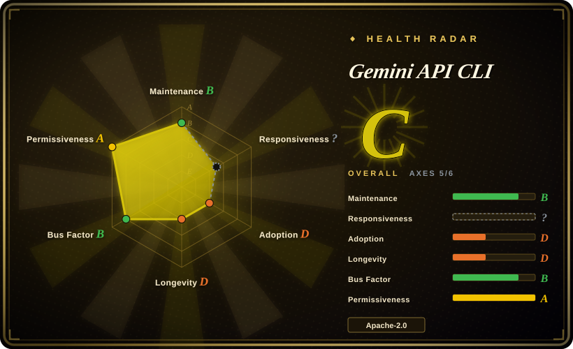
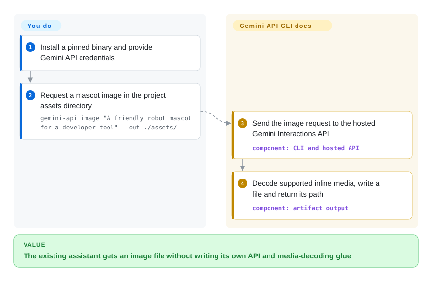
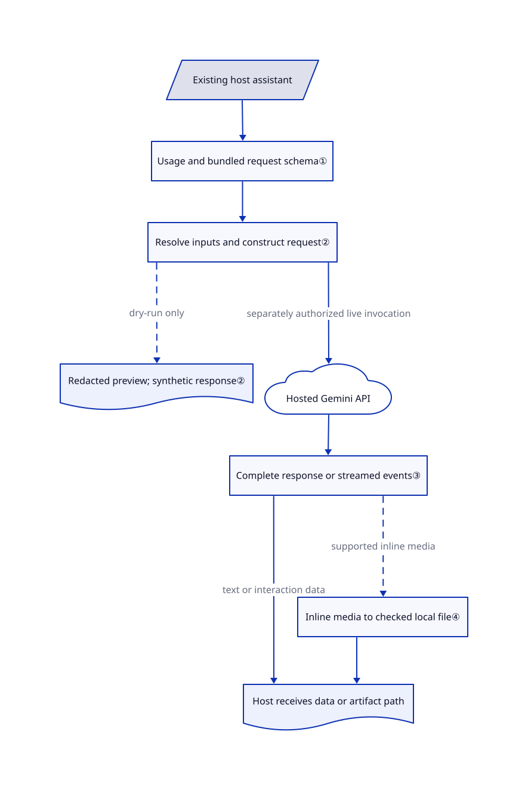

# Gemini API CLI

Your coding assistant can build a page but cannot hand you the mascot image it needs. `gemini-api` lets that existing assistant call Gemini through the shell and receive a local media path or a background job ID.

## When to use

You maintain a shell-enabled assistant that already plans work and edits your project. It reaches an empty `assets/` directory, a recording that needs subtitles, or a research task that should continue remotely. You want one Gemini-specific executable for these calls, rather than maintaining Python glue for every assistant. The CLI supplies command discovery, request previews, media extraction and managed-agent interactions; your assistant still chooses the task, authorizes data transfer and checks the result.

Pick it over a provider-neutral prompt CLI when direct Gemini media and Interactions API controls matter more than switching vendors. This is an API wrapper for an existing assistant, not the similarly named Gemini CLI coding-agent foundation. The [README's host/tool split](https://github.com/google-gemini/gemini-api-cli/blob/0707bcf0f48778e4f108d88522115bada9fed083/README.md#L6-L33) is the important boundary.

## When NOT to use

- **You need one command surface for several providers or local models.** Choose [LLM](https://github.com/simonw/llm) instead; its provider plugins and local-model integrations trade Gemini-specific convenience for a broader model choice.
- **You are integrating Gemini inside a Python application, not crossing a shell boundary.** Choose the [Google Gen AI Python SDK](https://github.com/googleapis/python-genai); typed calls and reusable clients avoid subprocess output parsing. This CLI's value is its executable interface, not a replacement application SDK.
- **Several teams need shared keys, budgets and failover.** Choose [LiteLLM](../../api-gateway/litellm.md) as a gateway. This binary sends individual requests; the calling workflow owns approval and spending policy.
- **The workflow must stay offline or cannot send its inputs to Google.** Choose LLM with a local-model plugin. A local CLI executable does not make Gemini inference local, and a request preview is not an anonymization guarantee.
- **A pinned automation cannot absorb beta contract changes.** Evaluate the Python SDK behind your own versioned adapter instead. The CLI explicitly warns about breaking changes; v0.4.0 changed repeated list flags into JSON arrays. Do not confuse a preview's synthetic HTTP success with remote authentication or model access.

## Comparison

| Alternative | In index | Our verdict | Tradeoff |
|---|---|---|---|
| [Google Gen AI Python SDK](https://github.com/googleapis/python-genai) | not indexed | Choose the SDK for calls inside a Python service; choose this CLI when several existing assistants need the same shell tool without application-language glue. | Typed Python calls and client reuse versus ready-made command discovery and media paths; not added in this tab batch. [SDK usage](https://github.com/googleapis/python-genai/blob/cb1408b06c573060f1593023ca320fde9a4fb5f6/README.md#L45-L111). |
| [LLM](https://github.com/simonw/llm) | not indexed | Choose LLM for cross-provider prompts, local models and SQLite prompt history; choose this CLI for Gemini-specific managed-agent and media operations. | Plugins broaden providers but add installation and capability differences; this CLI keeps no local conversation history. Not added in this tab batch. [LLM scope](https://github.com/simonw/llm/blob/aebaca27f9acb6cc56ba4b33ab81e08d6dcb3bc3/README.md#L33-L44), [plugins](https://github.com/simonw/llm/blob/aebaca27f9acb6cc56ba4b33ab81e08d6dcb3bc3/README.md#L102-L125). |
| [LiteLLM](../../api-gateway/litellm.md) | ✅ | Choose LiteLLM when many applications need centrally governed provider calls; choose this CLI for an assistant's direct Gemini task without operating a shared gateway. | Gateway budgets, virtual keys and routing add infrastructure and an enterprise-license boundary; this CLI leaves those policies to its host. |

## Quick start

Download a versioned archive from [Releases](https://github.com/google-gemini/gemini-api-cli/releases/tag/v0.4.4), place `gemini-api` on `PATH`, and supply `GEMINI_API_KEY` in the calling process environment. The README also documents `go install github.com/google-gemini/gemini-api-cli/cmd/gemini-api@latest`; building the reviewed development branch requires Go 1.26.10. Inspect `gemini-api --usage`, then use the README's `gemini-api image "A friendly robot mascot for a developer tool" --out ./assets/` to request an image; the supported inline-media response becomes a local file and its path. A request preview uses `--dry-run`, but you must separately approve and execute the real call, pay API charges and inspect the generated content. For one complete generation response, use `gemini-api generate "Hello" --stream=false --output-format json`; JSON alone can instead be a newline-delimited event stream. Background managed-agent work returns an interaction ID for later `agent status` calls; the host retains that ID and owns cancellation and cleanup, rather than gaining an autonomous local coding loop.

<!-- flow-steps:begin (generated from flows/gemini-api-cli.json by tools/flow_card.py — do not edit) -->

Text version of the flow

1. **You**: Install a pinned binary and provide Gemini API credentials
2. **You**: Request a mascot image in the project assets directory — `gemini-api image "A friendly robot mascot for a developer tool" --out ./assets/`
3. **Gemini API CLI**: Send the image request to the hosted Gemini Interactions API — component: `CLI and hosted API`
4. **Gemini API CLI**: Decode supported inline media, write a file and return its path — component: `artifact output`

**Value**: The existing assistant gets an image file without writing its own API and media-decoding glue

<!-- flow-steps:end -->

## Key techniques

<!-- mechanism:begin (generated from mechanisms/gemini-api-cli.json by tools/mechanism_card.py; do not edit) -->

Text version of the mechanism

- Existing host assistant
- Usage and bundled request schema①
- Resolve inputs and construct request②
- Redacted preview; synthetic response②
- Hosted Gemini API
- Complete response or streamed events③
- Inline media to checked local file④
- Host receives data or artifact path

- Existing host assistant → Usage and bundled request schema①
- Usage and bundled request schema① → Resolve inputs and construct request②
- Resolve inputs and construct request② → Redacted preview; synthetic response② (dry-run only) [optional/fallback]
- Resolve inputs and construct request② → Hosted Gemini API (separately authorized live invocation)
- Hosted Gemini API → Complete response or streamed events③
- Complete response or streamed events③ → Host receives data or artifact path (text or interaction data)
- Complete response or streamed events③ → Inline media to checked local file④ (supported inline media) [optional/fallback]
- Inline media to checked local file④ → Host receives data or artifact path

<!-- mechanism:end -->

### 1. Discover required inputs before supplying them

- **Problem:** An assistant cannot discover a command if asking for its schema first fails on missing required flags.
- **How:** `--usage` emits the command tree as KDL, a structured text format; `--schema` exposes the bundled JSON request schema. Usage queries skip configuration initialization, temporarily remove Cobra's required-flag annotations and restore them after execution.
- **Limits:** This is a discovery path, not proof that every API constraint is locally enforced. The bundled schema can describe a different contract from the remote service available to your key.
- **Source:** [Root hooks:74–104](https://github.com/google-gemini/gemini-api-cli/blob/0707bcf0f48778e4f108d88522115bada9fed083/internal/cli/root.go#L74-L104), [registration:232–243](https://github.com/google-gemini/gemini-api-cli/blob/0707bcf0f48778e4f108d88522115bada9fed083/internal/cli/root.go#L232-L243), [temporary disarm and restoration:131–163](https://github.com/google-gemini/gemini-api-cli/blob/0707bcf0f48778e4f108d88522115bada9fed083/internal/usage/schema.go#L131-L163), [execution wrappers:91–114](https://github.com/google-gemini/gemini-api-cli/blob/0707bcf0f48778e4f108d88522115bada9fed083/internal/output/exitcodes.go#L91-L114), [image schema path:139–145](https://github.com/google-gemini/gemini-api-cli/blob/0707bcf0f48778e4f108d88522115bada9fed083/internal/cli/agent/intent_image.go#L139-L145).

### 2. Preview resolved requests by replacing the HTTP client

- **Problem:** A host needs to inspect the actual request before sending project content or creating a remote resource.
- **How:** The shared client installs a diagnostics wrapper. Dry-run prints the resolved method, URL, redacted headers and body preview, then supplies a synthetic response instead of sending HTTP; credential lookup skips the OS keychain on that request path.
- **Limits:** Environment and config values can still be read. Redaction is not a complete secret audit; the synthetic `200 OK` proves neither remote permission, model availability, cost nor generated-content correctness. The host must separate preview from acceptance.
- **Source:** [Client composition:40–78](https://github.com/google-gemini/gemini-api-cli/blob/0707bcf0f48778e4f108d88522115bada9fed083/internal/client/client.go#L40-L78), [preview and synthetic response:602–659](https://github.com/google-gemini/gemini-api-cli/blob/0707bcf0f48778e4f108d88522115bada9fed083/internal/client/diagnostics.go#L602-L659), [credential resolution:247–261](https://github.com/google-gemini/gemini-api-cli/blob/0707bcf0f48778e4f108d88522115bada9fed083/internal/config/config.go#L247-L261), [handwritten command early-return support:104–121](https://github.com/google-gemini/gemini-api-cli/blob/0707bcf0f48778e4f108d88522115bada9fed083/internal/cli/custom/porcelain.go#L104-L121).

### 3. Make response framing an explicit caller decision

- **Problem:** A script expecting one JSON object cannot parse streamed event objects as that result.
- **How:** Generation presets set `stream:true`; `--stream=false` overrides it. `--agent-mode` selects structured errors and TOON, a compact structured format, unless the caller explicitly chooses another output format; CLI errors are classified through the shared output layer.
- **Limits:** Agent mode is not shorthand for JSON. For a complete object, explicitly request non-streaming JSON; streaming JSON is NDJSON, one event per line. Exit codes distinguish failure classes but do not assess the answer's truth or usefulness.
- **Source:** [Generation preset and explicit override:113–119,191–220](https://github.com/google-gemini/gemini-api-cli/blob/0707bcf0f48778e4f108d88522115bada9fed083/internal/cli/agent/intent_generate.go#L113-L220), [stream framing description:34–48](https://github.com/google-gemini/gemini-api-cli/blob/0707bcf0f48778e4f108d88522115bada9fed083/internal/cli/agent/intent_generate.go#L34-L48), [structured error path:140–171](https://github.com/google-gemini/gemini-api-cli/blob/0707bcf0f48778e4f108d88522115bada9fed083/internal/output/agentmode.go#L140-L171), [handwritten output precedence:134–161](https://github.com/google-gemini/gemini-api-cli/blob/0707bcf0f48778e4f108d88522115bada9fed083/internal/cli/custom/porcelain.go#L134-L161).

### 4. Turn supported media responses into usable file references

- **Problem:** A host should receive an image path, not have to decode a large response into its own project file.
- **How:** The image command declares a response-content selector. The artifact layer selects the last matching media block, decodes base64, rejects empty content, writes the file, checks its size and returns its path with structured metadata when requested.
- **Limits:** URI-only artifacts return an error asking the caller to fetch them; they are not automatically downloaded. A nonempty file is not visual acceptance, and an explicit destination can replace an existing file; the host owns path permissions and content review.
- **Source:** [Image selector:40–48](https://github.com/google-gemini/gemini-api-cli/blob/0707bcf0f48778e4f108d88522115bada9fed083/internal/cli/agent/intent_image.go#L40-L48), [image defaults:128–137](https://github.com/google-gemini/gemini-api-cli/blob/0707bcf0f48778e4f108d88522115bada9fed083/internal/cli/agent/intent_image.go#L128-L137), [decode, write and metadata:141–205](https://github.com/google-gemini/gemini-api-cli/blob/0707bcf0f48778e4f108d88522115bada9fed083/internal/output/artifact.go#L141-L205), [last matching block:239–253](https://github.com/google-gemini/gemini-api-cli/blob/0707bcf0f48778e4f108d88522115bada9fed083/internal/output/artifact.go#L239-L253), [destination write:289–324](https://github.com/google-gemini/gemini-api-cli/blob/0707bcf0f48778e4f108d88522115bada9fed083/internal/output/artifact.go#L289-L324).

## Tech stack

- Go executable; Cobra/pflag command tree and a generated Speakeasy SDK, with handwritten convenience commands.
- Bubble Tea, Bubbles and Lip Gloss for interactive forms; gojq for field filtering; gotoon for compact structured output; YAML configuration and go-keyring credential storage. [Manifest](https://github.com/google-gemini/gemini-api-cli/blob/0707bcf0f48778e4f108d88522115bada9fed083/go.mod#L1-L17).
- Gemini Interactions API and managed-agent platform, with a `v1beta` API-version default. [Root flags](https://github.com/google-gemini/gemini-api-cli/blob/0707bcf0f48778e4f108d88522115bada9fed083/internal/cli/root.go#L188-L201).

## Dependencies

- A supported macOS, Linux or Windows binary and a shell-capable calling workflow; no separately deployed application database or local model server in the documented path.
- Google network access, an API key or supported access token, remote model/agent availability and quota. A ChatGPT or coding-assistant subscription does not provision Gemini API access.
- Go 1.26.10 to build the reviewed branch, not to run a prebuilt archive. OS keychain integration is optional; an unavailable keychain can cause secret storage to fall back to the config file. [Storage fallback](https://github.com/google-gemini/gemini-api-cli/blob/0707bcf0f48778e4f108d88522115bada9fed083/internal/config/keyring.go#L163-L173), [config write permissions](https://github.com/google-gemini/gemini-api-cli/blob/0707bcf0f48778e4f108d88522115bada9fed083/internal/config/config.go#L365-L387).

## Ops difficulty

**Low for one-shot calls; medium for durable automation.** There is one binary rather than a local serving stack. The host must pin releases and models, set timeouts, protect credentials, bound spending, parse the chosen response framing and handle remote task lifecycles. Local configuration/keychain entries, exported files, uploaded files and server-side interactions are separate state surfaces: “no local conversation state” does not mean no state or no cloud retention. The README shows `store:false` for an image request, not a universal no-retention guarantee; it documents cancel/delete commands for remote resources. [State and request controls](https://github.com/google-gemini/gemini-api-cli/blob/0707bcf0f48778e4f108d88522115bada9fed083/README.md#L248-L310). Prefer a reviewed versioned archive over piping a mutable installer into a shell.

Local logout is not complete removal: it clears credentials in the config, skips an unavailable keychain and ignores keychain-deletion errors. It neither removes exported assets nor deletes cloud resources; verify those separately. [Logout implementation:227–256](https://github.com/google-gemini/gemini-api-cli/blob/0707bcf0f48778e4f108d88522115bada9fed083/internal/cli/auth.go#L227-L256).

## Health & viability

- **Maintenance, 2026-10-25:** v0.4.4 was released on October 23; the five cached releases span September 30–October 23. The repository is not archived and its last push was October 23. Active beta, not a frozen interface. [Releases](https://github.com/google-gemini/gemini-api-cli/releases), [beta policy](https://github.com/google-gemini/gemini-api-cli/blob/0707bcf0f48778e4f108d88522115bada9fed083/README.md#L314-L321).
- **Governance and backing:** Google owns the repository; the public contributors sample has nine accounts, with 46 of 96 attributed contributions on the leading account. The README explicitly does not accept external pull requests, and metadata restricts PR creation to collaborators. Vendor backing does not imply open community governance.
- **Age and adoption:** created April 29, 2026, less than six months before this check; 266 stars and 35 forks are discovery signals, not production-use evidence. [推断：based on creation date, releases and beta policy; no long-run observation] Active development supports a trial, but there is too little project history for a strong Lindy durability prior.
- **License and integration risk:** the actual [LICENSE](https://github.com/google-gemini/gemini-api-cli/blob/0707bcf0f48778e4f108d88522115bada9fed083/LICENSE) is Apache-2.0. The [README](https://github.com/google-gemini/gemini-api-cli/blob/0707bcf0f48778e4f108d88522115bada9fed083/README.md#L325-L331) separately licenses software under Apache-2.0 and other materials under CC-BY-4.0. v0.4.0's array-flag change and subsequent default-model changes make version pinning a real integration requirement.

## Caveats (unverified)

- [未验证：upstream execution prohibited by this batch; no Gemini credentials used] No live API call, media-generation quality, model entitlement, bill or remote cancellation/deletion was tested. Commands and mechanisms above were checked against the pinned source, README and test code; upstream tests were read, not executed.
- [未验证：installation, removal and cloud cleanup were not executed] Complete cleanup is unknown. The sources expose separate local credentials/configuration, output files and remote-resource lifecycles; no claim of residue-free removal is made.
- [推断：based on creation date, recent releases and beta policy; no long-run observation] The short active history supports cautious experimentation, not a demonstrated long-term maintenance guarantee or production-adoption verdict.
