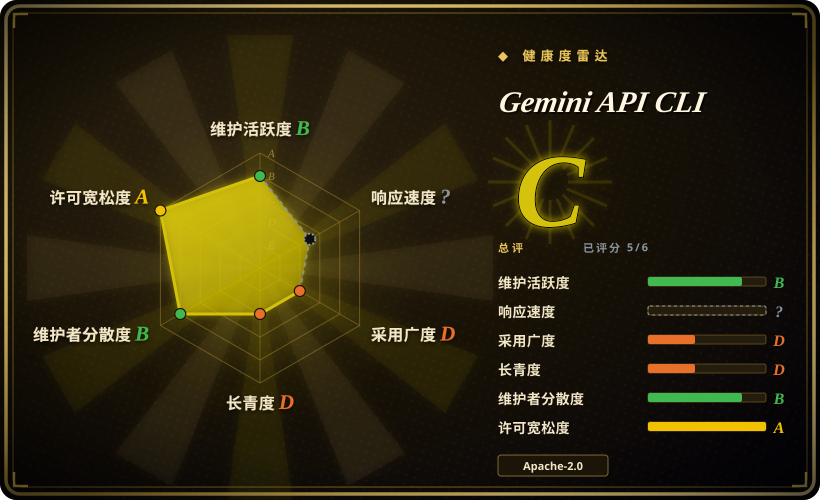
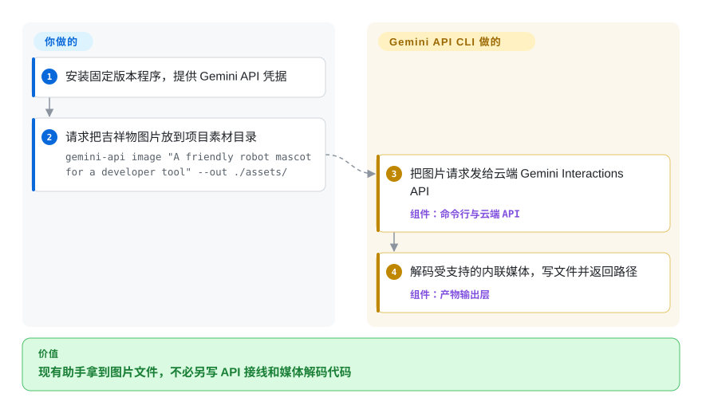
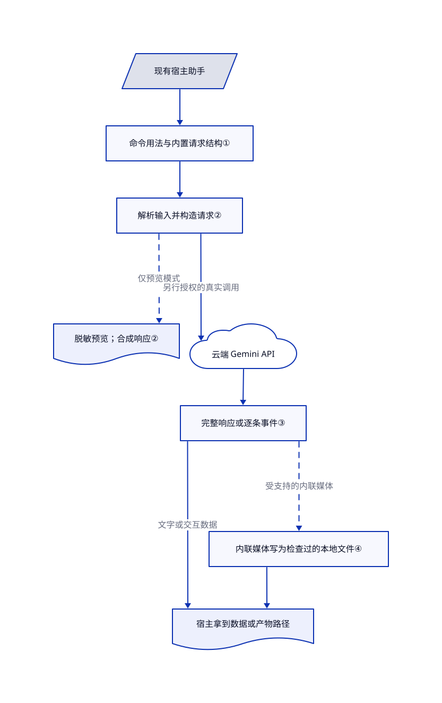

# Gemini API CLI

编码助手能搭好页面，却交不出页面需要的吉祥物图片。`gemini-api` 让现有助手通过命令行调用 Gemini，拿回本地媒体路径或后台任务编号。

## 何时使用

你维护的助手已经会规划任务、修改项目，也有执行命令的权限。它碰到空着的 `assets/` 目录、需要字幕的录音，或应该交给云端继续跑的调研任务。你希望给各个助手同一个 Gemini 专用程序，不想分别维护 Python 接线代码。它提供命令发现、请求预览、媒体落盘和托管 agent 调用；宿主仍要选任务、授权外发并验收结果。

当你更需要 Gemini 媒体能力和 Interactions API 的直接控制，而不是随时换提供方时，选它而非通用提示词命令行。它是现有助手调用的 API 包装，不是名称相近的 Gemini CLI 编码助手底座。[README 的宿主分工](https://github.com/google-gemini/gemini-api-cli/blob/0707bcf0f48778e4f108d88522115bada9fed083/README.md#L6-L33)是选型的关键边界。

## 何时不用

- **你要一套命令访问多个提供方或本地模型。** 选 [LLM](https://github.com/simonw/llm)。它用提供方插件和本地模型接入，牺牲 Gemini 专用便利，换取模型选择范围。
- **你在 Python 应用内部接入 Gemini，而非跨命令行调用。** 选 [Google Gen AI Python SDK](https://github.com/googleapis/python-genai)。类型化调用和复用客户端省去子进程输出解析；本项目的价值是可执行程序接口，不是替代应用 SDK。
- **多个团队需要统一密钥、预算和故障切换。** 选网关 [LiteLLM](../../api-gateway/litellm.zh.md)。本程序逐次发请求，审批和费用策略由调用方负责。
- **流程必须离线，或不能把输入发给 Google。** 选配有本地模型插件的 LLM。本地运行命令，不代表推理在本地；请求预览也不是匿名化保证。
- **固定自动化不能承受 beta 接口变化。** 优先评估 Python SDK，并在外面封装自己的版本化适配层。本项目明确提醒可能破坏兼容；v0.4.0 把重复列表参数改成了 JSON 数组。预览合成的 HTTP 成功不能证明远端鉴权或模型权限通过。

## 横向对比

| 替代品 | 是否收录 | 我们的评价 | 取舍 |
|---|---|---|---|
| [Google Gen AI Python SDK](https://github.com/googleapis/python-genai) | 未收录 | Python 服务内部调用选 SDK；多个现有助手需要共用命令行工具、不想分别写语言接线时，选本项目。 | SDK 提供类型化调用和客户端复用；本项目直接提供命令发现与媒体路径。本批不扩收。[SDK 用法](https://github.com/googleapis/python-genai/blob/cb1408b06c573060f1593023ca320fde9a4fb5f6/README.md#L45-L111)。 |
| [LLM](https://github.com/simonw/llm) | 未收录 | 跨提供方提示词、本地模型和 SQLite 提示历史选 LLM；直接调用 Gemini 托管 agent 和媒体操作选本项目。 | 插件扩大提供方范围，也增加安装与能力差异；本项目不保留本地对话历史。本批不扩收。[LLM 范围](https://github.com/simonw/llm/blob/aebaca27f9acb6cc56ba4b33ab81e08d6dcb3bc3/README.md#L33-L44)、[插件](https://github.com/simonw/llm/blob/aebaca27f9acb6cc56ba4b33ab81e08d6dcb3bc3/README.md#L102-L125)。 |
| [LiteLLM](../../api-gateway/litellm.zh.md) | ✅ | 多个应用需要集中治理提供方调用时选 LiteLLM；助手只需直接完成一个 Gemini 任务、不想运维共享网关时选本项目。 | 网关提供预算、虚拟密钥和路由，也引入基础设施与企业许可边界；本项目把这些策略留给宿主。 |

## 快速上手

从[版本发布页](https://github.com/google-gemini/gemini-api-cli/releases/tag/v0.4.4)下载固定版本压缩包，把 `gemini-api` 放入 `PATH`，再通过调用进程环境提供 `GEMINI_API_KEY`。README 也给出 `go install github.com/google-gemini/gemini-api-cli/cmd/gemini-api@latest`；构建本次核验的开发分支需要 Go 1.26.10。先查看 `gemini-api --usage`，再按原文执行 `gemini-api image "A friendly robot mascot for a developer tool" --out ./assets/`；受支持的内联媒体响应会变成本地文件，程序返回路径。加 `--dry-run` 可以预览请求，但真实调用仍要单独批准和执行，API 费用与生成内容验收由你承担。需要一次性完整响应时，用 `gemini-api generate "Hello" --stream=false --output-format json`；只选 JSON 仍可能得到逐行事件流。后台托管 agent 返回交互编号，供后续 `agent status` 查询；宿主保管编号并负责取消与清理，不会因此得到一套自主运行的本地编码循环。

<!-- flow-steps:begin (generated from flows/gemini-api-cli.json by tools/flow_card.py — do not edit) -->

流程文字版

1. **你**：安装固定版本程序，提供 Gemini API 凭据
2. **你**：请求把吉祥物图片放到项目素材目录 — `gemini-api image "A friendly robot mascot for a developer tool" --out ./assets/`
3. **Gemini API CLI**：把图片请求发给云端 Gemini Interactions API — 组件：`命令行与云端 API`
4. **Gemini API CLI**：解码受支持的内联媒体，写文件并返回路径 — 组件：`产物输出层`

**价值**：现有助手拿到图片文件，不必另写 API 接线和媒体解码代码

<!-- flow-steps:end -->

## 技术要点

<!-- mechanism:begin (generated from mechanisms/gemini-api-cli.json by tools/mechanism_card.py; do not edit) -->

机制文字版

- 现有宿主助手
- 命令用法与内置请求结构①
- 解析输入并构造请求②
- 脱敏预览；合成响应②
- 云端 Gemini API
- 完整响应或逐条事件③
- 内联媒体写为检查过的本地文件④
- 宿主拿到数据或产物路径

- 现有宿主助手 → 命令用法与内置请求结构①
- 命令用法与内置请求结构① → 解析输入并构造请求②
- 解析输入并构造请求② → 脱敏预览；合成响应②（仅预览模式）〔可选／兜底〕
- 解析输入并构造请求② → 云端 Gemini API（另行授权的真实调用）
- 云端 Gemini API → 完整响应或逐条事件③
- 完整响应或逐条事件③ → 宿主拿到数据或产物路径（文字或交互数据）
- 完整响应或逐条事件③ → 内联媒体写为检查过的本地文件④（受支持的内联媒体）〔可选／兜底〕
- 内联媒体写为检查过的本地文件④ → 宿主拿到数据或产物路径

<!-- mechanism:end -->

### 1. 先发现必填项，再提供必填项

- **解决：** 助手还不知道必填参数，查询命令结构却先因缺少参数失败。
- **做法：** `--usage` 用结构化文本格式 KDL 输出命令树，`--schema` 输出内置 JSON 请求结构。查询用法时跳过配置初始化，临时移除 Cobra 的必填参数标记，执行后再恢复。
- **边界：** 这是发现入口，不证明全部 API 约束都在本地强制校验。内置结构也可能不同于当前密钥可访问的远端服务契约。
- **源码：** [根钩子第 74–104 行](https://github.com/google-gemini/gemini-api-cli/blob/0707bcf0f48778e4f108d88522115bada9fed083/internal/cli/root.go#L74-L104)、[注册第 232–243 行](https://github.com/google-gemini/gemini-api-cli/blob/0707bcf0f48778e4f108d88522115bada9fed083/internal/cli/root.go#L232-L243)、[临时移除与恢复第 131–163 行](https://github.com/google-gemini/gemini-api-cli/blob/0707bcf0f48778e4f108d88522115bada9fed083/internal/usage/schema.go#L131-L163)、[执行包装第 91–114 行](https://github.com/google-gemini/gemini-api-cli/blob/0707bcf0f48778e4f108d88522115bada9fed083/internal/output/exitcodes.go#L91-L114)、[图片结构查询第 139–145 行](https://github.com/google-gemini/gemini-api-cli/blob/0707bcf0f48778e4f108d88522115bada9fed083/internal/cli/agent/intent_image.go#L139-L145)。

### 2. 替换 HTTP 客户端，预览已解析请求

- **解决：** 宿主希望先看实际请求，再决定是否外发项目内容或创建云端资源。
- **做法：** 共享客户端接入诊断包装。预览模式输出解析后的方法、地址、脱敏请求头和正文预览，再返回合成响应，不发送 HTTP；该请求路径的凭据解析会跳过系统钥匙串。
- **边界：** 环境变量和配置值仍可被读取。脱敏不是完整秘密审计；合成的 `200 OK` 不证明远端权限、模型可用性、费用或生成内容正确。宿主必须把预览与验收分开。
- **源码：** [客户端组装第 40–78 行](https://github.com/google-gemini/gemini-api-cli/blob/0707bcf0f48778e4f108d88522115bada9fed083/internal/client/client.go#L40-L78)、[预览与合成响应第 602–659 行](https://github.com/google-gemini/gemini-api-cli/blob/0707bcf0f48778e4f108d88522115bada9fed083/internal/client/diagnostics.go#L602-L659)、[凭据解析第 247–261 行](https://github.com/google-gemini/gemini-api-cli/blob/0707bcf0f48778e4f108d88522115bada9fed083/internal/config/config.go#L247-L261)、[手写命令提前返回支持第 104–121 行](https://github.com/google-gemini/gemini-api-cli/blob/0707bcf0f48778e4f108d88522115bada9fed083/internal/cli/custom/porcelain.go#L104-L121)。

### 3. 让调用方显式选择响应格式与分帧

- **解决：** 脚本期待一个 JSON 对象，却把逐条推送的事件当作完整结果解析。
- **做法：** 生成命令预设 `stream:true`，显式 `--stream=false` 可以覆盖。`--agent-mode` 选择结构化错误，并默认采用紧凑结构格式 TOON；调用方仍可显式指定输出格式。命令错误交给共享输出层分类。
- **边界：** agent 模式不等于 JSON。要完整对象就显式关闭流式并选择 JSON；流式 JSON 是每行一个事件的 NDJSON。退出码区分失败类别，不评价回答是否真实或有用。
- **源码：** [生成预设与显式覆盖第 113–119、191–220 行](https://github.com/google-gemini/gemini-api-cli/blob/0707bcf0f48778e4f108d88522115bada9fed083/internal/cli/agent/intent_generate.go#L113-L220)、[事件分帧说明第 34–48 行](https://github.com/google-gemini/gemini-api-cli/blob/0707bcf0f48778e4f108d88522115bada9fed083/internal/cli/agent/intent_generate.go#L34-L48)、[结构化错误路径第 140–171 行](https://github.com/google-gemini/gemini-api-cli/blob/0707bcf0f48778e4f108d88522115bada9fed083/internal/output/agentmode.go#L140-L171)、[手写输出优先级第 134–161 行](https://github.com/google-gemini/gemini-api-cli/blob/0707bcf0f48778e4f108d88522115bada9fed083/internal/cli/custom/porcelain.go#L134-L161)。

### 4. 把受支持的媒体响应变成文件引用

- **解决：** 宿主需要图片路径，不想自己解析大段响应并解码到项目文件。
- **做法：** 图片命令声明响应内容选择器。产物层挑最后一个匹配媒体块，解码 base64、拒绝空内容、写入文件并检查大小；按需返回路径和结构化元数据。
- **边界：** 只有 URI 的产物会报错，请调用方自行获取，不会自动下载。文件非空不代表画面通过验收；显式输出路径也可能替换已有文件，宿主负责目录权限和内容复核。
- **源码：** [图片选择器第 40–48 行](https://github.com/google-gemini/gemini-api-cli/blob/0707bcf0f48778e4f108d88522115bada9fed083/internal/cli/agent/intent_image.go#L40-L48)、[图片预设第 128–137 行](https://github.com/google-gemini/gemini-api-cli/blob/0707bcf0f48778e4f108d88522115bada9fed083/internal/cli/agent/intent_image.go#L128-L137)、[解码、写入和元数据第 141–205 行](https://github.com/google-gemini/gemini-api-cli/blob/0707bcf0f48778e4f108d88522115bada9fed083/internal/output/artifact.go#L141-L205)、[最后匹配块第 239–253 行](https://github.com/google-gemini/gemini-api-cli/blob/0707bcf0f48778e4f108d88522115bada9fed083/internal/output/artifact.go#L239-L253)、[目标写入第 289–324 行](https://github.com/google-gemini/gemini-api-cli/blob/0707bcf0f48778e4f108d88522115bada9fed083/internal/output/artifact.go#L289-L324)。

## 技术栈

- Go 可执行程序；Cobra 与 pflag 命令树，Speakeasy 生成的 SDK，外加手写便利命令。
- Bubble Tea、Bubbles、Lip Gloss 提供交互表单；gojq 过滤字段，gotoon 输出紧凑结构；YAML 保存配置，go-keyring 管理凭据。[依赖清单](https://github.com/google-gemini/gemini-api-cli/blob/0707bcf0f48778e4f108d88522115bada9fed083/go.mod#L1-L17)。
- Gemini Interactions API 和托管 agent 平台；API 版本默认 `v1beta`。[根参数](https://github.com/google-gemini/gemini-api-cli/blob/0707bcf0f48778e4f108d88522115bada9fed083/internal/cli/root.go#L188-L201)。

## 依赖

- 支持 macOS、Linux 或 Windows 的程序，以及能执行命令的调用流程；文档主路径不要求另外部署应用数据库或本地模型服务。
- Google 网络访问、API 密钥或受支持的访问令牌，以及远端模型／agent 权限与额度。ChatGPT 或编码助手订阅不会自动提供 Gemini API 权限。
- 构建本次核验分支需要 Go 1.26.10，运行预编译包则不需要。系统钥匙串可选；钥匙串不可用时，秘密存储可能退回配置文件。[存储回退](https://github.com/google-gemini/gemini-api-cli/blob/0707bcf0f48778e4f108d88522115bada9fed083/internal/config/keyring.go#L163-L173)、[配置写入权限](https://github.com/google-gemini/gemini-api-cli/blob/0707bcf0f48778e4f108d88522115bada9fed083/internal/config/config.go#L365-L387)。

## 运维难度

**单次调用低，长期自动化中等。** 本地只需一个程序，不必运维推理服务。宿主要固定版本与模型、设置超时、保护凭据、限制费用、解析选定输出，并管理云端任务生命周期。本地配置／钥匙串、导出文件、上传文件、服务端交互是不同状态面；“不保存本地对话”不代表没有状态或云端留存。README 给出单个图片请求的 `store:false`，不是全路径不留存保证；另有远端资源取消与删除命令。[状态与请求控制](https://github.com/google-gemini/gemini-api-cli/blob/0707bcf0f48778e4f108d88522115bada9fed083/README.md#L248-L310)。优先审查固定版本压缩包，不要直接把可变安装脚本交给 shell。

本地登出不是完整卸载。它清空配置中的凭据，跳过不可用的钥匙串，并忽略钥匙串删除错误；不会删除导出素材或云端资源，这些都要另行核对。[登出实现第 227–256 行](https://github.com/google-gemini/gemini-api-cli/blob/0707bcf0f48778e4f108d88522115bada9fed083/internal/cli/auth.go#L227-L256)。

## 健康度与可持续性

- **维护，2026-10-25：** v0.4.4 于 10 月 23 日发布；缓存中的五次发布覆盖 9 月 30 日至 10 月 23 日。仓库未归档，最后推送为 10 月 23 日。这是活跃 beta，不是冻结接口。[发布记录](https://github.com/google-gemini/gemini-api-cli/releases)、[beta 政策](https://github.com/google-gemini/gemini-api-cli/blob/0707bcf0f48778e4f108d88522115bada9fed083/README.md#L314-L321)。
- **治理与背书：** Google 持有仓库；公开贡献者样本有九个账号，头部账号占 96 次归属贡献中的 46 次。README 明确暂不接受外部 PR，元数据也把创建 PR 限于协作者。厂商背书不等于社区共治。
- **年龄与采用：** 2026 年 4 月 29 日建库，本次核验时不足六个月；266 星和 35 个 fork 只能作发现信号，不是生产采用证据。[推断：依据是建库日期、近期发布和 beta 声明，未做长期运行观察] 活跃开发支持试用，但项目历史不足以构成长寿先验。
- **许可与集成风险：** 实际 [LICENSE](https://github.com/google-gemini/gemini-api-cli/blob/0707bcf0f48778e4f108d88522115bada9fed083/LICENSE) 是 Apache-2.0。[README](https://github.com/google-gemini/gemini-api-cli/blob/0707bcf0f48778e4f108d88522115bada9fed083/README.md#L325-L331)另作区分：软件 Apache-2.0，其它材料 CC-BY-4.0。v0.4.0 的数组参数变化和后续默认模型调整，都使固定版本成为实际集成要求。

## 存疑（未验证）

- [未验证：按本批安全合同未安装或运行上游，也未使用 Gemini 凭据] 没有实测在线调用、媒体生成质量、模型权限、账单或远端取消／删除。命令与机制核对了固定源码、README 和测试代码；只读了上游测试，没有执行。
- [未验证：未执行安装、卸载或云端资源清理] 完整清理情况未知。源码暴露了本地凭据／配置、产物文件和远端资源各自的生命周期，本页不声称卸载后无残留。
- [推断：依据是 2026-04-29 建库、近期发布与 beta 声明，未观察长期运行] 短期活跃历史支持谨慎试用，不能证明长期维护保证或生产采用。
