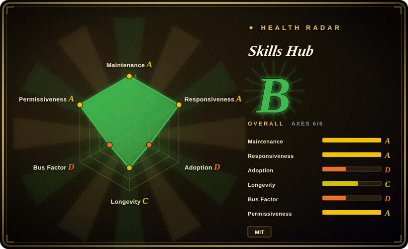
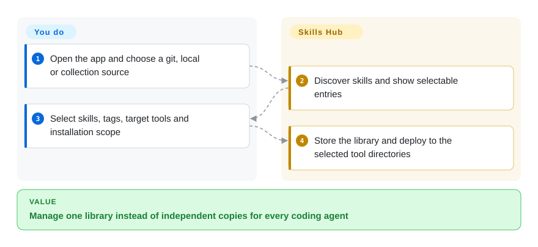
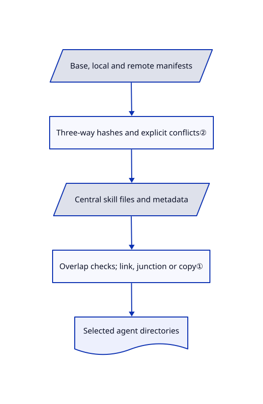

# Skills Hub

The same skill lives in several agents' folders, and edits stop matching across computers. Skills Hub keeps a central library, deploys selected skills to tool directories and offers git-backed device synchronization.

## When to use

You use several coding agents and want a desktop view of which skills are enabled globally or in one project. Choose Skills Hub over an install-only CLI when tags, bulk selection, local-folder imports and cross-device library reconciliation justify another stateful manager. It also offers AI management through a shared CLI/library surface; do not let that convenience hide the fact that installed skills become executable instructions in your agents.

## When NOT to use

- **Your dotfiles already own the skill source and symlinks.** Keep that version-controlled deployment script, or use [Vercel Skills](vercel-skills.md) for explicit CLI installs. Introducing a second writer can compete with your existing source of truth.
- **You mainly push skills to remote servers over SSH.** Choose [SkillsGate](skillsgate.md), after reviewing its lock-file caveat; Skills Hub's git device sync is a different workflow.
- **You expect catalog entries to be trusted.** Use a reviewed local allowlist and inspect each skill; [Vercel Skills](vercel-skills.md) and this GUI distribute content, not security approval.

## Comparison

| Alternative | In index | Our verdict | Tradeoff |
|---|---|---|---|
| [Vercel Skills](vercel-skills.md) | ✅ | Choose Vercel Skills for explicit scriptable package installs; choose Skills Hub for a persistent desktop library and git device sync. | Less manager state versus GUI tags, reconciliation and multiple deployment scopes. |
| [SkillsGate](skillsgate.md) | ✅ | Choose SkillsGate for its remote-server SSH pane; choose Skills Hub for project scopes and GitHub/GitLab/Gitee device synchronization. | SSH push versus git-backed library merge; both can alter existing agent folders. |
| Version-controlled copy/symlink script | not a repo | Keep a script when a small reviewed library already lives in dotfiles; choose Skills Hub once discovery and bulk management become recurring work. | A technique, not a repository: fewer moving parts, but you own path mappings and conflict handling. |

## Quick start

Download and open the desktop app, then choose Add Skills and import from a git repository, local folder or collection. Select individual skills, tags, target tools and global or supported project scope before confirming installation. Skills Hub stores the library and deploys to the chosen locations; you review third-party instructions and any replacement of existing files. Optional device sync needs a repository and credentials for a supported git provider. AI Management is a separate settings action; ordinary desktop use does not require Node.js or npm.

<!-- flow-steps:begin (generated from flows/skills-hub.json by tools/flow_card.py — do not edit) -->

Text version of the flow

1. **You**: Open the app and choose a git, local or collection source
2. **Skills Hub**: Discover skills and show selectable entries
3. **You**: Select skills, tags, target tools and installation scope
4. **Skills Hub**: Store the library and deploy to the selected tool directories

**Value**: Manage one library instead of independent copies for every coding agent

<!-- flow-steps:end -->

## Key techniques

<!-- mechanism:begin (generated from mechanisms/skills-hub.json by tools/mechanism_card.py; do not edit) -->

Text version of the mechanism

- Central skill files and metadata
- Overlap checks; link, junction or copy①
- Selected agent directories
- Base, local and remote manifests
- Three-way hashes and explicit conflicts②

- Central skill files and metadata → Overlap checks; link, junction or copy①
- Overlap checks; link, junction or copy① → Selected agent directories
- Base, local and remote manifests → Three-way hashes and explicit conflicts②
- Three-way hashes and explicit conflicts② → Central skill files and metadata

<!-- mechanism:end -->

### 1. Deploy from central storage with explicit link outcomes

- **Problem:** Maintaining independent skill copies under each agent creates drift and unsafe overlapping directories.
- **How:** The sync engine rejects source/target overlap, tries a symlink, then a Windows junction, then a copy, and reports the mode used. Managed-copy replacement accepts an expected hash; central-storage migration separately rejects overlapping tool/source roots.
- **Limits:** Copy fallback does not have live-link semantics, and explicit overwrite paths can remove an existing target. Back up local work before adoption rather than assuming every deployment is reversible.
- **Source:** [Deployment engine](https://github.com/qufei1993/skills-hub/blob/1647138a35c7d4cb4808f11f724cbaa77609f0de/src-tauri/src/core/sync_engine.rs#L31-L149), [storage guards](https://github.com/qufei1993/skills-hub/blob/1647138a35c7d4cb4808f11f724cbaa77609f0de/src-tauri/src/core/central_repo.rs#L21-L52).

### 2. Three-way reconciliation distinguishes edits from deletions

- **Problem:** Blindly pulling a remote library can erase local modifications or resurrect deleted skills.
- **How:** The merge planner compares base, local and remote content hashes, separates additions/deletions and metadata, then attempts text merge only when all three file versions exist. Unresolved cases stay explicit conflicts.
- **Limits:** Binary files, missing bases and conflicting metadata cannot be safely guessed; a conflict plan still needs a user decision and reliable synchronization state.
- **Source:** [Device merge planner and regression cases](https://github.com/qufei1993/skills-hub/blob/1647138a35c7d4cb4808f11f724cbaa77609f0de/src-tauri/src/core/device_sync/merge.rs#L17-L178).

## Tech stack

Tauri 2, Rust, React 19, TypeScript, Vite and Tailwind. Rust uses SQLite/rusqlite, git2, reqwest and platform keyring libraries; desktop and standalone CLI share backend services.

## Dependencies

Packaged builds for macOS, Windows and Linux, with OS webview/runtime requirements. Network access for discovery and git imports; provider credentials only for enabled device sync. Source builds additionally need Rust, Node tooling and platform-specific Tauri prerequisites.

## Ops difficulty

**Low to medium.** No server is needed for a local library. Complexity comes from central storage, per-tool scopes, copies versus links, credentials, update schedules and merge state. Audit those before letting the application manage an existing dotfiles-backed library.

## Health & viability

- **2026-10-18:** created January 2026, unarchived, with v1.0.1 released October 16 after v1.0.0 on October 11. Visible human commits are heavily concentrated in the owner; automated contributions are not extra maintainers.
- **Judgment:** active releases and synchronization tests support a trial, but nine months of history remain a weak Lindy prior for a tool that replaces files across agents.
- **Risk:** sampled recent changes address Windows deployment paths and stale sync state. MIT root text names Skills Hub contributors; placeholder Cargo metadata does not override that license file.

## Caveats (unverified)

- [未验证：未安装或跨设备复现] Symlink/copy recovery, keychain integration and concurrent device synchronization were source-read, not exercised on supported systems.
