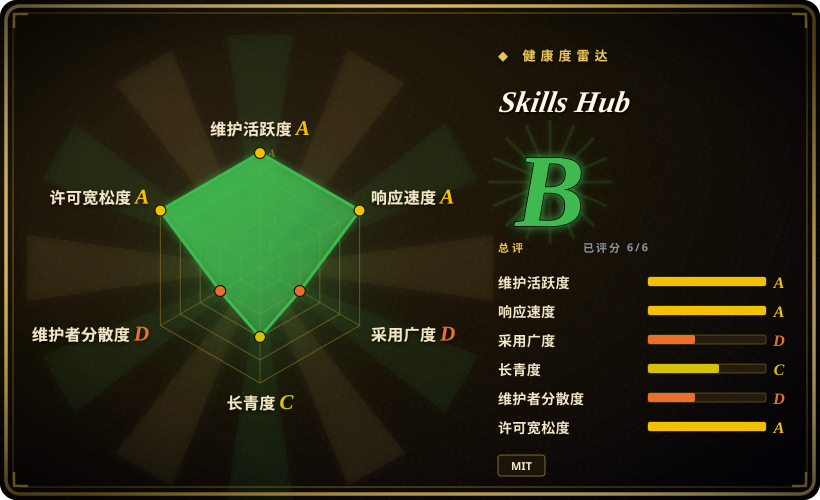
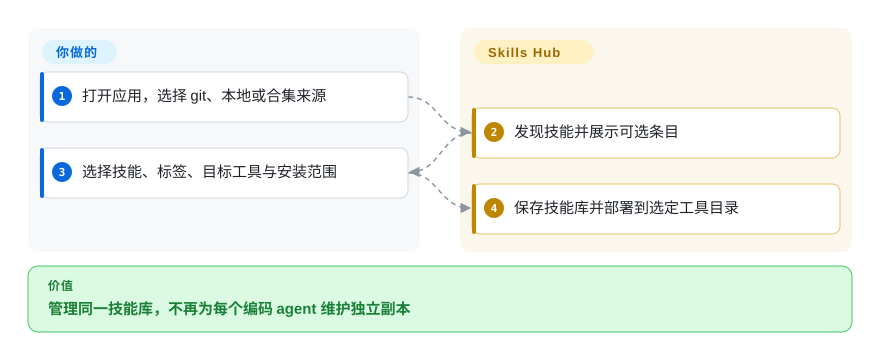
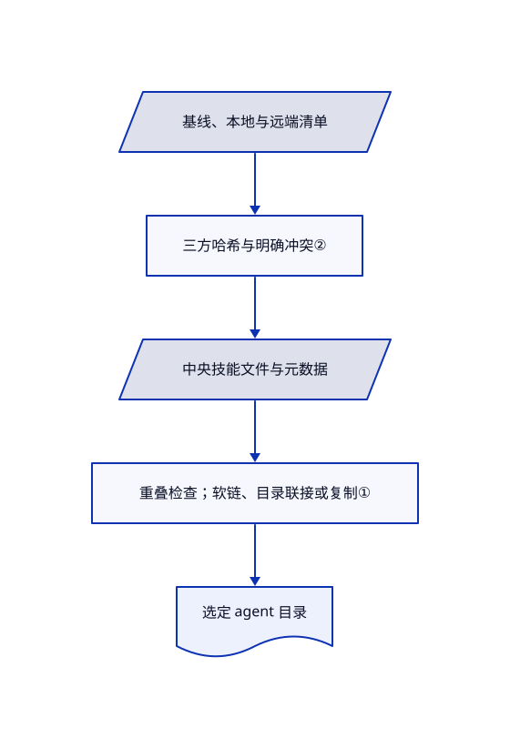

# Skills Hub

同一技能散落在几个 agent 目录，换台电脑后修改又对不上。Skills Hub 用中央技能库部署到工具目录，并提供基于 git 的跨设备同步。

## 何时使用

你使用多个编码 agent，需要桌面界面查看哪些技能在全局或某个项目中启用。标签、批量选择、本地目录导入与跨设备合并，足以抵偿另一个有状态管理器的成本时，选 Skills Hub 而非单纯安装 CLI。它还通过共享 CLI 和技能库提供 AI 管理；便利不改变一个事实：安装后的技能会成为 agent 可执行的指令。

## 何时不用

- **dotfiles 已管理技能源码与软链。** 保留版本化部署脚本，或用 [Vercel Skills](vercel-skills.zh.md) 做明确 CLI 安装；再加一个写入者可能争夺事实源。
- **主要通过 SSH 推送到服务器。** 选 [SkillsGate](skillsgate.zh.md)，同时注意其锁文件局限；Skills Hub 的 git 设备同步是另一条路径。
- **期待目录里的技能都已可信。** 使用人工审定的本地白名单，逐个阅读技能；[Vercel Skills](vercel-skills.zh.md) 与此 GUI 都只分发内容，不作安全批准。

## 横向对比

| 替代品 | 是否收录 | 我们的评价 | 取舍 |
|---|---|---|---|
| [Vercel Skills](vercel-skills.zh.md) | ✅ | 明确可脚本化安装选 Vercel Skills；要常驻桌面技能库与 git 设备同步，选 Skills Hub。 | 较少管理状态，对比 GUI 标签、合并与多部署范围。 |
| [SkillsGate](skillsgate.zh.md) | ✅ | 远端服务器 SSH 面板选 SkillsGate；项目范围与 GitHub/GitLab/Gitee 设备同步选 Skills Hub。 | SSH 推送对比 git 技能库合并；都可能改动已有 agent 目录。 |
| 版本化复制或软链脚本 | 非仓库 | 小型审定技能库已在 dotfiles 时保留脚本；发现技能与批量管理反复出现时再选 Skills Hub。 | 这是技术手段，不是仓库；状态少，但路径映射与冲突由你维护。 |

## 快速上手

下载并打开桌面应用，在 Add Skills 从 git、本地文件夹或合集导入。确认安装前选择具体技能、标签、目标工具和全局或受支持的项目范围。Skills Hub 保存技能库并部署到选定位置；第三方指令与已有文件替换由你审查。可选设备同步需要仓库及对应 git 提供方凭据。AI Management 要另行在设置中开启；普通桌面使用无需 Node.js 或 npm。

<!-- flow-steps:begin (generated from flows/skills-hub.json by tools/flow_card.py — do not edit) -->

流程文字版

1. **你**：打开应用，选择 git、本地或合集来源
2. **Skills Hub**：发现技能并展示可选条目
3. **你**：选择技能、标签、目标工具与安装范围
4. **Skills Hub**：保存技能库并部署到选定工具目录

**价值**：管理同一技能库，不再为每个编码 agent 维护独立副本

<!-- flow-steps:end -->

## 技术要点

<!-- mechanism:begin (generated from mechanisms/skills-hub.json by tools/mechanism_card.py; do not edit) -->

机制文字版

- 中央技能文件与元数据
- 重叠检查；软链、目录联接或复制①
- 选定 agent 目录
- 基线、本地与远端清单
- 三方哈希与明确冲突②

- 中央技能文件与元数据 → 重叠检查；软链、目录联接或复制①
- 重叠检查；软链、目录联接或复制① → 选定 agent 目录
- 基线、本地与远端清单 → 三方哈希与明确冲突②
- 三方哈希与明确冲突② → 中央技能文件与元数据

<!-- mechanism:end -->

### 1. 从中央存储部署，并报告实际链接方式

- **解决：** 各 agent 独立保存技能会漂移，目录重叠还可能破坏源文件。
- **做法：** 同步引擎拒绝源与目标重叠，依次尝试软链、Windows 目录联接和复制，并报告实际方式。受管复制接收预期哈希；中央存储迁移另行检查工具和源目录重叠。
- **边界：** 复制回退没有实时软链语义，明确覆盖路径可能删除已有目标。接管前应备份本地修改，不能假定每次部署都可逆。
- **源码：** [部署引擎](https://github.com/qufei1993/skills-hub/blob/1647138a35c7d4cb4808f11f724cbaa77609f0de/src-tauri/src/core/sync_engine.rs#L31-L149)、[存储检查](https://github.com/qufei1993/skills-hub/blob/1647138a35c7d4cb4808f11f724cbaa77609f0de/src-tauri/src/core/central_repo.rs#L21-L52)。

### 2. 三方合并区分修改与删除

- **解决：** 盲拉远端技能库可能覆盖本地修改，或恢复本已删除的技能。
- **做法：** 合并规划比较基线、本地和远端内容哈希，区分增删与元数据；只有三个文件版本都存在时才尝试文本合并。无法处理的情况保留为明确冲突。
- **边界：** 二进制、缺失基线与冲突元数据不能猜；冲突计划仍需要用户决定与可靠同步状态。
- **源码：** [设备合并规划与回归案例](https://github.com/qufei1993/skills-hub/blob/1647138a35c7d4cb4808f11f724cbaa77609f0de/src-tauri/src/core/device_sync/merge.rs#L17-L178)。

## 技术栈

Tauri 2、Rust、React 19、TypeScript、Vite 与 Tailwind。Rust 使用 SQLite/rusqlite、git2、reqwest 和平台钥匙串库；桌面与独立 CLI 共享后端服务。

## 依赖

macOS、Windows、Linux 打包产物及对应系统网页视图运行支持。发现与 git 导入需要网络；只有启用设备同步才需提供方凭据。源码构建另需 Rust、Node 工具和平台 Tauri 前置条件。

## 运维难度

**低到中。** 本地技能库无需服务端。复杂度来自中央存储、工具范围、复制与软链差异、凭据、更新计划和合并状态。接管已有 dotfiles 技能库前先核对这些状态。

## 健康度与可持续性

- **截至 2026-10-18：** 仓库建于 2026 年 1 月，未归档；10 月 11 日发布 v1.0.0，16 日发布 v1.0.1。可见人工提交高度集中在作者，自动化提交不算额外维护者。
- **判断：** 活跃发布与同步测试支持试用，但九个月历史不足以为跨 agent 替换文件的工具提供强长期存续证据。
- **风险：** 最新改动样本涉及 Windows 部署路径与过期同步状态。MIT 实文署名 Skills Hub contributors；Cargo 的占位元数据不覆盖许可证文件。

## 存疑（未验证）

- [未验证：未安装或跨设备复现] 软链与复制恢复、钥匙串集成和并发设备同步只读了源码，未在支持系统实测。
