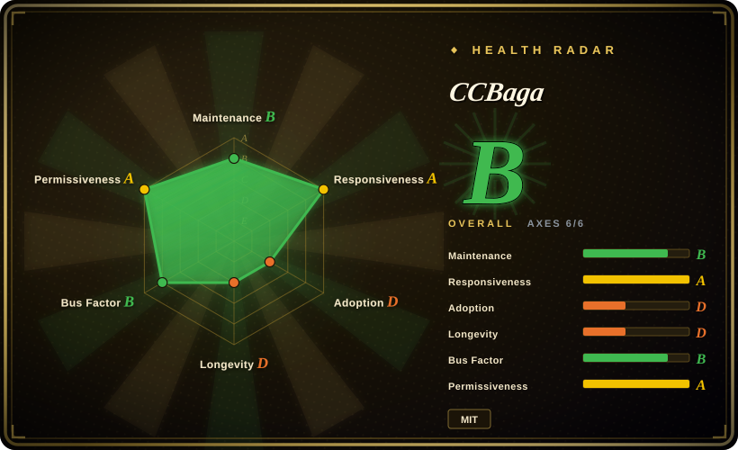
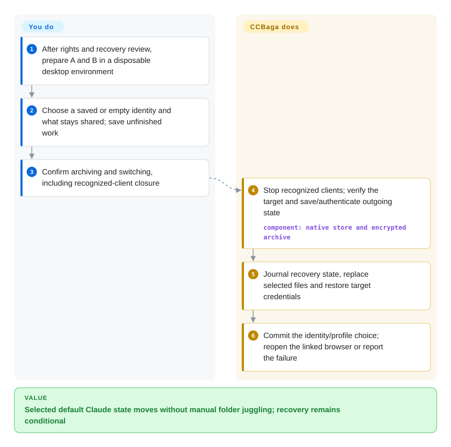
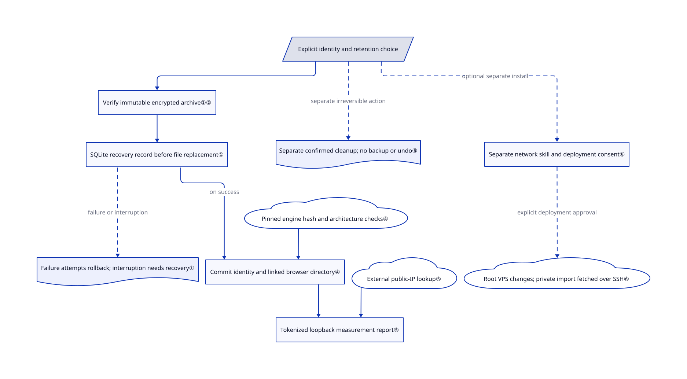

# CCBaga

Switching your own Claude accounts leaves Code, Desktop and browser state mixed together. CCBaga snapshots selected local Claude state and coordinates a separate browser profile, but the reviewed version has an open restore defect.

**Information-only inclusion, not installation or redistribution approval.** The [root MIT](https://github.com/liseami/CCBaga/blob/bdfb90ceadfc5fae6772ffff597bddecb0b73cc3/LICENSE) covers original project work only. [NOTICE](https://github.com/liseami/CCBaga/blob/bdfb90ceadfc5fae6772ffff597bddecb0b73cc3/NOTICE.md#vendored-interface) still requires confirmation of `vendor/cromma-ui` redistribution rights, including its Pika subset. Inclusion does not resolve that gap; neither does the machine's license grade. Review scope: public source at `bdfb90ceadfc5fae6772ffff597bddecb0b73cc3`, not a running installation.

## When to use

You maintain your own authorized Claude Code and Desktop accounts on a supported desktop. After switching, the command-line client shows one account while the browser still carries another session; moving whole folders also carries plugins and conversation files you wanted shared. CCBaga offers retention choices, encrypted local snapshots, an in-place backup action and optional identity-linked browser directories. Choose this over [CC Switch](../../agent-frameworks/coding-agents/orchestration-and-review/cc-switch.md) only when **local account state and its browser binding**, rather than API-provider configuration, are the problem.

For now, treat it as a source-review or disposable-fixture candidate, not the sole recovery mechanism for a daily account. [Issue #49](https://github.com/liseami/CCBaga/issues/49) reports a failed save on Claude's generated `debug/latest` link and a failed restore of a root configuration backup. [PR #50](https://github.com/liseami/CCBaga/pull/50) was still open and unmerged on 2026-10-22. The reviewed source still has both relevant rejection paths. The README restricts intended use to owners residing or traveling abroad and prohibits use violating Anthropic's terms.

## When NOT to use

- **You need reliable daily account round trips today.** Use the official Claude clients' own sign-in flow and an independent backup instead. The open #49 defect can reject ordinary generated paths; a recovery journal is not proof that every restore succeeds. Preserve the vault and stop on failure rather than deleting files to force a switch.
- **You only change model providers or endpoints.** Use [CC Switch](../../agent-frameworks/coding-agents/orchestration-and-review/cc-switch.md), or [Magpie](../../api-gateway/magpie-model-router.md) for a CLI-capable provider manager. CCBaga's account snapshots are a broader, more destructive state boundary than editing connection settings.
- **You require confirmed rights for every redistributed UI component.** Use a separately reviewed alternative such as CC Switch, or stay with the official client. CCBaga's root MIT cannot authorize Cromma UI/Pika on another rights holder's behalf; resolve the notice before copying or redistributing that subtree.
- **You need guaranteed undo or secure erasure.** Use an independent backup before maintenance, or retain the data. Direct current-identity deletion, residue cleanup and full browser reset create no new backup and do not use the trash. Partial deletion can survive a failure; none promises secure disk erasure or deletion of server records.
- **You need anonymity, a new public IP or permission to bypass service restrictions.** Use the official service through an authorized network and its supported client instead. Fingerprint changes and green checks neither grant authorization nor prove account acceptance, DNS/WebRTC leak freedom or resistance to correlation.
- **You only need browser-environment experiments.** Consider standalone [Fingerprint Chromium](https://github.com/adryfish/fingerprint-chromium), with the same authorization and privacy caveats, rather than granting a Claude-state manager access to account stores. Intel macOS and native Windows ARM are outside CCBaga's documented release targets; keep the supported official client there.

## Comparison

| Alternative | In index | Our verdict | Tradeoff |
|---|---|---|---|
| [CC Switch](../../agent-frameworks/coding-agents/orchestration-and-review/cc-switch.md) | ✅ | Choose CC Switch for a desktop provider/MCP/configuration switchboard; evaluate CCBaga only when default Claude login-state snapshots and linked browser directories are the specific need. | CC Switch avoids whole identity-state rotation for an endpoint change; CCBaga adds credential/file recovery machinery and its current restore defect. |
| [Magpie](../../api-gateway/magpie-model-router.md) | ✅ | Choose Magpie when several agents need one provider catalog or a headless CLI; CCBaga is for local Claude-state retention, not a multi-agent model gateway. | Magpie introduces request routing and its own subscription-policy risks; CCBaga instead closes clients and moves selected local state. |
| [Fingerprint Chromium](https://github.com/adryfish/fingerprint-chromium) | not indexed | Choose the standalone engine for authorized browser-fingerprint experiments without Claude credential management; CCBaga adds identity-to-profile coordination and a host measurement page. | The engine needs manual launch/profile management and offers no technical support. It is a real repository, not added in this targeted two-project intake; CCBaga pins engine 148 rather than following the latest build. |

## Quick start

This describes the documented path, not an approval to install: first resolve the third-party rights gap and verify recovery with disposable data. Upstream packages contain A, the native controller, and B, its companion browser; macOS installs both applications, while Windows uses one installer. The source path in the [README](https://github.com/liseami/CCBaga/blob/bdfb90ceadfc5fae6772ffff597bddecb0b73cc3/README.md#development) uses Bun, the browser-preparation scripts and `bun run tauri dev`; those preparation steps download and may execute the engine, and were not run here. In Claude identities, choose a saved or empty identity, decide what remains shared, and confirm closure of recognized Claude processes and the linked browser after saving your work. The app verifies and saves outgoing state before changing selected files, then restores the target and commits its selection; you remain responsible for independent backups, account ownership, valid logins and checking errors. Use Save backup for an in-place snapshot without switching, and use the explicit recovery action after an interrupted switch; do not confuse either action with undo for direct deletion.

<!-- flow-steps:begin (generated from flows/ccbaga.json by tools/flow_card.py — do not edit) -->

Text version of the flow

1. **You**: After rights and recovery review, prepare A and B in a disposable desktop environment
2. **You**: Choose a saved or empty identity and what stays shared; save unfinished work
3. **You**: Confirm archiving and switching, including recognized-client closure
4. **CCBaga**: Stop recognized clients; verify the target and save/authenticate outgoing state — component: `native store and encrypted archive`
5. **CCBaga**: Journal recovery state, replace selected files and restore target credentials
6. **CCBaga**: Commit the identity/profile choice; reopen the linked browser or report the failure

**Value**: Selected default Claude state moves without manual folder juggling; recovery remains conditional

<!-- flow-steps:end -->

## Key techniques

<!-- mechanism:begin (generated from mechanisms/ccbaga.json by tools/mechanism_card.py; do not edit) -->

Text version of the mechanism

- Explicit identity and retention choice
- Verify immutable encrypted archive①②
- SQLite recovery record before file replacement①
- Failure attempts rollback; interruption needs recovery①
- Commit identity and linked browser directory④
- Pinned engine hash and architecture checks④
- Tokenized loopback measurement report⑤
- External public-IP lookup⑤
- Separate confirmed cleanup; no backup or undo③
- Separate network skill and deployment consent⑥
- Root VPS changes; private import fetched over SSH⑥

- Explicit identity and retention choice → Verify immutable encrypted archive①②
- Verify immutable encrypted archive①② → SQLite recovery record before file replacement①
- SQLite recovery record before file replacement① → Commit identity and linked browser directory④ (on success)
- SQLite recovery record before file replacement① → Failure attempts rollback; interruption needs recovery① (failure or interruption) [optional/fallback]
- Pinned engine hash and architecture checks④ → Commit identity and linked browser directory④
- Commit identity and linked browser directory④ → Tokenized loopback measurement report⑤
- External public-IP lookup⑤ → Tokenized loopback measurement report⑤
- Explicit identity and retention choice → Separate confirmed cleanup; no backup or undo③ (separate irreversible action) [optional/fallback]
- Explicit identity and retention choice → Separate network skill and deployment consent⑥ (optional separate install) [optional/fallback]
- Separate network skill and deployment consent⑥ → Root VPS changes; private import fetched over SSH⑥ (explicit deployment approval) [optional/fallback]

<!-- mechanism:end -->

### 1. Coordinate filesystem changes through a durable recovery record

- **Problem:** Replacing files, credentials and a browser selection cannot be one atomic SQLite transaction.
- **How:** The store authenticates the target, writes and reloads an immutable outgoing archive, then commits its pointer with a pending recovery record. It checks processes and file fingerprints before clearing/restoring; ordinary failures attempt rollback, and explicit crash recovery first snapshots the pre-recovery state.
- **Limits:** Rollback can fail and leaves a recovery action, not a guaranteed automatic return. The generated-link and dynamic-backup allowlist paths in #49 remain in this SHA; browser reopening can fail separately after the identity commit.
- **Source:** [Save and round-trip journal](https://github.com/liseami/CCBaga/blob/bdfb90ceadfc5fae6772ffff597bddecb0b73cc3/src-tauri/src/identities/store.rs#L452-L737), [archive verification](https://github.com/liseami/CCBaga/blob/bdfb90ceadfc5fae6772ffff597bddecb0b73cc3/src-tauri/src/identities/archive.rs#L81-L192), [dynamic allowlist](https://github.com/liseami/CCBaga/blob/bdfb90ceadfc5fae6772ffff597bddecb0b73cc3/src-tauri/src/cleaner_identity.rs#L190-L229), [browser completion boundary](https://github.com/liseami/CCBaga/blob/bdfb90ceadfc5fae6772ffff597bddecb0b73cc3/src-tauri/src/browser/workspaces.rs#L221-L264).

### 2. Encrypt archives without claiming same-user isolation

- **Problem:** Login snapshots can contain credentials, transcripts and Desktop databases, not just harmless account names.
- **How:** Tar/Zstandard data enters AES-256-GCM authenticated frames with a fresh per-archive data key; readers require the authenticated terminator. The vault keeps its 32-byte master key in `key.bin` beside its catalog/archives, protected by private permissions. macOS reads only the named Claude Keychain services through the native bridge; other platforms use selected credential files, not a Credential Manager password dump.
- **Limits:** Same-user software or an administrator can access that local key; scratch extraction also writes private plaintext files. Browser profiles are outside this encryption. Password exports use a separate PBKDF2-HMAC-SHA256 key with 600,000 iterations, work only across the same OS, and do not re-key Windows Desktop's machine-bound login data.
- **Source:** [Authenticated framing](https://github.com/liseami/CCBaga/blob/bdfb90ceadfc5fae6772ffff597bddecb0b73cc3/src-tauri/src/identities/codec.rs#L11-L165), [local key](https://github.com/liseami/CCBaga/blob/bdfb90ceadfc5fae6772ffff597bddecb0b73cc3/src-tauri/src/identities/store.rs#L41-L61), [private files](https://github.com/liseami/CCBaga/blob/bdfb90ceadfc5fae6772ffff597bddecb0b73cc3/src-tauri/src/identities/private.rs#L57-L225), [Keychain bridge](https://github.com/liseami/CCBaga/blob/bdfb90ceadfc5fae6772ffff597bddecb0b73cc3/src-tauri/native/Identity.m#L14-L90), [transfer format and limits](https://github.com/liseami/CCBaga/blob/bdfb90ceadfc5fae6772ffff597bddecb0b73cc3/docs/identity-storage.md#L67-L79).

### 3. Keep snapshot switching distinct from irreversible cleaning

- **Problem:** A button labeled cleanup can silently mean deleting history, local login stores or the only configuration backup.
- **How:** The residue panel previews fixed default-Claude targets and sends one-use scan IDs after an explicit irreversible-action confirmation. It closes recognized Claude processes, then the native layer rechecks the allowlist, ownership/link boundaries and full snapshots before sequential deletion or narrow JSON edits. File credential cleanup removes only the selected login keys and preserves MCP/plugin secrets.
- **Limits:** This is not the archive-switch rollback path: direct deletion creates no backup, bypasses the trash and stops after the first execution error, preserving already-completed deletion. Client stopping escalates termination after 800 ms, so save unfinished tasks first. Residue cleaning excludes Keychain, skills, vault and browser data; current-identity deletion is a separate broader policy-driven action that can clear credentials. Full browser reset independently removes the entire selected profile, including passwords, key metadata, sessions and bookmarks.
- **Source:** [Preview, confirmation and stop](https://github.com/liseami/CCBaga/blob/bdfb90ceadfc5fae6772ffff597bddecb0b73cc3/src/claude-residue-panel.tsx#L28-L77), [termination escalation](https://github.com/liseami/CCBaga/blob/bdfb90ceadfc5fae6772ffff597bddecb0b73cc3/src-tauri/src/cleaner.rs#L651-L673), [one-use native plan](https://github.com/liseami/CCBaga/blob/bdfb90ceadfc5fae6772ffff597bddecb0b73cc3/src-tauri/src/cleaner_residue.rs#L108-L213), [partial failure behavior](https://github.com/liseami/CCBaga/blob/bdfb90ceadfc5fae6772ffff597bddecb0b73cc3/src-tauri/src/cleaner_transaction.rs#L17-L129), [identity deletion](https://github.com/liseami/CCBaga/blob/bdfb90ceadfc5fae6772ffff597bddecb0b73cc3/src-tauri/src/identities/store.rs#L354-L421), [browser reset](https://github.com/liseami/CCBaga/blob/bdfb90ceadfc5fae6772ffff597bddecb0b73cc3/src-tauri/src/browser/profile.rs#L264-L359).

### 4. Bind browser directories, not web logins, to local identities

- **Problem:** Restoring a Code login does not replace existing website cookies in a shared browser.
- **How:** Optional linking selects a separate Chromium user-data directory and stable local seed per identity. The host closes the exact linked profile before switching and blocks startup while recovery is pending. Engine preparation pins Fingerprint Chromium 148.0.7778.215, checks a fixed SHA-256 and platform architecture/version, then publishes a complete staged copy.
- **Limits:** The directories are not copied into the encrypted archive; first website sign-in remains yours. A checksum validates the selected download bytes, not privacy, upstream safety or authorization. Browser transfer carries settings/seed only, excluding cookies, passwords and explicit proxy settings; deleting a saved identity retains its browser data unless separately selected.
- **Source:** [Profile selection and recovery block](https://github.com/liseami/CCBaga/blob/bdfb90ceadfc5fae6772ffff597bddecb0b73cc3/src-tauri/src/browser/workspaces.rs#L16-L68), [profile deletion boundary](https://github.com/liseami/CCBaga/blob/bdfb90ceadfc5fae6772ffff597bddecb0b73cc3/src-tauri/src/browser/workspaces.rs#L180-L219), [pinned engine verification](https://github.com/liseami/CCBaga/blob/bdfb90ceadfc5fae6772ffff597bddecb0b73cc3/scripts/fetch-browser.py#L16-L137), [browser-data boundary](https://github.com/liseami/CCBaga/blob/bdfb90ceadfc5fae6772ffff597bddecb0b73cc3/docs/identity-storage.md#L53-L65).

### 5. Separate observed environment agreement from anonymity

- **Problem:** Changing language or timezone does not prove that the browser and network exit now agree.
- **How:** A random-token loopback session serves the measurement page, bounded context and reports without exposing native Tauri commands. The verifier compares observed country, timezone, language, device, CPU, browser version and location state; missing/error results do not pass. Exit lookups contact `ipwho.is` or `ipapi.co` and reveal the request's public IP to those services.
- **Limits:** The green page covers these comparisons only. DNS/WebRTC leaks are not independently verified; IP geolocation is an estimate, and neither client-account agreement nor server acceptance is authenticated. Region selection alone never changes the public IP.
- **Source:** [Loopback binding and resource boundary](https://github.com/liseami/CCBaga/blob/bdfb90ceadfc5fae6772ffff597bddecb0b73cc3/src-tauri/src/browser/server.rs#L63-L113), [bounded reports](https://github.com/liseami/CCBaga/blob/bdfb90ceadfc5fae6772ffff597bddecb0b73cc3/src-tauri/src/browser/server.rs#L257-L294), [actual pass criteria](https://github.com/liseami/CCBaga/blob/bdfb90ceadfc5fae6772ffff597bddecb0b73cc3/src/browser-verification.ts#L10-L38), [documented external calls and limits](https://github.com/liseami/CCBaga/blob/bdfb90ceadfc5fae6772ffff597bddecb0b73cc3/README.md#data--permissions).

### 6. Keep remote network deployment in a separately authorized skill

- **Problem:** A local maintenance UI must not silently gain permission to deploy servers or receive SSH secrets.
- **How:** The app exposes fixed provider links and an installation prompt. A separately installed Python/OpenSSH skill accepts private configuration through standard input, checks the supplied Debian VPS and SOCKS exit, and requires `--confirm` for deployment; it retrieves the resulting import file over SSH.
- **Limits:** That skill makes real root-level server changes and downloads an external Xray installer; it is not part of a local identity switch. Its HTTP subscription URL contains secrets, so prefer the SSH-retrieved file. Giving secrets to a coding agent also subjects them to that agent provider's handling; local app boundaries do not establish an all-local workflow.
- **Source:** [Fixed app links](https://github.com/liseami/CCBaga/blob/bdfb90ceadfc5fae6772ffff597bddecb0b73cc3/src-tauri/src/network_links.rs#L7-L40), [private configure, confirmation and fetch](https://github.com/liseami/CCBaga/blob/bdfb90ceadfc5fae6772ffff597bddecb0b73cc3/skills/ccbaga-network/scripts/network.py#L279-L357), [external installer](https://github.com/liseami/CCBaga/blob/bdfb90ceadfc5fae6772ffff597bddecb0b73cc3/skills/ccbaga-network/scripts/setup-vps.sh#L271-L297), [HTTP subscription](https://github.com/liseami/CCBaga/blob/bdfb90ceadfc5fae6772ffff597bddecb0b73cc3/skills/ccbaga-network/scripts/setup-vps.sh#L495-L503).

## Tech stack

- Rust/Tauri 2 host; React 19/TypeScript, Vite, Tailwind, Radix, Motion and the vendored Cromma UI frontend.
- Bundled SQLite catalog, tar/Zstandard with legacy gzip decoding, `ring` authenticated encryption and `zeroize` key-buffer handling.
- Objective-C Security/AppKit bridges on macOS; native Rust/Win32 boundaries on Windows. Fingerprint Chromium runs separately from the host webview.
- Separate optional network skill: Python standard library, OpenSSH, Bash and Xray. Dependency versions live in [the manifests](https://github.com/liseami/CCBaga/blob/bdfb90ceadfc5fae6772ffff597bddecb0b73cc3/src-tauri/Cargo.toml) and lockfiles, not in an external database service.

## Dependencies

- Documented targets: macOS 12+ **Apple Silicon**, Windows 10/11 **x86_64**, or Linux **x86_64** with GTK 3/WebKitGTK 4.1; packaged Linux targets glibc 2.35 or the separate current-Arch build. No Intel macOS or native Windows ARM release target is promised.
- Default local Claude directories and owned accounts; custom `CLAUDE_CONFIG_DIR` and other custom secure-storage locations are not automatically switched. Vault archives, local key and catalog need protected disk space; linked browser directories need separate backup planning.
- Source development needs Bun/Rust and native toolchains; Windows uses MSVC/WebView2 and may download WebView2 during installation. Browser binaries are absent from Git and prepared externally.
- macOS Keychain access follows system authorization; timezone changes require administrator authorization. Windows language packs, sign-out and default-app confirmation can remain manual; managed policies may block installation or settings changes. See [Windows boundaries](https://github.com/liseami/CCBaga/blob/bdfb90ceadfc5fae6772ffff597bddecb0b73cc3/docs/windows.md).
- No VPS is needed for local maintenance. The optional skill additionally needs an authorized Debian 12/13 VPS, root key access and a residential SOCKS5 service; purchases, network costs and permission to change that server remain yours.

## Ops difficulty

**Medium for a disposable evaluation; high consequence on daily identity data.** You operate no shared database server, but must protect the local key/catalog/archives together, stop active clients, preserve independent backups and review retention before each destructive operation. Password exports have no password recovery and do not include website sessions. macOS in-app updates replace A only; the full DMG updates A and B together. Windows updates both applications, but its installer is not Authenticode signed; do not disable organizational security policy to install it. Linux uses full packages/package managers. These documented paths were inspected, not executed.

## Health & viability

- **Maintenance, 2026-10-22:** GitHub shows v0.2.49 released on 2026-10-19 and a push on 2026-10-21. The repository was created only eleven days ago. The open identity defect and unmerged fix matter more for adoption than rapid releases.
- **Governance/backing:** personal owner `liseami`; the contributors API lists nine accounts, including a dependency bot, with 80 contributions for the owner out of 133 reported. CONTRIBUTING reserves official publishing to the owner. This is not evidence of a foundation or a guaranteed support organization.
- **Age/Lindy verdict:** [推断：based on the eleven-day age, recent commits and unresolved round-trip report, not runtime testing] evaluate as a very young, regression-prone utility; there is no long active history to support a strong longevity prior. Stars and forks measure attention, not verified users or restoration reliability.
- **License risk:** original work is MIT, but Cromma UI/Pika redistribution remains unresolved in NOTICE. The machine radar reads repository-level signals; even an A license axis does not clear copied components or the browser's complete attribution inventory.
- **Additional risk:** the source [security map](https://github.com/liseami/CCBaga/blob/bdfb90ceadfc5fae6772ffff597bddecb0b73cc3/src-tauri/SECURITY.md#已确认的上游依赖风险) acknowledges Linux `glib 0.18.5` under RUSTSEC-2024-0429 and the unmaintained `proc-macro-error 1.0.4` advisory. Tests and a green environment page do not substitute for dependency or account-policy review.

## Caveats (unverified)

- [未验证：NOTICE explicitly says terms still need confirmation, and no independent license was found in the copied subtree] Cromma UI/Pika redistribution permission and required upstream notices remain unresolved. This information-only entry does not supply those rights or approve installation, copying or redistribution.
- [未验证：static-only authorization; no clients, credentials, identity switch or release binary were run] Actual recovery after interruption, account round trips and preserved credential validity were not reproduced. #49 is an upstream report supported by the inspected rejection paths; #50 was unmerged when checked, not a verified fix.
- [未验证：no authorized target desktop, login or network experiment] Browser-profile isolation, OS permission prompts, Windows DPAPI migration, language changes and real DNS/WebRTC behavior were not exercised. Export/import success cannot establish a usable server login or website session.
- [未验证：browser releases were not downloaded or executed] The pinned hash/version/architecture checks exist in source; delivered-engine bytes, full bundled license inventory and third-party browser safety were not independently verified.
- [未验证：no vendor authorization or account-policy assessment] No claim is made that fingerprint changes, proxy use or local account rotation comply with a particular service contract, avoid bans or confer privacy/anonymity.
- [推断：age, public metadata and contributor counts only] The young-project viability verdict is a selection judgment, not a measured failure rate or proof of long-term support.
