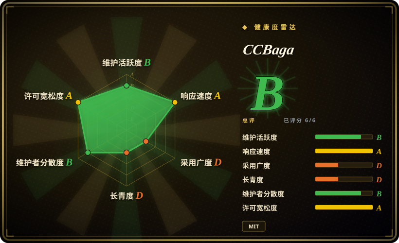
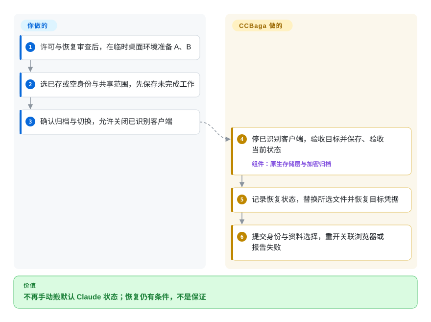
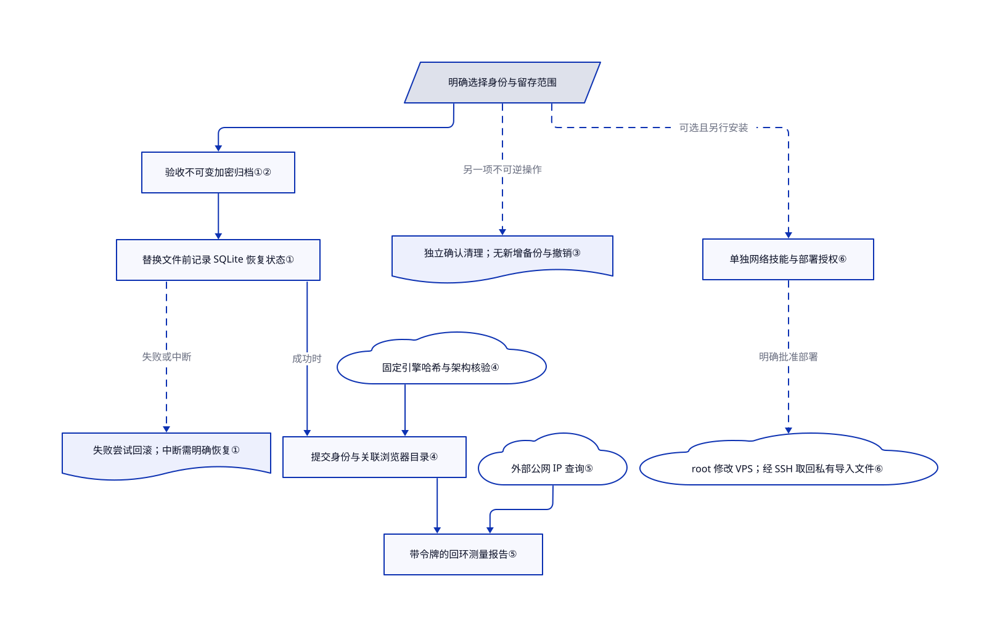

# CCBaga

切换自己的 Claude 账号后，命令行、桌面端和浏览器还混着不同身份。CCBaga 用本地快照配合独立浏览器资料目录管理这些状态，但本次核验版本仍有未修复的恢复缺陷。

**仅作选型信息收录，不批准安装或再分发。** [根 MIT](https://github.com/liseami/CCBaga/blob/bdfb90ceadfc5fae6772ffff597bddecb0b73cc3/LICENSE)只覆盖项目原作代码。[NOTICE](https://github.com/liseami/CCBaga/blob/bdfb90ceadfc5fae6772ffff597bddecb0b73cc3/NOTICE.md#vendored-interface)仍要求确认 `vendor/cromma-ui` 及其 Pika 子集的再分发许可。收录和机器许可评分都不能补齐授权。本页只静态核验公开源码 `bdfb90ceadfc5fae6772ffff597bddecb0b73cc3`，没有安装运行。

## 何时使用

你在受支持的桌面系统上管理自己有权使用的 Claude Code 和 Desktop 账号。切完身份，命令行显示一个账号，浏览器却仍带着另一个账号的会话；整目录搬走，又把本想共享的插件和对话文件一起带走。CCBaga 提供留存选项、本地加密快照、原地备份，以及可选的身份关联浏览器目录。只有问题是**本地账号状态与浏览器绑定**，而不是 API 供应商配置时，才考虑用它替代 [CC Switch](../../agent-frameworks/coding-agents/orchestration-and-review/cc-switch.zh.md)。

目前应把它当源码研究或临时样本候选，不当日常账号的唯一恢复手段。[问题 #49](https://github.com/liseami/CCBaga/issues/49)报告了 Claude 自动生成的 `debug/latest` 链接导致保存失败，以及根配置备份恢复失败。[修复 PR #50](https://github.com/liseami/CCBaga/pull/50)在 2026-10-22 仍未合并。本次源码仍保留相关拒绝路径。README 将预期用途限定为旅居或身处海外的账号所有者，并禁止违反 Anthropic 官方条款的用途。

## 何时不用

- **现在就要可靠地往返切换日常账号。** 改用官方客户端的登录流程，并另做独立备份。#49 的未修复缺陷会拒绝正常生成的路径；有恢复日志不等于任何快照都能恢复。失败后保留保险库并停止，不靠删除文件强行切换。
- **只是切模型供应商或地址。** 用 [CC Switch](../../agent-frameworks/coding-agents/orchestration-and-review/cc-switch.zh.md)，需要命令行能力则看 [Magpie](../../api-gateway/magpie-model-router.zh.md)。CCBaga 会触及账号快照，状态变更面比修改连接配置大得多。
- **要求每个再分发 UI 组件都有明确授权。** 选择另行审查的 CC Switch 等方案，或留在官方客户端。CCBaga 根 MIT 不能代替其他权利人的许可；复制或再分发 Cromma UI/Pika 前必须补证。
- **需要保证撤销或安全擦除。** 先独立备份，或保留数据。直接删除当前身份、残留清理和浏览器全清理不新增备份，也不经过废纸篓。中途失败可能留下部分删除结果；它们不承诺磁盘安全擦除，也不删除服务端记录。
- **需要匿名、新公网 IP 或绕过服务限制的授权。** 改用获准网络和官方客户端。更换指纹和绿色检测结果不授予权限，也不证明账号会被接受、DNS/WebRTC 无泄漏或不会被关联。
- **只做浏览器环境实验。** 在授权范围内考虑独立的 [Fingerprint Chromium](https://github.com/adryfish/fingerprint-chromium)，不必额外让 Claude 状态管理器接触账号存储；隐私和授权限制仍然存在。Intel macOS 和原生 Windows ARM 不在文档承诺的发布目标内，这些平台保留受支持的官方客户端。

## 横向对比

| 替代品 | 是否收录 | 我们的评价 | 取舍 |
|---|---|---|---|
| [CC Switch](../../agent-frameworks/coding-agents/orchestration-and-review/cc-switch.zh.md) | 已收录 | 要桌面供应商、MCP 和配置切换面板时选 CC Switch；只有默认 Claude 登录状态快照与关联浏览器目录才是具体需求时，才评估 CCBaga。 | 换地址不必轮换整份身份状态；CCBaga 增加了凭据和文件恢复机制，也带来当前的恢复缺陷。 |
| [Magpie](../../api-gateway/magpie-model-router.zh.md) | 已收录 | 多个 agent 要共享供应商目录，或需要无界面命令行时选 Magpie；CCBaga 管本地 Claude 状态留存，不是多 agent 模型网关。 | Magpie 引入请求路由及其订阅条款风险；CCBaga 则会关闭客户端并迁移选定本地状态。 |
| [Fingerprint Chromium](https://github.com/adryfish/fingerprint-chromium) | 未收录 | 授权浏览器指纹实验不需要 Claude 凭据管理时选独立引擎；CCBaga 增加身份与资料目录联动及宿主测量页。 | 独立引擎要自行管理启动和资料目录，上游不提供技术支持。它是真实仓库，未在本次定向两项目范围收录；CCBaga 固定引擎 148，不自动跟随最新版。 |

## 快速上手

以下说明文档路径，不是安装批准：先解决第三方许可缺口，再用临时数据核验恢复。上游分发包包含原生控制器 A 和配套浏览器 B；macOS 安装两个应用，Windows 使用一个安装器。[README](https://github.com/liseami/CCBaga/blob/bdfb90ceadfc5fae6772ffff597bddecb0b73cc3/README.md#development)的源码开发路径需要 Bun、浏览器准备脚本和 `bun run tauri dev`；准备步骤会下载且可能执行引擎，本次没有运行。在身份页选择已存或空身份，决定哪些数据继续共享，保存未完成工作后确认关闭已识别 Claude 进程与关联浏览器。应用先验收并保存当前状态，再修改所选文件、恢复目标并提交选择；独立备份、账号所有权、登录有效性和错误检查由你负责。“保存备份”只做原地快照；切换中断后使用明确的恢复操作，不把它们误当直接删除的撤销键。

<!-- flow-steps:begin (generated from flows/ccbaga.json by tools/flow_card.py — do not edit) -->

流程文字版

1. **你**：许可与恢复审查后，在临时桌面环境准备 A、B
2. **你**：选已存或空身份与共享范围，先保存未完成工作
3. **你**：确认归档与切换，允许关闭已识别客户端
4. **CCBaga**：停已识别客户端，验收目标并保存、验收当前状态 — 组件：`原生存储层与加密归档`
5. **CCBaga**：记录恢复状态，替换所选文件并恢复目标凭据
6. **CCBaga**：提交身份与资料选择，重开关联浏览器或报告失败

**价值**：不再手动搬默认 Claude 状态；恢复仍有条件，不是保证

<!-- flow-steps:end -->

## 技术要点

<!-- mechanism:begin (generated from mechanisms/ccbaga.json by tools/mechanism_card.py; do not edit) -->

机制文字版

- 明确选择身份与留存范围
- 验收不可变加密归档①②
- 替换文件前记录 SQLite 恢复状态①
- 失败尝试回滚；中断需明确恢复①
- 提交身份与关联浏览器目录④
- 固定引擎哈希与架构核验④
- 带令牌的回环测量报告⑤
- 外部公网 IP 查询⑤
- 独立确认清理；无新增备份与撤销③
- 单独网络技能与部署授权⑥
- root 修改 VPS；经 SSH 取回私有导入文件⑥

- 明确选择身份与留存范围 → 验收不可变加密归档①②
- 验收不可变加密归档①② → 替换文件前记录 SQLite 恢复状态①
- 替换文件前记录 SQLite 恢复状态① → 提交身份与关联浏览器目录④（成功时）
- 替换文件前记录 SQLite 恢复状态① → 失败尝试回滚；中断需明确恢复①（失败或中断）〔可选／兜底〕
- 固定引擎哈希与架构核验④ → 提交身份与关联浏览器目录④
- 提交身份与关联浏览器目录④ → 带令牌的回环测量报告⑤
- 外部公网 IP 查询⑤ → 带令牌的回环测量报告⑤
- 明确选择身份与留存范围 → 独立确认清理；无新增备份与撤销③（另一项不可逆操作）〔可选／兜底〕
- 明确选择身份与留存范围 → 单独网络技能与部署授权⑥（可选且另行安装）〔可选／兜底〕
- 单独网络技能与部署授权⑥ → root 修改 VPS；经 SSH 取回私有导入文件⑥（明确批准部署）〔可选／兜底〕

<!-- mechanism:end -->

### 1. 用持久恢复记录协调文件变更

- **解决：** 文件、凭据和浏览器选择不能组成一个 SQLite 原子事务。
- **做法：** 存储层先验收目标，写出并重新读取不可变的当前归档，再把归档指针与待恢复标记一起提交。清空和恢复前复核进程与文件指纹；普通失败尝试回滚，崩溃后明确恢复时先保存恢复前现状。
- **边界：** 回滚可能失败，届时留下恢复入口，不保证自动回到原状。#49 涉及的生成链接和动态备份白名单仍存在于该版本；身份提交后，浏览器重开也可能单独失败。
- **源码：** [保存与往返日志](https://github.com/liseami/CCBaga/blob/bdfb90ceadfc5fae6772ffff597bddecb0b73cc3/src-tauri/src/identities/store.rs#L452-L737)、[归档验收](https://github.com/liseami/CCBaga/blob/bdfb90ceadfc5fae6772ffff597bddecb0b73cc3/src-tauri/src/identities/archive.rs#L81-L192)、[动态白名单](https://github.com/liseami/CCBaga/blob/bdfb90ceadfc5fae6772ffff597bddecb0b73cc3/src-tauri/src/cleaner_identity.rs#L190-L229)、[浏览器收尾边界](https://github.com/liseami/CCBaga/blob/bdfb90ceadfc5fae6772ffff597bddecb0b73cc3/src-tauri/src/browser/workspaces.rs#L221-L264)。

### 2. 加密归档，不宣称隔离同用户程序

- **解决：** 登录快照可能包含凭据、对话和桌面数据库，不只是无害的账号名称。
- **做法：** tar/Zstandard 数据进入 AES-256-GCM 认证帧，每份归档生成独立数据密钥，读取时要求认证结尾。保险库把 32 字节主密钥写在目录、归档旁的 `key.bin`，靠私有权限保护。macOS 通过原生桥读取限定的 Claude 钥匙串服务；其他平台处理选定凭据文件，不批量提取 Credential Manager 密码。
- **边界：** 同用户程序和管理员仍可接触本地密钥；解包暂存区也会落地受限权限的明文。浏览器资料不在此加密范围。密码导出另用 PBKDF2-HMAC-SHA256、600000 次迭代派生密钥，只支持同系统迁移，不为 Windows Desktop 的机器绑定登录数据重新加密。
- **源码：** [认证分帧](https://github.com/liseami/CCBaga/blob/bdfb90ceadfc5fae6772ffff597bddecb0b73cc3/src-tauri/src/identities/codec.rs#L11-L165)、[本地密钥](https://github.com/liseami/CCBaga/blob/bdfb90ceadfc5fae6772ffff597bddecb0b73cc3/src-tauri/src/identities/store.rs#L41-L61)、[私有文件](https://github.com/liseami/CCBaga/blob/bdfb90ceadfc5fae6772ffff597bddecb0b73cc3/src-tauri/src/identities/private.rs#L57-L225)、[钥匙串桥](https://github.com/liseami/CCBaga/blob/bdfb90ceadfc5fae6772ffff597bddecb0b73cc3/src-tauri/native/Identity.m#L14-L90)、[迁移格式与边界](https://github.com/liseami/CCBaga/blob/bdfb90ceadfc5fae6772ffff597bddecb0b73cc3/docs/identity-storage.md#L67-L79)。

### 3. 区分快照切换与不可逆清理

- **解决：** “清理”可能实际删除历史、本地登录存储或唯一的配置备份。
- **做法：** 残留面板预览固定默认 Claude 目标，用户确认不可逆操作后才提交一次性扫描编号。界面先关闭已识别 Claude 进程，原生层再复核白名单、所有权、链接边界和完整快照，随后逐项删除或窄改 JSON。文件凭据清理只移除选定登录键，保留 MCP 和插件秘密。
- **边界：** 这不是归档切换的回滚路径：直接删除不创建备份、不经过废纸篓，执行首错即停，已完成删除保留。客户端停止流程在 800 毫秒后升级终止，先保存未完成任务。残留清理不碰钥匙串、技能、保险库和浏览器资料；直接删除当前身份是另一条更广的策略路径，可以清凭据。浏览器全清理另行删除所选完整资料目录，包含密码、密钥元数据、会话和书签。
- **源码：** [预览、确认与停进程](https://github.com/liseami/CCBaga/blob/bdfb90ceadfc5fae6772ffff597bddecb0b73cc3/src/claude-residue-panel.tsx#L28-L77)、[升级终止](https://github.com/liseami/CCBaga/blob/bdfb90ceadfc5fae6772ffff597bddecb0b73cc3/src-tauri/src/cleaner.rs#L651-L673)、[原生一次性计划](https://github.com/liseami/CCBaga/blob/bdfb90ceadfc5fae6772ffff597bddecb0b73cc3/src-tauri/src/cleaner_residue.rs#L108-L213)、[部分失败行为](https://github.com/liseami/CCBaga/blob/bdfb90ceadfc5fae6772ffff597bddecb0b73cc3/src-tauri/src/cleaner_transaction.rs#L17-L129)、[身份删除](https://github.com/liseami/CCBaga/blob/bdfb90ceadfc5fae6772ffff597bddecb0b73cc3/src-tauri/src/identities/store.rs#L354-L421)、[浏览器重置](https://github.com/liseami/CCBaga/blob/bdfb90ceadfc5fae6772ffff597bddecb0b73cc3/src-tauri/src/browser/profile.rs#L264-L359)。

### 4. 绑定浏览器目录，不伪装网页登录成功

- **解决：** 恢复 Code 登录，不会替换共享浏览器里已有的网站 Cookie。
- **做法：** 可选联动为各身份选择独立 Chromium 用户资料目录和稳定本地种子。宿主在切换前关闭精确关联的浏览器资料，恢复未完成时阻断启动。引擎准备固定 Fingerprint Chromium 148.0.7778.215，核对固定 SHA-256、平台架构与版本，再发布完整暂存副本。
- **边界：** 浏览器目录不进入加密归档，首次网页登录仍由你完成。校验和只核对选定下载字节，不证明隐私、上游安全或使用授权。浏览器迁移只带设置与种子，不含 Cookie、密码和显式代理设置；删除已存身份默认保留浏览器资料，需另选才删除。
- **源码：** [资料选择与恢复阻断](https://github.com/liseami/CCBaga/blob/bdfb90ceadfc5fae6772ffff597bddecb0b73cc3/src-tauri/src/browser/workspaces.rs#L16-L68)、[资料删除边界](https://github.com/liseami/CCBaga/blob/bdfb90ceadfc5fae6772ffff597bddecb0b73cc3/src-tauri/src/browser/workspaces.rs#L180-L219)、[固定引擎核验](https://github.com/liseami/CCBaga/blob/bdfb90ceadfc5fae6772ffff597bddecb0b73cc3/scripts/fetch-browser.py#L16-L137)、[浏览器数据边界](https://github.com/liseami/CCBaga/blob/bdfb90ceadfc5fae6772ffff597bddecb0b73cc3/docs/identity-storage.md#L53-L65)。

### 5. 把环境一致与匿名分开判断

- **解决：** 改语言或时区，不能证明浏览器观测与网络出口已经一致。
- **做法：** 随机令牌的本机回环会话提供测量页、有界上下文与报告，不暴露 Tauri 原生命令。核验器比较实测国家、时区、语言、设备、CPU、浏览器版本和定位状态；缺项或报错不通过。出口查询访问 `ipwho.is` 或 `ipapi.co`，这些服务会看到请求的公网 IP。
- **边界：** 绿色页只代表这些比较通过。DNS/WebRTC 泄漏没有独立核验；IP 定位只是估计，也不认证客户端账号一致或服务端接受。只选地区绝不会改变公网 IP。
- **源码：** [回环监听与资源边界](https://github.com/liseami/CCBaga/blob/bdfb90ceadfc5fae6772ffff597bddecb0b73cc3/src-tauri/src/browser/server.rs#L63-L113)、[有界报告](https://github.com/liseami/CCBaga/blob/bdfb90ceadfc5fae6772ffff597bddecb0b73cc3/src-tauri/src/browser/server.rs#L257-L294)、[实际通过条件](https://github.com/liseami/CCBaga/blob/bdfb90ceadfc5fae6772ffff597bddecb0b73cc3/src/browser-verification.ts#L10-L38)、[外连与限制说明](https://github.com/liseami/CCBaga/blob/bdfb90ceadfc5fae6772ffff597bddecb0b73cc3/README.md#data--permissions)。

### 6. 远端部署留给单独授权的网络技能

- **解决：** 本地维护界面不应静默取得服务器部署权限或接收 SSH 秘密。
- **做法：** 应用提供固定供应商链接与安装提示。另装的 Python/OpenSSH 技能从标准输入接收私有配置，检查用户提供的 Debian VPS 和 SOCKS 出口，部署要求 `--confirm`，产出的导入文件经 SSH 取回。
- **边界：** 该技能会以 root 修改真实服务器并下载外部 Xray 安装器，不属于本地身份切换。HTTP 订阅地址含秘密，应优先使用 SSH 取回的文件。把秘密交给 coding agent，也会受其服务商的数据处理规则约束；应用本地边界不能证明整个工作流完全本地。
- **源码：** [应用固定链接](https://github.com/liseami/CCBaga/blob/bdfb90ceadfc5fae6772ffff597bddecb0b73cc3/src-tauri/src/network_links.rs#L7-L40)、[私有配置、确认与取回](https://github.com/liseami/CCBaga/blob/bdfb90ceadfc5fae6772ffff597bddecb0b73cc3/skills/ccbaga-network/scripts/network.py#L279-L357)、[外部安装器](https://github.com/liseami/CCBaga/blob/bdfb90ceadfc5fae6772ffff597bddecb0b73cc3/skills/ccbaga-network/scripts/setup-vps.sh#L271-L297)、[HTTP 订阅](https://github.com/liseami/CCBaga/blob/bdfb90ceadfc5fae6772ffff597bddecb0b73cc3/skills/ccbaga-network/scripts/setup-vps.sh#L495-L503)。

## 技术栈

- Rust/Tauri 2 宿主；React 19/TypeScript、Vite、Tailwind、Radix、Motion 与复制的 Cromma UI 前端。
- 内嵌 SQLite 目录、tar/Zstandard 及旧 gzip 解码、`ring` 认证加密和 `zeroize` 密钥缓冲处理。
- macOS 使用 Objective-C Security/AppKit 桥，Windows 使用原生 Rust/Win32 边界。Fingerprint Chromium 与宿主网页视图分开运行。
- 独立可选网络技能使用 Python 标准库、OpenSSH、Bash 和 Xray。[依赖清单](https://github.com/liseami/CCBaga/blob/bdfb90ceadfc5fae6772ffff597bddecb0b73cc3/src-tauri/Cargo.toml)与锁文件记录版本，不需要外部数据库服务。

## 依赖

- 文档目标为 macOS 12+ **Apple Silicon**、Windows 10/11 **x86_64**，或带 GTK 3/WebKitGTK 4.1 的 Linux **x86_64**；Linux 包以 glibc 2.35 或独立的当前 Arch 构建为基础。不承诺 Intel macOS 和原生 Windows ARM 发布支持。
- 默认 Claude 本地目录和本人有权使用的账号。自定义 `CLAUDE_CONFIG_DIR` 及其他安全存储位置不自动切换。归档、本地密钥和目录数据库需要受保护磁盘空间；关联浏览器目录要另作备份规划。
- 源码开发需要 Bun/Rust 与原生工具链；Windows 使用 MSVC/WebView2，安装时可能补下载 WebView2。浏览器二进制不在 Git 中，需额外准备。
- macOS 钥匙串遵循系统授权，改时区需要管理员授权。Windows 语言包、注销登录和默认应用确认可能仍需人工处理；组织策略可能拦截安装或设置修改。参见 [Windows 边界](https://github.com/liseami/CCBaga/blob/bdfb90ceadfc5fae6772ffff597bddecb0b73cc3/docs/windows.md)。
- 本地维护不需要 VPS。可选网络技能另需获准的 Debian 12/13 VPS、root 密钥访问和住宅 SOCKS5 服务；购买、网络费用及服务器改动授权均由你承担。

## 运维难度

**临时评估为中，日常身份数据上的后果较重。** 不用运维共享数据库服务，但要一起保护本地密钥、目录数据库和归档，停止活跃客户端，另做独立备份，并在删除前审查留存范围。密码导出不提供密码找回，也不含网站会话。macOS 应用内更新只替换 A，完整 DMG 才同时更新 A、B。Windows 更新两个应用，但安装器没有 Authenticode 签名；不要为安装关闭组织安全策略。Linux 使用完整包或包管理器。本次只读这些路径，没有执行。

## 健康度与可持续性

- **维护情况，2026-10-22。** GitHub 显示 v0.2.49 于 2026-10-19 发布，2026-10-21 有推送。仓库创建仅十一天。身份缺陷未解决、修复未合并，比发版快更影响是否采用。
- **治理与支持。** 个人账号 `liseami` 持有仓库。贡献者 API 列九个账号，含依赖机器人；共计 133 次计数中所有者为 80 次。贡献指南将正式发布权保留给所有者。这不能证明有基金会或保证服务的支持组织。
- **年龄与长期性判断。** [推断：依据为十一天仓龄、近期提交和未解决的往返切换报告，没有运行实测] 应按极年轻、仍易回归的工具评估，尚无长期活跃历史支撑稳定预期。星数和分叉数表示关注，不是经验证的用户数或恢复可靠性。
- **许可风险。** 原作代码是 MIT，但 NOTICE 中 Cromma UI/Pika 再分发条款仍未确认。机器雷达读取仓库级信号；即使许可轴为 A，也不代表复制组件或浏览器完整声明清单已经通过。
- **额外风险。** 源码[安全地图](https://github.com/liseami/CCBaga/blob/bdfb90ceadfc5fae6772ffff597bddecb0b73cc3/src-tauri/SECURITY.md#已确认的上游依赖风险)承认 Linux 的 `glib 0.18.5` 命中 RUSTSEC-2024-0429，并列出 `proc-macro-error 1.0.4` 停止维护公告。测试和绿色环境页不能替代依赖及账号条款审查。

## 存疑（未验证）

- [未验证：NOTICE 明确要求补证，复制子树没有找到独立许可] Cromma UI/Pika 再分发权限及所需上游声明仍未解决。本选型页不补授权，也不批准安装、复制或再分发。
- [未验证：仅获静态核验授权，没有运行客户端、接触凭据、切换身份或执行发布二进制] 未复现中断恢复、账号往返及凭据有效性。#49 是上游报告，源码拒绝路径与其相符；核验时 #50 尚未合并，不能称为已验证修复。
- [未验证：没有获准的目标桌面、登录或网络实验] 未运行浏览器资料隔离、系统授权提示、Windows DPAPI 迁移、语言切换和真实 DNS/WebRTC 检测。导出导入成功不能证明服务端登录或网站会话可用。
- [未验证：没有下载或执行浏览器发布包] 源码存在固定哈希、版本和架构核验，但未独立核对实际交付引擎字节、完整附带许可清单或第三方浏览器安全性。
- [未验证：没有厂商授权或账号条款评估] 不声称指纹变化、代理或本地身份轮换符合某项服务合同、避免封号，或赋予隐私与匿名保证。
- [推断：仅依据年龄、公开元数据与贡献计数] 年轻项目的可持续性结论是选型判断，不是实测故障率，也不是长期支持证明。
