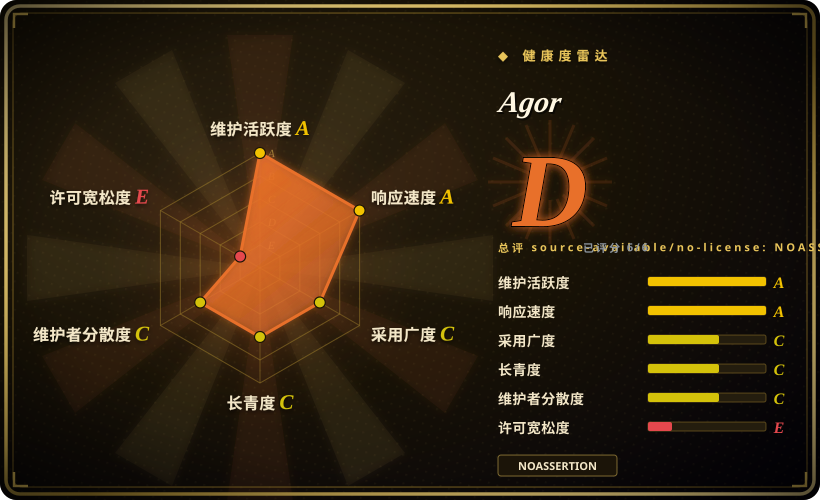
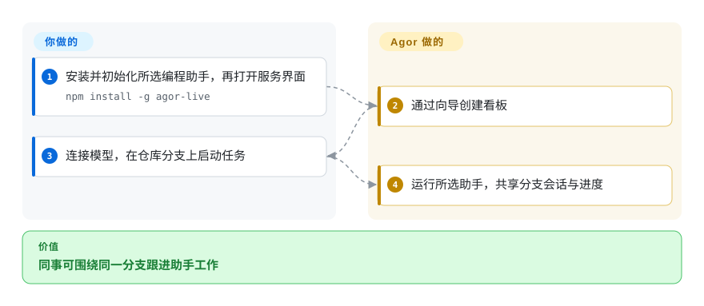
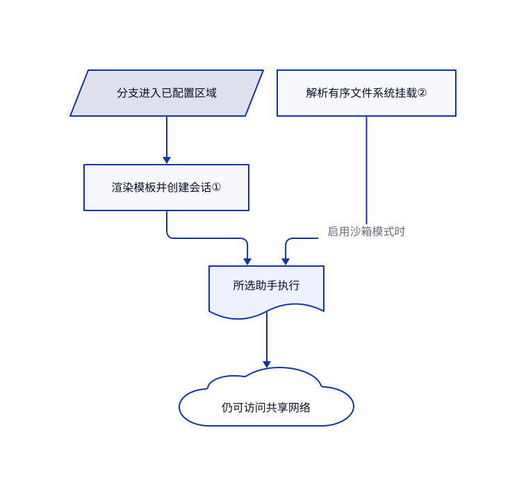

# Agor

几个同事都在跑编程助手，任务却藏在各自终端和分支里。Agor 把分支和会话放进共享实时看板，每项工作保留自己的目录与对话历史。

## 何时使用

你带一个混用多种编程助手的小团队，希望同事能跟进会话、查看分支预览，并复用同一套工作流提示词。不再传截图或共改一个目录，而是部署 Agor，用看板组织分支和对话。相比 OpenChamber，你更重视多运行时和团队可见性，而非深耕一个 OpenCode 界面；若更重视容器和明确设计的 agent 团队，则看 Scion。你仍需提供凭据、审查修改并运营控制服务。

## 何时不用

- **必须使用无限制开源许可：** Agor 在转换日前是 BSL，不属于 OSI 开源。浏览器控制台可考虑 MIT 的 [OpenHands](../../../agent-frameworks/coding-agents/orchestration-and-review/openhands.zh.md)；不要未审附加授权就转售 Agor 编排服务。
- **只有一名本地 OpenCode 操作者：** 选 [OpenChamber](../../../agent-frameworks/coding-agents/orchestration-and-review/openchamber.zh.md) 的专用审查界面，或直接用命令行；共享看板、角色和常驻服务是额外管理。
- **核心是容器中的协作团队：** 看 [Scion](../../../agent-frameworks/coding-agents/orchestration-and-review/scion.zh.md)，其 Hub 与运行代理明确描述运行位置和工作区共享。
- **把独立分支当作恶意租户隔离：** 应审查执行基础设施，不能只靠 worktree。所读 Linux 沙箱共享网络，还刻意开放部分主目录写入；若只是受限 GitHub 杂务，可看 [gh-aw](../../../agent-frameworks/coding-agents/orchestration-and-review/gh-aw.zh.md) 的另一种写权限模型。

## 横向对比

| 替代品 | 是否收录 | 我们的评价 | 取舍 |
|---|---|---|---|
| [OpenHands](../../../agent-frameworks/coding-agents/orchestration-and-review/openhands.zh.md) | ✅ | 跨本地与远端运行环境的浏览器控制台，选 OpenHands；同事围绕分支共享空间化流程，选 Agor。 | Agor 增加看板、区域、队友和共享知识，但要运营更大的协作系统，并接受 BSL。 |
| [OpenChamber](../../../agent-frameworks/coding-agents/orchestration-and-review/openchamber.zh.md) | ✅ | 一名操作者固定用 OpenCode，并重视细致差异审查，选 OpenChamber；多人参与且混用运行时，选 Agor。 | 专用 OpenCode 界面更小；Agor 增加身份、共享状态和适配成本。 |
| [Scion](../../../agent-frameworks/coding-agents/orchestration-and-review/scion.zh.md) | ✅ | 要在容器主机设计混合助手团队，选 Scion；用实时看板和人工参与组织工作，选 Agor。 | Scion 重点是运行代理和工作区策略；Agor 重点是分支、会话和可复用区域触发。 |

## 快速上手

README 通过 npm 全局安装 `agor-live`，再执行 `agor init`、`agor daemon start` 和 `agor open`。需要 Node.js 22.12 及以上与 Git；发布包明确排除原生 Windows。初始化会安装你主动选择的编程助手，网页向导连接模型凭据并建立看板。加入仓库分支并启动会话后，Agor 管理工作目录、传递进度和提供共享预览，底层助手负责改代码。你承担模型费用、仓库授权、安全配置与最终审查；看板不等于自动批准合并。

<!-- flow-steps:begin (generated from flows/agor.json by tools/flow_card.py — do not edit) -->

流程文字版

1. **你**：安装并初始化所选编程助手，再打开服务界面 — `npm install -g agor-live`
2. **Agor**：通过向导创建看板
3. **你**：连接模型，在仓库分支上启动任务
4. **Agor**：运行所选助手，共享分支会话与进度

**价值**：同事可围绕同一分支跟进助手工作

<!-- flow-steps:end -->

## 技术要点

<!-- mechanism:begin (generated from mechanisms/agor.json by tools/mechanism_card.py; do not edit) -->

机制文字版

- 分支进入已配置区域
- 渲染模板并创建会话①
- 解析有序文件系统挂载②
- 所选助手执行
- 仍可访问共享网络

- 分支进入已配置区域 → 渲染模板并创建会话①
- 渲染模板并创建会话① → 所选助手执行
- 解析有序文件系统挂载② → 所选助手执行（启用沙箱模式时）
- 所选助手执行 → 仍可访问共享网络

<!-- mechanism:end -->

### 1. 将看板区域变成真实会话触发器

- **解决：** 如果进入“审查”区域后还要手动复制提示词，拖动卡片就只是装饰。
- **做法：** 共用区域助手将分支、看板和区域数据代入模板，拒绝空提示词，在该分支创建会话，再提交任务。界面和 MCP 入口复用此实现。
- **边界：** 该助手要求 `always_new` 行为和有效运行时。启动审查会话不代表审查通过，下游失败仍需处理。
- **源码：** [区域触发器](https://github.com/preset-io/agor/blob/68cc270c5a77f34ce551a9848f9fa6b61b983750/apps/agor-daemon/src/services/zone-trigger.ts#L1-L126)。

### 2. 将文件系统策略变成有序 Linux 挂载

- **解决：** 只换工作目录，拦不住助手读取邻接分支或凭据文件。
- **做法：** 策略解析器生成 bubblewrap 参数，先只读根目录，再开放指定分支写入，最后遮盖秘密。按用户隔离时覆盖私有主目录，缺少所属用户存储就报错，不退回共享目录。
- **边界：** 网络仍共享；宿主禁止嵌套进程空间时，进程隔离可以降级。解析器默认值不能证明部署启用了预期执行模式，可写的工具状态目录也仍承载权限。
- **源码：** [沙箱策略与挂载顺序](https://github.com/preset-io/agor/blob/68cc270c5a77f34ce551a9848f9fa6b61b983750/packages/core/src/config/sandbox-policy.ts#L1-L223)、[私有主目录覆盖](https://github.com/preset-io/agor/blob/68cc270c5a77f34ce551a9848f9fa6b61b983750/packages/core/src/config/sandbox-policy.ts#L234-L365)。

## 技术栈

TypeScript 单仓库，FeathersJS 常驻服务，React 与 React Flow 界面，oclif 命令行，Drizzle 配 LibSQL 或 PostgreSQL，独立进程执行器和编程助手 SDK 适配。Node.js 22.12 及以上；源码开发需要 pnpm，发布包安装不一定需要。

## 依赖

Git 与仓库认证；所选编程助手及模型账号；持久数据库和工作目录。Linux 文件系统沙箱需要 bubblewrap 与兼容的宿主命名空间。团队或托管部署可能另需 PostgreSQL、反向代理、身份服务和委派执行基础设施。

## 运维难度

**单人中，团队高。** 本地数据库和常驻服务容易起步。共享服务增加权限、凭据、SDK 版本兼容、分支回收、端口分配、执行隔离和备份恢复工作。不要把文档里的开发默认账号暴露成生产服务。

## 健康度与可持续性

- **2026-10-18：** 默认分支持续更新；源码包和 [npm 注册表](https://registry.npmjs.org/agor-live/latest) 均为 0.27.0，GitHub Releases 最新却为 3 月的 v0.15.0。只看 Releases 会低估开发活动。
- 创建于 2025 年 10 月，约一年，仍活跃，但林迪历史短。Preset 持有许可证与路线控制权，可见提交以 `mistercrunch` 为主。
- BSL 附加授权允许内部商用，但禁止将 Agor 自身的编排功能作为商业产品向第三方提供。条款规定在 2029 年 1 月 15 日或该版本首次公开四周年时转 Apache-2.0，以较早者为准。
- 仓库包含大量测试与边界检查；存在测试不等于多用户隔离认证。

## 存疑（未验证）

- [未验证：本次仅静态阅读，未启动上游服务] 未实测多人协作、各运行时功能一致性和沙箱抗绕过。
