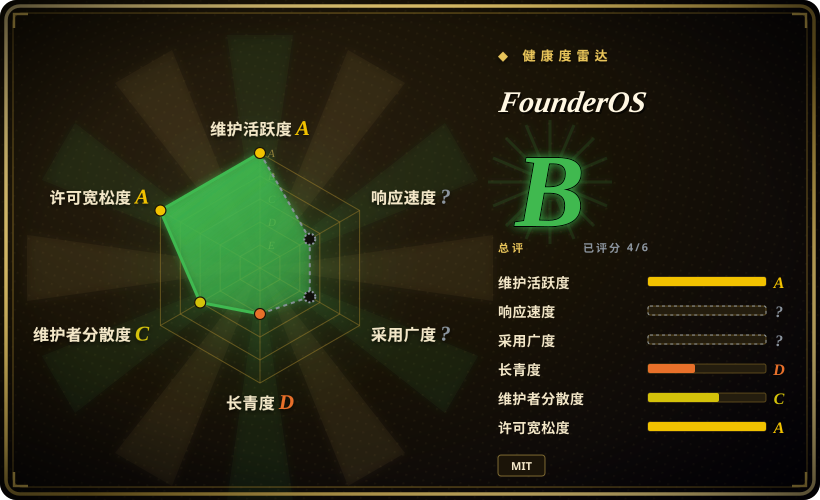
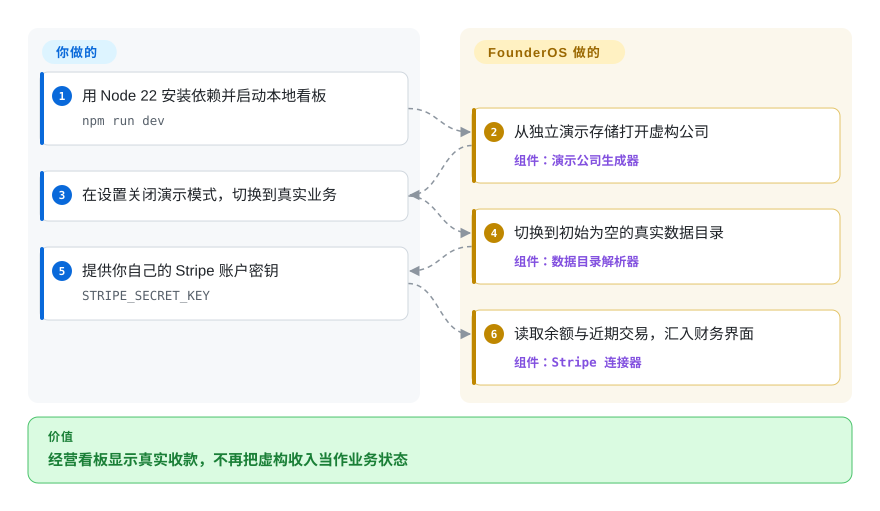
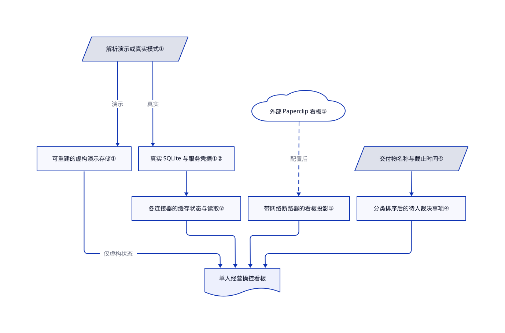

# FounderOS

你要查一笔收款、一封待回客户邮件和一个卡住的 agent 任务，却得来回切三个界面。FounderOS 把这些信息放进本地经营看板；但首次启动的公司是虚构的，真实 agent 仍需另接执行后端。

## 何时使用

你独自经营咨询或内容业务。给客户回信前，你先翻收件箱，再开 Stripe 查收款，还要问哪个 agent 已经写好草稿。你希望保留已有服务，只加一个私有界面，集中查看沟通、收入、内容和 agent 工作。FounderOS 提供本地 SQLite 数据与服务连接器上的界面；账号、凭据和真正执行工作的服务仍由你提供。

如果你不仅要派 agent，还要把任务板和经营信息放在一起，可以选它而不只用 Paperclip。如果只有一个操作者，想跑一个本地 Node 进程，而不是把整个团队迁入新工作区，可以选它而不是 Macro。核心取舍是丰富、可修改的操控界面，而不是一家公司开箱即自动运转；多个具名 agent 实际只检查现有服务，或报告尚未配置。

## 何时不用

- **你期待安装后，演示中的二十二名 agent 就开始干真活。** 用 [Paperclip](paperclip.zh.md) 接你已安装和配置的 agent。FounderOS 的真实 `/agents` 页面读取独立的 Paperclip 看板；内建运行时也有状态探针和明确未实现的任务，不是二十二名现成雇员。
- **你要的是跨服务的重复操作，不是查看经营状态。** 用 [n8n](../../../workflow-orchestration/n8n.zh.md) 组合触发器、连接器和执行记录。FounderOS 汇总业务视图；连接器亮绿，不代表工作流或每家支付服务的客户端都已实现。
- **多人需要各自账号与共享权限。** 评估 [Macro](../../../team-chat/macro.zh.md)，并接受更重的自托管栈。FounderOS 文档只有一个操作者密码，没有按人划分的账号与角色。
- **你需要平稳升级，或必须保留 v2 技术栈。** 评估期间继续用现有 n8n 工作流或 Paperclip 看板。仓库在十月十日从 Next.js 换成 Go／SvelteKit，又在十月二十日换回 Next.js；v2 留在标签里，不是当前架构。
- **你要求看板绝对只读，不能借用宿主已有凭据。** 用仅注入明确凭据的窄 n8n 集成。FounderOS 会从用户主目录文件回读部分密钥，沟通回复接口可向 Slack 或 WhatsApp 发送消息，而且不检查 `GLADOS_WRITES`；该开关不是全局只读保证。

## 横向对比

| 替代品 | 是否收录 | 我们的评价 | 取舍 |
|---|---|---|---|
| [Paperclip](paperclip.zh.md) | 已收录 | 瓶颈是 agent 调度、工单归属和预算时，选 Paperclip；需要把该看板与收入、收件箱和内容视图放在一起时，选 FounderOS。 | Paperclip 运营已有 agent；FounderOS 能读取同一个看板，两者可以叠用而非替换。更宽的界面也增加连接器与凭据运维。 |
| [n8n](../../../workflow-orchestration/n8n.zh.md) | 已收录 | 业务事件必须依次调用多个 API 时，选 n8n；一个人主要想查看和引导多个业务领域时，选 FounderOS。 | n8n 提供显式自动化画布与逐节点执行记录，但采用 fair-code 许可；FounderOS 根许可为 MIT，界面围绕经营组织，不过各集成的完成度不一致。 |
| [Macro](../../../team-chat/macro.zh.md) | 已收录 | 同事要共享互相链接的邮件、任务与文档时，选 Macro；单人想在已有工具上加一个较小的本地看板时，选 FounderOS。 | Macro 带来协作数据和明显更重的 AGPL 服务栈；FounderOS 是本地 SQLite 应用加单一密码，不提供团队身份模型。 |

## 快速上手

在已取到的源码目录中使用 Node 22，执行 `npm install`，再运行 `npm run dev`，打开 `http://localhost:4100`；CI 也使用 Node 22。初始界面来自 `demo-data/` 里的虚构公司，不是你的业务。在 Settings 中关闭 Filming mode，切到初始为空的 `data/`，再为所需服务提供凭据；例如 `STRIPE_SECRET_KEY` 让财务连接器读取余额与交易。FounderOS 负责拼装界面；API 权限、服务费用、备份，以及真实 agent 背后的 Paperclip 看板由你负责。远程访问前，先在 Settings → Security 设置操作者密码，再按预期监听地址重启；要使用构建后的应用，运行 `npm run preview`，不要拿开发时的首次编译速度作判断。

<!-- flow-steps:begin (generated from flows/founderos.json by tools/flow_card.py — do not edit) -->

流程文字版

1. **你**：用 Node 22 安装依赖并启动本地看板 — `npm run dev`
2. **FounderOS**：从独立演示存储打开虚构公司 — 组件：`演示公司生成器`
3. **你**：在设置关闭演示模式，切换到真实业务
4. **FounderOS**：切换到初始为空的真实数据目录 — 组件：`数据目录解析器`
5. **你**：提供你自己的 Stripe 账户密钥 — `STRIPE_SECRET_KEY`
6. **FounderOS**：读取余额与近期交易，汇入财务界面 — 组件：`Stripe 连接器`

**价值**：经营看板显示真实收款，不再把虚构收入当作业务状态

<!-- flow-steps:end -->

## 技术要点

<!-- mechanism:begin (generated from mechanisms/founderos.json by tools/mechanism_card.py; do not edit) -->

机制文字版

- 解析演示或真实模式①
- 可重建的虚构演示存储①
- 真实 SQLite 与服务凭据①②
- 各连接器的缓存状态与读取②
- 外部 Paperclip 看板③
- 带网络断路器的看板投影③
- 交付物名称与截止时间④
- 分类排序后的待人裁决事项④
- 单人经营操控看板

- 解析演示或真实模式① → 可重建的虚构演示存储①（演示）
- 解析演示或真实模式① → 真实 SQLite 与服务凭据①②（真实）
- 真实 SQLite 与服务凭据①② → 各连接器的缓存状态与读取②
- 各连接器的缓存状态与读取② → 单人经营操控看板
- 可重建的虚构演示存储① → 单人经营操控看板（仅虚构状态）
- 外部 Paperclip 看板③ → 带网络断路器的看板投影③（配置后）〔可选／兜底〕
- 带网络断路器的看板投影③ → 单人经营操控看板
- 交付物名称与截止时间④ → 分类排序后的待人裁决事项④
- 分类排序后的待人裁决事项④ → 单人经营操控看板

<!-- mechanism:end -->

### 1. 切换数据目录，不向真实记录灌入演示数据

- **解决：** 演示如果和真实业务共用存储，虚构收入与客户历史就会混入账本。
- **做法：** 模式解析器选择 `demo-data/` 或 `data/`；演示生成器把日期移到当前时间，每隔一周重建自己的目录。种子数据保护器拒绝普通的真实数据路径。
- **边界：** 演示中的修改随时可能被重建覆盖。代码提供路径与种子保护覆盖选项；这是带保护的存储约定，不是能防恶意代码或操作者覆盖的沙箱。
- **源码：** [模式与种子保护](https://github.com/Bennettxai/FounderOS/blob/fb974bfcdf529cb6c8faeb1473d561d26e3d103a/lib/paths.ts#L12-L90)、[演示重建](https://github.com/Bennettxai/FounderOS/blob/fb974bfcdf529cb6c8faeb1473d561d26e3d103a/lib/demo/store.ts#L62-L101)。

### 2. 区分缺凭据与读取失败，但逐项检查绿灯含义

- **解决：** 精美看板容易让尚未完成的集成看起来已经可用。
- **做法：** 连接器注册表汇总各服务状态，把检查异常变成错误。多个页面共享缓存检查结果，保存密钥会让缓存失效。Stripe 状态真的读取余额；缺少凭据会返回 `not_configured`。
- **边界：** 检查力度并不一致：LLM 有密钥就报告 `connected`，非 Stripe 支付状态可能仅表示已配置。演示模式使用合成状态。绿灯不是端到端验证证据。
- **源码：** [注册表与缓存](https://github.com/Bennettxai/FounderOS/blob/fb974bfcdf529cb6c8faeb1473d561d26e3d103a/lib/connectors/index.ts#L89-L126)、[凭据优先级与失效](https://github.com/Bennettxai/FounderOS/blob/fb974bfcdf529cb6c8faeb1473d561d26e3d103a/lib/creds.ts#L76-L158)、[支付检查](https://github.com/Bennettxai/FounderOS/blob/fb974bfcdf529cb6c8faeb1473d561d26e3d103a/lib/connectors/payments.ts#L202-L248)、[LLM 状态](https://github.com/Bennettxai/FounderOS/blob/fb974bfcdf529cb6c8faeb1473d561d26e3d103a/lib/connectors/llm.ts#L130-L143)。

### 3. 把独立 agent 看板投影到经营界面

- **解决：** 业务背景与真实 agent 执行历史分散在不同应用里。
- **做法：** 真实 agent 页面用看板密钥和公司标识，读取 Paperclip 的 agent、工单与心跳运行记录。网络失败会打开三十秒断路器，在看板不可达时暂时阻止重复请求。
- **边界：** 渲染 Paperclip 并不等于内置其执行引擎。列表读取失败时返回空数组，因此空界面本身不能区分没有工作和后端故障；状态检查走另一条路径。
- **源码：** [页面组合](https://github.com/Bennettxai/FounderOS/blob/fb974bfcdf529cb6c8faeb1473d561d26e3d103a/app/agents/page.tsx#L27-L46)、[看板凭据、断路器与读取](https://github.com/Bennettxai/FounderOS/blob/fb974bfcdf529cb6c8faeb1473d561d26e3d103a/founderos/lib/connectors/paperclip.ts#L189-L295)、[状态核验](https://github.com/Bennettxai/FounderOS/blob/fb974bfcdf529cb6c8faeb1473d561d26e3d103a/founderos/lib/connectors/paperclip.ts#L495-L529)。

### 4. 把具名交付物变成待人裁决队列

- **解决：** 平铺文件列表里，已完成报告和等待批准的回复看起来一样。
- **做法：** 分类器识别文件名中的 `STAGED`、`decision`、`draft` 等标记，完成标记优先。带截止时间的文件会升级成请求；排序依次照顾逾期事项、正在等待的人和未来截止时间，再放普通阻塞任务。
- **边界：** 分类器依赖命名约定与文件日期。这是确定性的展示队列，不是模型推理、权限执行，也不能证明批准文档后会安全完成按钮所述动作。
- **源码：** [分类与排序](https://github.com/Bennettxai/FounderOS/blob/fb974bfcdf529cb6c8faeb1473d561d26e3d103a/founderos/lib/board-approvals.ts#L97-L211)。

## 技术栈

- TypeScript、Next.js 14 App Router、React 18、Tailwind CSS 3；当前代码不是 Go／SvelteKit 的 v2。
- 通过 `better-sqlite3` 使用本地 SQLite，Zod 校验记录；图谱界面使用 D3 力导向布局。
- 连接器使用 IMAP／SMTP 库与服务 SDK；agent 聊天使用 Vercel AI SDK 的网关。有 Vitest 测试和 Node 22 CI 工作流。
- 来源：[依赖清单](https://github.com/Bennettxai/FounderOS/blob/fb974bfcdf529cb6c8faeb1473d561d26e3d103a/package.json)、[CI](https://github.com/Bennettxai/FounderOS/blob/fb974bfcdf529cb6c8faeb1473d561d26e3d103a/.github/workflows/ci.yml)。

## 依赖

- 此处最稳妥的文档基线是 Node 22 与 npm。README 写 Node 22 或更新版本，但当前清单又声明 `better-sqlite3` 11；[PR #10](https://github.com/Bennettxai/FounderOS/pull/10) 记录该大版本缺 Node 24 预构建包。不要假定旧版已合并的升级在 v3 换底座后仍然存在。
- 可写的本地 SQLite 与文件目录；基础看板不需独立数据库服务器。保护 `.env.local`，备份真实数据目录。
- 每个真实服务都要单独账号与凭据。网关聊天需要 `AI_GATEWAY_API_KEY`；真实 agent 看板需要独立运行的 Paperclip，以及 `PAPERCLIP_API_URL`、`PAPERCLIP_BOARD_KEY`、`PAPERCLIP_COMPANY_ID`。
- 可选知识搜索使用 gbrain CLI 与 Markdown 存储，缺少 CLI 时可退回纯文本搜索。其他功能可能依赖本地守护进程、发送程序或付费内容 API，不会全部随仓库安装。见[环境变量清单](https://github.com/Bennettxai/FounderOS/blob/fb974bfcdf529cb6c8faeb1473d561d26e3d103a/.env.example)。

## 运维难度

**看演示低，运营真实业务中到高。** 基础进程和 SQLite 很小。负担在于提供服务权限、核对哪些连接器真的读取数据、维护可选守护进程，以及保护可能从项目外解析的凭据。定时任务要求单台常开主机，`GLADOS_CRON` 默认关闭。`GLADOS_WRITES` 只保护部分启动路径，不覆盖每个发送接口；授予敏感密钥前必须检查具体路由。首次评估留在回环地址；若不能让应用接触主目录已有凭据，用隔离的系统账号。

来源：[操作开关](https://github.com/Bennettxai/FounderOS/blob/fb974bfcdf529cb6c8faeb1473d561d26e3d103a/lib/gates.ts#L1-L40)、[凭据回读](https://github.com/Bennettxai/FounderOS/blob/fb974bfcdf529cb6c8faeb1473d561d26e3d103a/lib/creds.ts#L42-L51)、[回复接口](https://github.com/Bennettxai/FounderOS/blob/fb974bfcdf529cb6c8faeb1473d561d26e3d103a/app/api/comms/reply/route.ts#L29-L51)、[监听保护](https://github.com/Bennettxai/FounderOS/blob/fb974bfcdf529cb6c8faeb1473d561d26e3d103a/scripts/serve.mjs#L68-L80)。

## 健康度与可持续性

- **维护，2026-10-21：** 最近推送为十月二十日，没有已发布的 GitHub release。十月十日与二十日的提交都更换了底层技术栈；应钉住提交，按版本理解旧 issue 和说明，不把它们当作当前保证。
- **所有权：** 仓库由个人账号持有。贡献者 API 列出 Bennettxai 的 11 次贡献、brodyautomates 的 2 次、XJJelley 的 1 次。Brody 也提交了已合并的 [GladOS 移植 PR](https://github.com/Bennettxai/FounderOS/pull/15)。README 链接商业教学营，不是基金会治理流程。
- **年龄与采用：** 建仓于 2026-07-07，核验时约三个半月；1,218 个 star 和 336 个 fork 只能衡量关注，不能证明多少企业真在用。[推断：依据建仓日期与两次换底座提交] 项目活跃，但太年轻且架构未稳，不足以积累强持久性先验；宜当作可改造的操作者界面，而不是稳定经营平台。
- **许可与来源：** 根 [LICENSE](https://github.com/Bennettxai/FounderOS/blob/fb974bfcdf529cb6c8faeb1473d561d26e3d103a/LICENSE) 为 MIT，版权署名是 2026 FounderOS。[v3 导入提交](https://github.com/Bennettxai/FounderOS/commit/042c3fe4341eecf5488f5720cdc1deb69df23aad) 指明底座为 `brodyautomates/glados d8daf67`。[未验证：该源仓库及指定 tree 的 GitHub API 均返回 404] 无法独立比对原始许可和文件对象；商业再分发前应核实继承权利。
- **实测健康度：** 自动雷达覆盖六轴中的四轴。响应速度没有可评分的抽样窗口（`no_window_signal`），采用度没有包信号（`no_package_structural`）；未知不代表质量差。许可轴测的是检测到的 MIT 声明，不能证明不可访问底座的权利。

## 存疑（未验证）

- [未验证：按本批次要求只读上游，未安装或运行] 真实连接器、完整测试集、远程访问控制与页面渲染只做了源码检查，没有实际执行；不作运行效果或生产就绪承诺。
- [未验证：`gh api repos/brodyautomates/glados` 及指定 tree 返回 404] 无法按文件对象 SHA 或原始许可核对声明的 GladOS 底座。PR #15 能证明公开协作，但不能替代独立许可审计。
- [推断：依据仓库年龄、提交历史和现有集成边界，未观察长期部署] 把它作为可修改的个人看板，而非持久自治公司的建议，是选型判断，不是测得的故障率。
