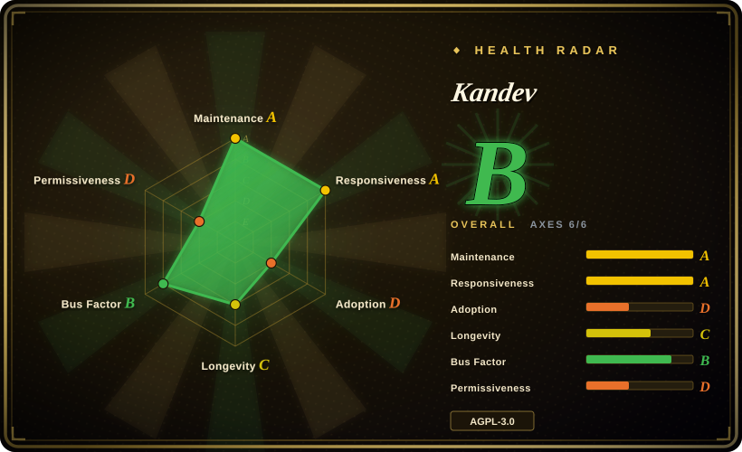
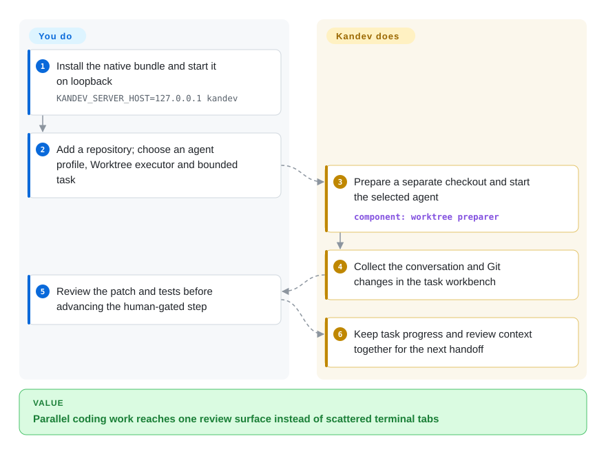
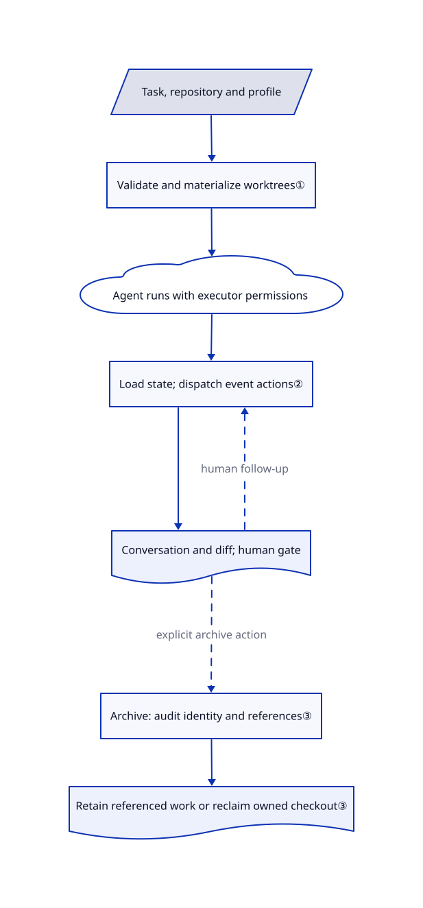

# Kandev

Three coding agents finish on different branches, and you keep switching terminals to find the patch that needs review. Kandev puts each task's conversation, checkout, diff and review step in one browser workbench.

## When to use

You maintain several repositories and run Claude Code, Codex or another supported coding CLI in parallel. One task needs a plan approved before implementation; another needs a follow-up on its diff. You want those handoffs recorded as task steps rather than remembered across terminal tabs. Choose Kandev when you need a server-first review workbench with configurable step actions and a choice of host worktrees, containers or remote execution, rather than a desktop-only supervisor or a browser mirror of existing CLI sessions.

You supply the repository, agent credentials and acceptance criteria. Kandev prepares the selected environment and brings the conversation, editor, terminal and Git changes together. Keep a human-controlled Review step: an agent finishing a turn does not establish that tests passed or a merge was authorized. The reviewed implementation is main at `b6263ea4c3165c86ec60e29e798475ad552ad6ce`, newer than the latest stable release.

## When NOT to use

- **You only want to reach one existing CLI session from a phone.** Prefer [CloudCLI](claudecodeui.md); task workflows, executor profiles and environment lifecycle add machinery you do not need.
- **You want a desktop-native parallel coding supervisor under a permissive license.** Prefer [Agent Orchestrator](agent-orchestrator.md). Kandev's npm manifest explicitly selects AGPL-3.0-only; the [actual license](https://github.com/kdlbs/kandev/blob/b6263ea4c3165c86ec60e29e798475ad552ad6ce/LICENSE#L540-L559) requires a modified network-interactive version to offer its corresponding source to remote users.
- **You need standing business teams with recurring work and budgets, not primarily branch review.** Compare [Paperclip](paperclip.md). Kandev's Office autonomy layer is experimental and disabled by default in production; do not select it as an established organization-management contract.
- **You need an execution security boundary for hostile code.** Start with [OpenSandbox](../../../sandboxing/opensandbox.md) and validate its configured isolation. Kandev worktrees separate checkout state, not host credentials, processes or network access. Its [security guide](https://github.com/kdlbs/kandev/blob/b6263ea4c3165c86ec60e29e798475ad552ad6ce/docs/public/security.md#L19-L56) says the default bind is `0.0.0.0` and authentication is opt-in; never publish a plain default instance.

## Comparison

| Alternative | In index | Our verdict | Tradeoff |
|---|---|---|---|
| [Agent Orchestrator](agent-orchestrator.md) | Indexed | Pick Agent Orchestrator for a desktop worktree supervisor and CI/review feedback routing; pick Kandev when a self-hosted browser workbench and configurable remote executors decide the choice. | Desktop packaging and Apache-2.0 versus a server-first AGPL application whose network and executor boundaries you operate. |
| [CloudCLI](claudecodeui.md) | Indexed | Pick CloudCLI to reach your existing coding CLI sessions remotely; pick Kandev when tasks must carry their own workflow steps, review gates and execution environments. | Less task-lifecycle machinery versus an integrated task board, environment preparation and branch review. |
| [Paperclip](paperclip.md) | Indexed | Pick Paperclip for a persistent organization of agents with heartbeats and budgets; pick Kandev when the deliverable is a patch you inspect in a coding workbench. | Organization-level controls versus conversations, diffs and per-task executors; Kandev Office remains experimental. |

## Quick start

The README documents `brew install kdlbs/kandev/kandev`; launch the installed binary with `KANDEV_SERVER_HOST=127.0.0.1 kandev`, the safer bind shown in the security guide. In the browser, add a workspace repository and configure a compatible agent profile with your own provider access. Create a bounded task, choose the Worktree executor, and start the agent; a worktree is a separate checkout, not a sandbox. Kandev prepares the checkout and displays the agent's work and diff while you supply tests and decide whether to advance the task. Configure Review to wait for a user, and commit and push anything valuable before archiving, because archive cleanup can delete even ignored and untracked files. This path was checked in documentation and source, not installed or executed during this review.

<!-- flow-steps:begin (generated from flows/kandev.json by tools/flow_card.py — do not edit) -->

Text version of the flow

1. **You**: Install the native bundle and start it on loopback — `KANDEV_SERVER_HOST=127.0.0.1 kandev`
2. **You**: Add a repository; choose an agent profile, Worktree executor and bounded task
3. **Kandev**: Prepare a separate checkout and start the selected agent — component: `worktree preparer`
4. **Kandev**: Collect the conversation and Git changes in the task workbench
5. **You**: Review the patch and tests before advancing the human-gated step
6. **Kandev**: Keep task progress and review context together for the next handoff

**Value**: Parallel coding work reaches one review surface instead of scattered terminal tabs

<!-- flow-steps:end -->

## Key techniques

<!-- mechanism:begin (generated from mechanisms/kandev.json by tools/mechanism_card.py; do not edit) -->

Text version of the mechanism

- Task, repository and profile
- Validate and materialize worktrees①
- Agent runs with executor permissions
- Load state; dispatch event actions②
- Conversation and diff; human gate
- Archive: audit identity and references③
- Retain referenced work or reclaim owned checkout③

- Task, repository and profile → Validate and materialize worktrees①
- Validate and materialize worktrees① → Agent runs with executor permissions
- Agent runs with executor permissions → Load state; dispatch event actions②
- Load state; dispatch event actions② → Conversation and diff; human gate
- Conversation and diff; human gate → Load state; dispatch event actions② (human follow-up) [optional/fallback]
- Conversation and diff; human gate → Archive: audit identity and references③ (explicit archive action) [optional/fallback]
- Archive: audit identity and references③ → Retain referenced work or reclaim owned checkout③

<!-- mechanism:end -->

### 1. Materialize a task environment before starting the agent

- **Problem:** Parallel agents editing one checkout interfere with each other's branches and files.
- **How:** The worktree preparer validates the repository, delegates checkout creation to the worktree manager, and returns the worktree path, branch and identity to the runtime. Multi-repository preparation records one worktree per attachment and attempts rollback after a partial failure.
- **Limits:** This is checkout isolation only. Repository setup scripts execute on the host; a failed setup can be surfaced as a warning while the agent still starts, and multi-repository preparation skips the profile-level task setup script.
- **Source:** [Preparation and returned identity](https://github.com/kdlbs/kandev/blob/b6263ea4c3165c86ec60e29e798475ad552ad6ce/apps/backend/internal/agent/runtime/lifecycle/env_preparer_worktree.go#L58-L177), [multi-repository preparation](https://github.com/kdlbs/kandev/blob/b6263ea4c3165c86ec60e29e798475ad552ad6ce/apps/backend/internal/agent/runtime/lifecycle/env_preparer_worktree.go#L431-L565), [nonfatal repository setup](https://github.com/kdlbs/kandev/blob/b6263ea4c3165c86ec60e29e798475ad552ad6ce/apps/backend/internal/worktree/manager_cleanup.go#L418-L465).

### 2. Drive workflow actions from persisted task state and events

- **Problem:** A completed agent turn and a human-approved next step are different events, but a terminal transcript tends to blur them.
- **How:** The engine loads the current task/session and step, selects actions for the trigger, runs callbacks, and persists data and transitions. A supplied operation identifier lets it skip previously marked work; evaluation-only transitions defer the operation marker to the caller that owes the commit.
- **Limits:** Do not read that marker as exactly-once shell execution or proof of code quality. The workflow configuration controls advancement; a human gate must explicitly wait for a user rather than automatically move on turn completion.
- **Source:** [Trigger handling and deferred markers](https://github.com/kdlbs/kandev/blob/b6263ea4c3165c86ec60e29e798475ad552ad6ce/apps/backend/internal/workflow/engine/engine.go#L267-L424), [action evaluation](https://github.com/kdlbs/kandev/blob/b6263ea4c3165c86ec60e29e798475ad552ad6ce/apps/backend/internal/workflow/engine/engine.go#L452-L515), [human-gate configuration](https://github.com/kdlbs/kandev/blob/b6263ea4c3165c86ec60e29e798475ad552ad6ce/docs/public/security.md#L157-L171).

### 3. Audit ownership and references before reclaiming a worktree

- **Problem:** A task can share an environment or retain unpublished work; deleting a directory by its displayed path can destroy another task's files.
- **How:** Cleanup snapshots the worktree record, acquires path and repository locks, checks inventory identity, active references and retention, then audits before executing repository cleanup and removal. Referenced worktrees are retained; successful removal emits a branch-cleanup receipt.
- **Limits:** Ownership protection does not preserve every local edit: archive explicitly discards staged, unstaged, untracked and ignored files in owned checkouts. Cleanup-script failure does not prevent deletion, and archive completion is separate from asynchronous resource cleanup.
- **Source:** [Audited cleanup and reference retention](https://github.com/kdlbs/kandev/blob/b6263ea4c3165c86ec60e29e798475ad552ad6ce/apps/backend/internal/worktree/manager_cleanup.go#L244-L381), [cleanup scripts](https://github.com/kdlbs/kandev/blob/b6263ea4c3165c86ec60e29e798475ad552ad6ce/apps/backend/internal/worktree/manager_cleanup.go#L468-L503), [archive data-loss contract](https://github.com/kdlbs/kandev/blob/b6263ea4c3165c86ec60e29e798475ad552ad6ce/docs/public/tasks-and-workflows.md#L1078-L1111).

## Tech stack

- Go 1.26 backend with Gin, WebSockets, ACP integration, SQLite and optional PostgreSQL support in the dependency manifest.
- React 19, TypeScript, Vite, Zustand, Monaco/CodeMirror and xterm frontend; compiled web assets are embedded in the native Go distribution. A Tauri desktop shell and npm native-runtime selector are alternative packaging.
- Source evidence: [Go manifest](https://github.com/kdlbs/kandev/blob/b6263ea4c3165c86ec60e29e798475ad552ad6ce/apps/backend/go.mod), [web manifest](https://github.com/kdlbs/kandev/blob/b6263ea4c3165c86ec60e29e798475ad552ad6ce/apps/web/package.json), [distribution](https://github.com/kdlbs/kandev/blob/b6263ea4c3165c86ec60e29e798475ad552ad6ce/README.md#L24-L34).

## Dependencies

- Native application bundle, Git, writable state storage, and authenticated supported agent runtimes. Model subscriptions/API usage remain your cost. The native server does not require Node; npm/npx launch does.
- Docker, Kubernetes, SSH or Sprites infrastructure only for those execution modes. Protect their credentials separately from Kandev application login.
- The default state directory is `~/.kandev`, including worktrees and SQLite. Back up the database and its matching secret master key with controlled access.
- Building upstream from source requires Go 1.26.0, Node 24 and pnpm 9.15.9. Its bootstrap can install OS packages, fetch and run the mise installer, modify shell startup and wire Git hooks. The repository's own Claude settings also run formatters after file edits. Do not treat source bootstrap as a passive preview. See [bootstrap](https://github.com/kdlbs/kandev/blob/b6263ea4c3165c86ec60e29e798475ad552ad6ce/scripts/bootstrap-dev-env) and [project hooks](https://github.com/kdlbs/kandev/blob/b6263ea4c3165c86ec60e29e798475ad552ad6ce/.claude/settings.json).

## Ops difficulty

**Medium on one trusted host; higher for shared or remote execution.** The native bundle reduces server packaging, but you operate agent versions, provider spend, repository scripts, credential scope and retained environments. Bind loopback explicitly; enabled authentication adds application accounts, not an OS sandbox. In disabled mode the [middleware](https://github.com/kdlbs/kandev/blob/b6263ea4c3165c86ec60e29e798475ad552ad6ce/apps/backend/internal/auth/httpmw/middleware.go#L33-L56) assigns every reachable request a synthetic administrator.

Stop, archive and delete have different effects. Worktree archive reclaims owned local changes; Local leaves its folder; SSH leaves the remote task directory; cloud sandbox destruction can lose unpushed work. Cleanup failure does not roll back the archive, so inspect retained resources and charges. Credentials must be revoked at their provider, not merely removed from a Kandev profile. The README's no-telemetry statement is not an air-gap guarantee: agents call providers, integrations contact Git hosts, and optional sharing publishes redacted conversations to secret GitHub Gists. Secret Gists are external publication, not private storage.

## Health & viability

- **Maintenance, 2026-10-26:** not archived; latest stable [v0.98.0](https://github.com/kdlbs/kandev/releases/tag/v0.98.0) published October 23, after v0.97.0 on October 4 and v0.96.0 on September 25. Main received a commit on October 26. Active development is clear; stable behavior across upgrades is a separate question.
- **Governance and backing:** the canonical repo is owned by the `kdlbs` Organization, not a fork. The sampled contributor endpoint lists several substantial contributors, led by carlosflorencio and jcfs. [Contribution policy](https://github.com/kdlbs/kandev/blob/b6263ea4c3165c86ec60e29e798475ad552ad6ce/CONTRIBUTING.md) requires human maintainer review and discussion before architectural changes; no GOVERNANCE, CODEOWNERS or SECURITY.md file appeared in the pinned recursive tree.
- **Age and durability:** created January 9, 2026, about nine and a half months before review. [推断：based on creation date and release cadence] Active but pre-1.0 and too young for a strong Lindy durability prior; pilot it with recoverable work before making it indispensable.
- **Adoption evidence, 2026-10-26:** the scorer measured 3,805 monthly npm downloads for `kandev` and an adoption grade of D. Multiple contributors and the [OpenCode bootstrap report #4793](https://github.com/kdlbs/kandev/issues/4793) demonstrate community interaction, not verified production deployment. The integration list and release artifacts show an ecosystem surface; neither downloads nor a health aggregate establishes reliable usage at scale.
- **License and risk:** [LICENSE](https://github.com/kdlbs/kandev/blob/b6263ea4c3165c86ec60e29e798475ad552ad6ce/LICENSE) contains AGPLv3, and the [CLI manifest](https://github.com/kdlbs/kandev/blob/b6263ea4c3165c86ec60e29e798475ad552ad6ce/apps/cli/package.json#L1-L10) states AGPL-3.0-only. Main's default all-interface listener, optional authentication, executable repository setup and destructive archive lifecycle are the adoption blockers to review, not reasons to exclude the repository.

## Caveats (unverified)

- [未验证：upstream was not installed or run] Agent compatibility, visual behavior, throughput, cost, cleanup recovery and cross-platform operation were not reproduced. The flow describes the documented path, not a completed local trial.
- [未验证：no traffic capture or full security audit] The README says no telemetry; zero egress, the complete credential boundary and absence of vulnerabilities were not established. The inspected authentication path is not an audit of every HTTP, WebSocket, MCP or plugin route.
- [未验证：public metadata cannot establish financing or production usage] Maintainer funding, decision rights beyond the contribution guide and named production deployments remain unknown. An organization account and contributor counts do not prove institutional backing.
- [推断：creation date plus active pre-1.0 releases] The conservative durability judgment is a selection prior, not a prediction that maintenance will stop.
- [未验证：no OpenCode reproduction environment was used] Issue #4793 reports bootstrap failure on October 26; its applicability to a specific runtime/profile remains unconfirmed.
